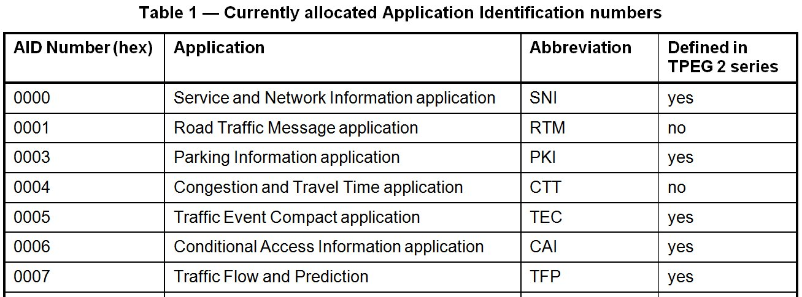
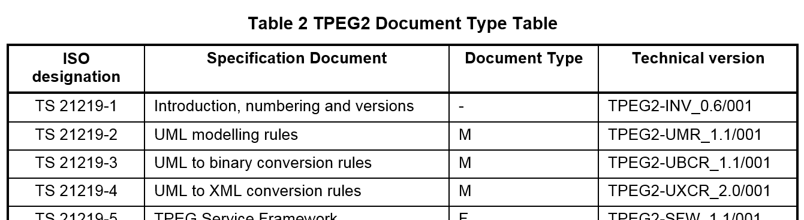

# EXTRAKT z technické specifikace ISO

Extrakt nenahrazuje samotnou technickou normu, je pouze informativním materiálem o normě.

|     |     |
| --- | --- |
| Inteligentní dopravní systémy –   Dopravní a cestovní informace v dopravním protokolu expertní skupiny, druhá generace (TPEG2) – Část 1: Úvod, číslování a verze | ISO/TS 21219-1    01 8259 |

Vydána 2016, 20 stran

# Úvod

Technická specifikace ISO 21219 stanovuje formát a protokol TPEG určený pro poskytování informací o dopravě koncovým uživatelům.

TPEG je určen pro média s vysokou přenosovou kapacitou, umožňuje informace členit strukturovaně se zvyšující se mírou detailů a komplexně popisovat polohu. Jednotlivé oblasti dopravních událostí jsou v TPEG popsány odděleně (samostatné Aplikace), to umožňuje aby struktura a obsah popisu vyhovoval požadavkům konkrétního typu události a zároveň se zbytečně nezvyšovala složitost modelu dodáním modelů dalších oblastí (jak je tomu například v DATEX II).

Zpráva TPEG se skládá ze tří částí (kontejnerů): kontejneru managementu zprávy, kontejneru s dopravní aplikací a kontejneru s odkazem na polohu. 

Technická specifikace ISO 21219 se zabývá druhou generací protokolu TPEG, označovaným zkratkou TPEG2. Rozlišení TPEG/TPEG1/TPEG2 se většinou uvádí pouze v úvodní části norem/specifikací, zatímco ostatní kapitoly již mezi TPEG a TPEG2 nerozlišují - to je implicitní dle kontextu.

ISO/TS 21219 obsahuje řadu částí, které pokrývají úvod, pravidla, nástroje (toolkity) a jednotlivé aplikace. Aplikace jsou v TPEG2 popsány platformě nezávislým modelem v UML a dvěma platformě závislými modely (fyzickými formáty), binárním pro vysílání v DAB a XML pro šíření Internetem. Pro snazší práci s platformě závislými modely se veškeré změny provádí pouze na úrovni platformě nezávislého modelu a následně jsou pomocí sady pravidel (a za pomoci k tomu vytvořeného nástrojů) převedeny do platformě závislých popisů (přílohy 1 a 2 částí, stanovujících aplikace). Tato koncepční témata jsou řešena částmi, které se nazývají nástroje (toolkity).

Technická specifikace ISO/TS 21219 se skládá z těchto částí:
- - Nástroje (toolkity): 
	- TPEG2-INV (část 1: Úvod, číslování a verze), 
    - TPEG2-UML (část 2: Pravidla modelování pomocí UML), 
    - TPEG2-UBCR (část 3: Pravidla pro konverzi z UML do binárního kódu), 
    - TPEG2-UXCR (část 4: Pravidla pro konverzi UML do XML), 
    - TPEG2-SFW (část 5: Rámec pro služby TPEG), 
    - TPEG2-MMC (část 6: Kontejner pro management zpráv) a
    - TPEG2-LRC (část 7: Kontejner pro odkazování na polohu)
- Speciální aplikace: 
    - TPEG2-SNI (část 9: Informace o službách a síti), 
    - TPEG2-CAI (část 10: Informace o podmíněném přístupu), 
    - TPEG2-LTE (část 24: Jednoduché šifrování)
- Odkazování na polohu: 
    - TPEG2-ULR (část 11: Odkazování na polohu v aplikacích), 
    - TPEG2-ETL (část 20: Odkazování na polohu metodou rozšířeného TMC), 
    - TPEG2-GLR (část 21: Geografické odkazování na polohu), 
    - TPEG2-OLR (část 22: Odkazování na polohu metodou OpenLR)
- Aplikace: 
    - TPEG2-RTM (část 12: Aplikace pro zprávy o silniční dopravě), 
    - TPEG2-PTI (část 13: Aplikace pro informace o veřejné dopravě), 
    - TPEG2-PKI (část 14: Aplikace pro informace o parkování), 
    - TPEG2-TEC (část 15: Aplikace pro vybrané dopravní události), 
    - TPEG2-FPI (část 16: Aplikace pro informace o cenách pohonných hmot), 
    - TPEG2-SPI (část 17: Aplikace pro informace o rychlostních omezeních), 
    - TPEG2-PKI (část 18: Aplikace pro informace o stavu dopravního proudu a jeho predikci), 
    - TPEG2-WEA (část 19: Aplikace pro informace o počasí), 
    - TPEG2-RMR (část 23: Aplikace pro informace o multimodálních trasách), 
    - TPEG2-EMI (část 25: Nabíjecí infrastruktura pro elektromobily) 
    - další aplikace se stále doplňují.

Tento extrakt popisuje část 1, TPEG2-INV “úvod číslování a verze”, dále jen “popisovaný dokument”, která řeší přidělení “identifikátorů aplikace” a způsob verzování norem.

Poznámka: Extrakt přejímá původní číslování kapitol.

# Užití

Popisovaný dokument uvádí jednotlivé části specifikace TPEG2 s jejich zkratkami, čísly a dalšími identifikačními znaky. Přiděluje aplikacím TPEG2 číselné identifikátory AID a stanovuje pravidla pro číslování verzí.

Pro poskytovatele a odběratele je tato část normy důležitá proto, že identifikuje jednotlivé aplikace TPEG číslem, to se poté uvádí ve vysílaném datovém proudu (umožňuje interpretaci a rychlou orientaci v datech).

Dále je také zajímavá pro programátory aplikací, protože uvádí čísla technické verze aplikací TPEG. Různé verze Aplikace se většinou liší na úrovni datového modelu/struktury.

Tabulka s verzemi aplikací a nástrojů je obsažena v příloze A, ta je vzhledem k rychlejší dynamice vývoje/obnovy aplikací a nástrojů TPEG pouze informativní, mohou totiž existovat i novější verze.

# Souvisící normy

Tento dokument uvádí 18 normativních odkazů na normu TPEG2 ISO 21219  části 1-7, 9-11, 14-16,18, 21-25 stanovující sestavení zpráv z kontejnerů, odvození z modelu UML, vysílání zpráv a jejich signalizaci a jednotlivé aplikace, zmíněné také v úvodu. Dále jsou to tři normy na popis polohy, ISO 17572 části 1-3 základy, popis polohy pomocí sdílených číselníků (pre-coded) a dynamickou lokalizaci.

# 1 Předmět

Popisovaný dokument uvádí ucelený seznam norem TPEG2 s jejich zkratkami, čísly a dalšími identifikačními znaky (k době revize dokumentu). Přiděluje aplikacím TPEG2 číselné identifikátory AID a stanovuje pravidla pro číslování verzí.

# 3 Termíny a definice

Popisovaný dokument obsahuje 2 termíny, a to služba a součást služby.

Klíčovými jsou také tyto termíny (nestanovené v kapitole 3):

**Aplikace TPEG** _(TPEG Application)_ – určitá oblast dopravních informací (dojezdové doby, informace o veřejné hromadné dopravě, informace o cenách benzínu, běžné dopravní informace, atp.) která je popsána jedním UML modelem a částí normy.

**Toolkit TPEG** _(TPEG Toolkit)_ – obsahuje datový model, který je většinou společný pro aplikací TPEG, týká se zbývajících 2 částí zprávy (kontejnerů), lokalizace a managementu.

# 4 Zkratky

Tato kapitola stanovuje 31 zkratek, většina zkratek se týká informací obsažených v předmluvě, nesouvisí tedy s vlastním textem normy. V popisované dokumentu nejsou uvedeny všechny třípísmenné zkratky norem TPEG. Zkratky i jejich vysvětlení uvádíme jako součást výčtu částí specifikace v úvodu tohoto extraktu, proto je zde dále neuvádíme.

**TPEG** dopravní protokol expertní skupiny _(transport protocol experts group)_

Termíny a zkratky z oboru ITS jsou obsahem slovníku ITS terminology ([www.itsterminology.org](http://www.itsterminology.org)).

# 5 Identifikace aplikace

Tato kapitola (rozsah 1 strana) stanoví pro každou Aplikaci TPEG (celkem 11) jednoznačný identifikátor AID, složený ze 4 hexadecimálních čísel, viz následující tabulka (tabulka 1 popisovaného dokumentu). Ten umožňuje v rámci multiplexu identifikovat nové služby. Dále je zde stanoveno. jak z identifikátoru aplikace vytvořit identifikátor “testovací aplikace”.

**Obr. 1.** Ukázka tabulky obsahující identifikátory aplikací TPEG (tab. 1 normy)

# 6 Aplikace a přenosové cesty

Tato kapitola (rozsah ⅓ strany) obsahuje ve dvou odstavcích rozvahu nad tím, co se při zavádění TPEG myslelo slovy “vysokorychlostní přenosové cesty”, a konstatování, že to splňují všechny používané metody, jako je ARIB, ATSC či DVBT.

# 7 Další čísla a identifikátory

Tato kapitola odkazuje na dvě části normy TPEG2 stanovující další čísla a indikátory, jsou to části TPEG2-SNI (část 9) a TPEG2-SWF (část 5)

# 8 Bibliografie

Tato kapitola uvádí zdroje, které byly využity při psaní normy.

# Příloha A (informativní) – Přehled částí, pojmenování a verzí

Tato příloha je rozdělena na dvě části. První obsahuje příklady přidělování 3písmenných zkratek normám podle jejich názvu a podle čísla technické a redakční verze normy.

“Příklad: druhá redakční verze Aplikace TPEG TEC bude vydána jako TPEG2-TEC_1.0/002.”

Druhá část obsahuje vysvětlení různých kategorií/typů norem TPEG2. Ty se dělí na normy popisující:

- modelování a pravidla konverze (M).
- rámec služby (F),
- aplikace (A),
- toolkity (T),
- profily (P).

Každý výše uvedený typ je v příloze popisovaného dokumentu stručně popsán i s uvedením, kterých částí specifikace se týká a jak jsou tyto části použity.

V této části jsou také uvedeny všechny normy TPEG2, číslem, názvem, zkratkou, typem a identifikátorem technické verze, viz následující tabulka (ukázka tabulky 2 popisovaného dokumentu).

**Obr. 2.** Tabulka typů dokumentů TPEG (část tabulky 2 z Přílohy A)
