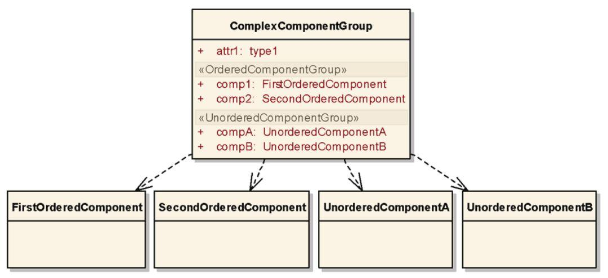
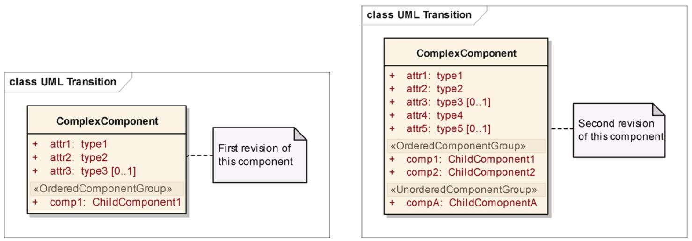
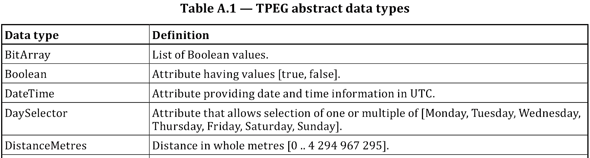
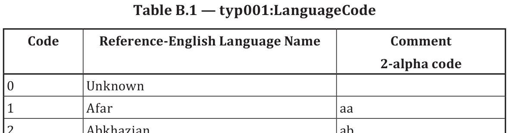

# EXTRAKT z technické specifikace ISO

**Extrakt nenahrazuje samotnou technickou normu, je pouze informativním materiálem o normě.**

|     |     |
| --- | --- |
| **Inteligentní dopravní systémy – Dopravní a cestovní informace předávané prostřednictvím expertní skupiny pro protokoly v dopravě 2. generace (TPEG 2) - Část 2: Pravidla modelování pomocí UML** | **ISO/TS 21219-2**  01 8388 |

Vydána 2016, 43 stran

## Úvod

Technická specifikace ISO 21219 stanovuje formát a protokol TPEG určený pro poskytování informací o dopravě koncovým uživatelům. TPEG je určen pro média s vysokou přenosovou kapacitou, umožňuje informace členit strukturovaně se zvyšující se mírou detailů a komplexně popisovat polohu. 

Jednotlivé oblasti dopravních událostí jsou v TPEG popsány odděleně, pomocí platformě nezávislého modelu (UML) a dvou odvozených platformě závislých modelů (binární a XML). Části specifikace stanovují pravidla tvorby modelu jeho převodu do platformě závislé podoby. 

Více informací o kontextu TPEG je obsaženo v úvodu extraktu k části 1 normy TPEG (21219-1).

Technická specifikace ISO 21219 se zabývá druhou generací protokolu TPEG, označovaným zkratkou TPEG2. Rozlišení TPEG/TPEG1/TPEG2 se většinou uvádí pouze v úvodní části norem/specifikací, zatímco ostatní kapitoly již mezi TPEG a TPEG2 nerozlišují - to je implicitní dle kontextu. 

Tento extrakt (dále jen “popisovaný dokument”) popisuje část 2 normy TPEG, která řeší pravidla modelování pomocí UML.

Poznámka 1: Extrakt přejímá původní číslování kapitol.
## Užití

Popisovaný dokument stanoví pravidla pro vytváření UML modelů pro popis TPEG aplikací (určité oblasti dopravních informací, např. dojezdové doby). Určuje, které části popisu UML je vhodné/možné použít a které nikoliv. Zároveň stanoví jak vytvořit základní části specifikace TPEG popisující TPEG aplikace v UML. Také stanoví jak z modelů UML polo-automaticky odvozovat platformě závislé (XML a binární) části specifikace aplikací TPEG.

Základním blokem jednotlivých částí specifikace TPEG, popisujících aplikace TPEG, je blok obsahující pouze UML modely. Tento blok je vytvořen podle pravidel stanovených popisovaným dokumentem. Při použití v popisovaném dokumentu stanovených pravidel pro vytváření částí specifikace TPEG, vygenerovaná část specifikace obsahuje, ve stanovené struktuře, samotný model UML, poznámky k jednotlivým prvkům modelu a předem připravené texty (obsažené v popisovaném dokumentu). UML model aplikace TPEG v “UML specifikaci” je poté použit pro vytvoření dalších, platformě závislých (popisujících XML a binární podobu aplikace TPEG) částí specifikace.

Z výše uvedeného plyne, že je popisovaný dokument primárně použitelný **tvůrci norem** TPEG a správci datových struktur TPEG.

Pro ostatní tvůrce norem může být tato norma inspirací věcnosti a konkrétnosti s jakou může být norma/specifikace vytvořena. Popisovaný dokument neobsahuje žádný zbytečný text, jakýkoliv další redukční zásah by již přinesl i redukci informace.

Tvůrce norem použije popisovaný dokument v krocích 1-2 následujícího postupu:

1. vytvoří a podrobně okomentuje UML model navrhované aplikace TPEG, který bude respektovat pravidla daná popisovaným dokumentem (ISO/TS 21219-2),
2. zkopíruje z popisovaného dokumentu předem připravenou šablonu i s úvodními texty,
3. připraví a vloží další doplňkové texty a
4. použije softwarový nástroj na vytvoření tří norem. Jedné univerzální: UML a dvou platformě závislých: XML a binární (pro DAB) viz způsob tvorby v ISO/TS 21219-3 a ISO/TS 21219-4.

**Vývojáři aplikací TPEG** popisovaný dokument nepoužijí, použijí normu konkrétní aplikace TPEG vzniklou podle pravidel popisovaného dokumentu.
## Souvisící normy

Popisovaný dokument neobsahuje samostatnou kapitolu věnující se souvisícím normám, místo toho přímo souvisejících 17 částí specifikace TPEG vyjmenovává v předmluvě (počet částí se stále rozšiřuje). Skutečně použité normy/dokumenty cituje v textu a uvádí v kapitole Literatura.
## 1 Předmět

Tato kapitola obsahuje účel popisovaného dokumentu, který je podrobně popsán výše v tomto extraktu. Ve stručnosti, stanovuje pravidla tvorby UML modelů, obecné texty a obecnou strukturu norem aplikací TPEG a pravidla pro vytvoření nové konkrétní normy aplikace TPEG. Pravidla mají zajistit, že UML modely aplikace TPEG lze jednoznačně převést do platformě závislé reprezentace.

Abstraktní datové typy TPEG a obecná sada TPEG tabulek jsou uvedeny v přílohách.
## 2 Termíny, definice a zkratky

Tato specifikace obsahuje 9 termínů a 8 zkratek. Termíny se vztahují k způsobům vytváření UML modelů. Termíny a zkratky použité v tomto extraktu:

**UML** unifikovaný modelovací jazyk (_Unified Modeling Language_)

**TPEG** expertní skupina pro protokoly v dopravě (_Transport protocol experts group_)

Klíčovými jsou také (v normě nezavedené) tyto termíny:

**aplikace TPEG**  určitá oblast dopravních informací (_dojezdové doby, informace o veřejné hromadné dopravě, informace o cenách benzínu, běžné dopravní informace, atp_.) která je popsána jedním UML modelem (a následně několika částmi normy)

**tabulka TPEG**  tabulka obsahující výčet všech hodnot konkrétního atributu i s jejich popisem a příkladem
## 3 Stanovení UML modelu pro TPEG

Článek 3.1 se zabývá výběrem určité části modelovacích prostředků (prvky) z UML, které jsou použity při následném vytváření UML modelů aplikací TPEG. Diagramy tříd (class diagram) jsou základním stavebním prvkem popisu aplikace TPEG; popisovaný dokument zavádí restrikce při použití tříd (class) a omezení jejich vzájemných vztahů. Povolené prvky zahrnují: třídy, abstraktní třídy, atributy a vztahy mezi třídami: “závisí na” (dependency), “zahrnuje” (aggregation), “slučuje” (composition), “odvozuje” (specialization). Popisovaný dokument dále stanovuje používání několika základních typů prvků pomocí tzv. stereotypů (ty udávají způsob převedení prvku do platformě závislého formátu, dále také fyzické reprezentaci) a zavádí dokumentační prvky pro popis formátu.

Článek 3.2 nejprve popisuje způsob použití stereotypů, hlavně s ohledem na výstupní řazení jednotlivých prvků UML modelu v jeho fyzické reprezentaci. Je zaveden zápis tabulek TPEG pomocí typu výčet (enumeration) a způsob jejich zakomponování do tříd, viz obrázek 1.

**Obr. 1.** Způsob popisu dat pomocí UML modelu TPEG (obrázek 5 normy)

Článek 3.3 stanovuje způsob, jakým lze UML model TPEG dále rozšiřovat, aniž by došlo k narušení zpětné kompatibility, viz následující obrázek.

**Obr. 2.** Způsob rozšiřování UML modelu TPEG (obrázek 9 normy)

Článek 3.4 stanovuje způsob používání dokumentace modelu aplikace TPEG v UM , co vše je nutné popsat a jak to provést.
## 4 Vytváření norem pomocí UML modelů

Tato kapitola stanovuje pravidla pro vytváření struktury a obsahu norem pomocí UML modelů aplikací TPEG . Nejprve, v kapitole 4.1 stanovuje pevný obsah všech norem TPEG (předmluvu a úvod) a způsob, jak vytvořit popis předmětu normy (scope) a použité literatury.

V kapitole 4.2 zavádí strukturu pro “normativní” články/kapitoly; ta by měla sestávat z částí: “omezení dané aplikací TPEG”, “model tříd”, “komponenty”, “datové typy” a “tabulky”.

V kapitole 4.3 se norma věnuje způsobu tvorby normativních dodatků, obsahujících většinou modely či fyzické reprezentace formátu aplikace TPEG.
## Příloha A (normativní) Abstraktní datové typy TPEG

V tomto dodatku jsou popsány odvozené datové typy (celkem 29) používané v UML modelech všech aplikací TPEG, viz část tabulky na obrázku 3. Vybrané (složitější) datové typy jsou navíc popsány v samostatných článcích.

**Obr. 3.** Ukázka tabulky definující datové typy TPEG (tabulka A.1 normy)
## Příloha B (normativní) Tabulky TPEG

V tomto dodatku jsou popsány číselníky používané v UML modelech všech aplikací TPEG. Číselníky jsou zde uvedeny v tabelární formě, na rozdíl od datového modelu UML kde se vyskytují jako datový typ výčet (enumeration) s návěštím, které indikuje obsah tabulky, například typ001:LanguageCode. Část této tabulky je ukázána na následujícím obrázku. Tabulky dovolují oddělené překlady popisu do různých textů bez vlivu na samotný model, viz obrázek 4.

**Obr. 4.** Ukázka tabulky definující kódy jazyků používaných (potenciálně) v TPEG (tabulka B.1 normy)

Tato příloha obsahuje dlouhé tabulky definující obecné charakteristiky. Jedná se o tabulky

- typ001:LanguageCode (187 kódů jazyků, viz ISO 639)
- typ002:SpecialDay (11 kódů “dnů”, např. kód 9 = “školní den”)
- typ003:CurrencyType (173 kódy měny, např. kód 153 = “USD”)
- typ004:NumericalMagnitude (256 kódů pro převod čísel, např. kód 98= “800”)
- typ005:CountryCode (243 kódů zemí z ISO 3166-1, např. kód 242 = “Jemen” )
- typ006:OrientationType (9 směrových kódů, např. kód 5 = “jih” )
- typ007:Priority (4 kódy priority, např. kód 3 = “vysoká” )
- typ008:OptionalBoolean (3 kódy logické proměnné, např. kód 0 = “není stanovena”)

## Literatura

Tato kapitola uvádí 8 zdrojů, které byly využity při psaní normy.