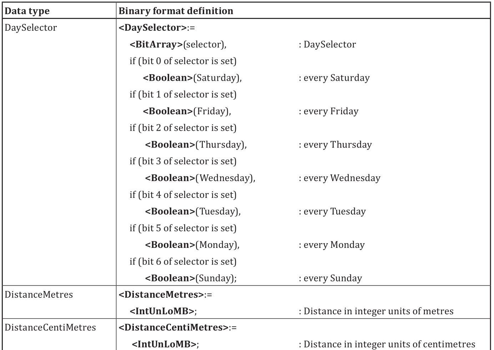
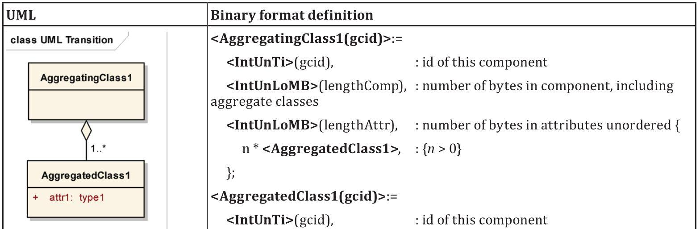

# EXTRAKT z technické specifikace ISO

**Extrakt nenahrazuje samotnou technickou normu, je pouze informativním materiálem o normě.**

|     |     |
| --- | --- |
| Inteligentní dopravní systémy – Dopravní a cestovní informace předávané prostřednictvím expertní skupiny pro protokoly v dopravě 2. generace (TPEG 2) – Část 3: Pravidla pro konverzi z UML do binárního kódu | **ISO/TS 21219-3**  01 8388 |

Vydána 2016, 13 stran

## Úvod

Technická specifikace ISO 21219 stanovuje formát a protokol TPEG určený pro poskytování informací o dopravě koncovým uživatelům. TPEG je určen pro média s vysokou přenosovou kapacitou, umožňuje informace členit strukturovaně se zvyšující se mírou detailů a komplexně popisovat polohu. 

Jednotlivé oblasti dopravních událostí jsou v TPEG popsány odděleně, pomocí platformě nezávislého modelu (UML) a dvou odvozených platformě závislých modelů (binární a XML). Části specifikace stanovují pravidla tvorby modelu jeho převodu do platformě závislé podoby. 

Více informací o kontextu TPEG je obsaženo v úvodu extraktu k části 1 normy TPEG (21219-1).

Technická specifikace ISO 21219 se zabývá druhou generací protokolu TPEG, označovaným zkratkou TPEG2. Rozlišení TPEG/TPEG1/TPEG2 se většinou uvádí pouze v úvodní části norem/specifikací, zatímco ostatní kapitoly již mezi TPEG a TPEG2 nerozlišují - to je implicitní dle kontextu. 

Tento extrakt (dále jen “popisovaný dokument”) popisuje část 3 normy TPEG, která řeší pravidla pro konverzi z UML do binárního kódu.

Poznámka 1: Extrakt přejímá původní číslování kapitol.

## Užití

Popisovaný dokument stanoví pravidla pro převod UML modelu aplikace TPEG do platformě závislého popisu tzv. binární formy vhodné pro popis aplikace TPEG v prostředí digitálního rozhlasu (DAB). Aby bylo popisovaný dokument použít, musí UML model aplikace TPEG (a tedy i s tím souvisící norma) existovat. Vzniklý binární formát slouží jednak jako šablona pro testy rozhraní, tak i jako “obsah”, který je následně vložen do části specifikace TPEG popisující binární formát, vytvořené podle šablony ISO/TS 21219-2.

Z výše uvedeného plyne, že je popisovaný dokument primárně použitelný **tvůrci norem** TPEG a správci datových struktur TPEG.

Pro ostatní tvůrce norem, může být tato norma inspirací věcnosti a konkrétnosti s jakou může být norma/specifikace vytvořena. Popisovaný dokument neobsahuje žádný zbytečný text, jakýkoliv další redukční zásah by již přinesl i redukci informace.

Tvůrce norem použije popisovaný dokument v krocích 3-4 následujícího postupu:

1. vytvoří a podrobně okomentuje UML model navrhované aplikace TPEG, který bude respektovat pravidla daná popisovaným dokumentem (ISO/TS 21219-2),
2. zkopíruje z popisovaného dokumentu předem připravenou šablonu i s úvodními texty,
3. připraví a vloží další doplňkové texty a
4. použije softwarový nástroj na vytvoření tří norem. Jedné univerzální: UML a dvou platformě závislých: XML a binární (pro DAB) viz způsob tvorby v ISO/TS 21219-3 a ISO/TS 21219-4.

**Vývojáři aplikací** TPEG popisovaný dokument nepoužijí, použijí normu konkrétní aplikace TPEG vzniklou podle pravidel popisovaného dokumentu.

## Souvisící normy

Tento dokument uvádí 3 normativní odkazy na normu TPEG2 ISO 21219 části 2 (pravidla modelování) a 5 (rámec služby) a normu TPEG1 ISO 18234-2 syntaxe a sémantika.

## 1 Předmět

Popisovaný dokument stanoví pravidla pro převod UML modelu aplikace TPEG do binární podoby používané v digitálním rozhlasu (DAB). Obsahuje definice binární formy abstraktních datových typů a pravidla pro konverzi složených datových typů stanovených ISO/TS 21219-2

## 3 Zkratky a termíny

Tato specifikace obsahuje 2 vlastní zkratky a dále odkazuje na všechny zkratky použité v specifikaci ISO/TS 21219-2: Pravidla modelování pomocí UML.

**UML** unifikovaný modelovací jazyk (Unified Modeling Language)

**TPEG** expertní skupina pro protokoly v dopravě (Transport protocol experts group)

Klíčovými jsou také (v normě nezavedené) tyto termíny:

**Aplikace TPEG**  určitá oblast dopravních informací (dojezdové doby, informace o veřejné hromadné dopravě, informace o cenách benzínu, běžné dopravní informace, atp.) která je popsána jedním UML modelem (a následně několika částmi normy)

**tabulka TPEG**  tabulka obsahující výčet všech hodnot konkrétního atributu i s jejich popisem a příkladem

**stereotypování**  mechanismus rozšíření modelu UML o nové prvky odvozené z původních prvků, ale s přiřazenými konkrétními hodnotami atributů, specifickým propojením více základních prvků dohromady apod.

Další termíny a zkratky z oboru ITS jsou obsaženy ve slovníku ITS terminology ([www.ITSterminology.org](http://www.ITSterminology.org/)).

## 4 Pravidla pro konverzi popisu z UML do binární reprezentace

Tato kapitola stanovuje veškerá pravidla, která jsou potřebná pro převod UML modelu aplikace TPEG do binární formy pro DAB vysílání. Texty, které mají být přímo (se záměnami klíčových slov) převzaty do cílové normy, jsou v popisovaném dokumentu zřetelně vyznačeny.

Kapitola 4.1 stanovuje popis binárního formátu, který bude normativní přílohou vytvářené normy (části specifikace), název přílohy je odvozen z názvu UML modelu. Struktura přílohy je stanovena na 4 kapitoly (úvod, rámec a signalizace, komponenty a datové struktury). Pro každou kapitolu přílohy je stanoven buď přímo obsah, nebo způsob jeho tvorby.

Pro úvod přílohy popisovaný dokument stanovuje výchozí text. Pro kapitolu rámec a signalizace je uvádí jak samotný text, tak strukturu, která se skládá ze tří částí (identifikace, signalizace čísla verze a rámec).

Část rámec stanovuje, jaká část služby (service component) bude vysílána. Části služby jsou definované v ISO/TS 21219-5.

Část komponenty uvádí způsob složení z položek datového modelu, které nejsou stereotypovány jako datová struktura ((&lt;<data structure&gt;>).

Poslední část datové struktury obsahuje opět pouze popis složení, tentokrát z položek datového modelu, které jsou stereotypovány jako datová struktura ((&lt;<data structure&gt;>). Binární reprezentace komponent a datových struktur se dále řídí pravidly definovanými v kapitole 4.5.

Článek 4.2 stanovuje pravidla pro převod abstraktních datových typů a stereotypů definovaných v pravidlech pro modelování aplikací TPEG pomocí UML (ISO/TS 21219-2), viz ukázka tabulky na následujícím obrázku.

**Obr. 1.** Ukázka tabulky stanovující abstraktním typům v UML jejich binární reprezentaci
(článek 4.2 normy)

Články 4.3 a 4.4 stanovují převod pole logických proměnných (pravda/nepravda) a tabulek TPEG do binární podoby.

Článek 4.5 stanovuje pravidla pro převod datových typů složených pomocí vztahu “odkaz na” tzv. složené datové typy (compound data types). Je stanoveno 5 základních pravidel, přičemž pravidlo 4 se skládá z pěti dalších pravidel. Jedná se o následující pravidla uvádějící mimo jiné povinné prvky binárního formátu:

1. pro převod třídy (identifikátor, délka celku/obsahu + další obsah) viz obrázek 2
2. pro převod datové struktury (struktura na rozdíl od třídy začíná rovnou dalším obsahem)
3. pro signalizaci volitelných položek (pomocí binárního logického pole)
4. pro atributy:
    - pro konverzi datových atributů odkazuje na pravidla 1-3
    - pro řazení (musí být zachováno)
    - pro jednoduchou multiplicitu (atribut je vždy přítomen)
    - pro vícenásobnou multiplicitu [0 .. n] či [1 .. n] (relativně složité pravidlo)
    - pro multiplicitu [0 .. 1]

**Obr. 2.** Pravidlo (1) pro převod obecné třídy do binární podoby (článek 4.5.1 normy)

Články 4.6 a 4.7 stanovují převod datových typů složených pomocí vztahu “agregace” (aggregation) viz obrázek 3 a “kompozice” (composition) a převod odvozených datových typů a abstraktních tříd.

**Obr. 3.** Ukázka pravidla (5) pro převod datových typů složených pomocí vztahu “agregace” do binární podoby (článek 4.6 normy)

## Literatura

Tato kapitola uvádí 1 zdroj, který byl využit při tvorbě technické specifikace.