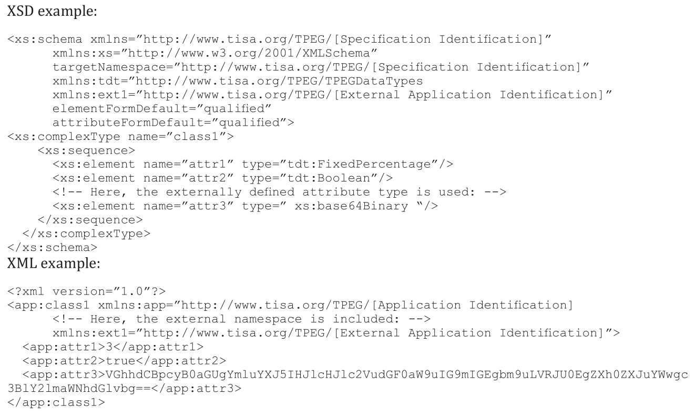
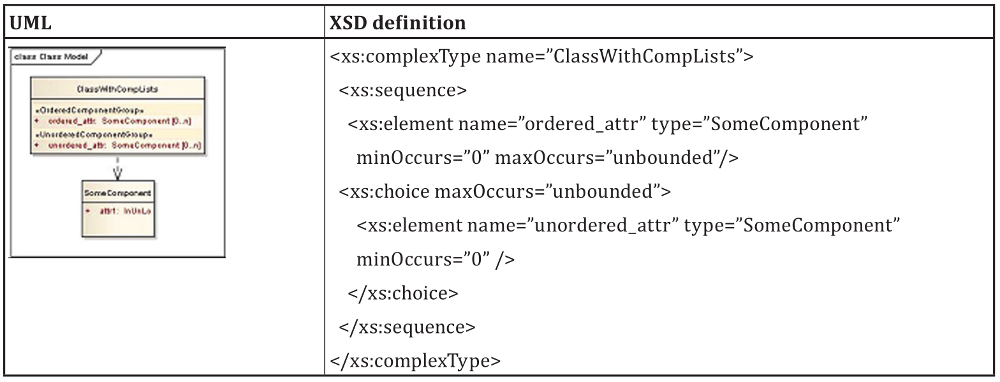
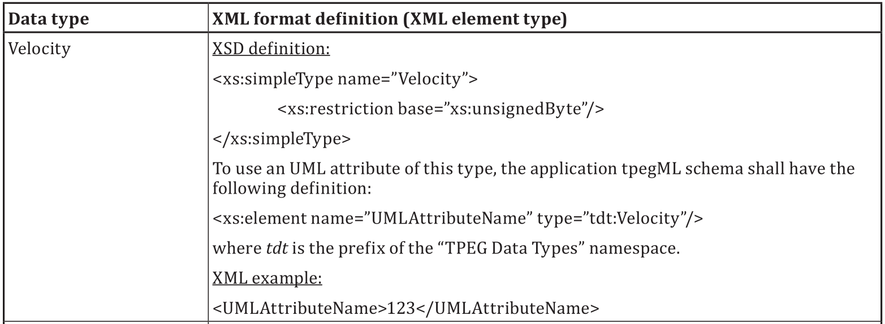
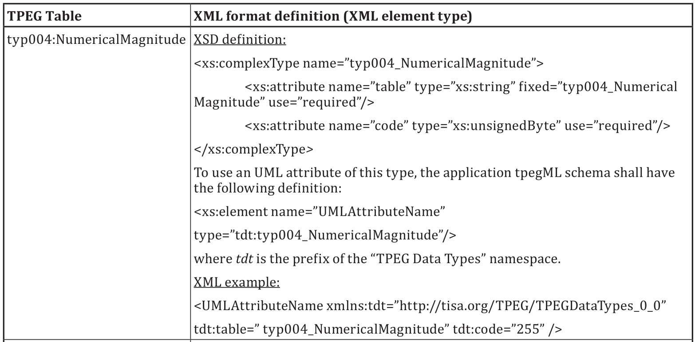

# EXTRAKT z technické specifikace ISO

**Extrakt nenahrazuje samotnou technickou normu, je pouze informativním materiálem o normě.**

|     |     |
| --- | --- |
| Inteligentní dopravní systémy – Dopravní a cestovní informace předávané prostřednictvím expertní skupiny pro protokoly v dopravě 2. generace (TPEG 2) - Část 4: Pravidla pro konverzi z UML do XML | **ISO/TS 21219-4**  01 8388 |

Vydána 2016, 46 stran

## Úvod

Technická specifikace ISO 21219 stanovuje formát a protokol TPEG určený pro poskytování informací o dopravě koncovým uživatelům. TPEG je určen pro média s vysokou přenosovou kapacitou, umožňuje informace členit strukturovaně se zvyšující se mírou detailů a komplexně popisovat polohu. 

Jednotlivé oblasti dopravních událostí jsou v TPEG popsány odděleně, pomocí platformě nezávislého modelu (UML) a dvou odvozených platformě závislých modelů (binární a XML). Části specifikace stanovují pravidla tvorby modelu jeho převodu do platformě závislé podoby. 

Více informací o kontextu TPEG je obsaženo v úvodu extraktu k části 1 normy TPEG (21219-1).

Technická specifikace ISO 21219 se zabývá druhou generací protokolu TPEG, označovaným zkratkou TPEG2. Rozlišení TPEG/TPEG1/TPEG2 se většinou uvádí pouze v úvodní části norem/specifikací, zatímco ostatní kapitoly již mezi TPEG a TPEG2 nerozlišují - to je implicitní dle kontextu. 

Tento extrakt (dále jen “popisovaný dokument”) popisuje část 4 normy TPEG, která řeší pravidla pro konverzi z UML do XML.

Poznámka 1: Extrakt přejímá původní číslování kapitol.

## Užití

Popisovaný dokument stanoví pravidla pro převod UML modelu aplikace TPEG do platformě závislého popisu tzv. XML, ve formě XML schématu (tpegML) vhodného pro popis a validaci aplikace TPEG v prostředí Internetu. Aby bylo možno popisovaný dokument použít, musí UML model aplikace TPEG (a tedy i s tím souvisící norma) existovat. Vzniklý binární formát slouží jednak jako šablona pro testy rozhraní, tak i jako “obsah”, který je následně vložen do části specifikace TPEG popisující binární formát, vytvořené podle šablony ISO/TS 21219-2.

Z výše uvedeného plyne, že je popisovaný dokument primárně použitelný tvůrci norem TPEG a správci datových struktur TPEG.

Pro ostatní tvůrce norem může být tato norma inspirací věcnosti a konkrétnosti s jakou může být norma/specifikace vytvořena. Popisovaný dokument neobsahuje žádný zbytečný text, jakýkoliv další redukční zásah by již přinesl i redukci informace.

**Tvůrce norem** použije popisovaný dokument v krocích 3-4 následujícího postupu:

1. vytvoří a podrobně okomentuje UML model navrhované aplikace TPEG, který bude respektovat pravidla daná popisovaným dokumentem (ISO/TS 21219-2),
2. zkopíruje z popisovaného dokumentu předem připravenou šablonu i s úvodními texty,
3. připraví a vloží další doplňkové texty a
4. použije softwarový nástroj na vytvoření tří norem. Jedné univerzální: UML a dvou platformě závislých: XML a binární (pro DAB) viz způsob tvorby v ISO/TS 21219-3 a ISO/TS 21219-4

**Vývojáři aplikací TPEG**, ani poskytovatelé popisovaný dokument nepoužijí, použijí normu konkrétní aplikace TPEG vzniklou podle pravidel popisovaného dokumentu.

## Souvisící normy

Tento dokument uvádí 3 normativní odkazy na normu TPEG2 ISO 21219 části 2 pravidla modelování a 5 rámec služby a normu ISO 8601 stanovující standardní datové prvky.

## 1 Předmět

Popisovaný dokument stanoví pravidla pro převod UML modelu aplikace TPEG do XML schématu používaného pro návrh a validaci XML (tpegML) dokumentů pro danou aplikaci TPEG. Obsahuje definice XML schématu i s příklady samotného XML pro abstraktní datové typy a pravidla pro konverzi složených datových typů stanovených v ISO/TS 21219-2.

## 3 Termíny, definice a zkratky

Tato specifikace obsahuje 3 termíny s definicí a 4 vlastní zkratky a dále odkazuje na všechny zkratky použité v specifikaci ISO 21219-2: Pravidla modelování pomocí UML.

**UML** unifikovaný modelovací jazyk (_Unified Modeling Language_)

**XSD** definice schématu XML _(XML schema definition_)

Klíčovými jsou také (v normě nezavedené) tyto termíny:

**aplikace TPEG**  určitá oblast dopravních informací (_dojezdové doby, informace o veřejné hromadné dopravě, informace o cenách benzínu, běžné dopravní informace, atp_.) která je popsána jedním UML modelem (a následně několika částmi normy)

**tabulka TPEG**  tabulka obsahující výčet všech hodnot konkrétního atributu i s jejich popisem a příkladem

**stereotypování**  mechanismus rozšíření modelu UML o nové prvky odvozené z původních prvků, ale s přiřazenými konkrétními hodnotami atributů, specifickým propojením více základních prvků dohromady apod.

Další termíny a zkratky z oboru ITS jsou obsaženy ve slovníku ITS terminology ([www.ITSterminology.org](http://www.ITSterminology.org/)).

## 4 Pravidla pro konverzi popisu z UML do XML

Tato kapitola stanovuje veškerá pravidla, která jsou potřebná pro převod UML modelu aplikace TPEG do formy schématu XML. Texty, které mají být přímo (se záměnami klíčových slov) převzaty do cílové normy, jsou v popisovaném dokumentu zřetelně vyznačeny.

Kapitola 4.1 stanovuje popis formátu XML schématu, který bude normativní přílohou vytvářené normy (části specifikace), název přílohy je odvozen z názvu UML modelu. Struktura přílohy je stanovena na 2 kapitoly (úvod a definice aplikačních datových typů). Pro každou kapitolu přílohy je stanoven buď přímo obsah, nebo způsob jeho tvorby.

Pro úvod přílohy popisovaný dokument stanovuje výchozí text.

Kapitola 4.2 stanovuje pravidla pro obsah tpegML schématu, který popisuje danou aplikaci TPEG.

Kapitola 4.3 stanovuje pravidla pro obsah XML dokumentu definovaného prostřednictvím tpegML schématu, popisujícího danou aplikaci TPEG.

Kapitola 4.4 stanovuje rozsah XML datových typů, například typ “xs:unsignedByte” od 0 do 255.

Kapitola 4.5 stanovuje pravidla pro konverzi abstraktních datových typů z UML do XSD (definice XML schématu). Odkazuje na Přílohu A, kde jsou schémata pro jednotlivé typy definována. Stanovuje a doporučuje další obsah, jako například verzování, způsob importu dat a další.

Kapitola 4.6 obsahuje stručný popis a ukázku konverze standardních tabulek TPEG do XSD a XML.

Kapitola 4.7 obsahuje pravidla a ukázku konverze aplikačně závislých tabulek (stereotypovaných) tzv. “výčtových typů” do XSD a XML.

Kapitola 4.8 stanovuje pravidla a příklady konverze tzv. “přepínatelných tabulek” do XSD a XML.

Kapitola 4.9 obsahuje způsob konverze třídy UML stereotypované jako &lt;<external&gt;>. Třída external odkazuje na externí specifikaci v binární nebo XML podobě. Pravidla jsou definována pro tyto typy externích specifikací:

- specifikace aplikace TISA TPEG
- specifikace aplikace TPEG pomocí XML schématu
- specifikace aplikace TPEG v binární podobě

Stanoveny jsou zejména speciální tagy, prefixy a jmenné prostory pro jejich uvedení ve schématu. Příklad pro binární definici třídy stereotypované jako &lt;<external&gt;> následuje na obrázku 1.

**Obr. 1.** Příklad použití třídy external zahrnující binární popis do popisu XML viz atribut 3 (ukázka z textu normy)

Kapitola 4.10 stanovuje pravidla pro aplikační převod datových typů složených pomocí vztahu “odkaz na” tzv. složené datové typy (compound data types). Jsou stanovena 4 základní pravidla, přičemž pravidlo 3 se skládá z pěti dalších pravidel a pravidlo 4 ze dvou dalších pravidel. Jedná se o následující pravidla uvádějící mimo jiné povinné prvky schématu XML:

1. pro převod (kořenové) třídy (konverze do typu ComplexType a kořenové třídy, datová struktura se překládá stejně)
2. pro kořenové elementy (jako globálně platných elementů)
3. pro atributy:
    - a) pro konverzi datových atributů odkazuje na pravidla 4.5, 4.7 a 4.10
    - b) pro řazení (musí být zachováno)
    - c) pro jednoduchou multiplicitu (atribut je vždy přítomen)
    - d) pro vícenásobnou multiplicitu [0 .. 1] či [0 .. n] a [1 .. n]
    - e) pro řazené a neřazené skupiny a komponent (viz obrázek 2)
4. pro abstraktní třídy
    - a) pro dědičnost (pomocí kopírování z rodiče)
    - b) pro přepínání (příklad užití jedné z více možností třídy)

**Obr. 2.** Příklad převodu z UML do XSD podle pravidla 3e

Kapitola 4.11 obsahuje příklad tpegML schématu (2,5 strany) a souvisejícího XML (půl strany A4).

## Normativní příloha A – Definice schématu datových typů TPEG

Tato příloha je rozdělena na 3 části. První obsahuje deklaraci XML schématu, druhá pomocí tabulek popisuje převod abstraktních datových typů a třetí, také pomocí tabulek, popisuje převod standardních tabulek TPEG.

V části A.2 se jedná o tyto abstraktní datové typy:

- jednoduché (Boolean, BitArray),
- složité (DateTime, DaySelector),
- s plovoucí řádovou čárkou (FixedPointNumber, Float),
- celočíselné (IntSiTi, IntSiLi, IntSi24, IntSiLo, IntSiLoMB, IntUnTi, IntUnLi, IntUn24, IntUnLo, IntUnLoMB),
- specifické celočíselné (DistanceMetres, DistanceCentiMetres, Duration, FixedPercentage),
- řetězce znaků (ShortString, LongString, LocalisedShortString, LocalisedLongString) a
- různé (MajorMinorVersion, Probability, ServiceIdentifier, TimeInterval, TimePoint, TimeToolkit, Velocity, Weight). Viz příklad na obrázku 3.

**Obr. 3.** ukázka převodu abstraktního datového typu Velocity do XSD i s příkladem a komentářem

V části A.3 jsou popsány standardní tabulky TPEG:

- typ001:LanguageCode,
- typ002:SpecialDay,
- typ003:CurrencyType,
- typ004:NumericalMagnitude viz příklad na obrázku 4,
- typ005:CountryCode,
- typ006:OrientationType,
- typ007:Priority a
- typ008:OptionalBoolean

**Obr. 4.** Ukázka převodu standardní tabulky TPEG popisující atribut “numerická velikost” do XSD i s příkladem a komentářem

## Literatura

Tato kapitola uvádí jeden zdroj, který byl využit při psaní normy.