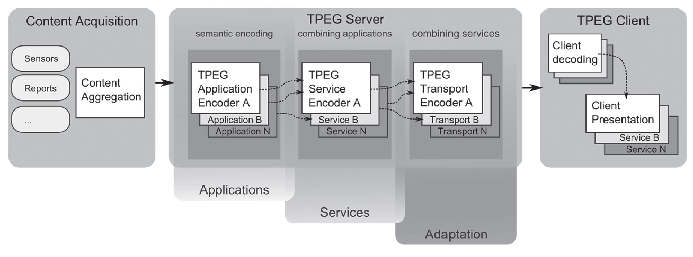
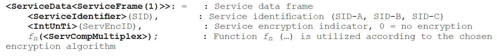
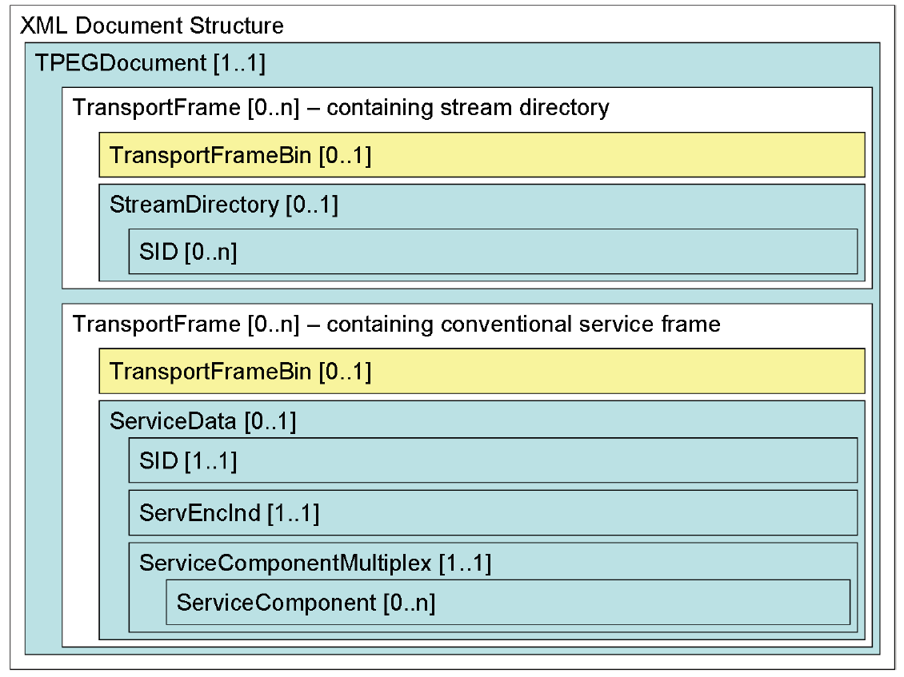

# EXTRAKT z technické specifikace ISO

**Extrakt nenahrazuje samotnou technickou normu, je pouze informativním materiálem o normě.**

|                                                                                                                                                              |                                                                                                                          |
| ------------------------------------------------------------------------------------------------------------------------------------------------------------ | ------------------------------------------------------------------------------------------------------------------------ |
| Inteligentní dopravní systémy – Dopravní a cestovní informace v dopravním protokolu expertní skupiny, druhá generace (TPEG2) – Část 5: Rámec pro služby TPEG | ISO/TS 21219-5  **Extrakt nenahrazuje samotnou technickou normu, je pouze informativním materiálem o normě.** 01 8259 |

Vydána 2015, 46 stran

## Úvod

Technická specifikace ISO 21219 stanovuje formát a protokol TPEG určený pro poskytování informací o dopravě koncovým uživatelům. TPEG je určen pro média s vysokou přenosovou kapacitou, umožňuje informace členit strukturovaně se zvyšující se mírou detailů a komplexně popisovat polohu. 

Jednotlivé oblasti dopravních událostí jsou v TPEG popsány odděleně, pomocí platformě nezávislého modelu (UML) a dvou odvozených platformě závislých modelů (binární a XML). Části specifikace stanovují pravidla tvorby modelu jeho převodu do platformě závislé podoby. 

Více informací o kontextu TPEG je obsaženo v úvodu extraktu k části 1 normy TPEG (21219-1).

Technická specifikace ISO 21219 se zabývá druhou generací protokolu TPEG, označovaným zkratkou TPEG2. Rozlišení TPEG/TPEG1/TPEG2 se většinou uvádí pouze v úvodní části norem/specifikací, zatímco ostatní kapitoly již mezi TPEG a TPEG2 nerozlišují - to je implicitní dle kontextu. 

Tento extrakt (dále jen “popisovaný dokument”) popisuje část 5 normy TPEG, která specifikuje obálky zpráv TPEG2 při poskytování „multiplexu“ služeb a aplikací TPEG2.

_Poznámka: Extrakt uvádí vybrané kapitoly popisovaného dokumentu a přejímá původní číslování kapitol._

## Užití

Popisovaný dokument uvádí „obálku“ zpráv TPEG (rámec, strukturu rámce) pro vysílání v DAB (binární forma) a pro šíření zpráv Internetem (XML). Všechny aplikace TPEG tuto obálku (rámec) dále používají k přenosu zpráv. Proto je popisovaná specifikace nezbytná pro poskytovatele i příjemce dopravních informací, jejich programátory, kteří pracují se samotným formátem XML či programují datové proudy pro DAB. Popis „obálky“ v popisovaném dokumentu je konkrétní a je určen k její implementaci.

## Souvisící normy

Tento dokument uvádí 4 normativní odkazy na normu TPEG2 ISO 21219 části 2 (pravidla modelování), 3 (odvozování do XML) a 4 (odvozování do binární podoby) a 5 (rámec služby) a normu TPEG1 ISO 18234-3 Informace o službách a síti.
^## (\d+) Předmět

Popisovaný dokument TPEG2-SWF uvádí základní možnosti TPEG2 při poskytování „multiplexu“ služeb a aplikací TPEG2 a nahrazuje dokumenty TPEG1-INV (číslování a verze) a TPEG1-SSF (rámec služby) z první generace TPEG.

^## (\d+) Termíny, definice a zkratky

Tato kapitola definuje 10 termínů. Klíčovými jsou tyto termíny a zkratky:

**Služba TPEG** (TPEG Service) – multiplex komponentů služby TPEG s vyhrazeným identifikátorem

**Komponenta služby TPEG** (TPEG Service component) – virtuální kanál vyhrazený pro zprávy jedné Aplikace

**Aplikace TPEG** (TPEG Application) – určitá oblast dopravních informací (dojezdové doby, informace o veřejné hromadné dopravě, informace o cenách benzínu, běžné dopravní informace, atp.) která je popsána jedním UML modelem a částí normy.

**Rámec služby** (Service Framework) – datová struktura pro službu TPEG v binární a XML reprezentaci.

Tato kapitola dále stanoví 24 zkratek. V popisovaném dokumentu nejsou uvedeny všechny třípísmenné zkratky norem TPEG. Nicméně tyto zkratky i jejich vysvětlení uvádíme jako součást výčtu částí specifikace v úvodu tohoto extraktu, proto je zde dále neuvádíme.

**TPEG-** dopravní protokol expertní skupiny (transport protocol experts group)

**SID** identifikátor služby (Service identifier)

Další termíny a zkratky z oboru ITS jsou obsaženy ve ITS terminology ([www.itsterminology.org](http://www.itsterminology.org/)).
^## (\d+) TPEG – úvod

Tato kapitola (rozsah 3 strany) stanovuje způsob přenosu TPEG, role „klient“ a „server“, model vrstev TPEG podle OSI ISO, kde pro vrstvu 7 uvádí seznam TPEG aplikací existujících v době vydání normy a pro další vrstvy stručný popis jejich účelu. Jako poslední část jsou uvedeny principy, na kterých je TPEG založen.

^## (\d+) Návrh multiplexu TPEG a struktur TPEG

Tato kapitola (rozsah 5 stran) obsahuje 4 části. V přehledu stanovuje různé úrovně TPEG (viz střed obrázku 1, obrázek 3 popisovaného dokumentu) na kterých je možné multiplexovat, jedná se o tyto úrovně:

- Komponenty služby TPEG a aplikace TPEG (sémantické kódování dle aplikace)
- Služby TPEG a multiplex komponent služby TPEG (kombinace aplikací do služby)
- Multiplex služeb TPEG (kombinace služeb)

**Obr. 1.** Hierarchie multiplexu TPEG (obrázek 3 dokumentu)

Pro výše uvedené způsoby multiplexování je zapotřebí na těchto úrovních – odpovídajících vrstvám protokolu, stanovit datové struktury TPEG. Popisem těchto struktur se dokument zabývá dále, jde o:

- přenosovou vrstvu TPEG (OSI vrstvy 3 a 4),
- vrstvu služeb TPEG (OSI vrstvy 3 a 4) a
- vrstvu komponent služeb TPEG (OSI vrstvy 5 a 6).

V části popisující přenosovou vrstvu TPEG se zmiňuje závislost na fyzické reprezentaci (XML, binární forma) a pro konkrétní informace jsou odkazovány přílohy A a B.

V části vrstva služeb TPEG se opět zmiňuje závislost na fyzické reprezentaci a jsou odkazovány přílohy A a B. Navíc jsou zde ale stanoveny atributy struktur „Služba TPEG“ (TPEG Service) a „Adresář datových proudů TPEG“ (TPEG Stream Directory). Dále jsou zde vyjmenovány atributy popisující vrstvu služeb: identifikátor úrovně šifrování a identifikátor služby (jeho varianty pro testy i reálnou službu).

V části vrstva komponent služeb TPEG je stanoven způsob generování struktury komponent služby odkazem do normy 18234-3 SNI (část z první generace TPEG) a jsou zde stanoveny atributy této struktury.

## Příloha A (normativní) TPEG-binární reprezentace rámcových struktur

Tato příloha o rozsahu 7 stran je, současně s následující přílohou, klíčovou částí normy.

Příloha obsahuje popis binární reprezentace rámce TPEG pro použití v DAB. Popis binární reprezentace je pojat interpretovaně, ne tedy skupinami “nul a jedniček” ale prostřednictvím zápisu, kde pro každé klíčové slovo zapsané struktury je znám jeho binární tvar. V části A.2 uvádí popis datového proudu, ten se v binární reprezentaci sestává z datových rámců. Dále uvádí syntaxi datového proudu TPEG; pro přenosový rámec uvádí:

- strukturu
- typ synchronizace
- délku rámce
- typ rámce
- cyklický kód pro hlavičku rámce
- metodu synchronizace

Dále uvádí jednotlivé typy rámců, jejich strukturu a atributy, jedná se o:

- adresář datových proudů StreamDirectory&lt;ServiceFrame(0)&gt; obsahující
- rámec služby ServiceData&lt;ServiceFrame(1)&gt; obsahující
- multiplex komponent služby &lt;ServCompMultiplex&gt; obsahující n
- rámců komponent služby &lt;ServCompFrame&gt;, které se skládají z
- hlavičky &lt;ServCompFrameHeader&gt; a aplikačních dat &lt;ApplicationData&gt;

Pro každé výše uvedené struktury uvádí jejich přesný datový obsah, tak jak je ukázáno na obrázku 2 (obrázek části textu v článku A.1 popisovaného dokumentu).

**Obr. 2.** Ukázka struktury rámce služby ServiceData&lt;ServiceFrame(1)&gt;

## Příloha B (normativní) tpegML reprezentace rámcových struktur

Tato příloha o rozsahu 16 stran je, současně s předcházející přílohou, klíčovou částí normy.

Příloha obsahuje popis XML reprezentace a XML schéma rámce TPEG.

Část B.1 obsahuje reprezentaci XML obálky/zapouzdření (rámcová struktura); to jakým způsobem má být použita; jaké jsou její základní charakteristiky a jaká pro ni platí pravidla. Zapouzdření má dva technické účely:

- bezztrátové zobrazení všech položek z binární podoby do XML struktury TPEG
- agregace více XML zpráv aplikací TPEG do jednoho XML dokumentu

Část B.2 uvádí hierarchickou strukturu XML dokumentu TPEG, ta umožňuje na různé úrovně vložit i binární popis, viz žluté části obrázku 3 (obrázek B.1 popisovaného dokumentu). Dále k jednotlivým XML tagům uvádí jejich kontext, obecný popis a XML schéma, také stanovuje význam a hodnoty atributů, které se v daných tazích nacházejí. Stanovuje:

- hlavičky dokumentu TPEG,
- speciální datové typy (např. „byteCRChex“) a
- popisuje strukturu obsahu a atributy tagů TPEG (zahrnuje XSD)

**Obr. 3.** XML Struktura TPEG (obrázek B.1 dokumentu)

Struktura rámce je uvedena v následujícím výčtu, tagy na jedné úrovni jsou uvedeny v jedné odrážce. Tagy na nižší úrovni jsou potomky podtrženého tagu vyšší úrovně.

- TPEGDocument
- TransportFrame
- TransportFrameBin, StreamDirectory, ServiceData
- SID, ServEncID, ServiceComponentMultiplex
- ServiceComponent
- ServiceComponentBin, ServiceComponentFrameContent
- SCID, MessageCount, Priority, ApplicationRootMessage
- ApplicationRootMessageBin, ApplicationRootMessageML

Článek B.3 uvádí příklad rámcové struktury pro TPEG v XML i s komentářem na místě, kde by měla být vložena struktura aplikace TPEG. V části B.4 je uvedeno celé XML schéma rámcové struktury pro TPEG.

## Příloha C (normativní) správní postupy přidělování SID

Tato normativní příloha (rozsah 1 strana) stanovuje jaké číslo služby (SID) mají poskytovatelé přiřazovat v případech:

- technických testů,
- veřejných testů a
- normálního provozu.

Pro tyto případy dále stanovuje časový horizont platnosti SID a kde o číslo požádat, případně kam číslo oznámit. Informace o přidělených, použitých číslech SID by měly být zveřejněny na [http://tisa.org](http://tisa.org/) 

POZNÁMKA Po prozkoumání stránek k datu 9. 9. 2025 nejsou informace o přidělených SID veřejně přístupné.

## Příloha D (normativní) Výpočet CRC

Tato normativní příloha popisuje algoritmus výpočtu kontrolního součtu, zvolený polynom a ukázku výpočtu CRC pro zvolenou sekvenci. Dále obsahuje ukázku implementace výpočtu CRC v  jazycích Pascal a C.

## Bibliografie

Tato příloha obsahuje seznam 7 odkazovaných zdrojů, mimo jiné i odkazy na stránky asociace TISA a na definici XML schémat.