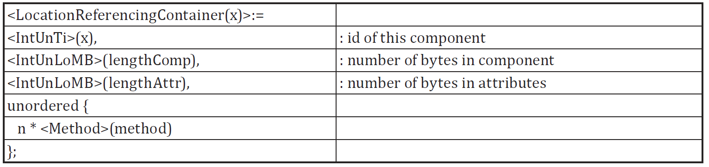
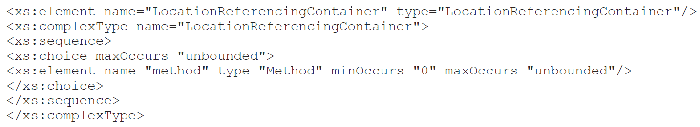
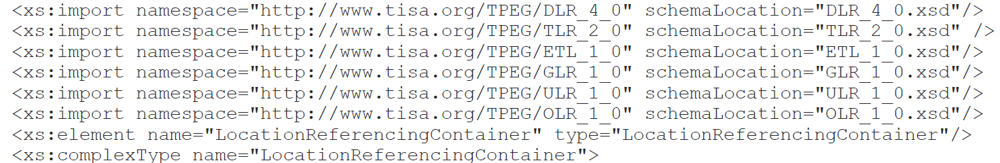

# EXTRAKT z technické specifikace ISO

Extrakt nenahrazuje samotnou technickou normu, je pouze informativním materiálem o normě.

|     |     |
| --- | --- |
| **Inteligentní dopravní systémy – Dopravní a cestovní informace (TTI) v dopravním protokolu expertní skupiny, druhá generace (TPEG2) – Část 7: Kontejner pro odkazování na polohu (TPEG2-LRC)** | **ČSN P   ISO/TS 21219-7**  01 8259 |

Vydána 2017, 20 stran

# Úvod

Technická specifikace ISO 21219 se zabývá druhou generací protokolu TPEG pro **poskytování informací o dopravě koncovým uživatelům**, označovaným TPEG2.

ISO/TS 21219 obsahuje řadu částí, které pokrývají úvod, pravidla, “sady nástrojů” (toolkity) a jednotlivé aplikace. TPEG2 je postaven na modelování v UML, se sadou základních pravidel stanovujících strategii modelování a pravidla konverze modelu do dvou fyzických formátů: binárního pro vysílání v DAB a XML pro šíření Internetem (části 2, 3, 4 normy). Pro snazší udržovatelnost specifikace se změny provádí pouze na úrovni obecného modelu v UML (XMI soubor) a následně pomocí automatizovaných nástrojů převádějí do popisů jednotlivých fyzických formátů (dokument s přílohami pro každý fyzický formát). Tato koncepční témata jsou řešena částmi, které se nazývají sady nástrojů (toolkity).

TPEG2 stanovuje použití tří dílčích částí (kontejnerů): management zpráv (část 6 normy), dopravní aplikaci (mnoho částí) a odkazování na polohu (část 7 normy).

ISO/TS 21219 se skládá z těchto částí (tučně je zvýrazněna část popisovaná v tomto extraktu):

- **Toolkity** (nástroje): TPEG2-INV (část 1: Úvod, číslování a verze), TPEG2-UML (část 2: Pravidla modelování pomocí UML), TPEG2-UBCR (část 3: Pravidla pro konverzi z UML do binárního kódu), TPEG2-UXCR (část 4: Pravidla pro konverzi UML do XML), TPEG2-SFW (část 5: Rámec pro služby TPEG), TPEG2-MMC (část 6: Kontejner pro management zpráv), **TPEG2-LRC (část 7: Kontejner pro odkazování na polohu)**
- **Speciální aplikace**: TPEG2-SNI (část 9: Informace o službách a síti), TPEG2-CAI (část 10: Informace o podmíněném přístupu), TPEG2-LTE (část 24: Slabé šifrování)
- **Odkazování na polohu**: TPEG2-ULR (část 11: Odkazování na polohu v aplikacích), TPEG2-ETL (část 20: Odkazování na polohu metodou rozšířeného TMC), TPEG2-GLR (část 21: Geografické odkazování na polohu), TPEG2-OLR (část 22: Odkazování na polohu metodou OpenLR)
- **Aplikace**: TPEG2-RTM (část 12: Aplikace pro zprávy o silniční dopravě), TPEG2-PTI (část 13: Aplikace pro informace o veřejné dopravě), TPEG2-PKI (část 14: Aplikace pro informace o parkování), TPEG2-TEC (část 15: Aplikace pro vybrané dopravní události), TPEG2-FPI (část 16: Aplikace pro informace o cenách pohonných hmot), TPEG2-SPI (část 17: Aplikace pro informace o rychlostních omezeních), TPEG2-TFP (část 18: Aplikace pro informace o stavu dopravního proudu a jeho predikci), TPEG2-WEA (část 19: Aplikace pro informace o počasí), TPEG2-RMR (část 23: Aplikace pro informace o multimodálních trasách), TPEG2-EMI (část 25: Nabíjecí infrastruktura pro elektromobily) a další.

Na rozdíl od RDS-TMC, které je svým způsobem popisu události jednoúrovňové, umožňuje TPEG informace členit strukturovaně se zvyšující se mírou detailu. Dopravní události popisuje TPEG úzkoprofilově, je vždy zaměřen na jeden konkrétní typ situací (například pro ceny pohonných hmot, dojezdové doby atd.), které popisuje do větší hloubky, každému typu je věnována samostatná část specifikace (tzv. ”aplikace TPEG”).

Rozlišení TPEG / TPEG1 / TPEG2 se většinou uvádí pouze v úvodu částí norem/specifikací, zatímco ostatní kapitoly již mezi TPEG a TPEG2 nerozlišují - to je implicitní dle kontextu. Stejným způsobem k tomu přistupujeme i v tomto extraktu.

Tento extrakt popisuje část 7 “Kontejner pro odkazování na polohu” (dále jen “popisovaný dokument”), která specifikuje jednu ze tří důležitých částí zprávy, tzv. Kontejner pro odkazování na polohu a související způsob indikace typu popisu polohy. Zprávy TPEG dle typu aplikace mohou či nemusí obsahovat tento kontejner (LRC), každý takový kontejner může obsahovat jeden či více různých metod popisu polohy jednoho fyzického místa.

Poznámka: Extrakt přejímá původní číslování kapitol.

# Užití

Popisovaný dokument stanovuje strukturu kontejneru pro odkazy na polohu, jednotlivé metody zavádí identifikátorem a externí referencí. Dokument je tak důležitý pouze jako specifikace obálky s indikací obsahu, který je stanoven v jiných normách, většinou pro každou metodu jiná norma. Dokument ke každé metodě uvádí její zdrojovou normu, kde by měl existovat její standardizovaný popis. Kontejner pro odkazování na polohu nelze použít samostatně, je vždy součástí zprávy obsahující dle typu aplikace kontejner pro management zpráv a kontejner pro popis aplikace.

Kontejner pro odkazy na polohu je důležitou součástí předávaných zpráv, proto je tato norma nezbytná pro **poskytovatele i příjemce** dopravních informací, jejich programátory, kteří pracují se samotným formátem XML či programují datové proudy pro DAB. Identifikátor použitých metod, obsažený právě v LRC, je zásadní pro správnou interpretaci obsahu LRC a tedy správné dekódování polohy v přijímači a pro prezentaci uživateli.

# Souvisící normy (výběr)

Klíčové normy, na které tento dokument odkazuje, jsou: specifikace předdefinovaných popisů poloh (17572-2), dynamických popisů poloh (17572-3), geografického odkazování na polohu (21219-21, TPEG2-GLR) a odkazování na polohu metodou OpenLR (21219-22, TPEG2-OLR), dále odvozování do XML (21219-4, TPEG2-UXCR) a binární podoby (21219-3, TPEG2-UBCR).

# 1 Předmět

Popisovaný dokument stanoví způsob signalizace (klientskému zařízení) použité metody odkazování na polohu ve všech aplikacích TPEG2, které požadují přenos podrobných informací o poloze do klientských zařízení, jako je například TPEG2-TEC. Dále popisuje kontejner pro odkazování na polohu TPEG2-LRC a jeho použití k signalizaci použité metody odkazování na polohu pro danou zprávu TPEG. LRC obsahuje informace umožňující dekodéru určit typ popisu polohy a použít správný algoritmus dekódování.

# 3 Termíny, definice a zkratky

Popisovaný dokument stanovuje 8 termínů. Klíčovými jsou tyto termíny:

**kontejner pro odkazování na polohu** _(location referencing container)_ – koncept sloužící pro seskupení všech komponent odkazování na polohu v rámci jedné zprávy TPEG na jednom místě

**dynamický odkaz na polohu** _(dynamic location reference)_ – odkaz na polohu vygenerovaný nezávisle na mapových podkladech, vycházející z geografických vlastností/atributů digitální mapové databáze

**předdefinovaný odkaz na polohu** _(pre-coded location reference)_ – odkaz na polohu používající jedinečný identifikátor, který je dopředu dohodnutý v přijímacích a vysílacích systémech za účelem výběru polohy ze souboru dohodnutých předdefinovaných poloh

Tato kapitola dále stanovuje 24 zkratek reprezentujících jednotlivé části / kontejnery zprávy:

**MMC** kontejner pro management zpráv _(message management container)_

**ADC** kontejner pro popis události _(Application data container)_

**LRC** kontejner pro popis místa _(Location referencing container)_

V popisovaném dokumentu je uvedena většina zkratek částí specifikace TPEG, zabývajících se odkazy na polohu. Tyto zkratky i jejich vysvětlení uvádíme jako součást výčtu částí specifikace v úvodu tohoto extraktu, proto je zde dále neuvádíme.

Další termíny a zkratky z oboru ITS jsou obsaženy ve slovníku ITS terminology ([www.ITSterminology.org](http://www.itsterminology.org)).

# 5 Podmínky a omezení toolkitu

Kapitola (rozsah 2 odstavce) obsahuje ujištění o použití všech popisů polohy z TPEG1, kromě těch, které byly v mezidobí vyřazeny, a zároveň přidává nové popisy. Dále kapitola informuje o povaze obsahu dokumentu, který není „aplikací“, je důležitou součástí aplikací, ale nemá vlastní identifikátor aplikace (AID).

# 6 Struktura kontejneru LRC

Kapitola (rozsah 1 strana) informuje o možnostech kontejneru pro odkazování na polohu:

- použít dynamické popisy polohy, předdefinované popisy polohy či jejich kombinaci
- použít více než jeden popis polohy uvnitř kontejneru jedné TPEG zprávy
- použít nové metody popisu polohy (stanovené v dalších verzích tohoto dokumentu)

Popisovaný dokument nestanovuje konkrétní metody popisu polohy, ty jsou stanoveny v jiných normách. Nicméně umožňuje tyto externě stanovené datové koncepty použít v kontejneru pro odkazy na polohu (viz. Obrázek 1).

**Obr. 1.** Možnosti popisu polohy v kontejneru Obecná struktura zprávy TPEG (obr. 2 normy)

# 7 LRC komponenty zprávy

Tato kapitola (rozsah 2 strany) nejprve popisuje strukturu samotného kontejneru pro odkazování na polohu (tedy to, že se skládá z jednoho či více popisů polohy pomocí různých metod) a potom krátce popisuje každou z možných metod popisů polohy i s uvedením zdrojové normy:

- DLR1LocationReferenceLink – dynamický popis polohy stanovený v ISO 17572-3
- TMCLocationReferenceLink – předdefinovaný popis polohy dle ISO 14819-1 a ISO 17572-2
- KoreanNodeLinkLocationReferenceLink – předdefinovaný popis polohy dle ISO 17572-2
- VICSLinkReferenceLink – předdefinovaný popis polohy dle ISO 17572-2
- ExtendedTMCLocationReferenceLink – předdefinovaný popis polohy dle ISO 14819-1 a ISO 17572-2
- GeographicLocationReferenceLink – dynamický popis polohy dle ISO/TS 21219-21
- UniversalLocationReferenceLink – dynamický popis polohy dle TISA spec. SP13008
- OpenLRLocationReferenceLink – dynamický popis polohy dle ISO/TS 21219-22

# Příloha A (normativní) – TPEG-bin reprezentace Kontejneru pro odkazování na polohu

Příloha o rozsahu 2 stran je současně s následující přílohou klíčovou částí normy, stanovuje binární reprezentaci Kontejneru pro odkazování na polohu v pseudokódu.

V této příloze jsou jednotlivým metodám přiděleny identifikátory (1 = DLR1LocationReferenceLink až 8 = OpenLRLocationReferenceLink) nezbytné pro signalizaci použitých metod popisu polohy. Dále je zde pevně stanovena struktura kontejneru (viz Obrázek 2) a abstraktní třída “metoda”, ke které jsou potom stanoveny instance pro jednotlivé metody.

**Obr. 2.** Ukázka struktury šablony binární reprezentace Kontejneru pro odkazování na polohu (nečíslovaná tabulka Přílohy A)

# Příloha B (normativní) – TPEG-ML reprezentace Kontejneru pro odkazování na polohu

Příloha o rozsahu 2 stran je současně s Přílohou A klíčovou částí normy, stanovuje XML reprezentaci Kontejneru pro odkazování na polohu formou XML schématu.

Identifikátory metod byly přiděleny v předchozím dodatku (viz výše), tento se jimi již nezabývá a stanovuje strukturu kontejneru (viz následující výpis kódu na obrázku 3) a komplexní třídu “metoda”, a následně uvádí celé XML schéma.

**Obr. 3.** Ukázka struktury šablony (XML schéma) XML reprezentace Kontejneru pro odkazování na polohu (výřez XML kódu z Přílohy B)

XML schémata jednotlivých metod popisování polohy jsou odkazována pomocí instrukce _schemaLocation_. Tedy nejsou součástí popisovaného dokumentu, existují v jiných částech této normy (část 21 a 22) či v jiných zdrojových normách (ISO 17572), viz následující výpis kódu na obrázku 4.

Schémata je zapotřebí buď opatřit, nebo při sestavování šablony vypustit, jinak není možné šablonu použít.

**Obr. 4.** Ukázka části XML schématu Kontejneru pro odkazování na polohu s odkazy na specifikace poloh (výřez XML kódu z Přílohy B)

# Bibliografie

Tato příloha obsahuje řadu (19) normativních odkazů.