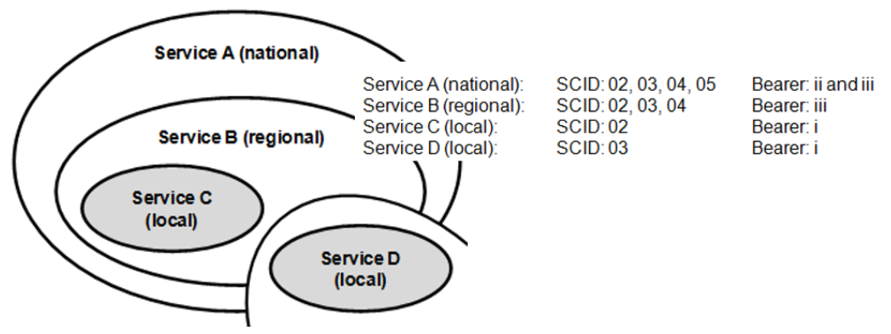
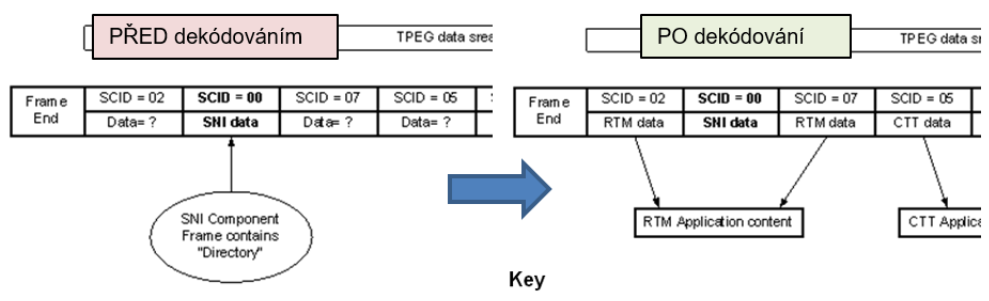
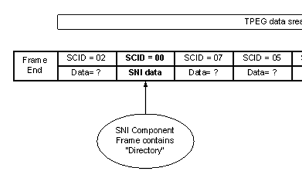

# EXTRAKT z technické specifikace ISO

**Extrakt nenahrazuje samotnou technickou normu, je pouze informativním materiálem o normě.**

|     |     |
| --- | --- |
| **Inteligentní dopravní systémy –  **Extrakt nenahrazuje samotnou technickou normu, je pouze informativním materiálem o normě.**Dopravní a cestovní informace v dopravním protokolu expertní skupiny, druhá generace (TPEG2) – Část 9: Informace o službách a síti** | **ISO/TS 21219-9  **Extrakt nenahrazuje samotnou technickou normu, je pouze informativním materiálem o normě.****  01 8259 |

Vydána 2015, 101 stran

## Úvod

Technická specifikace ISO 21219 se zabývá druhou generací protokolu TPEG pro **poskytování informací o dopravě koncovým uživatelům**, označovaným TPEG2.

ISO/TS 21219 obsahuje řadu částí, které pokrývají úvod, pravidla, “sady nástrojů” (toolkity) a jednotlivé aplikace. TPEG2 je postaven na modelování v UML, se sadou základních pravidel stanovujících strategii modelování a pravidla konverze modelu do dvou fyzických formátů: binárního pro vysílání v DAB a XML pro šíření Internetem (části 2, 3, 4 normy). Pro snazší udržovatelnost specifikace se změny provádí pouze na úrovni obecného modelu v UML (XMI soubor) a následně pomocí automatizovaných nástrojů převádějí do popisů jednotlivých fyzických formátů (dokument s přílohami pro každý fyzický formát). Tato koncepční témata jsou řešena částmi, které se nazývají sady nástrojů (toolkity).

TPEG2 stanovuje použití tří dílčích částí (kontejnerů): management zpráv (část 6 normy), dopravní aplikaci (mnoho částí) a odkazování na polohu (část 7 normy).

ISO/TS 21219 se skládá z těchto částí (tučně je zvýrazněna část popisovaná v tomto extraktu):

- **Toolkity** (nástroje): TPEG2-INV (část 1: Úvod, číslování a verze), TPEG2-UML (část 2: Pravidla modelování pomocí UML), TPEG2-UBCR (část 3: Pravidla pro konverzi z UML do binárního kódu), TPEG2-UXCR (část 4: Pravidla pro konverzi UML do XML), TPEG2-SFW (část 5: Rámec pro služby TPEG), TPEG2-MMC (část 6: Kontejner pro management zpráv), TPEG2-LRC (část 7: Kontejner pro odkazování na polohu)
- **Speciální aplikace**: **TPEG2-SNI (část 9: Informace o službách a síti)**, TPEG2-CAI (část 10: Informace o podmíněném přístupu), TPEG2-LTE (část 24: Slabé šifrování)
- **Odkazování na polohu**: TPEG2-ULR (část 11: Odkazování na polohu v aplikacích), TPEG2-ETL (část 20: Odkazování na polohu metodou rozšířeného TMC), TPEG2-GLR (část 21: Geografické odkazování na polohu), TPEG2-OLR (část 22: Odkazování na polohu metodou OpenLR)
- **Aplikace**: TPEG2-RTM (část 12: Aplikace pro zprávy o silniční dopravě), TPEG2-PTI (část 13: Aplikace pro informace o veřejné dopravě), TPEG2-PKI (část 14: Aplikace pro informace o parkování), TPEG2-TEC (část 15: Aplikace pro vybrané dopravní události), TPEG2-FPI (část 16: Aplikace pro informace o cenách pohonných hmot), TPEG2-SPI (část 17: Aplikace pro informace o rychlostních omezeních), TPEG2-TFP (část 18: Aplikace pro informace o stavu dopravního proudu a jeho predikci), TPEG2-WEA (část 19: Aplikace pro informace o počasí), TPEG2-RMR (část 23: Aplikace pro informace o multimodálních trasách), TPEG2-EMI (část 25: Nabíjecí infrastruktura pro elektromobily) a další.

Na rozdíl od RDS-TMC, které je svým způsobem popisu události jednoúrovňové, umožňuje TPEG informace členit strukturovaně se zvyšující se mírou detailu. Dopravní události popisuje TPEG úzkoprofilově, je vždy zaměřen na jeden konkrétní typ situací (například pro ceny pohonných hmot, dojezdové doby atd.), které popisuje do větší hloubky, každému typu je věnována samostatná část specifikace (tzv. ”aplikace TPEG”). Počet částí se stále rozšiřuje.

Rozlišení TPEG / TPEG1 / TPEG2 se většinou uvádí pouze v úvodu částí norem/specifikací, zatímco ostatní kapitoly již mezi TPEG a TPEG2 nerozlišují - to je implicitní dle kontextu. Stejným způsobem k tomu přistupujeme i v tomto extraktu.

Tento extrakt popisuje část 9 „Informace o službách a síti” (dále jen “popisovaný dokument”), která stanovuje způsob indikace služeb dostupných ve vysílaném obsahu. Část těchto informací je určena pro prezentaci uživateli a část pro dekodér.

_Poznámka: Extrakt uvádí vybrané kapitoly popisovaného dokumentu a přejímá původní číslování kapitol._

## Užití

Popisovaný dokument uvádí strukturu a obsah informací o službě TPEG a síti pro vysílání v DAB (binární forma) a pro šíření zpráv Internetem (XML). Všechny služby TPEG musí tuto povinnou komponentu rámce služby používat. Bez použití informací o službách a síti (SNI) by dekodér neměl informace o komponentách přijatého datového rámce a uživateli by nemohl být prezentován popis služby. Dále SNI umožňuje popisování přesahů a propojení stejných či podobných služeb na stejném či rozdílném médiu. Proto je popisovaná specifikace nezbytná pro **poskytovatele i příjemce dopravních informací**, jejich programátory, kteří pracují se samotným formátem XML či programují datové proudy pro DAB. Popis SNI v popisovaném dokumentu je konkrétní a je určen k její implementaci.

## Souvisící normy (výběr)

Klíčové normy, na které tento dokument odkazuje, jsou: specifikace TPEG2 části 1 až 6 a 9, dále normy ETSI stanovující rámec DAB, RDS, DVB, SWIFT a normu NRSC k HD Radiu.

## 1 Předmět

Popisovaný dokument TPEG2-SNI zavádí způsob poskytování informací o službách a síti v rámci služby TPEG. Aplikace TPEG-SNI je navržena tak, aby umožnila efektivní a jazykově nezávislé poskytování informací o dostupnosti stejné služby na jiném kanálu nebo podobných datech od jiného poskytovatele služeb.

Dokument popisuje řadu tabulek s informacemi, které poskytují komplexní možnosti popisu služeb, jejich časování, obsah, zeměpisné pokrytí apod. Ve všech datových tocích TPEG je povinné uvádět tzv. GST (průvodní tabulky služby). Dále je možné oznamovat propojení obsahu mezi různými nosiči a službami.

## 3 Termíny, definice a zkratky

Tato kapitola definuje 21 termínů. Většina se věnuje definici určitého typu tabulek s informacemi o službě či identifikaci té které služby či její komponenty. Klíčovými jsou tyto termíny:

**průvodní tabulky služby** _(guide to the service tables)_ – tabulky obsahující základní informace o službě jako například struktura služby, její načasování či popis obsahu

**služba** _(service)_ – sbírka různých informačních toků (aplikací) logicky spojených a dodaných poskytovatelem služeb koncovému uživateli

**aplikace** _(application)_ – tok informací, který sám o sobě přináší výhodu (tj. může být "aplikován") koncovým uživatelem

## 4 Zkratky

Tato kapitola stanoví 35 zkratek. V kapitole jsou uvedeny pouze některé zkratky částí specifikace TPEG. Tyto zkratky uvádíme v úvodu tohoto extraktu, proto je zde dále neuvádíme.

**TPEG** dopravní protokol expertní skupiny _(transport protocol experts group)_

**GST** průvodní tabulky služby _(guide to service tables)_

**SIT** tabulka informací o službě _(service information table)_

**SCID** identifikace komponenty služby _(service component identification)_

**SNI** Informace o službách a síti _(service and network identification)_

**COID** identifikace obsahu _(content identification_)

**AID** identifikace aplikace (_application identification)_

Další termíny a zkratky z oboru ITS jsou obsaženy ve slovníku ITS terminology ([www.itsterminology.org](http://www.itsterminology.org)).

## 5 Podmínky a omezení aplikace

Tato kapitola (rozsah 1 strana, 5 článků) nejprve vymezuje použití identifikátoru aplikace (AID) v rámci informací o službě, kdy každá „aplikace“ TPEG má svůj identifikátor stanovený v části TPEG-INV. AID je v TPEG2-SNI použit k indikaci jakým způsobem má dekodér pracovat s předávaným obsahem.

Dále se kapitola věnuje signalizaci verze aplikace. Verze je klíčová z pohledu dekodéru, jednotlivé verze stejné aplikace se totiž mohou od sebe lišit strukturou, obsahem, atp. Princip přidělování verzí je stanoven v popisovaném dokumentu.

Za zmínku stojí článek 5.3, který uvádí, že díky zachování binární kompatibility (v DAB) mezi formáty TPEG1 a TPEG2 nebylo možné plně automatizovaně použít pravidel pro konverzi mezi modelem a binární reprezentací. Odchylky od postupu stanoveného v TPEG2-UBCR jsou popsány v Příloze A.

SNI používá rámec komponent služby TPEG. V posledním článku je uveden konceptuální model multiplexu aplikací a služeb.

## 6 Zásady návrhu

Tato kapitola (rozsah 4 stran, 4 článkyy) uvádí základní zásady návrhu služby (principy) a sadu pravidel.

První zásada stanovuje tzv. „proměnné odkazování na obsah“, tedy způsob jak (prostřednictvím **SCID**) identifikovat obsah sdílený mezi více službami, kdy tyto služby mohou být národní, regionální, lokální či kombinace lokálních a regionálních atp. (viz obrázek 1).

 

**Obr. 1.** Jak použít identifikaci obsahu (SCID) sdíleného mezi službami (výřez obr. 2 dokumentu)

Další zásada ukazuje použití aplikace SNI v proudu TPEG dat v jednom datovém rámci, kdy právě SNI přiřazuje jednotlivým komponentům rámce jejich význam (viz obrázek 2).

 

PŘED dekódováním SNI

PO dekódování SNI

**Obr. 2.** Identifikace komponent služby v datovém rámci TPEG (výřez obr. 3 dokumentu)

Následující zásada ukazuje na dvou příkladech přidělování identifikačních čísel službám TPEG ve vazbě na identifikátor obsahu COID, aplikace AID a komponenty služby SCID.

Poslední článek kapitoly stanovuje obecná pravidla aplikace TPEG2-SNI pro přidělování služeb jejich poskytovatelem v rámci jednoho přenosového média. Například:

- každá služba musí povinně použít SNI
- SNI se ve službě smí vyskytnout pouze jednou a má rezervovaný identifikátor SCID=00

## 7 Struktura SNI

Tato kapitola (rozsah 1 obrázek) uvádí strukturu SNI. Jsou ukázány pouze obecné části, GST a SIT jsou na této úrovni ukázány jen jako „prázdné“ obálky.

## 8 Komponenty SNI zprávy

Tato kapitola (rozsah 10 stran) podrobně popisuje komponenty zprávy SNI.

V článku 8.1 Šablona SNI se uvádí, že SNI poskytuje 3 skupiny komponent, které umožňují dekódovat službu TPEG; jsou to:

- Informace o službě – obecný popis služby, např. logo a abstrakt
- Informace o komponentách – tabulka GST obsahující základní popis služby a dynamický popis (tabulka SIT) obsahující například počet aktuálních zpráv. Frekvence vysílání těchto tabulek může být upravena podle možností média a požadavků služby.
- Informace o propojení – propojení služeb nezávisle na médiu

Dále jsou v článku 8.1 stanovena pravidla na číslování verzí tabulek poskytovaných v rámci SNI.

Články 8.2 až 8.6 stanovují atributy (rozsahy, typy, příklady) obecných tříd (viz následující obrázek) vyskytujících se v SNI, tak jak byly tyto třídy ukázány na obrázku v kapitole 7.

**Obr. 2.** Obecné třídy SNI stanovené v kapitole 8 dokumentu (výřez obr. 6 dokumentu)

Článek 8.7 stanovuje strukturu a obsah tabulek GST, jejich struktura se skládá ze 7 částí.

Články 8.8 – 8.15 tyto části **obecně** popisují (uvádějí pouze řádek textu a číslo tabulky s odkazem na externě definovanou pod-tabulku) následující tabulky:

- GST1_FastTuningTable – povinná tabulka, ve které musí být uvedeny všechny komponenty služby. Tabulka je uvedena verzí a kódováním a následně obsahuje řádky propojující SCID s COID a AID.
- Další tabulky: GST2_TimeScheduleTable, GST3_ContentDescription (viz tabulka 1), GST4_GeographicalCoverage, GST5_ServiceComponentReset, GST6_ConditionalAccessInformationReference a GST7_Versioning.

**Tabulka 1 - Definice tabulky GST3_ContentDescription (tab. 10 dokumentu)**

|     |     |     |     |
| --- | --- | --- | --- |
| **Name** | **Type** | **Multiplicity** | **Description** |
| tableVersion | IntUnTi | 1   | Incremented, if any of the entries is changed. |
| tableEntry | GST3_Entry | 1..255 | Lines of table GST3. |

Článek 8.15 stanovuje volitelnou komponentu GST_ServiceTableAccelerator, která se opakuje ve vysílaném proudu častěji než GST a umožňuje „rychleji“ předat číslo verze tabulek GST = tedy to jediné, co tato komponenta obsahuje.

Článek 8.16 stanovuje volitelnou komponentu LinkageToSameService, SNI „propojení“ pomáhá přijímači najít komponenty stejné služby na stejném médiu ve stejné síti nebo na jiných nosičích v jiných sítích.

Článek 8.17 stanovuje význam slovního spojení „stejná služba“ použitého v předchozím článku. Uvádí, že LinkageToSameService se použije díky konceptu „dělitelnosti“ služby do malých, úzce tematicky a geograficky specializovaných částí (komponent) služby.

Článek 8.18 stanovuje volitelnou komponentu LinkageToRelatedService, SNI „propojení“ pomáhá přijímači najít komponenty návazné služby na stejném médiu ve stejné síti nebo na jiných nosičích v jiných sítích.

Články 8.20 – 8.24 popisují informace o typu média a propojení služeb pro DAB (BearerLinkageInfoDAB), DARC (BearerLinkageInfoDARC), DVB (BearerLinkageInfoDVB), Internet (BearerLinkageInfoURL) (viz tabulka 2) a HD Radio (BearerLinkageInfoHDRadio).

**Tabulka 2 - Definice tabulky BearerLinkageInfoURL (tab. 21 dokumentu)**

|     |     |     |     |
| --- | --- | --- | --- |
| **Name** | **Type** | **Multiplicity** | **Description** |
| uniformResourceLocator | LongString | 1   | URL (Uniform Ressource Locator) as defined in RFC 1738. |

Článek 8.25 stanovuje SIT_ServiceInformationTables, tabulky SIT mají stejnou strukturu jako GST ale liší se v definici a použití čísla verze (jsou dynamické a neplatí pro ně stejná pravidla jako pro verze tabulek GST).

## 9 Datové typy SNI

Tato kapitola (rozsah 13 stran) stanovuje obsah typů definovaných v předchozí kapitole.

Jsou to základní typy: MaskedTime, DayMask, AppStartTime, TimeSlot, OpTime, GeographicCoverage, CoordinatePair a ByteField

a odvozené typy (struktury): GST1_Entry, GST2_Entry, GST3_Entry (viz tabulka 3), GST4_Entry, GST5_Entry, GST6_Entry, GST7_Entry, RelatedServiceEntry, DABFrequency, DVBFrequency, FMFrequency, AMFrequency, SameServiceEntry, SIT1_Entry, HDRadioStationID a podřízené HDFMBearerInfo a HDAMBearerInfo.

**Tabulka 3 - Definice tabulky GST3_Entry (tab. 35 dokumentu)**

|     |     |     |     |
| --- | --- | --- | --- |
| **Name** | **Type** | **Multiplicity** | **Description** |
| SCID | IntUnTi | 1   | Service Component Identification (SCID). |
| contentDescription | ShortString | 1   | Content Description:  Gives further information related to a service component. The general description of a service is signalled by the CurrentServiceInformation component. |

Definice SameServiceEntry na rozdíl od ostatních definic obsahuje textově definovaná pravidla použití.

## 10 Tabulky SNI

Tato kapitola (rozsah 2 strany) uvádí 2 tabulky výčtových typů, formát obrázku loga (sni001:GraphicType) a kódování znaků (sni002:CharacterEncoding).

## 11 Bibliografie

Tato kapitola (rozsah 1 odstavec) uvádí 2 odkazy, první na předchozí verzi SNI v TPEG1 a druhý na definici XML schématu.

## Příloha A (normativní) TPEG-bin reprezentace SNI

Tato příloha o rozsahu 20 stran je současně s Přílohou B klíčovou částí normy.

Příloha stanovuje binární reprezentaci aplikace informace o službách a síti (SNI) TPEG pro použití v DAB. Popis binární reprezentace je uveden v pseudokódu, kde pro každé klíčové slovo zapsané struktury je znám jeho binární tvar.

V části A.1 se uvádí rozdíly konverze z UML do binární reprezentace od konverze stanovené v dokumentu TPEG2-UBCR. Například změna typu proměnné LengthIndicator na IntUnLi, atp.

V části A.2 je uvedena tabulka (viz dole) identifikátorů komponent TPEG2 a TPEG1.

**Tabulka 4 – Seznam identifikátorů obecných komponent (tab. 53 normy)**

|     |     |     |     |
| --- | --- | --- | --- |
| Name | Id  | Name | Id  |
| CurrentServiceInformation | 0   | LinkageToRelatedService | 9   |
| GST1_FastTuningTable | 1   | SubscriberInformation | 10  |
| GST2_TimeScheduleTable | 2   | FreeTextInformation | 11  |
| GST3_ContentDescription | 3   | HelpInformation | 12  |
| GST4_GeographicalCoverage | 4   | GST6_ConditionalAccessInformationReference | 13  |
| GST5_ServiceComponentReset | 5   | GST7_Versioning | 14  |
| GST_ServiceTableAccelerator | 6   | BearerLinkageInfoHDRadio | 15  |
| ServiceLogo | 7   | SIT1_NumberOfMessages | 33  |
| LinkageToSameService | 8   |     |     |

Kapitola pokračuje „binárními“ definicemi dříve uvedených komponent. Například:

**Tabulka 5 – Popis obsahu GST3_ContentDescription (tab. a 64 normy)**

|     |     |
| --- | --- |
| &lt;GST3_ContentDescription(3)<SNI1Template(3)&gt;>:= |     |
| &lt;IntUnTi&gt;(3), | : id of this component |
| &lt;IntUnLi&gt;(lengthComp), | : number of bytes in component |
| &lt;IntUnTi&gt;(tableVersion), | : Incremented, if any of the entries is changed. |
| n \* &lt;GST3_Entry&gt;(tableEntry); | : Lines of table GST3. |

Článek A.3 stejným způsobem zavádí „binární“ definice datových typů. Například:

**Tabulka 53 – Popis obsahu GST3_Entry (tab. 90 normy)**

|     |     |
| --- | --- |
| &lt;GST3_Entry&gt;:= |     |
| &lt;IntUnTi&gt;(SCID), | : Service Component Identification (SCID). |
| &lt;ShortString&gt;(contentDescription); | : Content Description:  Gives further information related to a service component. The general description of a service is signalled by the CurrentServiceInformation component. |

## Příloha B (normativní) TPEG-ML reprezentace SNI

Tato příloha o rozsahu 30 stran je současně s Přílohou A klíčovou částí normy.

Příloha obsahuje popis XML reprezentace a XML schéma rámce TPEG.

Část B.2 obsahuje reprezentaci XML struktury (komponent), tak jak byly stanoveny v kapitole 8. Například článek B2.10 uvádí definici GST3_ContentDescription

&lt;xs:complexType name="GST3_ContentDescription"&gt; 

&nbsp;&lt;xs:sequence&gt; 

&nbsp;&lt;xs:element name="tableVersion" type="tdt:IntUnTi"/&gt; 

&nbsp;&lt;xs:element name="tableEntry" type="GST3_Entry" maxOccurs="255"/&gt; 

&nbsp;&lt;/xs:sequence&gt; 

&lt;/xs:complexType&gt; 

Část B.3 obsahuje reprezentaci datových typů v XML, tak jak byly stanoveny v kapitole 9. Například článek B3.11 uvádí definici GST3_Entry

&lt;xs:complexType name="GST3_Entry"&gt; 

&nbsp;&lt;xs:sequence&gt; 

&nbsp;&lt;xs:element name="SCID" type="tdt:IntUnTi"/&gt; 

&nbsp;&lt;xs:element name="contentDescription" type="tdt:ShortString"/&gt; 

&nbsp;&lt;/xs:sequence&gt; 

&lt;/xs:complexType&gt;