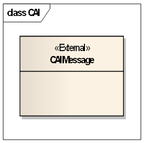

# EXTRAKT z technické specifikace ISO

**Extrakt nenahrazuje samotnou technickou normu, je pouze informativním materiálem o normě.**

|                                                                                                                                                                             |                                 |
| --------------------------------------------------------------------------------------------------------------------------------------------------------------------------- | ------------------------------- |
| **Inteligentní dopravní systémy – Dopravní a cestovní informace v dopravním protokolu expertní skupiny, druhá generace (TPEG2) – Část 10: Informace o podmíněném přístupu** | **ISO/TS 21219-10**  01 8259 |

Vydána 2015, 19 stran

## Úvod

Technická specifikace ISO 21219 stanovuje formát a protokol TPEG určený pro poskytování informací o dopravě koncovým uživatelům. TPEG je určen pro média s vysokou přenosovou kapacitou, umožňuje informace členit strukturovaně se zvyšující se mírou detailů a komplexně popisovat polohu. 

Jednotlivé oblasti dopravních událostí jsou v TPEG popsány odděleně, pomocí platformě nezávislého modelu (UML) a dvou odvozených platformě závislých modelů (binární a XML). Části specifikace stanovují pravidla tvorby modelu jeho převodu do platformě závislé podoby. 

Více informací o kontextu TPEG je obsaženo v úvodu extraktu k části 1 normy TPEG (21219-1).

Technická specifikace ISO 21219 se zabývá druhou generací protokolu TPEG, označovaným zkratkou TPEG2. Rozlišení TPEG/TPEG1/TPEG2 se většinou uvádí pouze v úvodní části norem/specifikací, zatímco ostatní kapitoly již mezi TPEG a TPEG2 nerozlišují - to je implicitní dle kontextu. 

Tento extrakt (dále jen “popisovaný dokument”) popisuje část 10 normy TPEG, která specifikuje obálku komponenty CAI a popisuje vhodnost linkování komponent CAI se zašifrovaným obsahem v jiných komponentách služby.

_Poznámka: Extrakt uvádí vybrané kapitoly popisovaného dokumentu a přejímá původní číslování kapitol._

## Užití

Části přenášených informací mohou být zašifrovány a tím podmíněně zpřístupněné pouze odběratelům vlastnícím dešifrovací klíč. Tato část se zabývá poskytnutím informací o tom, které části služby jsou nějakým způsobem zašifrovány (a tím podmíněně přístupné).

Popisovaný dokument stanovuje obálku pro informace o podmíněném přístupu. Obálka je v rámci služby přenášena současně s ostatními komponentami služby a informuje o zašifrovaných komponentách. Dokument odkazuje na TPEG2-SNI a TPEG2-SWF, které stanovují, jak mají vypadat zašifrované komponenty služby a jak na ně odkazovat. Konkrétní struktura kontejneru aplikace CAI není v tomto dokumentu stanovena.

Popisovaný dokument je vhodný pro programátory a tvůrce zašifrovaných služeb, které informuje o způsobu předávání informací o podmíněném přístupu (zašifrovaných částech služby). Pro samotnou implementaci podmíněného přístupu nestačí, zde jsou potřeba další normy, viz výše.

## Souvisící normy (výběr)

Tento dokument uvádí 7 normativních odkazů na normu TPEG2 ISO 21219 části 1-6 a 9. Důležité jsou zejména TPEG2-SNI (část 5) a TPEG2-SWF (část 9).

## 1 Předmět

Popisovaný dokument definuje aplikaci TPEG2-CAI „podmíněného přístupu“ na úrovni komponenty služby. Ta umožňuje chránit obsah služby TPEG před neoprávněným přístupem. Dále zmiňuje správu informací o odběratelích na klientských zařízeních za účelem nastavení, prodloužení nebo zrušení předplatného na daném klientském zařízení.

## 3 Termíny a definice

Tato kapitola definuje dva termíny, služba a komponenta služby.

**služba** _(service)_ – sbírka různých informačních toků (aplikací) logicky spojených a dodaných od poskytovatele služeb koncovému uživateli

**komponenta služby** _(service component)_ – součást služby ze kterých může být služba poskládána

## 4 Zkratky

Tato kapitola stanoví 16 zkratek. V kapitole jsou uvedeny pouze některé zkratky částí normy TPEG. Tyto zkratky uvádíme v úvodu tohoto extraktu, proto je zde dále neuvádíme.

**TPEG** dopravní protokol expertní skupiny (transport protocol experts group)

**EncID** identifikace šifrování (encryption identifier)

**AID** identifikace aplikace (application identification)

**CAI** informace o podmíněném přístupu (conditional access information)

Další termíny a zkratky z oboru ITS jsou obsaženy ve slovníku ITS terminology ([www.itsterminology.org](http://www.itsterminology.org/)).

## 5 Podmínky a omezení aplikace

Tato kapitola (rozsah 1/2 strany) nejprve vymezuje použití identifikátoru aplikace (AID) v rámci informací o službě; každá „aplikace“ TPEG má svůj identifikátor stanovený v části 1 normy (TPEG-INV). AID je použit v TPEG2-SNI k indikaci, jakým způsobem má dekodér pracovat s předávaným obsahem.

Dále se věnuje způsobu předání informace o verzi aplikace. Verze je klíčová z pohledu dekodéru, jednotlivé verze stejné aplikace se totiž mohou od sebe lišit strukturou, obsahem, atp. Princip přidělování verzí je stanoven v popisovaném dokumentu.

CAI používá rámec komponent služby TPEG s CRC daty dle specifikace v TPEG2-UXCR.

## 6 Metodika podmíněného přístupu

Tato kapitola (rozsah 1 strana) uvádí, že podmíněný přístup je stanoven v normách TEPG2-SFW a TPEG2-SNI jako funkce aplikovaná na úrovni rámce služby či komponent služby. Šifrovací metoda je indikovaná pomocí identifikátoru šifrování (EncID) přímo v rámci služby či pro její komponenty prostřednictvím tabulky GST1.

Kapitola dále uvádí, že k dešifrování zašifrovaného obsahu je zapotřebí někde přenášet informace o použitém způsobu šifrování, o tom, co je a co není zašifrováno nezávisle na zašifrovaném obsahu. Ideálním způsobem, jak tyto informace přenášet, je prostřednictvím další komponenty služby s vyhrazeným AID.

Některé komponenty služby mohou být zašifrovány jedním (stejným) klíčem, zatímco jiné komponenty jiným. To umožňuje prodávat „balíčky“ služeb (pro všechny komponenty „balíčku“ je použit stejný šifrovací klíč).

Každá zašifrovaná komponenta služby musí být propojena s relevantní komponentou CAI nesoucí informace o podmíněném přístupu. Toto se řeší prostřednictvím tabulky GST-6 Odkazy CAI.

Dále tato kapitola uvádí příklad, kdy rámec služby obsahuje 9 komponent. Komponentu SNI, dále jednu nezašifrovanou komponentu TEC a 2 zašifrované TEC (stejným klíčem), jednu zašifrovanou a nezašifrovanou komponentu PKI a dále 3 komponenty CAI. První pro indikaci skupiny TEC, druhou pro indikaci komponenty PKI a třetí pro všechny zašifrované komponenty dohromady.

Metodika dále uvádí, že popisovaný dokument stanovuje obálku, do které musí být teprve vložen obsah specifický dle použitého způsobu podmíněného přístupu (dle indikace pomocí EncID).

## 7 Struktura CAI

Tato kapitola (rozsah 1 obrázek) uvádí strukturu CAI. Na rozdíl od dalších aplikací TPEG nemá aplikace CAI kontejnery pro popis polohy a řízení zprávy, skládá se pouze z jedné generické komponenty, jejíž obsah v dokumentu není stanoven.

**Obr. 1.** Struktura zprávy CAI (obr. 1 dokumentu)

## 8 Komponenty CAI zprávy

Tato kapitola (rozsah 1 odstavec) popisuje komponenty zprávy CAI.

Uvádí, že zpráva CAI obsahuje pouze jeden kontejner, jehož struktura je definována v jiných dokumentech (normách) pro ten který systém podmíněného přístupu. Systém podmíněného přístupu je určen indikátorem šifrování (EncID) signalizovaným v SNI.

## 9 Bibliografie

Tato kapitola uvádí dva odkazy, první na předchozí verzi CAI v TPEG1 a druhý na definici XML schématu.

## Příloha A (normativní) TPEG-bin reprezentace CAI

Tato příloha o rozsahu 1 strany stanovuje binární reprezentaci aplikace informace o podmíněném přístupu (CAI) TPEG pro použití v DAB . Popis binární reprezentace je použit pseudokód, kde pro každé klíčové slovo zapsané struktury je znám jeho binární tvar.

Kapitola stanovuje identifikátor zprávy CAI a strukturu zprávy pomocí instrukce „external“, nestanovuje tedy strukturu obsahu, ale pouze „obálku“.

## Příloha B (normativní) TPEG-ML reprezentace CAI

Tato příloha o rozsahu 1 strany obsahuje popis XML reprezentace a XML schéma rámce TPEG.

Stanovuje prázdné XML schéma a uvádí, že do tohoto prázdného schématu má být naimportováno externí schéma stanovující konkrétní strukturu kontejneru CAI dle požadavků té které aplikace.