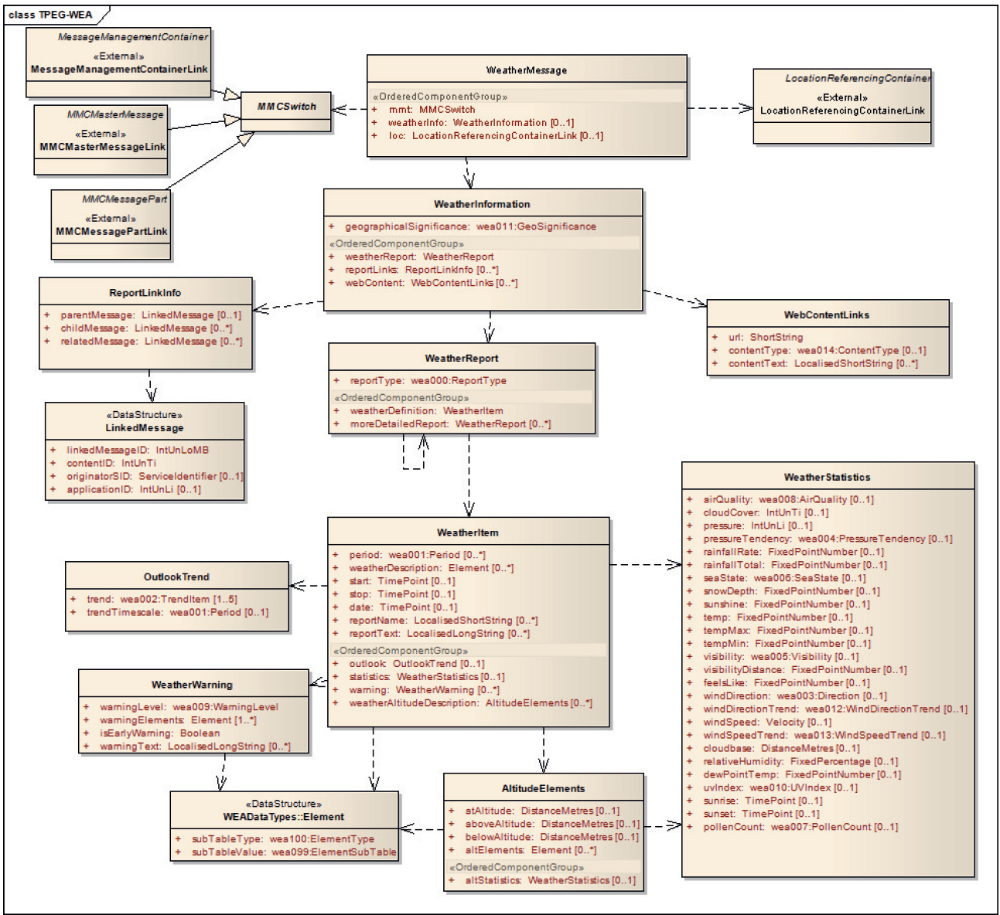
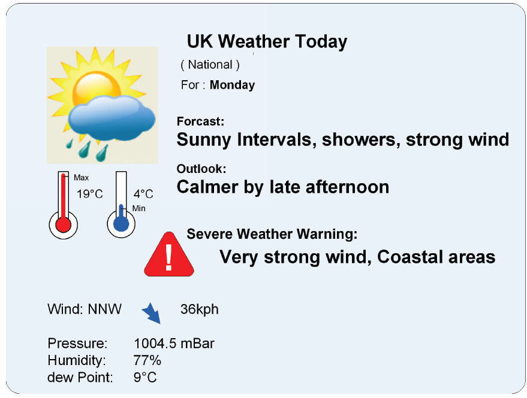
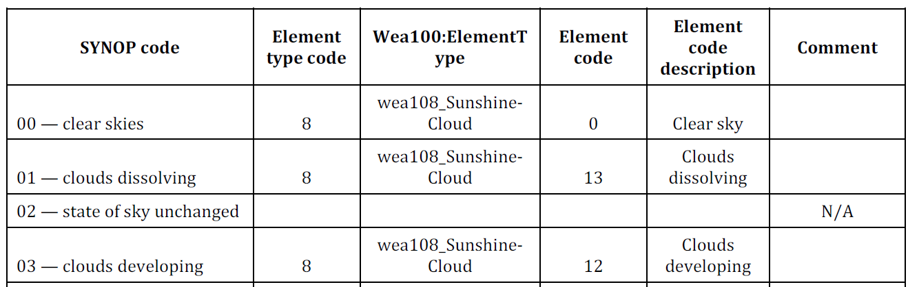

# EXTRAKT z technické specifikace ISO

**Extrakt nenahrazuje samotnou technickou normu, je pouze informativním materiálem o normě.**

|     |     |
| --- | --- |
| **Inteligentní dopravní systémy – Dopravní a cestovní informace (TTI) v dopravním protokolu expertní skupiny, druhá generace (TPEG2) - Část 19: Aplikace pro informace o počasí (TPEG2-WEA)** | **ISO/TS 21219-19** <br>01 8388 |

Vydána 2020, 82 stran

## Úvod

Technická specifikace ISO 21219 stanovuje formát a protokol TPEG určený pro poskytování informací o dopravě koncovým uživatelům. TPEG je určen pro média s vysokou přenosovou kapacitou, umožňuje informace členit strukturovaně se zvyšující se mírou detailů a komplexně popisovat polohu. 

Jednotlivé oblasti dopravních událostí jsou v TPEG popsány odděleně, pomocí platformě nezávislého modelu (UML) a dvou odvozených platformě závislých modelů (binární a XML). Části specifikace stanovují pravidla tvorby modelu a jeho převodu do platformě závislé podoby. 

Více informací o kontextu TPEG je obsaženo v úvodu extraktu k části 1 normy TPEG (21219-1).

Technická specifikace ISO 21219 se zabývá druhou generací protokolu TPEG, označovaným zkratkou TPEG2. Rozlišení TPEG/TPEG1/TPEG2 se většinou uvádí pouze v úvodní části norem/specifikací, zatímco ostatní kapitoly již mezi TPEG a TPEG2 nerozlišují – to je implicitní dle kontextu.

Tento extrakt (dále jen “popisovaný dokument”) popisuje část 19 normy TPEG „Aplikace pro informace o počasí (TPEG2-WEA)”, která popisuje kódování různě rozsáhlých zpráv o počasí.

_Poznámka: Extrakt uvádí vybrané kapitoly popisovaného dokumentu a přejímá původní číslování kapitol._

## Užití

Popisovaný dokument stanovuje způsob poskytování informací o počasí. Počítá s prezentací těchto informací uživateli. Obsahuje významné množství výčtů (tabulek) stanovujících typy počasí a také převodník mezi těmito tabulkami a kódy WMO SYNOP. Je nezbytný pro analytiky provozovatele služby o počasí a pro analytiky výrobce uživatelského terminálu (aplikace), kteří mají na starost návrh datového modelu systému a návrh pravidel, se kterými systém pracuje. Použije se při návrhu systému.

## Souvisící normy

Popisovaný dokument uvádí 3 normativní odkazy na normu TPEG2 ISO 21219 části 5, 6 a 9. Dále je v části Literatura odkázána řada v textu použitých normativních referencí.

## 1 Předmět

Popisovaný dokument definuje aplikaci TPEG WEA „Aplikace pro informace o počasí“. Ta umožňuje poskytování informací o počasí pro různé geografické oblasti (i hierarchicky propojené) v různém časovém horizontu. Informace o počasí mohou být velmi detailní. Tyto informace jsou určeny obecně cestujícím a nejsou omezeny módem dopravy ani není jejich cílem poskytnout varování o nebezpečné povětrnostní situaci řidičům, k tomu je určena jiná aplikace TPEG (TPEG-TEC, 21219-15).

## 3 Termíny a definice

Tato kapitola definuje 5 termínů, m.j.  

**kontejner pro management zprávy;** MMC (_message management container_) část zprávy obsahující informace pro sestavení zprávy z dalších “aplikačního” a “polohového” kontejneru či pro řízení zprávy (například její zrušení).  

**kontejner pro odkazování na polohu**; LRC (_location referencing container_)  část zprávy obsahující  informace o poloze odkazované dopravní informace či odkazovaného stavu dopravní situace.  

**odkazování na polohu** (_Location Referencing_) – prostředky umožňující systému přesně identifikovat polohu

## 4 Zkratky

Tato kapitola stanovuje 16 zkratek, důležité z pohledu tohoto extraktu jsou:

**MMC** kontejner pro management zpráv _(Message Management Container)_
**ADC** kontejner pro popis aplikace _(Application Data Container)_
**LRC** kontejner pro odkazování na polohu _(Location Referencing Container)_
**WEA** aplikace pro informace o informace o počasí _(Weather information application)_
**TPEG** framework poskytující formáty a protokoly pro poskytování dopravních informací, optimalizovaných na šíření prostřednictvím digitálního rozhlasu či Internetu

_Poznámka: Další termíny a zkratky z oboru ITS jsou obsaženy ve slovníku ITS terminology (_[_www.itsterminology.org_](http://www.itsterminology.org)_)._

## 5 Podmínky a omezení aplikace

Tato kapitola (rozsah 1,5 strany) vymezuje:

- **Identifikátor aplikace**, který je stanovený pro všechny aplikace v TS 21219-1.
- **Verzi aplikace**. Verze je klíčová z pohledu dekodéru, jednotlivé verze stejné aplikace se totiž mohou od sebe lišit strukturou, obsahem atp. 
- **Pořadí kontejnerů**, ze kterých je zpráva složena. Zpráva se skládá z kontejneru pro management zpráv (MMC), a volitelně z kontejneru pro popis aplikace (ADC) a kontejneru pro odkazování na polohu (LRC). 
- **Rozšiřitelnost a zpětnou kompatibilitu**, jako požadavek na přeskočení neznámých částí zprávy dekodérem a specifikaci v budoucnu rozšiřitelných částí struktur TPEG zprávy.
- **Rámec komponent služby TPEG** dle ISO/TS 21219-5.

## 6 Struktura WEA

Tato kapitola (rozsah 1 UML schéma) obsahuje UML model zprávy aplikace WEA.


**Obr. 1** UML model tříd aplikace WEA (obrázek 2 normy)

## 7 Komponenty zprávy WEA

Tato kapitola (rozsah 8 stran, tabulky, obrázky) popisuje jednotlivé komponenty zprávy WEA. Cílem je zavést hierarchickou strukturu vzájemně propojených zpráv s různým pokrytím či časovými horizonty předpovědí.

Stanovuje pro zprávu WEA její základní strukturu a detailně popisuje její jednotlivé součásti. Základní zpráva „WeatherMessage“ může obsahovat informaci o počasí (WeatherInformation) a informaci o poloze (LocationReferencingContainerLink), ne nezbytně v jedné zprávě.

Informace o počasí se skládá z typu popisované oblasti, samotného reportu (WeatherReport) a souvisejících reportů odkázaných prostřednictvím ID. Každá zpráva o počasí sestává z typu reportu a položky (WeatherItem) a možného detailního reportu. Položka (WeatherItem) již obsahuje konkrétní informace o počasí, včetně předpovědi (OutlookTrend) podrobných číselných statistik (WeatherStatistics), varování před specifickým počasím (WeatherWarning) a výškového rozložení počasí (AltitudeElements).

Položka WeatherStatistics (kap 7.5) pokrývá 25 číselných údajů o počasí jako jsou teplota, vítr, rosný bod, východ slunce, tlak, srážky a další.

Popis polohy není specifikován.

## 8 Datové typy WEA

Tato kapitola (rozsah 1 strana) obsahuje definice 2 použitých datových struktur (typů).  Konkrétně LinkedMessage umožňující hierarchicky propojit zprávy mezi sebou pomocí messageID a Element kvalitativně popisující typ počasí. 

## 9 Tabulky WEA

Tato kapitola (rozsah 20 stran) obsahuje definice výčtových typů aplikace WEA (v 29 tabulkách).  Následující tabulka jmenovitě uvádí jednotlivé tabulky a doplňuje je popisem a příkladem obsahu.

**Tab. 1** Seznam tabulek WEA (výčtů hodnot) (zdroj: autor extraktu)

| Tabulka WEA | Popis | Obsah |
| --- | --- | --- |
| wea000:ReportType | Typ reportu (0-5) | Př.:002: Daily |
| wea001:Period | Popis období platnosti (0-50) | Př.: 019: Dusk |
| wea002:TrendItem | Trend vývoje počasí (0-16) | Př.: 004: hotter |
| wea003:Direction | Směr počasí (0-16) | Př.: 013: W (west) |
| wea004:PressureTendency | Trend tlaku (0-6) | Př.: 003: Falling |
| wea005:Visibility | Viditelnost (0-4) | Př.: 002: Poor |
| wea006:SeaState | Výška vln na moři (0-7) | Př.: 003: Rough |
| wea007:PollenCount | Množství pylových částic (0-3) | Př: 002: High |
| wea008:AirQuality | Kvalita počasí (0-6) | Př.: 003: Unhealthy |
| wea009:WarningLevel | úroveň hrozby počasí (0-4) | Př.: 002: Bad weather |
| wea010:UVIndex | UV index (0-11) | Př.: 010: 10-very high |
| wea011:GeoSignificance | Význam / rozsah (0-9) | Př.: 006: City |
| wea012:WindDirectionTrend | Trend směru větru (0-2) | Př.: 001: Veering |
| wea013:WindSpeedTrend | Trend rychlosti větru (0-4) | Př.: 003: Decreasing |
| wea014:ContentType | Popis typu obsahu (0-6) | Př.: 004: Pressure |
| wea099:ElementSubTable | Tabulka podtypů počasí (0) | prázdná |
| wea100:ElementType | Tabulka elementů počasí (0-12) | Př.: 006: wea106_FogElements |
| wea101:RainElements | Popis deštivého počasí (0-12) | Př.: 012: Damp |
| wea102:SnowElements | Popis sněžného počasí (0-14) | Př.: 006: Low drifting snow |
| wea103:SleetHailElements | Popis špatného počasí (0-11) | Př.: 002: Light sleet |
| wea104:WindElements | Popis větrného počasí (0-27) | Př.: 012: Hurricane |
| wea105:StormElements | Popis bouřkového počasí (0-12) | Př.: 012: Sand storm |
| wea106:FogElements | Popis mlžného počasí (0-13) | Př.: 004: Shallow fog |
| wea107:FrostElements | Popis ledového počasí (0-5) | Př.: 004: Severe frost |
| wea108:SunshineCloudElements | Popis slunečné oblačnosti | Př.: 005: A few clouds |
| wea109:TemperatureElements | Popis teploty (0-12) | Př.: 008: Heat-wave |
| wea110:HazardElements | Popis hrozby (0-13) | Př.: 005: Landslides |
| wea200:ElementQualifier | Popis prostředí (0-25) | Př.: 003: Urban areas |
| wea201:ElementQualifierProbability | Pravděpodobnost realizace | Př.: 001: 10 % |

Následující tabulka obsahuje ukázku tabulky „wea200:ElementQualifier” z popisovaného dokumentu.

**Tab. 2** Příklad části definice výčtového typu wea200:ElementQualifier (tabulka 41 normy)

| **Kód** | **Fráze** | **komentář** |
| --- | --- | --- |
| 000 | V některých oblastech (In some areas) | V celkové oblasti, na kterou se odkazuje, se prvek nemusí vyskytovat všude, ale jen na některých místech |
| 001 | Nízko položené oblasti (Low lying areas) | Prvky jako mlha se mohou častěji vyskytovat v údolích a nízkých polohách v blízkosti řek. |
| 002 | Vyvýšená místa (High ground) | Prvky jako mráz a sníh mohou být pravděpodobnější ve vysokých oblastech. |
| 003 | Městské oblasti (Urban areas) | Městské oblasti mají vlastní mikroklima, takže někdy bývají teplejší nebo může být problémem smog. |

## Příloha A (normativní) TPEG-bin reprezentace WEA

Tato příloha (rozsah 9 stran) stanovuje binární reprezentaci aplikace WEA pro použití v DAB. Pro popis binární reprezentace je použit pseudokód, kde pro každé klíčové slovo zapsané struktury je znám jeho binární tvar.

Příloha obsahuje samostatně uvedené binární reprezentace rámce TPEG, zprávy WEA a jejích součástí, prvků určených pro budoucí rozšíření a datových typů. Dále obsahuje identifikátory komponent zprávy a vysvětlení použití obecných atributů TPEG. Příklad pseudokódu binární specifikace prvku WeatherReport je uveden v následující tabulce.

**Tab. 3** Příklad pseudokódu binární specifikace prvku WeatherReport (článek A.4 normy)

| &lt;WeatherReport(6)&gt;:= |     |
| --- | --- |
| &lt;IntUnTi&gt;(6), | : Id této komponenty |
| &lt;IntUnLoMB&gt;(lengthComp), | : Počet bajtů v komponentě, kromě indikátorů id a lengthComp |
| &lt;IntUnLoMB&gt;(lengthAttr), | : Počet bajtů v atributech |
| &lt;wea000:ReportType&gt;(reportType), | : stanovuje časový rámec reportu |
| ordered { |     |
| &lt;WeatherItem&gt;(weatherDefinition), | : hlavní část zprávy o počasí |
| n \* &lt;WeatherReport&gt;(moreDetailedReport) | : volitelné další úrovně reportu |
| };  |     |

## Příloha B (normativní) TPEG-ML reprezentace WEA

Tato příloha (rozsah 14 stran) obsahuje nejprve samostatně uvedené XML schéma rámce TPEG, dále zprávy WEA a jejích součástí, prvků určených pro budoucí rozšíření, datových typů a tabulek WEA (definovaných jako xs:complexType), viz příklad na obrázku níže. Následně uvádí vše výše zmíněné v jednom funkčním XML schématu.

```xml
<xs:complexType name=″WeatherReport”>
  <xs:sequence>
    <xs:element name=″reportType″ type=″wea000_ReportType″/>
    <xs:element name=″weatherDefinition″ type=″WeatherItem″/>
    <xs:element name=″moreDetailedReport″ type=″WeatherReport″ minOccurs=″0″ maxOccurs=″unbounded″/>
  </xs:sequence>
</xs:complexType>
```
**Obr. 2** Výstřižek schématu XSD stanovujícího strukturu prvku WeatherReport (článek B.1.3 normy)

## Příloha C (informativní) Vypracované příklady

Tato příloha (rozsah 5 stran) obsahuje možné vizualizace informace o počasí a UML diagramy (většinou nečitelné) pro 3 příklady hlášení počasí, od jednoduchého až po hierarchické oblastní hlášení pomocí propojených reportů.


**Obr. 3** Ukázka vizualizace jednoduchého hlášení o počasí (obrázek C.1 normy)

## Příloha D (informativní) Doporučený překlad mezi tabulkami WEA a WMO SYNOP kódy pozorování

Tato příloha (rozsah 6 stran) obsahuje tabulku stanovující propojení mezi kódy SYNOP a kódy stanovenými v popisovaném dokumentu.


**Obr. 4** Výstřižek z tabulky propojení SYNOP a WEA (tabulka D.1 normy)

## Literatura

Tato část (rozsah 1 strana) obsahuje odkazy na literaturu i normy použité v popisovaném dokumentu.