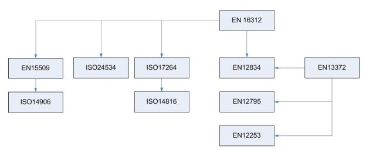
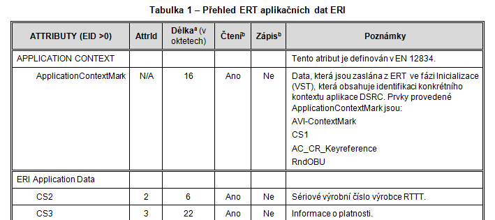
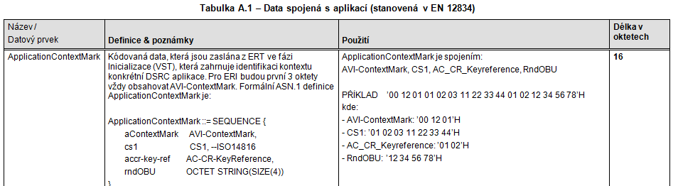

## Úvod

CEN/TC 278 vytvořila soubor norem, které podporují interoperabilitu automatické identifikace vozidel a automatické identifikace zařízení pomocí systémů založených na vyhrazeném spojení krátkého dosahu (DSRC). I když jsou tyto normy nezbytné, **nestačí** k zajištění technické interoperability.

Tato evropská norma stanoví ucelený soubor požadavků na aplikace AVI/AEI, který má sloužit jako společná technická platforma pro interoperabilitu AVI/AEI (kompatibilitu zařízení mezi jeho dodavateli a technickou kompatibilitu mezi jednotlivými AVI/AEI systémy). Definuje aplikační profil interoperability pro AVI/AEI a identifikaci elektronické registrace (ERI) pomocí CEN DSRC.

Aplikační profil interoperability je definován **pomocí požadavků na ověřování shody**. K usnadnění odkazování, zkoušení a vyhledávání jsou tyto požadavky rozděleny na dvě části; požadavky na tag elektronické registrace (ERT) a požadavky na čtecí/zapisovací zařízení ERI (ERR).

Kromě toho norma obsahuje také různé přílohy, které poskytují další podrobné specifikace, stejně jako pozadí, důvody a příklady pro požadavky na ověřování shody. Záměrem je, aby zlepšily čitelnost a porozumění této normě.

Poznámka: Extrakt uvádí vybrané kapitoly popisovaného dokumentu a přejímá původní číslování kapitol.

## Užití

Tato norma je založena na základních normách pro automatickou identifikaci vozidla a zařízení AVI/AEI, jako jsou ISO 14816, ISO 17264 a ISO 24534. Proto tento aplikační profil interoperability **umožňuje dalším implementacím aplikace AVI/AEI použít prvky této normy jako základu pro technickou interoperabilitu**.

Aplikační profil je popsán pomocí konceptu „mezinárodní normalizované profily (ISP)“, který je definován v ISO/IEC TR 10000-1. ISP koncept je speciálně vhodný pro definování specifikací interoperability, kde lze soubor základních norem použít různými způsoby.

Tato norma, mimo jiné:

  - definuje nezbytné a dostatečné DSRC požadavky na podporu technické interoperability;

  - nabízí výběr datových prvků, včetně dat o vozidle;

  - stanoví jasné rozhodnutí pro implementaci zabezpečení;

  - usnadňuje doplňující zkušební specifikace

  - poskytuje dobrou podporu pro veřejné zakázky.

Dle výše zmíněného výčtu je zřejmé že norma je, díky přesné specifikaci potřebných vlastností a parametrů ale také kvůli návodům na vyplnění ICS v dodatcích, vhodná jak **pro zkušební laboratoře** a **výrobce zařízení ERI** tak i pro **státní správu**, která může díky této normě **vypisovat přesnější tendry** na dodání zařízení.

## 1 Předmět normy

Předmět této normy se omezuje na požadavky na:

  - systémy ERT, ERR a jejich DSRC rozhraní;

  - spojení DSRC; na ERI relace přes toto rozhraní DSRC;

  - datové prvky používané ERT a ERR při relaci ERI a

  - mechanismy zabezpečení pro ERT a ERR používané při relaci ERI.

<!-- end list -->

  - Do předmětu této normy **nespadají** smluvní a procesní požadavky na interoperabilitu, postupy shody a zkušební specifikace, použití jiných komunikačních technologií a jiná rozhraní nebo funkce v systémech ERI

## 2 Souvisící normy

Kapitola souvisící normy definuje 7 technických norem. Tři jsou na DSRC, dvě na AVI/AEI a po jedné na EFC a zkoušení.

Tato norma aplikačního profilu vychází z norem na aplikační profil interoperability EFC EN 15509:2007 a DSRC (EN 13372) a poté z norem specifikujících jednotlivá rozhraní (EN ISO 14906:2011 a ISO 17264:2009 a EN 12834). Tato evropská norma souvisí se souborem norem stanovujících „posuzování shody“ pomocí „požadavků na shodu“ pro vrstvu 1, vrstvu 2 a vrstvu 7 CEN DSRC implementace (vrstvy 1 2 a 7 odpovídají modelu ISO OSI).

**Obr. 1** Vztah mezi základními normami ERI a touto normou (viz obr. 3 normy)

## 3 Termíny a definice

V této kapitole je obsaženo 22 termínů, klíčové jsou:

**čtečka/zapisovací zařízení elektronické registrace** _(Electronic Registration Reader / Writer)_ ERR – zařízení používané pro čtení/zápis dat z nebo do „tagu elektronické registrace“ ERT

**tag elektronické registrace** _(Electronic Registration Tag)_ ERT – palubní zařízení ERI, které obsahuje data ERI s relevantním zabezpečením a jedno nebo více rozhraní pro přístup k datům

**ERI relace** _(ERI session)_ – určitý výskyt „Identifikace vozidla“ používající harmonizovaný protokol bezdrátového rozhraní známý jako „profil CEN DSRC“, pomocí určité sady „AVI/AEI atributů“, získaných „základními službami (komunikace)“ a „mechanismy zabezpečení“ stanovených v příloze B této normy

Další termíny a zkratky z oboru ITS jsou obsaženy ve slovníku ITS terminology.

## 4 Symboly a zkratky

V této kapitole je obsaženo 27 zkratek, klíčové jsou:

**IAP** aplikační profil interoperability _(Interoperable Application Profile)_

**ICS** prohlášení o shodě implementace _(Implementation Conformance Statement)_

Další termíny a zkratky z oboru ITS jsou obsaženy ve slovníku ITS terminology (www.ITSterminology.org).

## 5 Shoda

Tato kapitola obsahuje závazné požadavky na shodu:

  - ERT (čl. 5.1) pomocí odkazů na požadavky na OBU ustanovené v základních normách a

  - ERR (čl. 5.2) pomocí požadavků na RSE v EN 15509.

Například požadavky na DSRC jsou vyjádřeny jako fráze odkazující na jiné normy:

  - „_ERT musí být ve shodě s EN 15509:2007, 5.1.2_“.

Tímto způsobem jsou postupně zmíněny požadavky na:

  - DSRC

  - DSRC L7 a ERI funkce

  - relaci ERI

Požadavky na data a zabezpečení jsou pojaty různě jak u ERT tak u ERR. Jedná se o tabulky s výčty datových prvků, které musí být implementovány, zároveň se stanovením jejich hodnot.

Z požadavků uvedených v textu lze například zmínit:

  - „_ERT/ERR musí být schopno vypočítat autentikátor, ERR musí provést derivaci klíče pro autentizační klíče podle postupů stanovených v EN 15509_“, a podobně.

Pro podrobné vysvětlení některých požadavků je odkazováno do příloh této normy.

**Tab. 1** Ukázka tabulky přehled ERI aplikačních dat s požadovanými atributy ERI, které musí být implementovány v OBU (viz Tabulka 1 normy)

**Přílohy**

Tato norma obsahuje 3 normativní a 3 informativní přílohy

  - Příloha A (normativní) Datová specifikace

  - Příloha B (normativní) Formulář ICS

  - Příloha C (normativní) Taxonomie IAP a číslování AVI/AEI

  - Příloha D (informativní) Příklady výpočtu zabezpečení

  - Příloha E (informativní) Opatření pro zabezpečení

  - Příloha F (informativní) Použití této evropské normy pro jiné transakce, založené na DSRC

## Příloha A (normativní) Datová specifikace

Specifikace a použití datových prvků je stanovena v normách EN ISO 17264:2009, EN ISO 14816 a EN 12834. Tato příloha obsahuje atributy ERI a požadavky na data ERI související se zabezpečením:

  - **které omezují** možnost volby (implementace) nebo jsou

  - **konkrétnější** a tedy více omezené ve svém předmětu, než jsou ty v základních normách.

Atributy a požadavky na datové prvky jsou zde uvedeny ve formě tabulek. Důležité je i to že jsou zde k atributům stanoveno použití.

**Tab. 2** Ukázka tabulky s požadovanými atributy ERI, společně s jejich konkretizací (viz Tabulky A.1 normy)

## Příloha B (normativní) Formulář ICS

Tato příloha uvádí šablony formuláře ICS (prohlášení o shodě s implementací) jež vyplňují dodavatelé zařízení.

Konkrétní formulář ICS, tak jak bude vyplněn dodavatelem, **musí být technicky** ekvivalentní s textem formuláře ICS uvedeným v této příloze. Musí zachovat číslování, názvy a pořadí položek formulářů.

Dále tato příloha uvádí

  - B.2 Návod na vyplnění formuláře ICS podrobný návod krok za krokem jak vyplnit formulář (jak je formulář organizován) s jakými daty a jakými zkratkami.

  - B.3 Pokyny pro dokončení vyplnění formuláře ICS stručné shrnutí co navíc musí ICS ještě obsahovat

  - B.4 ICS formulář pro ERT vlastní formulář ICS skládající se z tabulek pro vyplnění

  - B.5 Formulář ICS pro ERR vlastní formulář ICS skládající se z tabulek pro vyplnění

## Příloha C (normativní) Taxonomie IAP a číslování AVI/AEI

Tato příloha uvádí základní taxonomii IAP a číslování AVI/AEI a může být použita pro odkazování (reference), například při stanovení shody s touto evropskou normou nebo při přípravě budoucích vydání této evropské normy nebo norem IAP.

Jsou zde uvedeny zásady tvorby IAP pro případ následných vydání nebo jiných norem. Předmět IAP je definován v kapitole 1. IAP je ucelenou sadou **voleb** a **hodnot parametrů** vybraných z těchto základních norem:

  - EN ISO 14906:2011 – Definice aplikačního rozhraní EFC pro DSRC (to zahrnuje nepřímý odkaz na EN ISO 14816 – Číslování a datové struktury);

  - EN 12834 – DSRC aplikační vrstva (L7);

  - EN 13372 – DSRC Profily (to zahrnuje nepřímý odkaz na normy DSRC L1, L2 a L7: EN 12253, EN 12795 a EN 12834).

**C.3.3 Příklady číslování a odkazování**

PŘÍKLAD 1 ERR ve shodě podle EN XXXXX, bez podpory počítadla relací „SessionCounter“ je označeno: „ERR ve shodě s XXXXX IAP 1.0 úroveň 0“ (analogicky, s podporou počítadla relací SessionCounter, je uváděno jako úroveň 1).

## Příloha D (informativní) Příklady výpočtu zabezpečení

Tato příloha ilustruje kryptografické mechanismy popsané v kapitole 5 pomocí několika výpočetních příkladů:

  - výpočet autentikátoru atributu,

  - výpočet pověření k přístupu a

  - odvození klíče.

## Příloha E (informativní) Opatření pro zabezpečení

Tato příloha uvádí pozadí a důvody pro znaky zabezpečení uvedené v této evropské normě. Témata zabezpečení jsou zde analyzována s ohledem na:

  - integritu dat s ohledem na data uložená v ERT;

  - autentizaci původu dat s ohledem na citlivá data ve všech přenášených datech zpoplatnění;

  - ochrana přístupu k datům s ohledem na data uložená v ERT.

## Příloha F (informativní) Použití této evropské normy pro jiné transakce, založené na DSRC

Tato evropská norma stanoví aplikační profil pro interoperabilní ERI transakce, ale nestanoví, pro které účely lze tyto transakce použít. Tato příloha uvádí informace, jak lze datové atributy a transakce použít pro specifické účely. Např.:

  - CS2 lze použít pro identifikaci ERT, které jsou na černé listině.

  - CS3 lze použít pro omezení platnosti ERT.

  - CS4 lze použít pro identifikaci vozidla
