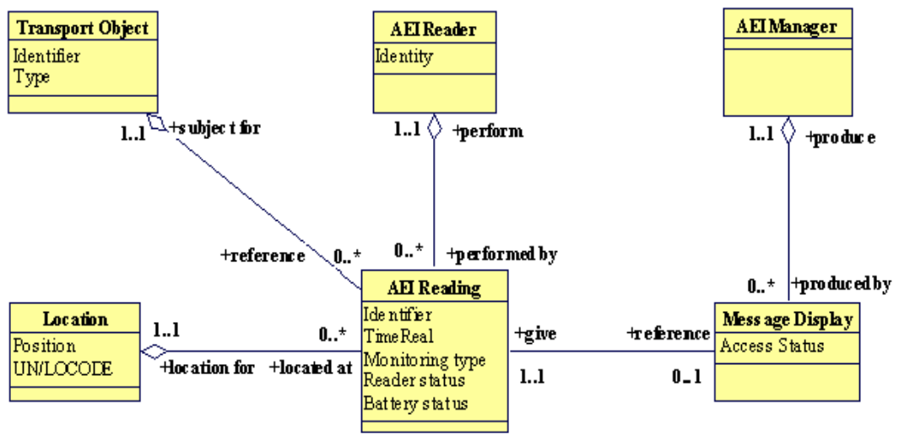
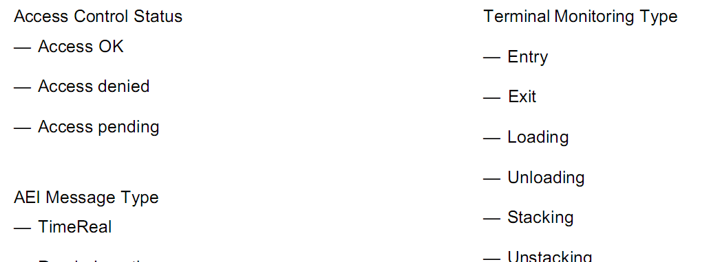
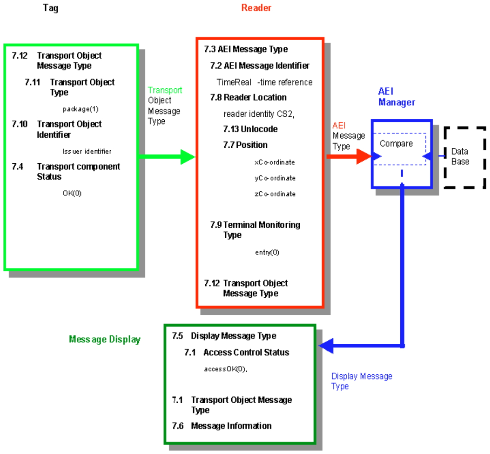

## Úvod

Tato norma je součástí souboru norem zaměřené na automatickou identifikaci vozidla, nákladu či položky zařízení pro účely telematických aplikací. Stanovuje číslování a strukturu dat v systému automatické identifikace nákladu a zařízení v multimodální/intermodální přepravě za použití bezdrátového rozhraní.

Poznámka: Extrakt uvádí vybrané kapitoly popisovaného dokumentu a přejímá původní číslování kapitol.

## Užití

Tato norma je důležitým rozšířením normy ISO 14816, která je nezbytná na celostátní úrovni pro přidělování identifikátoru vydavatele a stanovuje postupy jeho přidělování.

**Pro orgány státní správy** tato norma pouze odkazuje na svého předchůdce ISO 14816, kde jsou stanoveny postupy pro přidělování jednoznačných identifikátorů žadatelům, způsob jejich spravování a stanovena práva a povinnosti NRA/I vůči žadatelům a vůči CRA, který má sídlo v Holandsku.

**Pro výrobce zařízení a dodavatele telematických systémů** tato norma obsahuje nové datové struktury. Zejména se jedná o strukturu CS9 a jednotlivých složek systému AVI/AEI: Manažer AEI, Čtečka, Zobrazovací jednotka a přepravovaný objekt resp. jeho TAG. Struktury CS1 až CS8 jsou obsahem předchozí normy ISO 14816.

## 1 Předmět normy

Norma rozšiřuje číslování a datové struktury pro jednoznačnou identifikaci, stanovené v normě ISO 14816, o další struktury. Tato norma se věnuje jednotkám AVI/AEI. Krabice, malé nádoby a přepravované zboží jsou mimo rámec této normy. Obecně platí, že to, co je uvnitř nákladního prostoru, řeší skupina ISO/IEC JTC1 SC31, co je vně, to zase skupina CEN TC278 WG12 společně s ISO TC204 WG4.

Tato norma stanovuje 10 nových datových typů pro multimodální/intermodální systém AVI/AEI, jedním z nových datových typů je kódovací struktura CS9 určená pro lehké kontejnery. Další datové typy popisují nezbytné datové struktury v jednotlivých složkách systému AVI/AEI (Manažer AEI, Čtečka, Displej a přepravovaný objekt resp. jeho TAG).

Kromě uvedených struktur obsahuje norma jeden normativní a dva informativní dodatky.

## 2 Souvisící normy

Tato norma vychází z normy ISO 14816, která popisuje číslování a strukturu dat v modálním systému automatické identifikace AVI/AEI. Pro samotnou práci s touto normou je vhodné se seznámit s normami ISO/IEC 8824, ISO/IEC 8825-1, ISO/IEC 8825-2 a ISO/IEC 8825-3, případně s dalšími publikovanými pracemi na téma ASN.1, a to již před čtením hlavní části této mezinárodní normy.

## 3 Termíny a definice

**3.1 manažer AEI** _(AEI manager)_ součást, která přijímá data z čteček AEI a porovnává je s informacemi v databázi. Vygeneruje a přenese do zobrazovací jednotky zprávu "vše v pořádku" nebo "ve zprávě došlo k chybě".

**3.2 čtečka** _(AEI reader)_ kompletní zařízení, i když se skládá z víc než jedné součásti požadované k obousměrné komunikaci, přijmutí a interpretaci dat v TAGu za účelem zjištění identifikace.

**3.5 intermodální přeprava** _(intermodal transport)_ pohyb zboží v jedné nebo více přepravních jednotkách nebo vozidle, které postupně používá různé způsoby dopravy bez samotné manipulace se zbožím při procesu změny módu přepravy.

3.7 **displej** _(message display)_ přijímá data z manažera AEI, a zobrazuje je prostřednictvím proměnlivých symbolů řidiči.

**3.8 TAG** _(TAG)_ zařízení určené k identifikaci, zabudované do jednotky, vozidla nebo položky, které obsahuje jednoznačný identifikátor a v případě potřeby další doplňková data. Pro zvláštní účely může být TAG nainstalovaný na pevném místě a pohyblivá bude čtečka.

Další termíny a zkratky z oboru ITS jsou obsaženy ve slovníku ITS terminology (www.ITSterminology.org).

## Kapitola 5 Složky AVI/AEI v intermodální přepravě zboží

Tato kapitola uvádí schéma (viz obrázek 1) jednotlivých složek systému AVI/AEI při intermodální/multimodální přepravě nákladu. Tyto složky jsou: Manažer AEI, Čtečka, Displej a přepravovaný objekt resp. jeho TAG.



**Obr. 1** Schéma složek systému AVI/AEI při intermodální/multimodální přepravě nákladu

## Kapitola 6 Přehled datových definic

Kapitola předkládá přehled datových definic stanovených v této normě. Je zde uvedeno 10 datových definic, mezi jinými například: „Position“ (pozice), skládající se ze 3 souřadnic, Transport Component Status (stav složky AVI/AEI) se stavy – v pořádku, málo energie v baterii a chybový stav.

Příklad přehledu datových definic je na obrázku 2.



**Obr. 2** Příklad přehledu datových definic

## Kapitola 7 Datové definice

Zde je uvedeno 10 nových definic datových typů, každá definice se skládá ze slovního popisu významu, účelu a použití datového typu a jeho definice v kódu ASN.1. Například v popisu definice datového typu „Transport Component Status“ je uvedeno, že se jedná o kód indikující provozní stav složek AVI/AEI (čtečky, displeje a TAGu) stanovených v této normě.

### 7.3 Kódovací struktura CS9 pro „lehký kontejner“

Tento článek popisuje strukturu CS9, obsahující číslování lehkých kontejnerů (swap bodies) dle EN 13044. Tyto kontejnery se liší od standardních ISO kontejnerů svojí konstrukcí a také tím, že se nedají stohovat. Struktura se skládá z datových položek obsahujících kód vlastníka, identifikátor třídy nákladu, sériové číslo, kontrolní součet, délku, výšku a šířku kontejneru, kód typu, maximální plně zatíženou váhu a váhu prázdného kontejneru.

Příklad definice kódové struktury CS9 v ASN.1 je ve výpisu 1.

```asn1
CS9 ::= SwapBodyStructure ::= SEQUENCE {
        ownerCode               BIT STRING(SIZE(15)),   -- EN 13044
        equipCategoryId         BIT STRING(SIZE(3)),    -- EN 13044
        serialNumber            INTEGER(0 .. 1000000),  -- EN 13044
        checkDigit              INTEGER(0 .. 10),       -- EN 13044
        length                  INTEGER(1 .. 2048),     -- cm
        height                  INTEGER(1 .. 512),      -- cm
        width                   INTEGER(200 .. 327),    -- cm (7bits)
        containerTypeCode       INTEGER(0 .. 63),       -- EN 13044
        maximumGrossWeight      INTEGER(1 .. 512),      -- 100 kg
        tareWeight              INTEGER(0 .. 63)        -- 100 kg
}
```

**Výpis 1** Příklad definice kódové struktury CS9 v ASN.1

## Příloha A (normativní) Modul ASN.1 pro číslování a datové struktury v intermodální přepravě

Tato příloha uvádí souhrnnou definici všech stanovených datových typů (tzv. modul), aby je bylo možné snadno importovat do dalších aplikací a norem dopravní telematiky.

Název a identifikační číslo modulu ASN.1 zavedeného v popisovaném dokumentu jsou ve výpisu 2.

```asn1
AVIAEIIntermodalNumberingAndDataStructures
{iso(1) standard(0) iso17262(17262) rev1 (1)}
```

**Výpis 2** Název a identifikační číslo modulu ASN.1 zavedeného v popisovaném dokumentu

## Příloha B (informativní) Příklady aplikací AEI v intermodální přepravě

Tato příloha obsahuje dva schematické příklady intermodálních aplikací AVI/AEI. První schéma uvádí hypotetickou aplikaci, zatímco druhý příklad je založen na architektuře existujícího systému INTERPORT.



**Obr. 3** Příklad scénáře umístění dat v jednotlivých složkách systému AVI/AEI (obr. B.1 popisovaného dokumentu)

## Příloha C (informativní) Příklady užití pro číslování a datové struktury v intermodální přepravě

Poskytuje stručný popis co je ASN.1. Rekapituluje datové typy z ASN.1 a informuje čtenáře o tom, co je modul, jaká je jeho identifikace a jak lze do modulu včlenit definice z jiných norem.

Ukázka modulu definovaného v ASN.1 je ve výpisu 3.

```asn1
Example1Module DEFINITIONS ::=  BEGIN
IMPORTS CS2 FROM ENV ISO 14816:2000; --AVI/AEI Numbering and Data Structures
value CS2 ::= { '8AE'H  'AB4130'H}
END
```

**Výpis 3** Ukázka modulu definovaného v ASN.1

V další části uvádí dva příklady zakódování konkrétních instancí nově stanovených datových typů v strukturované i binární podobě pomocí PER či BER pravidel jazyka ASN.1.

Ukázka zakódování modulu definovaného v ASN.1 pomocí PER je v tabulce 1.

**Tab. 1** Ukázka zakódování modulu definovaného v ASN.1 pomocí PER (CodingScheme)

| Element | Value | Binary representation |
|---|---|---|
| ManufacturerId | '08AE'H | 0000100010101110 |
| Service Number | '00AB4130'H | 00000000101010110100000100110000 |
