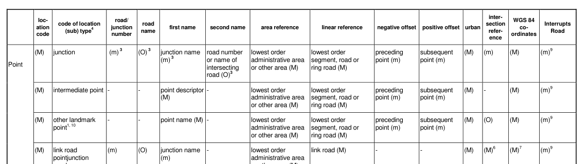
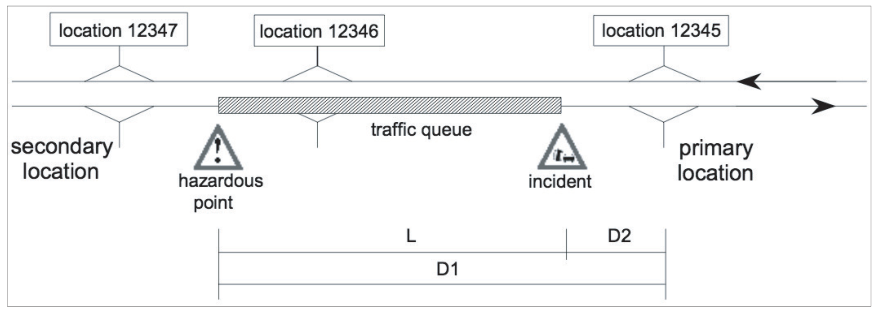

## Úvod

Soubor norem EN ISO 14819 stanovuje formát a protokol RDS-TMC pro nepřetržité poskytování strukturovaných dopravních informací do navigačních přístrojů a pro jejich interpretaci v jazyce uživatele. Zprávy RDS-TMC nepřenášejí text, ale číselné kódy z předem dohodnutých číselníků – zvlášť pro popis události a zvlášť pro popis polohy – které musí být shodné na obou koncích přenosového řetězce.

Popisovaný dokument stanovuje druhý z obou číselníků, lokační tabulku. Určuje, která místa na pozemních komunikacích lze ve zprávě vůbec adresovat, jak se popisují a jakým číslem se ve zprávě přenášejí.

Soubor norem EN ISO 14819 se skládá ze 3 částí. Část 1 stanovuje strukturu zprávy, způsob přenosu a šifrování obsahu, část 2 stanovuje kódy událostí a doplňkových informací a popisovaná část 3 stanovuje způsob odkazování na polohu. Protokol ALERT-C je podrobněji popsán v extraktu části 1.

Poznámka: Extrakt uvádí vybrané kapitoly popisovaného dokumentu a přejímá původní číslování kapitol.

## Užití

Popisovaný dokument použije zejména systémový analytik a programátor při tvorbě aplikací, které kódují polohu dopravní informace protokolem ALERT-C, zobrazují ji na mapě a dekódují ji v navigačních přístrojích. Datový analytik jej použije při analýze a vizualizaci poloh lokalizovaných prostřednictvím lokační tabulky.

Tvůrce lokační tabulky se jím řídí při rozhodování, které části pozemní komunikace popsat a jakým způsobem, a při exportu lokační tabulky do výměnného formátu.

## 1 Předmět normy

Tato kapitola (rozsah 1 odstavec) stanovuje předmět popisovaného dokumentu: pravidla odkazování na polohu pro zprávy kanálu dopravních zpráv (TMC), především pro zprávy RDS-TMC podle protokolu ALERT-C. Pravidla jsou vytvořena modulárně tak, aby je bylo možné v budoucnu rozšířit i na jiné systémy dopravních zpráv, například na výměnné protokoly DATEX a DATEX II.

Popisovaný dokument tedy stanovuje strukturu a význam lokační tabulky pro dopravní informační centra i pro koncová zařízení. Ke kódování poloh sám nestačí: pokrývá základy, kdežto podrobnou metodiku kódování a certifikaci lokačních tabulek vede TISA a distribuuje ji svým členům. U části položek výměnného formátu stanovuje pouze formální stránku – pořadí, název, velikost a typ – nikoli jejich význam a použití.

## 2 Souvisící normy

Popisovaný dokument uvádí 7 souvisících norem a 2 neveřejné specifikace TISA: EN ISO 14819-1 (kódovací protokol a struktura zprávy), EN ISO 14819-2 (kódy událostí), EN ISO 14819-6 (šifrování a podmíněný přístup), IEC 62106 (soubor) Specifikace rádiového datového systému (RDS) pro rozhlasové vysílání VKV/FM v kmitočtovém pásmu od 64,0 MHz do 108,0 MHz, ISO 14825 Geografické datové soubory (GDF) pro popis silniční sítě, ISO/IEC 8859-15 a ISO/IEC 10646 (kódování znaků), TISA SP13011 (zpětná kompatibilita lokačních tabulek) a TISA SP17005 (pokyny pro slučování dat TMC).

## 3 Symboly a zkratky

Tato kapitola (rozsah 1 strana) obsahuje 20 zkratek použitých v popisovaném dokumentu, z nichž nejdůležitější jsou následující:

**ALERT-C** doporučení a poloha problému v evropském silničním provozu, verze C (_Advice and problem Location for European Road Traffic, Version C_)

**LC** kód polohy (_Location Code_)

**LTCC** kód země lokační tabulky (_Location Table Country Code_)

**LTN** číslo lokační tabulky (_Location Table Number_)

**GDF** geografické datové soubory (_Geographic Data Files_)

**TISA** Asociace pro dopravní informační služby (_Traveller Information Services Association_)

**WGS 84** Světový geodetický systém 1984 (_World Geodetic System 1984_)

Popisovaný dokument neobsahuje kapitolu termínů a definic. Pro čtení extraktu jsou podstatné tyto termíny:

**lokační tabulka** (_location table_) – tabulka s identifikátory a polohovým popisem předem dohodnutých míst, kterou používá daná služba TMC

**lokace** (_location_) – jeden záznam lokační tabulky, tedy popis jednoho objektu reálného světa, na který zpráva odkazuje

**kód polohy** (_location code_) – číslo v rozsahu 1 až 63 487, kterým se lokace ve zprávě adresuje

**primární lokace** (_primary location_) – místo, kde se nachází zdroj problému, například místo nehody

**sekundární lokace** (_secondary location_) – místo, kde problém končí, například čelo kolony

**směr** (_direction_) – kladný nebo záporný směr silnice; při kladném směru roste kolona v kladném směru silnice, ovlivněn je provoz jedoucí v záporném směru a počet kroků daný rozsahem se odkrokuje sloupcem kladného ofsetu

Další termíny a zkratky z oboru ITS jsou obsaženy ve slovníku ITS terminology (www.ITSterminology.org).

## 4 Kódování poloh

Tato kapitola (rozsah 15 stran) obsahuje 7 článků: 4.1 Všeobecně, 4.2 Lokační tabulky, 4.3 Kategorie, typy a subtypy poloh TMC, 4.4 Obsah lokační tabulky, 4.5 Podrobné odkazování na křižovatky, 4.6 Podrobné určení polohy situací a 4.7 Jednosměrné a obousměrné polohy.

Článek 4.2 stanovuje koncept a tvorbu lokačních tabulek. Kód polohy nabývá hodnot 1 až 63 487, tabulka pojme nejvýše 65 536 kódů a zbývající rozsahy jsou vyhrazeny pro zvláštní účely a pro mechanismus INTER-ROAD. Článek dále stanovuje verzování lokačních tabulek, jejich výměnu (odkazem na přílohu C), hierarchickou strukturu tří kategorií položek – oblast, linie a bod – a propojení bodů pomocí kladných a záporných ofsetů. Lokační tabulku jednoznačně určuje trojice LTN (1 až 63), LTCC (1 až F) a rozšířený kód země LTECC (dvě šestnáctkové číslice).

Článek 4.3 stanovuje kód položky složený z písmene kategorie, čísla typu, tečky a čísla subtypu: P1.8 je kruhový objezd (P = bod, P1 = křižovatka, 8 = kruhový objezd), A3.0 je země. Není-li subtyp definován, použije se 0.

Článek 4.4 (rozsah 6 stran) stanovuje obsah lokační tabulky. Záznam obsahuje kód polohy, kód kategorie, typu a subtypu, číslo komunikace nebo křižovatky, název komunikace, první a druhý název, odkaz na oblast, odkaz na liniový úsek, záporný a kladný ofset, městský příznak, odkaz na polohy na křižovatce a souřadnice WGS 84. Pro každou kategorii, typ a některé subtypy stanovuje, zda je položka povinná (M), povinná tam, kde existuje (m), nebo nepovinná (O), a co má obsahovat (viz tabulka 1).

**Tab. 1** Část tabulky Obsah lokační tabulky pro ALERT-C, kategorie bod (tab. 1 popisovaného dokumentu)

Jednotlivé položky stanovují pod-články 4.4.3 až 4.4.10 samostatně: hierarchické odkazy na oblast a na liniový úsek, ofsety, městský příznak, odkaz na polohy na křižovatce – u tří a více silnic se odkazuje kruhově proti směru hodinových ručiček, takže každý kód odkazuje výslovně jen na jeden další – souřadnice WGS 84 a atribut InterruptsRoad. Tabulku uzavírají 2 strany vysvětlivek.

Článek 4.5 stanovuje podrobné odkazování na křižovatky a rozlišuje běžné křižovatky, složité křižovatky s rozlišenými jízdními pruhy, nadjezdy, mosty a objezdy, a podrobné kódování spojovacích silnic.

Článek 4.6 rozlišuje tři úrovně určení polohy: běžné odkazování na předdefinované křižovatky a významné silniční objekty (například mosty a tunely), podrobné odkazování, které umožňuje definovat mezilehlé body mezi křižovatkami údajem kilometráže, a přesné odkazování, které stanovuje vzdálenost v metrech od předdefinovaných referenčních bodů.

Článek 4.7 stanovuje, že polohy na obousměrných komunikacích se kódují jednou pro oba směry; odděleně pro každý směr se kódují jen vozovky natolik fyzicky oddělené, že je řidič vnímá jako dvě samostatné silnice. Pro polohy s jedním vjezdem nebo výjezdem a pro polohy na jedné straně komunikace stanovuje šest doplňkových atributů – In +, Out +, In −, Out − pro možnost najet a vyjet v daném směru a Present +, Present − pro přítomnost polohy v daném směru – a umožňuje polohu propojit s předdefinovanou objízdnou trasou atributy DiversPos a DiversionNeg.

## Příloha A (normativní) Kategorie, typy a subtypy poloh TMC

Příloha o rozsahu 12 stran stanovuje všechny kategorie, typy a subtypy poloh s popisem, příkladem a případnou poznámkou, a to od obecných ke konkrétním. Stanovuje 23 typů a subtypů kategorie oblast, 16 kategorie linie a 94 kategorie bod (viz tabulka 2).

**Tab. 2** Příklady položek stanovených přílohou A (výběr z tab. A.1 až A.3 popisovaného dokumentu)

| **Kód** | **Název**         | **Popis**                                                                                                                  |
| ------- | ----------------- | -------------------------------------------------------------------------------------------------------------------------- |
| A6.7    | Parkoviště P+R    | Vyhrazený prostor, kde mohou motoristé zaparkovat a pokračovat veřejnou dopravou                                           |
| L7.0    | Spojovací silnice | Jednosměrná silnice spojující dvě různé dálnice v místě jejich křížení; příklad: silnice spojující britské dálnice M5 a M4 |
| P1.8    | Kruhový objezd    | Úrovňová okružní křižovatka, kde provoz objíždí středový ostrov                                                            |
| P1.12   | Křižovatka typu T | Úrovňová křižovatka, kde se jedna silnice napojuje na průjezdní silnici                                                    |

## Příloha B (informativní) Identifikace lokačních tabulek

Příloha o rozsahu 3 strany stanovuje pro každou zemi přidělený kód země lokační tabulky (LTCC), rozšířený kód země (LTECC) a povolený rozsah čísel lokační tabulky (LTN). Tyto tři hodnoty spolu s kódem polohy určují polohu jednoznačně celosvětově. Přidělení spravuje TISA; příloha je informativní, protože se seznam průběžně mění (viz tabulka 3).

**Tab. 3** Identifikátory lokačních tabulek pro Česko a sousední země (příloha B popisovaného dokumentu)

| **Země**  | **LTCC** | **LTECC** | **LTN**  |
| --------- | -------- | --------- | -------- |
| Česko     | 2        | E2        | 25 až 28 |
| Německo   | 1 a D    | E0        | 01 až 08 |
| Polsko    | 3        | E2        | 05 až 08 |
| Rakousko  | A        | E0        | 01 až 08 |
| Slovensko | 5        | E2        | 51 až 54 |

## Příloha C (normativní) Podrobnosti použití lokačních tabulek

Příloha o rozsahu 38 stran obsahuje 3 články: C.1 Metody odkazování na ovlivněné úseky komunikací, C.2 Metody odkazování na specifické objekty a C.3 Metody identifikace a výměny lokačních tabulek.

Článek C.1 (rozsah 8 stran) stanovuje 11 metod odkazování na polohu, každou obrázkem a popisem funkce: předdefinovaná primární lokace a rozsah, předdefinovaná primární a sekundární lokace, milníky s rozsahem, milníky se sekundární lokací, primární a sekundární lokace s využitím předdefinované lokace, rozsahu a vzdáleností, totéž se dvěma předdefinovanými lokacemi a vzdálenostmi, popis rozsahu události v ALERT-C, souřadnice primární a sekundární lokace, proprietární reference (například GDF), textové pojmenování lokace a přesné odkazování na polohu. Dvě z nich jsou popsány natolik podrobně, že umožňují implementaci: popis rozsahu události v ALERT-C (článek C.1.8) a přesné odkazování na polohu (článek C.1.12).

Pro popis rozsahu události v ALERT-C uvádí článek C.1.8 ukázku lokační tabulky a obrázek situace s výsledným odkazem na polohu, tedy s primární lokací, rozsahem a směrem. Přesnou polohu stanovuje článek C.1.12 vzdáleností obou míst ohraničujících událost od primární lokace (viz obrázek 1). Klíčová je znalost přesné polohy primární lokace, která bývá generalizovaná (například centroidem), proto článek stanovuje postup odvození referenčních bodů R+ a R− i pro složitější případy.

**Obr. 1** Princip přesného odkazování na polohu pomocí ALERT-C (obr. C.9 popisovaného dokumentu)

Článek C.2 stanovuje odkazování a kódování specifických poloh, zejména tzv. izolovaných poloh, které nejsou navázány na silniční síť obsaženou v lokační tabulce. U parkovišť (článek C.2.1) stanovuje, kdy jde o izolovanou polohu a kdy o součást zřetězených poloh podél linie komunikace; totéž stanovuje pro letiště, přístavy, tunely a mosty (článek C.2.2). Pro izolované polohy jsou určeny typy P5.x (parkovací lokalita) a P6.x (izolovaný bod zájmu). Článek C.2.3 stanovuje kódování paralelních silnic a přerušovaných silničních tahů, vždy popisem metody a příkladem se schématem situace a s reprezentací zakódování v lokační tabulce.

Článek C.3 (rozsah 23 stran a desítky tabulek) stanovuje přidělování verzí lokační tabulce a výměnný formát pro její záznam. Formát tvoří 25 datových souborů .DAT a soubor README, provázaných sdílenými klíči – mimo jiné COUNTRIES, LOCATIONDATASETS, LOCATIONCODES, CLASSES, TYPES, SUBTYPES, NAMES, ROADS, SEGMENTS, SOFFSETS, POINTS, POFFSETS, INTERSECTIONS a JUNCTIONS. Popisovaný dokument stanovuje i pořadí jejich importu do databáze, aby odkazy mezi soubory zůstaly konzistentní.

Obsah každého souboru stanovuje samostatný pod-článek tabulkou a popisem, případně příkladem. Například tabulka C.27 stanovuje položky souboru POFFSETS.DAT, který popisuje podélné vazby mezi položkami lokační tabulky (viz tabulka 4).

**Tab. 4** Položky souboru POFFSETS.DAT (tab. C.27 popisovaného dokumentu)

| Sort | Logical name | Code | Type | Optional |
|---|---|---|---|---|
| 1st | Country ID | CID | NUMERIC(5) | No |
| 2nd | Table code | TABCD | NUMERIC(2) | No |
| 3rd | Location code | LCD | NUMERIC(5) | No |
| 4th | Negative offset | NEG\_OFF\_LCD | NUMERIC(5) | Yes |
| 5th | Positive offset | POS\_OFF\_LCD | NUMERIC(5) | Yes |

Článek C.3.2.6 uzavírá přílohu přehledem všech souborů a všech atributů; u každého atributu stanovuje název pole, odkaz na jeho definici v popisovaném dokumentu a výskyt v jednotlivých souborech jako primární klíč, cizí klíč nebo hodnotu.

## Příloha D (informativní) Ostatní informace

Příloha o rozsahu 3 strany popisuje další přístupy k odkazování na polohu v dopravních zprávách, mimo jiné předdefinované lokace a odkazování pomocí prvků GDF podle ISO 14825. Tyto metody nejsou v ALERT-C všechny použitelné: některé využívá DATEX, jiné jsou pouze teoretickou možností.
