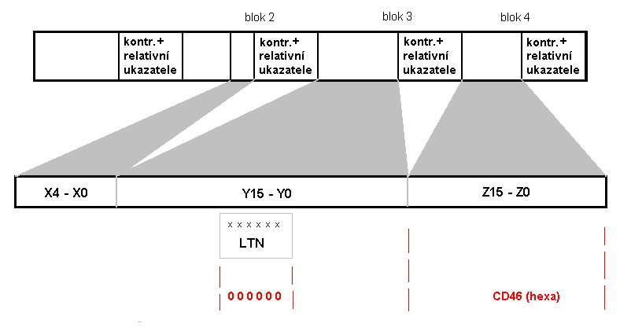

## Úvod

Dopravní a cestovní informace mohou být šířeny pomocí více prostředků a služeb (pomocí statických terminálů, přenosných terminálů, vybavení vozidla). Pro interoperabilitu je potřeba definovat předávaná data včetně formátů jejich předávání tak, aby byla umožněna spolupráce s více poskytovateli dopravních dat i při použití rozdílných technických prostředků.

ČSN CEN ISO TS 14819 má několik částí, a to část 1 obsahující všeobecný popis, část 2 definující kódování obsahu zprávy a tato část 3, která řeší kódování polohy vozidla, předmětné události nebo směru komunikace. Část 6 se zaobírá metodou, jak lze část informací uvolnit pouze pro skupinu platících či jinak oprávněných uživatelů.

Podmíněným přístupem k datům se zabývá i část 4 (protokol Alert +), ale část 6 ho vyřešila mnohem sofistikovaněji. To, že se placený přístup v současné době nepoužívá, je spíše obchodní otázka. Část 5 popisuje lokalizační tabulky pro protokol Alert +. Okolo částí 4 a 5 se v současné době nevyvíjí žádná aktivita, proto nebylo u těchto částí změněno označení a jsou stále značeny jako ENV 12313-4 a ENV 12313-5.

Předem stanovená kritéria pro volbu vhodného šifrovacího postupu byla poměrně tvrdá, viz:

  - Žádné nebo minimální nároky pro režijní kapacity potřebné k dekódování (i z tohoto důvodu bylo zvoleno 16 bitové šifrování, bezpečnější metody by příliš zvyšovaly požadavky na systém).

  - Žádné změny HW nutné pro zavedení této metody.

  - Musí být v souladu se stávajícími metodami a postupy.

  - Použití obchodních modelů zaměřených na poskytování plnohodnotných služeb po celou dobu používání zařízení – „lifetime“ i časově ohraničených – „term“ musí umožňovat u terminálu aplikaci modelu předplatného (uživatel si předplatí určitou dobu).

Snadná dostupnost pro poskytovatele služeb a výrobce koncových zařízení.

Poznámka: Extrakt uvádí vybrané kapitoly popisovaného dokumentu a přejímá původní číslování kapitol.

## Užití

Tento materiál ukazuje metodu řešení výše popsané úlohy, tj. zavedení podmíněného přístupu k informacím RDS-TMC při dodržení uvedených kritérií. Šifruje přitom pouze část zprávy – lokalizační údaje – takže informace o funkci RDS-TMC systému je indikována i bez rozšifrování.

## 2 Souvisící normy

V této kapitole jsou uvedena odvolání na následující normy:

  - IEC EN 62106:2000 Specifikace systému RDS pro VHF/FM zvukové vysílání v rozsahu od 87,5 MHz do 108,0 MHz

  - EN ISO 14819-1 Dopravní a cestovní informace (TTI), TTI vzkazy pomocí digitálního přenosu dopravních dat, část 1: Kódovací protokol pro kanál RDS –TMC s použitím ALERT-C\].

  - EN ISO 14819-2 Dopravní a cestovní informace (TTI), kódy událostí a informací pro RDS-TMC, Část 2: Události a informace kódované pro kanál RDS – TMC

  - EN ISO 14819-3 Dopravní a cestovní informace (TTI), TTI vzkazy pomocí digitálního přenosu dopravních dat, část 3: Lokální reference pro kanál RDS – TMC

## 3 Symboly a zkratky

V této kapitole je uvedeno 15 zkratek použitých termínů: **ACP**, AID, CC, **ENCID**, LTN, **LTNBE**, ODA, ON, PI, RDS, rfu, SID, **SVK**, TMC, UTC. Zkratky typické pro tuto část jsou vyznačeny tučným písmem.

Další termíny a zkratky z oboru ITS jsou obsaženy ve slovníku ITS terminology.

## 5 Termíny a definice

V páté kapitole jsou v článku 5.1 uvedeny definice pojmů používaných v problematice RDS – TMC, pojmy typické pro tuto část (tj. část zabývající se kódováním dopravních informací) jsou popsány v článku 5.2.

Další termíny a zkratky z oboru ITS jsou obsaženy ve slovníku ITS terminology (www.ITSterminology.org).

## 6 Popis aplikace

Po úvodu, který vysvětluje okolnosti vzniku této normy a zkratky použité v textu, je popsáno umístění identifikátoru zakódované zprávy v paketech RDS typů 3A a hlavně 8A (použití těchto paketů je uvedeno v EN ISO 14819-1).

To, že zpráva, přenášená v paketu typu 8A je kódovaná, indikuje následující skladba paketu 3A.

**Obr. 1** Paket RDS – TMC typu 3A, indikující, že data jsou kódována

Pakety a bitové operace pro kódování a dekódování jsou velmi podrobně popsány na nízké (bitové) úrovni. Údaje pro lokalizační tabulku (16 bitů ve zprávě typu 8A) jsou jednoznačně kódovány pomocí dvou šifrovacích údajů, kterými jsou:

  - **servisní klíč** (SVK, poskytovatel jej ke zprávě nepřipojuje) a

  - **identifikátor kódu** ( ENCID, slouží k zakódování v určený den, připojen ke každé zprávě).

Před použitím je nutno každý terminál pro příjem zakódovaných dat aktivovat pomocí PIN kódu. V tomto PIN kódu je zároveň ukryt druh služeb, který tento PIN umožňuje (přístup k dekódovaným datům po určitou dobu, tzn. "dobu života", která je individuálně nastavitelná).

Doporučuje se změnit kódovací parametry jednou za 24 hodin.

## 7 Principy šifrování a metody podmíněného přístupu

Hlavní zásady a principy tohoto systému.

## 8 Kódování dat providerem

Zde jsou popsány požadavky na systém a postupy, jakými poskytovatel služeb (provider) zašifruje jím poskytovaná data za účelem podmíněného přístupu k nim.

## 9 Dekódování dat terminálem

Požadavky na systém terminálu a postupy vedoucí k přístupu k přijatým zprávám. Řeší, jaké základní vybavení musí mít vyrobený terminál a jak se provede jeho následná aktivace. Je zde uvedeno i několik příkladů, které mají usnadnit pochopení dekódovacích postupů.

## 10 Dekódovaní dat terminálem

Porovnává vlastnosti terminálů určených pro podmíněný přístup i dříve vyrobených a popisuje, jak se bude chovat dříve vyrobený terminál, pokud přijme zakódovaný signál (nebude fungovat).

V době zpracování této normy se předpokládalo, že všechny terminály vyráběné po roce 2003 již budou vybaveny pro tento druh kódovaného provozu. Což, jak ukázal čas, se nestalo.
