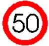

## Úvod

Tuto technickou zprávu doplňuje EN ISO 14823-1, která stanovuje formát a protokol pro slovník grafických dat (GDD) umožňující jazykově nezávislou reprezentaci a interpretaci dopravních značek a piktogramů. Tento slovník je používaný při výměně informací mezi centry (DATEX II) a mezi infrastrukturou a vozidly (kooperativní systémy, C-ITS) pro popis dopravního značení zobrazeného například na proměnném dopravním značení.

Tento extrakt (dále jen “popisovaný dokument”) popisuje část 2 normy GDD s příklady použití.

Poznámka: Extrakt uvádí vybrané kapitoly popisovaného dokumentu a přejímá původní číslování kapitol.

## Užití

Popisovaný dokument uvádí praktické příklady kódování různých dopravních značek. Popisovaný dokument použijí analytici a vývojáři výrobců automobilů, poskytovatelů služby a výrobců koncových uživatelských zařízení (aplikace) při návrhu a vývoji systému pro zakódování, přenos a interpretaci a informace obsažené na dopravní značce. Slovník grafických dat je použit C-ITS a DATEX II.

## 1 Předmět normy

Primárním obsahem popisovaného dokumentu jsou příklady kódování různých dopravních značek zakódovaných podle ISO 14823-1 GDD v ASN.1.

## 2 Souvisící normy

Popisovaný dokument uvádí 3 normativní odkazy na normy ISO 3166-1 (Kódy zemí), ISO 8601 (Datová reprezentace času), ISO 8824-1 (Specifikace zápisu ASN.1). Dále jsou v textu zmíněny normy ISO 14823-1 (Struktura a kódovací pravidla pro GDD) a ISO 14813-6 (Prezentace dat v ASN.1).

## 3 Termíny a definice

Tato kapitola definuje 6 termínů. Například:

**slovník grafických dat** _(graphic data dictionary)_ systematicky strukturovaný seznam kódů piktogramů

**piktogram** _(pictogram)_ znak nebo ikonka zobrazená na displeji systému IT, jako je počítač nebo proměnné dopravní značení (VMS), která poskytuje informace cestujícím například o dopravním omezení, veřejných zařízeních apod.

Další termíny a zkratky z oboru ITS jsou obsaženy ve slovníku ITS terminology.

## 4 Symboly a zkratky

Tato kapitola stanovuje 6 zkratek. Zkratka důležitá z pohledu tohoto extraktu je:

**ASN.1** jazyk ASN.1; abstraktní zápis syntaxe (číslo) jedna _(Abstract Syntax Notation One)_

**GDD** _slovník grafických dat (graphic data dictionary)_

Další termíny a zkratky z oboru ITS jsou obsaženy ve slovníku ITS terminology (www.ITSterminology.org).

## 5 Případ užití

Tato kapitola (rozsah 1 věta) uvádí typický případ použití grafického datového slovníku pro zobrazování dopravního značení ve vozidlech službě kooperativních systémů (C-ITS).

## 6 Příklady popisu ASN.1

Tato kapitola (rozsah 20 stran, 2 obrázky) obsahuje nejprve celkové ASN.1 schéma GDD a poté příklady zakódování různých dopravních značek, příklady zakódování různých atributů (vlastností) značky. Každý příklad obsahuje krátký popis následovaný kódem v ASN.1 a ilustrativním obrázkem.

V článku 6.2 (1 strana) jsou uvedeny 2 příklady kódů ASN.1 a 2 obrázky pro značky bez volitelných vlastností, sestávající z kódu země, kódu kategorie služby a kódu kategorie piktogramu.

Článek 6.3 Atributy (rozsah 13 stran) uvádí 21 příkladů zakódování různých vlastností dopravních značek včetně kódů ASN.1 a ilustrací, jako jsou platná období, rozměry vozidel, rychlostní limity a směrové informace, viz následující výčet.

  - **Platné období**: Poskytuje příklady značek, které označují datum/čas, kdy je značka platná. Například značka pro silniční práce začínající 31. prosince 2017 a končící 1. ledna 2018.

  - **Výjimky z platného období**: Ukazuje příklady značek, které uvádějí, kdy nejsou platné. Například zákaz vjezdu, který je výjimkou v pondělí a pátek od 0:00 do 12:30.

  - **Úsek značky**: Indikuje úsek vozovky, kde značka platí. Například značka pro práce na silnici platná od pozice značky po vzdálenost 100 metrů od značky.

<!-- end list -->

  - **Počet pruhů a směr**: Určuje počet pruhů a jejich směr. Například značka s jedním pruhem a přímým směrem.

  - **Rozměry vozidel**: Specifikuje rozměrová omezení pro vozidla. Například značka zakazující vjezd vozidlům vyšším než 3,5 metru, značka zakazující vjezd vozidlům širším než 2 metry, značka zakazující vjezd vozidlům delším než 10 metrů či značka zakazující vjezd vozidlům těžším než 5 tun.

  - **Rychlostní limity**: Určuje maximální a minimální rychlostní limity. Například značka s maximální rychlostí 50 km/h nebo různé rychlostní limity pro tři pruhy.

  - **Stoupání**: Indikuje sklon vozovky vyjádřený v procentech. Například sklon vozovky 10 %.

  - **Rozestupy mezi vozidly**: Specifikuje mezery mezi vozidly. Například zákaz menších rozestupů jedoucích vozidel než 70 metrů.

  - **Informace o cíli**: Poskytuje směrové informace (detaily cíle) pro jednotlivé větve křižovatek zobrazených na informativní značce, umožňuje popsat různé konfigurace křižovatek a jejich reprezentaci na značce. Například křižovatka se třemi větvemi, každá s informacemi o cíli, neúplná kruhová křižovatka se třemi rameny, křižovatka se třemi rameny a s čtvrtkruhovou propojkou mezi dvěma z nich, po sobě jdoucí odbočení či pouze směr a vzdálenost každého cíle bez grafiky znázorňující křižovatku nebo značka indikující cíl na jedné z větví pomocí piktogramu, například značku nemocnice.

Příklad kódování dopravní značky omezující maximální rychlost na 50 km/h je na obrázku 1.

<table>
<thead>
<tr class="header">
<th>Příklad 14: dopravní značení omezující maximální rychlost na 50 km/h</th>
<th></th>
</tr>
</thead>
<tbody>
<tr class="odd">
<td>
example14 GddStructure ::= {

pictogramCode {

serviceCategoryCode trafficSignPictogram:12,

pictogramCategoryCode {

nature 5,

serialNumber 57

}

},

attributes {

spe {

speedLimitMax 50,

unit 0

}

}

}
</td>
<td>

Obr 6.14 — Značka z příkladu 14
</td>
</tr>
</tbody>
</table>

**Obr. 1** Příklad kódování dopravní značky omezující maximální rychlost na 50 km/h (příklad 14 popisovaného dokumentu)

**Literatura**

Tato kapitola (rozsah 0,5 strany) uvádí odkazy na dokumenty stanovující názvy a definice piktogramů dopravních značek, včetně značek OSN, francouzských značek, japonských značek, amerických značek a britských značek.
