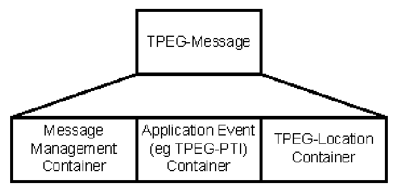

## Úvod

V úvodu normy je popsána technologie TPEG a její vývoj. TPEG je formou strukturovaného zápisu informací o dopravě, která používá bajtově orientovaný formát toku dat, který lze použít pro přenos jakýmkoliv digitálním nosičem s příslušnou adaptační vrstvou. Zprávy TPEG jsou přenášeny od poskytovatelů služeb ke koncovým uživatelům a používají se k přenosu dat aplikace z databáze poskytovatele služeb do zařízení koncového uživatele.

Tato norma je 5. část souboru norem věnujících se standardizaci protokolu pro dopravu TPEG. Detailně popisuje aplikaci TPEG PTI: Informace o veřejné dopravě, její základní datovou strukturu a dále způsoby kódování a dekódování hierarchicky uspořádaných zpráv. Cílem aplikace PTI je přinést poskytovatelům služeb (včetně vysílacích stanic) prostředky pro předávání dopravních informací o veřejné dopravě koncovým uživatelům.

Poznámka: Extrakt uvádí vybrané kapitoly popisovaného dokumentu a přejímá původní číslování kapitol.

## Užití

Technologie TPEG je určena pro poskytovatele služeb, neboť byla navržena pro širokou škálu aplikací, které vyžadují efektivní přenos z jednoho bodu do více bodů přes veskrze nespolehlivé rádiové vysílání.

## 1 Předmět normy

Tato norma popisuje aplikaci TPEG PTI, tedy způsob, jakým mohou být přenášeny informace o veřejné dopravě v rámci služby TPEG a to nezávisle na jazyce uživatele či poskytovatele služby. Aplikace TPEG-PTI byla vytvořena tak, aby postihla všechny modely veřejné dopravy, a to jak dopravy v rámci města, tak i meziměstské. Poskytované informace se týkají širokého tématu veřejné dopravy, jako je například dočasné přerušení, zrušení služby (spoje), čas příjezdu prostředku veřejné hromadné dopravy do zastávky či dokonce informací o zastávkovém jízdním řádu. TPEG-PTI umožňuje, kromě popisu jednotlivých služeb, také obecný popis trasy, služeb či oblasti. Informace o veřejné dopravě jsou většinou využívány v jednom z následujících případů:

  - elektronické informační tabule na zastávkách veřejné dopravy,

  - zprávy o stavu sítě,

  - popis jednotlivých služeb,

  - aktuální zprávy.

Zprávy TPEG-PTI mohou být seskupovány tak, aby výsledná „prezentace“ měla charakter, na který je uživatel zvyklý (informační tabule na zastávkách), např.:

  - zprávy o nehodách,

  - informace o trase,

  - informace o jednotlivých službách.

Aplikace TPEG-PTI se (obdobně jako CEN ISO/TS 18234-4) skládá ze 3 částí: zásobníku řízení zprávy (Message Management Container), zásobníku události (Application Event Container) a zásobníku lokace (TPEG-Location Container). První dva zásobníky (části) jsou plně popsány v rámci této normy, poslední zásobník je popsán v normě CEN ISO/TS 18234-6.

V první normě této série CEN ISO/TS 18234-1 je popsán tzv. identifikátor aplikace (AID), který přesně určuje, jakým způsobem budou data z konkrétní aplikace zpracovávána, tato aplikace (TPEG-PTI) má přidělen identifikátor **AID=0002**.

Zprávy TPEG-PTI lze dle této normy klasifikovat do kategorií. Ke klasifikaci do kategorií jsou použity základní datové prvky, ty jsou vybrány z množiny, která je dle jejích tvůrců kompletní sadou prvků potřebných pro vyjádření široké škály informací o veřejné dopravě.

## 2 Souvisící normy

Kromě ostatních částí této specifikace (18234-1 až 6) souvisí také se 13 částmi ISO/IEC 8859, které definují jedním 8-bitovým bajtem kódované soubory grafických znaků.

## 3 Termíny a definice

Tato kapitola uvádí 33 termínů a definicí popisujících zprávy TPEG-PTI.

Další termíny a zkratky z oboru ITS jsou obsaženy ve slovníku ITS terminology.

## 4 Symboly a zkratky

Tato kapitola uvádí 21 zkratek, podstatné z nich jsou uvedeny níže:

**4.1 AID** application identification – identifikátor aplikace TPEG

**4.12 PTI** public transport information – informace o veřejné dopravě

**4.15 RTM** road traffic message – zpráva o stavu dopravy

**4.16 SNI** service and network information application – informace o službách v síti

**4.17 SSF** syntax, semantics and framing structure – syntax, sémantika a rámcová struktura

**4.18 TPEG** Transports protocol experts group – Expertní skupina dopravních protokolů, forma strukturovaného zápisu informací o dopravě

Další termíny a zkratky z oboru ITS jsou obsaženy ve slovníku ITS terminology (www.ITSterminology.org).

## 5 Přehled aplikace PTI

Aplikace TPEG-PTI má předpoklad být široce využitelným formátem pro zpracování informací o veřejné dopravě a to prostřednictvím široké škály dekodérů – od pokročilých přístrojů, po jednoduchá zařízení. Zpráva TPEG-PTI může být použita v přijímačích s digitální mapou, nebo bez ní, či v přístrojích umožňujících pouze textový výstup. Zpráva může být v závislosti na dekodéru prezentována textově, graficky či pomocí syntézy řeči.

Pokud má být aplikace TPEG-PTI dobře využitelná pro rozhodování na základě obsahu zpráv, je nutné do zpráv začlenit alespoň některé z dále uvedených povinných prvků:

  - kdo je ovlivněn?,

  - ovlivněná oblast,

  - ovlivněná trasa,

  - popis události,

  - závažnost události,

  - ověření informace,

  - doba platnosti zprávy, …

Nedílnou součástí všech zpráv TPEG je jejich lokace (detailní popis viz CEN ISO/TS 18234-6). S její pomocí je tedy možné vybrat zprávy o shodné lokaci (ať již přesné adrese, či oblasti, atp.). Kapitola se dále věnuje obsahové stránce TPEG informací, shrnuje povinné a nepovinné prvky, s jejichž pomocí je např. možné rozpoznat konkrétní jednotlivé události či odhadnout vážnost situace a také např. jakým způsobem proběhne zrušení zprávy.

Dále je v článku 5.4 popsán koncept stavební struktury aplikací TPEG, kterou je možné rozdělit do 3 základních částí – zásobníku řízení zprávy (Message Management Container), zásobníku události (Application Event Container) a zásobníku lokace (Location Container), viz obrázek 1.



**Obr. 1** Struktura zásobníků TPEG-PTI (obr. 4 popisovaného dokumentu)

**Popis zásobníků (čl. 5.5 -5.7)**

Zde nalezneme stručný popis tří zásobníků zprávy TPEG, včetně jednotlivých datových prvků, Článek 5.5 pojednává o zásobníku pro řízení zprávy s popisem toho, jak jsou jednotlivé části tohoto zásobníku skládány dohromady a jakým způsobem lze mezi různými informacemi tvořit odkazy. Článek 5.6 obsahuje popis zásobníku událostí, toho jakým způsobem se skládá popis události z jednotlivých frází a jakým způsobem se dekóduje (viz příklad níže). Článek 5.7 obsahuje pouze velmi stručný popis zásobníku na lokaci spolu s odkazem na CEN ISO TS 18234-6, která se tomuto tématu věnuje detailně.

Příklad strukturování informace PTI je ve výpisu 1.

```
"A landslide is blocking a railway line"

Level 1   Route Description
Level 1   Railway Service
Level 2                 Cancelled
Level 3                         Environment Event
Level 4                             landslide
```

**Výpis 1** Příklad strukturování informace PTI (čl. 5.6 popisovaného dokumentu)

## 6 Zásobník RTM

Tato kapitola obsahuje definici celkového rámce TPEG-PTI (viz příklad níže), jsou zde vyčísleny jednotlivé datové struktury (prvky) obsažené v zásobnících aplikace PTI společně s odkazy na jejich výskyty v rámci normy. Dále tato kapitola obsahuje definici zápisu, který použit v této normě pro zapsání struktur aplikace TPEG-PTI.

Příklad kódování rámce součástí aplikace PTI je ve výpisu 2.

```
<component_frame(x)>:=                      : Public Transport Information Application
    <intunti>(scid)                         : Service Component Identifier (scid = x)
    <intunli>                               : Length of application data in bytes
    <crc>                                   : Header CRC
                                            : Application Data
    <intunti>(n)                            : Number of PTI messages
    n * <public_transport_information>      : Public Transport Information messages
    <crc>                                   : CRC check of all messages
```

**Výpis 2** Příklad kódování rámce součástí aplikace PTI (čl. 6.3.3 popisovaného dokumentu)

## 7 Zásobník pro řízení zprávy – Message Management Container

Obsahuje definici a syntaxi struktur, které jsou povinnou i volitelnou součástí zásobníku pro řízení zprávy. Mezi hlavní struktury (prvky) tohoto zásobníku patří identifikátor zprávy (message identifier), verze zprávy (version number) a prvky popisující časové parametry či věrohodnost a závažnost zprávy.

## 8 Zásobník událostí – Event Container

Obsahuje detailní slovní popis jaké všechny informace o veřejné dopravě mohou být obsahem zprávy TPEG a seznam příznaků příslušných k těmto typům informací. Ze zprávy TPEG PTI se můžeme dozvědět např. typ dopravního prostředku, provozovatele, časovou specifikaci, stav služby; typ lístku, který je potřeba zakoupit, informace o stanicích, o trasách, atp. V kapitole najdeme i 3 příklady konkrétní prezentace TPEG zprávy v závislosti na jejím použití, jsou to informace určené na zastávku, informace o cestě a informace o individuální službě.

Příklad kódování typu události v zásobníku události PTI (třída Způsob přepravy) je ve výpisu 3.

```
<pti_component(A0)>:=                       : Transport Mode
    <intunti>(id),                          : Identifier, id = 0xA0 hex
    <intunli>(n),                           : Length, n, of component data in bytes
    <pti01>(transport_mode),                : Transport mode, TPEG table pti01
    <intunti>(transport_submode),           : Transport submode, see table in 8.9.3
    m * <transport_mode_component()>;       : Transport mode components
```

**Výpis 3** Příklad kódování typu události v zásobníku události PTI, třída Způsob přepravy (čl. 8.7.1 popisovaného dokumentu)

V článku 8.5 je uvedena struktura kódu zprávy typu TPEG-PTI, tedy hierarchie příznaků jejich opakovatelnost a to jestli jsou povinné či volitelné. Článek 8.7 uvádí výčet datových typů zásobníku událostí složený ze základních typů definovaných v EN ISO 18234-2 (viz příklad níže) a jejich obsah, který je reprezentován odkazem na tabulku PTI.

**Tab. 1** Výčet tabulek PTI seřazený dle abecedy (tab. 2 popisovaného dokumentu)

| Description | Table | Description | Table |
|---|---|---|---|
| additional\_information\_type | 30 | self-drive\_vehicle\_type | 12 |
| air\_service\_type | 8 | service\_condition\_type | 13 |
| booking\_status\_type | 24 | service\_day\_type | 34 |
| bus\_service\_type | 5 | service\_delivery\_point\_type | 17 |
| coach\_service\_type | 3 | service\_facility\_type | 23 |
| cross\_reference\_type | 31 | severity\_type | 26 |
| Environment\_event\_type | 22 | taxi\_service\_type | 11 |
| equipment\_event\_type | 21 | telecabin\_service\_type | 9 |
| event\_reason\_type | 18 | ticket\_restriction\_type | 25 |
| funicular\_service\_type | 10 | timetable\_type | 33 |
| message\_report\_type | 27 | time\_type | 28 |
| miscellaneous\_event\_type | 19 | tram\_service\_type | 6 |
| mode\_of\_transport | 1 | transport\_information\_type | 14 |
| personnel\_problem\_type | 20 | urban\_railway\_service\_type | 4 |
| railway\_service\_type | 2 | unverified\_information | 32 |
| _Reserved for future use_ | 29 | water\_transport\_service\_type | 7 |
| route\_point\_type | 15 | _~ end of version 3.0 tables ~_ |  |
| scheduled\_predicted | 16 |  |  |

**Tabulky aplikace PTI (čl. 8.9)**

Tento článek (8.9) obsahuje definice všech tabulek frází a slov používaných v aplikaci PTI. Každá tabulka je zde plně uvedena (viz tabulka 1) a také je zde stanoveno jakým způsobem jsou tabulky mezi sebou propojeny. Tabulka pti01 (viz tabulka 2) obsahuje definici způsobu transportu, kde kódem 1 je specifikován obecný typ „železnice“, který může být dále zpřesněn tabulkou pti02 jež obsahuje více detailů o typu železničního vozidla, např. vysokorychlostní dráha, regionální dráha, příměstská dráha atd. Tabulky (pojmenované pti01 až pti34) obsahují popisy (fráze) týkající se prostředku přepravy, podmínek přepravy, stavu rezervace, bodu na cestě, popis události, atd.

**Tab. 2** Příklad tabulky TPEG pti01 – mode\_of\_transport (druhy dopravy) (tab. 4 popisovaného dokumentu)

| Code | CEN-English 'Word' | Comments | Examples |
|---|---|---|---|
| 0 | Unknown |  |  |
| 1 | railway service |  |  |
| 2 | coach service |  |  |
| 3 | suburban railway service |  |  |
| 4 | urban railway service |  |  |
| 5 | metro service |  |  |
| 6 | underground service |  |  |
| 7 | bus service |  |  |
| 8 | trolleybus service |  |  |
| 9 | tram service |  |  |
| 10 | water transport service |  |  |
| 11 | air service |  |  |
| 12 | ferry service |  |  |
| 13 | telecabin service |  |  |
| 14 | funicular service |  |  |
| 15 | taxi service |  |  |
| 16 | self-drive |  |  |
| 17 | all services | logical plural |  |
| 18 | all services except | contains logical plural |  |
| .. | **_~ end of version 3.0 ~_** |  |  |
| .. |  |  |  |
| 255 | undefined public transport service | **- the table default word -** |  |
