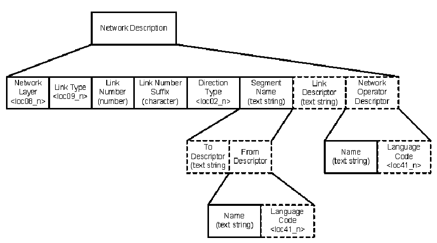
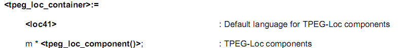

## Úvod

V úvodu normy je popsána technologie TPEG a její vývoj. TPEG je formou strukturovaného zápisu informací o dopravě, která používá bajtově orientovaný formát toku dat, který lze použít pro přenos jakýmkoliv digitálním nosičem s příslušnou adaptační vrstvou. Zprávy TPEG jsou přenášeny od poskytovatelů služeb ke koncovým uživatelům a používají se k přenosu dat aplikace z databáze poskytovatele služeb do zařízení koncového uživatele.

Tato norma je 6. část souboru norem věnujících se standardizaci protokolu pro dopravu TPEG. Popisuje kódování, dekódování a datovou strukturu TPEG-Loc. TPEG-Loc je struktura popisující lokalizaci dopravní informace v takové formě, že je použitelná jak pro navigační, na mapě založený, přístroj, tak i pro textový popis místa. Metodologie TPEG-Loc umožňuje její použití s jakoukoliv aplikací TPEG (RTM, PTI, a další). Struktura TPEG-Loc je navržena pro širokou řadu použití, umožňuje poskytovat služby založené na jednoduché (textové) i složité (mapové) lokalizaci. Struktura lokalizace je vhodná pro pokročilé filtrování dle oblasti.

Poznámka: Extrakt uvádí vybrané kapitoly popisovaného dokumentu a přejímá původní číslování kapitol.

## Užití

Technologie TPEG je určena pro poskytovatele služeb, neboť byla navržena pro širokou škálu aplikací, které vyžadují efektivní přenos z jednoho bodu do více bodů přes veskrze nespolehlivé širokopásmové vysílání.

## 1 Předmět normy

Tato technická specifikace stanovuje metodu odkazování na polohu (TPEG-Loc) používanou aplikacemi TPEG jako jsou TPEG-RTM a TPEG-PTI. TPEG-Loc není aplikací, a proto nemá tzv. identifikátor aplikace (AID) (jako např. TPEG-RTM), je jen nezbytnou součástí dané aplikace.

Při popisu lokace je nezbytné brát na zřetel koncového uživatele, ten musí z poskytnutých informací být schopen poznat, kde se daná lokace nachází. Tato norma umožňuje popisovat lokace nezávisle na jazyku uživatele a to díky soustavě v této normě definovaných tabulek obsahující základní fráze sloužící k popisu lokace. TPEG-Loc také umožňuje složitější formu popisu určenou pro strojové zpracování navigačním počítačem koncového uživatele. Tato metoda je nazývána on-the-fly lokalizace, pro její popis byly využity výstupu projektu ILOC.

Při tvorbě této normy nebyla zahrnuta zpětná kompatibilita s popisem lokace pomocí lokalizačních tabulek, který je používán v systému RDS-TMC (EN ISO 14819-3). Díky tomu není možné jednoduše převádět (pouze na základě této normy) informace ve tvaru RDS-TMC do aplikací TPEG.

## 2 Souvisící normy

Tato norma úzce souvisí s ostatními částmi tohoto souboru norem (18234-1 až 6).

## 3 Termíny a definice

Tato kapitola uvádí 20 termínů a definicí vztahující se k odkazování na polohu. Mezi nejdůležitější patří:

**3.7 lokalizační kontejner***(location container)* v TPEG-Loc je lokalizační schránka pojem aplikovaný na lokalizační odkazové prvky, aby ukázal, jak jsou vzájemně seskupeny; schránka TPEG-Loc zahrnuje standardní jazykový kód, schránku lokalizačních souřadnic i schránku s dodatečnými popisy

**3.9 odkazování na polohu** _(location referencing)_ metoda odkazování na polohu za účelem snadné výměny informací o poloze mezi různými systémy

Další termíny a zkratky z oboru ITS jsou obsaženy ve slovníku ITS terminology.

## 4 Symboly a zkratky

Tato kapitola uvádí 16 zkratek, podstatné z nich jsou uvedeny níže:

**4.6 ILOC** intersection location – formát polohy křížení

**4.10 PTI** public transport information – informace o veřejné dopravě

**4.12 RTM** road traffic message – zpráva o stavu dopravy

**4.13 TPEG** Transports protocol experts group – Expertní skupina dopravních protokolů, forma strukturovaného zápisu informací o dopravě

**4.13 TPEG-ilc** deskriptor vytvořený podle pravidel TPEG-Loc

Další termíny a zkratky z oboru ITS jsou obsaženy ve slovníku ITS terminology (www.ITSterminology.org).

## 5 Lokalizační schránka

Tato kapitola tvoří hlavní část normy, popisuje z čeho se skládá zásobník události TPEG-Loc a jak zapadá do struktury aplikací definovaných v souboru norem TPEG. Uvádí, že v další části jsou definovány 2 hlavní metody popisu lokace, textová a mapová, v rámci mapové části jsou použity výstupy z projektu ILOC, který byl zaměřen na tvorbu tzv. „on the fly“ lokalizace, tedy vytvoření lokalizace nad mapou (jakoukoliv) poskytovatele a její zpětné interpretace do mapy (jakékoliv) koncového uživatele bez použití předem stanovených „pevných referencí“ či stejného mapového díla u obou subjektů.

**Struktura zásobníku TPEG-Loc (čl. 5.1 až 5.3)**

Základní zásobník se skládá ze dvou částí, první jsou souřadnice lokace a druhou další doplňkové popisné prvky. Část obsahující souřadnice polohy obsahuje kromě samotných souřadnic ještě další prvky popisující směr, rozsah, dopravní prostředky, názvy lokace (město, ulice, název stanice, letiště, křižovatky, viz tabulka loc03). Popisované místo může mít charakter rozsáhlé oblasti (loc01\_1), uzlové oblasti (loc01\_2), segmentu (loc01\_3), křižovatky (loc01\_5), ohraničeného bodu (loc01\_6), nepropojených bodů (loc01\_7) a konečně propojených bodů (loc01\_8).

**Obr. 1** Popis sítě v části doplňkový popis zásobníku TPEG-Loc (obr. 14 popisovaného dokumentu)

Druhá část popisuje popis oblasti, sítě (viz obrázek 1) a bodu. Tyto struktury používají tabulky definované v normě k detailnímu, hierarchickému, popisu místa, okolí a sítě, které se týká dopravní informace, a to bez použití (primárního) souřadnicového popisu. Hlavním cílem je poskytnout solidní základ pro filtrovací mechanismy (díky hierarchickému popisu) a dosažení popisu místa v takové podobě, která bude srozumitelná člověku. Článek 5.2 popisuje strukturu zásobníku a uvádí výčet všech typů a jejich umístění v jednotlivých podstrukturách zásobníku. V článku 5.3 je stanovena syntaxe pro všechny typy popisu lokace definované v této normě dle základních typů z normy EN ISO 18234-2, viz příklad níže.

Příklad kódování zásobníku lokace:

### 5.4 Základní prvky TPEG-Loc

Tento článek (5.4) obsahuje definice všech tabulek frází a slov používaných v TPEG-Loc. Každá tabulka je zde plně uvedena (viz tabulka 1) a také je zde stanoveno jakým způsobem jsou tabulky mezi sebou propojeny. Tabulka (loc01) obsahuje popis možných typů lokací, kde kódem 1 je specifikován typ lokace 1 tj. Rozsáhlá oblast. Tabulky (pojmenované loc01 až loc27 a loc40 a loc41) obsahují fráze týkající se popisu místa (lokalizace) dopravní informace.

**Tab. 1** Tabulky TPEG (loc01 až loc27 a loc40 až loc41) seřazené podle čísel tabulek (tab. 4 popisovaného dokumentu)

| Table | Description | Table | Description |
|---|---|---|---|
| 01 | location\_type | 17 | node\_type |
| 02 | direction\_type | 18 | fuzzy\_directionality\_glue |
| 03 | descriptor\_type | 19 | explicit\_directionality\_glue |
| 04 | height\_decriptor | 20 | fuzzy\_proximity\_glue |
| 05 | modes\_of\_transport | 21 | explicit \_proximity\_glue |
| 06 | area\_type | 22 | intermediate\_glue |
| 07 | area\_qualifier | 23 | road\_objects |
| 08 | network\_layer | 24 | buildings |
| 09 | road\_link\_type | 25 | geographical\_sites |
| 10 | bus\_link\_type | 26 | sightseeing\_attarctions |
| 11 | metro\_rail\_link\_type | 27 | orientations |
| 12 | tram\_link\_type | .. | .. |
| 13 | train\_link\_type | 40 | country\_code |
| 14 | telecabin\_link\_type | 41 | language\_code |
| 15 | water\_transport\_link\_type |  | _\~ end of version 3.0 tables \~_ |
| 16 | air\_link\_type |  |  |

Příkladem ilustrujícím popis např. druhů dopravy je uveden níže jako tabulka 2.

**Tab. 2** Tabulka TPEG loc05: modes\_of\_transport (tab. 10 popisovaného dokumentu)

| Code | CEN-English ‘Word’ | Comments | Examples |
|---|---|---|---|
| 0 | unknown |  |  |
| 1 | road |  |  |
| 2 | railway | full-size carriages | in UK: Connex SE |
| 3 | coach |  |  |
| 4 | suburban railway | full-size carriages | in DE: Berlin S-Bahn |
| 5 | underground | also metro | in FR: Ligne 14 |
| 6 | bus | also trolleybus |  |
| 7 | tram |  | in BE: Pre-metro |
| 8 | water transport | canal, river and sea |  |
| 9 | aircraft |  |  |
| 10 | telecabin |  |  |
| 11 | funicular |  |  |
| 12 | taxi |  |  |
| 13 | self drive |  |  |
| 14 | cable–drawn boat |  |  |
| 15 | monorail |  |  |
| 16 | light railway | light-weight carriages |  |
| .. | **_\~ end of version 3.0 \~_** |  |  |
| .. |  |  |  |
| 255 | undefined | - the table default word - |  |

## 6 Kódování TPEG-Loc pro kompatibilitu s metodou ILOC

Kapitola uvádí pravidla pro vytvoření tzv. prostorového deskriptoru (spatial descriptor) a deskriptoru PK (road descriptor). Základem prvku TPEG-Loc „souřadnice polohy“ jsou souřadnice výšky a šířky přibližného středu křížení, které se označuje jako prostorový deskriptor, ke kterému je přiřazen deskriptor PK pozemních komunikací, které se v daném křížení kříží. Formát odkazování na polohu umožňuje prezentovat polohu v běžné řeči koncovému uživateli, ale také umožňuje konverzi TPEG dekodérem do formátu ILOC zpracovatelného strojem pro využití v mapových systémech.

Článek 6.1 uvádí odkazování na polohu pomocí metody souřadnic polohy, která se používá pro kódování poloh podle daných pravidel, které umožní jejich interpretaci navigačními přístroji. Článek 6.2 obsahuje pravidla pro kodér polohy TPEG a pro vytvoření prostorového deskriptoru a deskriptoru PK. Deskriptor PK má tři kategorie – číslo PK, název PK a jiné deskriptory PK (např. název mostu, tunelu, železničního přejezdu apod.). Článek dále uvádí postup pro vytvoření deskriptoru PK z čísla PK, z názvu PK a z jejich kombinace a dále i z jiných deskriptorů PK.

Příklad vytvoření deskriptorů PK je uveden v tabulce 3.

**Tab. 3** Příklady vytvoření deskriptorů PK (tab. 36 popisovaného dokumentu)

| Road/Route number/name | Resultant Road Descriptor |
|---|---|
| N5 | N5 |
| E52 | E52 |
| A329(M) | A329M |
| A1000(M) | A1000M |
| A4 Great Western Road | A4;Great Western Road |
| Bristol \_ Parkway | Bristol \_ Parkway |
| St \_ James \_ Avenue | St \_ James \_ Avenue |
| Rue \_ de \_ Aix | Aix,Rue \_ de \_ |
| Voie \_ de \_ Moëns | Moëns,Voie \_ de \_ |
| Route \_ de \_ Neuchatel | Neuchatel,Route \_ de \_ |
| Place \_ de \_ la \_ Concorde | Concorde,Place \_ de \_ a \_ |
| Neuburgstrasse | Neuburgstrasse |
| Platz \_ der \_ Einheit | Einheit,Platz \_ der \_ |

Článek 6.3 popisuje pravidla TPEG dekodéru polohy pro odvození prostorových deskriptorů pro mapové využití a pro prezentaci deskriptorů PK koncovým uživatelům.

Příklad vytvoření hotového deskriptoru ILOC zpracovatelného strojem je uveden v tabulce 4.

**Tab. 4** Vytvoření hotového deskriptoru ILOC zpracovatelného strojem (tab. 40 popisovaného dokumentu)

<table>
<thead>
<tr class="header">
<th colspan="2">Spatial Descriptor</th>
<th colspan="3">ILOC Road Descriptor</th>
</tr>
</thead>
<tbody>
<tr class="odd">
<td>Longitude</td>
<td>Latitude</td>
<td>Road Des. 1</td>
<td>Road Des. 2</td>
<td>Road Des. 3</td>
</tr>
<tr class="even">
<td><strong>-00234356</strong></td>
<td><strong>+5125190</strong></td>
<td><strong>STJAM</strong></td>
<td><strong>BRIST</strong></td>
<td>_ _ _ _ _</td>
</tr>
</tbody>
</table>
