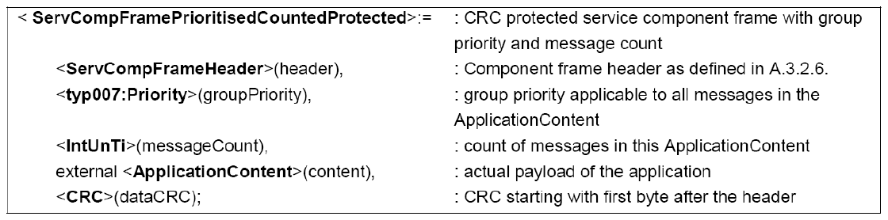
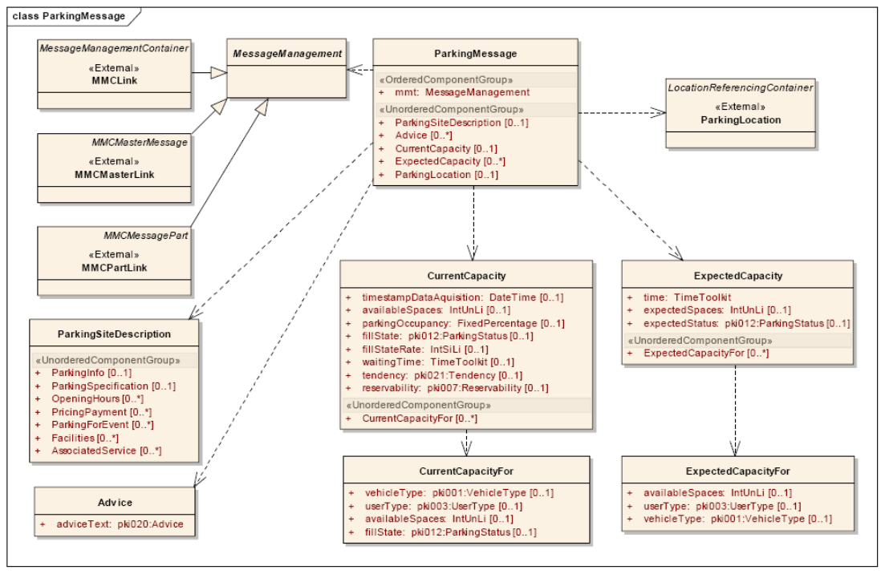
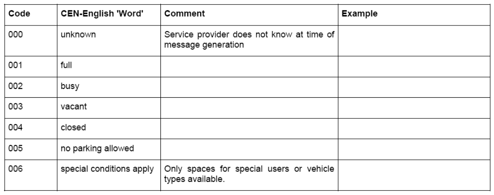
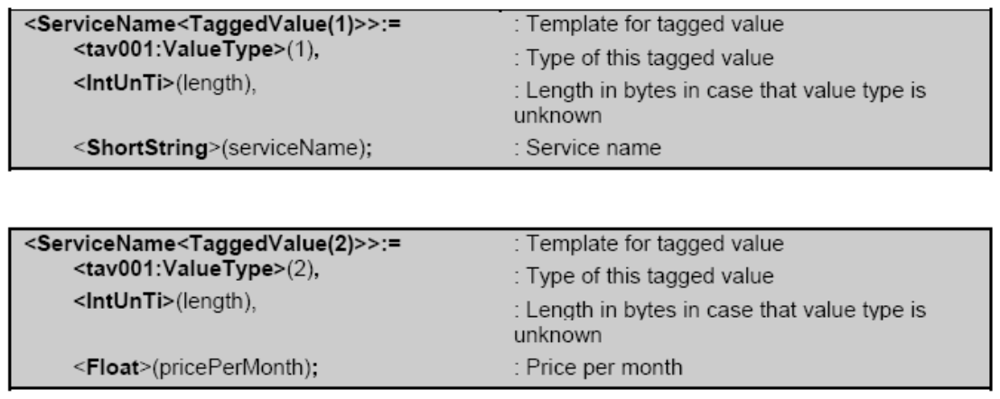

## Úvod

Sedmá část technické specifikace je součástí technických specifikací zaměřených na inteligentní dopravní systémy a poskytování dopravních informací. ISO/TS 18234 se skládá z následujících dílčích částí, pod obecným názvem Inteligentní Dopravní Systémy - Dopravní a cestovní informace (TTI) – Zprávy TTI předávané označovacím jazykem s možností rozšíření Expertní skupiny protokolů pro dopravu (TPEG)

  - Část 1: Úvod, číslování a verze (TPEG-INV)

  - Část 2: Syntax, sémantika a rámování struktura (TPEG-SSF)

  - Část 3: Aplikace služeb a informační sítě (TPEG-SNI)

  - Část 4: Použití zpráv silniční dopravy (TPEG-RTM)

  - Část 5: Informace o veřejné dopravě (TPEG-PTI)

  - Část 6: Odkazování na polohu, používané v souvislosti s ostatními způsoby využití (TPEG‑LOC)

  - **Část 7: Informace o parkování (TPEG-PKI)**

  - Část 9: Stručné dopravní události (TPEG-TEC)

  - Část 10: Podmíněný přístup k informacím (TPEG-CAI)

  - Část 11: Lokace označených kontejnerů (TPEG-LRC)

Tato technická specifikace stanoví způsob a formu doručení zpráv s informací o parkování, která jsou účastníkům provozu předávána v několika formách a to buď v textové anebo grafické pomocí standardních formátů v rámci služby protokolu TPEG.

Dopravní zácpy jsou dnes vážným problémem v městských oblastech. Dopravní zácpy jsou v některých případech generovány účastníky provozu hledající parkovací a odstavná místa. Poskytování informací o parkování dokáže zmírnit dopravní kongesce a to především informace předávané příležitostním návštěvníkům dané lokality o dočasných parkovištích a jejich obsazenosti.

Poznámka: Extrakt uvádí vybrané kapitoly popisovaného dokumentu a přejímá původní číslování kapitol.

## Užití

Tato technická specifikace informuje o možnostech poskytování informací o parkování účastníkům silničního provozu. Nezabývá se technickou částí možností přenosu informací, ale definuje způsob komprese informací o parkování. Definuje způsob zpracování a předání informací o parkování pro rychlé a srozumitelné předání informace od poskytovatele, až koncovému uživateli.

Technická specifikace je určena správcům parkovacích a odstavných ploch zabývající se přenosem informací o parkování, ale také společnostem a vlastníkům spravujícím pozemní komunikace a dopravně informační centra a společnostem zabývající se poskytováním dopravních informací.

## 1 Předmět normy

Tato technická specifikace definuje formu předávaných informací pomocí definovaného protokolu TPEG. Je pevně stanovena struktura zprávy, která jsou podávány a jsou striktně definovány způsoby komprese předávané informace do binární formy dat, která dále přenáší zmiňovanou strukturou samotné zprávy. Samotné komunikační rozhraní po technické stránce není řešeno. Technická specifikace obsahuje i základní tabulky pro práci s informacemi a zpětné dekomprese komprimované informace ve zprávě u uživatele. Technická specifikace je dělená do několika kapitol, jejichž obsah je extrahován níže.

### 1.1 Důvod standardizace

Hlavními důvody pro vývoj norem v této oblasti je zvýšení interoperability koncových zařízení uživatelů, jimiž jsou účastníci silničního provozu. Protokolová standardizace, kterou je popisovaný dokument, je základem pro samotnou technologickou standardizaci vybavení pro příjem a poskytování informací.

Aplikace informování o parkování má dnes již totožnou váhu jako samotné poskytování informací o dopravnách excesech a je nedílnou součástí při zkvalitňování poskytování cestovních informací. Je nutné v tomto směru tuto aplikaci normalizovat na evropskou úroveň z důvodu zajištění interoperability na evropském kontinentu.

## Souvisící normy

Následující dokumenty jsou nepostradatelné pro používání této technické specifikace:

  - CEN ISO/TS 18234-1:2006, Traffic and Travel Information (TTI) — TTI via Transport Protocol Expert Group

  - (TPEG) data-streams — Part 1: Introduction, Numbering and Versions

  - CEN ISO/TS 18234-2:2006, Traffic and Travel Information (TTI) — TTI via Transport Protocol Expert Group

  - (TPEG) data-streams – Part 2: Syntax, Semantics and Framing Structure (SSF)

  - CEN ISO/TS 18234-3:2006, Traffic and Travel Information (TTI) — TTI via Transport Protocol Expert Group

  - (TPEG) data-streams – Part 3: Service and Network Information (SNI) application

  - CEN ISO/TS 18234-6:2006, Traffic and Travel Information (TTI) – TTI via Transport Protocol Expert Group

  - (TPEG) data-streams – Part 6: Location Referencing for applications

  - ISO TS 18234-11, Traffic and Travel Information (TTI) — TTI via Transport Protocol Expert Group (TPEG)

  - binary data format -- Location Referencing Container

  - ISO 639-1:2002 Codes for the representation of names of languages – Part 1: Alpha-2 codes

  - ISO 3166:2006 Codes for the representation of names of countries and their subdivisions – Part 1: country

  - codes

  - ISO 4217:2001 Codes for the representation of currencies and funds

  - IEC 60559:1989 Binary floating-point arithmetic for microprocessor systems

## 2 Termíny a definice

Definice v této technické specifikaci jsou odvozeny z definic datového slovníku DATEX (ENV 13106). Pozornost je věnována především **AID** (Application identification). AID definuje, jak zpracovat do obsahu TPEG zprávy trasu informací na příslušný dekodéru koncového uživatele. Každá aplikace TPEG má jedinečné číslo, které identifikuje aplikaci. Identifikace aplikace je součástí TPEG specifikace a je definován každou novou aplikace. AID pro přenos informací o parkování je definován technickou specifikací v kapitole 5 a v kapitole 4 tohoto dokumentu.

Další termíny a zkratky z oboru ITS jsou obsaženy ve slovníku ITS terminology.

## 3 Symboly a zkratky

Část technické specifikace definuje použité zkratky a termíny, které jsou identifikovány pouze pro potřeby aplikace informování o parkování.

Další termíny a zkratky z oboru ITS jsou obsaženy ve slovníku ITS terminology (www.ITSterminology.org).

## 4 Použití identifikace

Slovo "aplikace" je používán ve specifikace TPEG, které popisují specifické podskupiny TPEG struktury. Aplikace definuje omezený slovník pro určitý typ zpráv, informace např. parkovací nebo silniční dopravní informace. Každá aplikace TPEG je přiděleno jedinečné číslo, tzv. Application IDentification (AID). AID je definován vždy, když je vyvinut novou žádost a tyto jsou uvedeny V CEN ISO/TS18234-1. Identifikační číslo aplikace používané v TPEG-SNI ukazují, jak zpracovat obsahu TPEG zprávy a usnadňuje směrování informací do příslušné jednotky koncového uživatele. Hexadecimální hodnota AID je uvedena v kapitole 5 technické specifikace.

## 5 Service Component Frame

Tato část technické specifikace definuje strukturu TPEG zpráv aplikace informování o parkování a opakuje použitou strukturu z přílohy A pro vysvětlující účely v následující kapitole Komponenty zpráv.

## 6 Komponenty zpráv

Obsahem této části je přesná definice a struktura zasílaných zpráv. Jedná se o stěžejní kapitolu technické specifikace normalizující protokol, zkraty a management zasílaných zpráv pro kompresi a dekompresi informací o parkování. Kapitola je členěna do několika struktur a obsahuje následující prvky.

  - List of Generic Component Ids

_Definice použitých názvů s přiděleným Id použitým při kompresi a dekompresi zprávy._

  - Parking Message

_Definuje UML strukturu zasílané zprávy a upřesňuje použité parametry nutné pro časově nenáročnou aktualizaci. Blíže je toto popsáno v příloze B. Komponenta Parking Message se dále čelní na dle následující struktury na další komponenty, které jsou definitivně popsány v technické specifikace dle přehledných UML struktur:_

  - MessageManagement

  - ParkingLocation

  - ParkingSiteDescription

  - CurrentCapacity

  - ExpectedCapacity

  - Advice

**Obr. 1** Struktura složky parkovací zprávy

## 7 Tabulky pro strukturu aplikace informací o parkování

TPEG tabulky poskytují seznam tzv. CEN-English "Word" spojené s hodnotou kódu. Navíc tabulky poskytují komentáře.

Každý jediný subjekt, pokud je to možné, je popsán jedním slovem. TPEG tabulky jsou v podstatě tabulky singulárních slov, které představují hodnoty, které mohou nabývat předchozích struktury. Příkladem je tabulka pro ParkingStatus.

## Příloha A (normativní)

Normativní přílohu A, popisuje byt orientovanou strukturu protokolu a na příkladech ukazuje způsob členění generovaných zpráv pro kompresi a zpětnou dekompresi zprávy pro účastníky provozu. Definuje, jak mají vypadat zasílané zprávy v protokolu TPEG a jsou detailně popsány jednotlivé položky obsahující informace o parkování včetně hexadecimálního kódování zprávy a zpětné CRC kontroly.

Položkám zprávy jako je např. lokace parkoviště, počet volných míst, otevírací doba parkoviště je věnována vždy samostatná podkapitola přesně definující na příkladech možnost použití. Příloha A slouží samotným programátorům jako nástroj pro zavádění protokolu TPEG.

Příloha A dále nabízí použití šablon pro používání protokolu TPEG, která napomáhá k implementaci protokolu aplikace PKI.

Zabývá se i definicí grafického znázornění informací.

**Obr. 2** Šablona protokolu TPEG aplikace PKI

## Příloha B (normativní)

Normativní přílohu B, popisuje management zasílaných zpráv, který bude použit v tomto a všech budoucích TPEG aplikací. Budoucí aktualizace týkající se managementu zpráv budou oznamovány a ohlašovány pomocí změn.

Management zpráv se zejména zabývá prioritami zasílaných zpráv jak je vidět např. na schématu níže.

**Obr. 3** Struktura managementu zpráv
