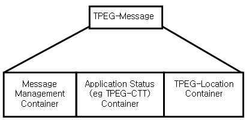

## Úvod

Tato osmá část technické specifikace je součástí technických specifikací zaměřených na inteligentní dopravní systémy a poskytování dopravních informací. ISO/TS 18234 se skládá z následujících dílčích částí, pod obecným názvem Inteligentní Dopravní Systémy - Dopravní a cestovní informace (TTI) – Zprávy TTI předávané označovacím jazykem s možností rozšíření Expertní skupiny protokolů pro dopravu (TPEG), část 8: Aplikace pro informace o kongescích a době jízdy (TPEG-CTT), formát binárních dat:

  - Část 1: Úvod, číslování a verze (TPEG-INV)

  - Část 2: Syntax, sémantika a rámování struktura (TPEG-SSF)

  - Část 3: Aplikace služeb a informační sítě (TPEG-SNI)

  - Část 4: Použití zpráv silniční dopravy (TPEG-RTM)

  - Část 5: Informace o veřejné dopravě (TPEG-PTI)

  - Část 6: Odkazování na polohu, používané v souvislosti s ostatními způsoby využití (TPEG‑LOC)

  - Část 7: Informace o parkování (TPEG-PKI)

  - **Část 8: Aplikace pro informace o kongescích a době jízdy (TPEG-CTT)**

  - Část 9: Stručné dopravní události (TPEG-TEC)

  - Část 10: Podmíněný přístup k informacím (TPEG-CAI)

  - Část 11: Lokace označených kontejnerů (TPEG-LRC)

Tato technická specifikace stanoví způsob doručení zpráv o dopravní kongesci a cestovních časů v rámci služby protokolu TPEG.

Dopravní zácpy jsou dnes vážným problémem v městských oblastech. Dopravní zácpy jsou především způsobeny nedostatečným informováním řidičů a stavu dopravy. Včasné informování řidičů a všeobecně účastníků provozu o cestovním čase dokáže snížit riziko vzniku dopravních kongescí a poskytování informací o samotné dopravní kongesci dokáže omezit následky tohoto dopravního excesu.

TPEG zprávy o kongesci a cestovním čase jsou navrženy tak, aby poskytly informace různým druhům přijímačů s využitím digitálního vysílání a internetových technologií. Informace o dopravních kongescích a cestovním čase mohou být prezentovány uživateli mnoha různými způsoby v podobě textu, zvuku, nebo graficky pomocí standardizovaných formátů. Tato aplikace slouží jako nezávislý efektivní jazyk pro poskytování silničních informací přímo od poskytovatele služeb konečným uživatelům.

Poznámka: Extrakt uvádí vybrané kapitoly popisovaného dokumentu a přejímá původní číslování kapitol.

## Užití

Tato technická specifikace informuje o možnostech poskytování informací účastníkům silničního a veřejného provozu. Tato technická specifikace se nezabývá technickou částí možností přenosu informací, ale definuje způsob komprese informací o definovaných dopravních excesech a jiných dopravních informacích. Definuje způsob zpracování a předání dopravních informací pro rychlé a srozumitelné předání informace od poskytovatele, až koncovému uživateli. Technická zpráva je určena především společnosti zabývající se přenosem informací a dopravní telematikou, ale také společnostem a vlastníkům spravujícím pozemní komunikace a dopravně informační centra.

## 1 Předmět normy

Tato technická specifikace definuje formu předávaných informací pomocí definovaného protokolu TPEG. Je pevně stanovena struktura zprávy, která jsou podávány a jsou striktně definovány způsoby komprese předávané informace do binární formy dat, která dále přenáší zmiňovanou strukturou samotné zprávy. Samotné komunikační rozhraní po technické stránce není řešeno. Technická specifikace obsahuje i základní tabulky pro práci s informacemi a zpětné dekomprese komprimované informace ve zprávě u uživatele.

## Souvisící normy

Následující dokumenty jsou nepostradatelné pro používání technické zprávy ISO/TS 18234-1, ISO/TS 18234-2, ISO/TS 18234-3, ISO/TS 18234-4, ISO/TS 18234-5, ISO/TS 18234-6, ISO 17572-2, ISO/IEC 7498-1.

## 2 Termíny a definice

Definice v této technické specifikaci jsou odvozeny z definic datového slovníku DATEX (ENV 13106) až na následující výjimky:

### 4.1 CRI - cross reference informatik

Odkaz na jedno nebo více zpráv ve stejné, nebo jiné TPEG službě.

### 4.2 EVE - event description

Část zprávy popisující událost, neplánované či plánované dopravního omezení na silniční komunikační síti nebo informace o stavu dopravy, včetně kvalifikantů a kvantifikátorů.

### 4.3 Location referencing

Metoda odkazování na umístění s cílem usnadnit výměnu informací týkajících se umístění mezi různými systémy.

### 4.4 Message

Sbírka konzistentních informací odeslána prostřednictvím informačního kanálu. Popisuje událost nebo sbírku událostí, nebo informace o dopravě obsahující informaci o dopravním opatření, které je obsaženo v záhlaví zprávy.

### 4.5 MET - message expiry time

Datum a čas v souladu s EN ISO 8601, kdy má být zpráva odstraněna ze všech TPEG-dekodérů

### 4.6 MGT - message generation time

Razítko data a času v souladu s EN ISO 8601 vzniku zprávy

### 4.7 MID - message identifier

Jedinečný identifikátor pro posloupnost verzí jedné zprávy týkající se konkrétního případu.

### 4.8 Position

Definice místa vzniku vzhledem k návrhovým vlastnostem řezu komunikace v místě události.

### 4.9 SEV - severity factor

Výše narušení provozu.

### 4.10 STA - start time

Datum a čas v souladu s EN ISO 8601, ve které událost, nebo informace o stavu dopravy, začala nebo má či by měla být zahájena

### 4.11 Status

Charakteristika prvku dopravního systému

### 4.12 STO - stop time

Datum a čas v souladu s EN ISO 8601, ve kterém událost, nebo informace o stavu, skončila nebo je naplánován jejich konec.

### 4.13 TSI - time schedule information

Informace o časovém harmonogramu pro opakující se události.

### 4.14 UNV - unverified information

Zpráva obsahuje informace z neověřených zdrojů.

### 4.15 VER - version number

Pořadové číslo k rozlišení zpráv, které mají zvláštní identifikátor.

Kapitola 5 technické specifikace obsahuje 34 zkratek týkající se symbolů a definic zasílaných zpráv pomocí protokolu TPEG.

Další termíny a zkratky z oboru ITS jsou obsaženy ve slovníku ITS terminology (www.ITSterminology.org).

## 3 Důvod standardizace

Hlavními důvody pro vývoj norem v této oblasti je zvýšení interoperability koncových zařízení uživatelů, jimiž jsou účastníci silničního provozu. Protokolová standardizace, kterou je popisovaný dokument, je základem pro samotnou technologickou standardizaci vybavení pro příjem a poskytování informací.

## 4 Aplikace CTT

Je nutné zdůraznit, že TPEG je svázán s datovým formátem DATEX, který není určen pro přenos ke koncovým uživatelům. Z tohoto důvodu je konfigurován datový formát TPEG.

TPEG - Aplikace dopravní kongesce a cestovní čas umožňuje širokou škálu podpory TPEG-dekódovacích typů a prezentačních možností. TPEG definuje širokou škálu dekodérů od sofistikovaných TPEG-dekodérů s navigačními systémy, až po jednoduché TPEG-dekodéry schopné dekódovat pouze základní informace. CTT zprávy mohou být prezentovány uživateli mnoha různými způsoby, včetně textu, syntetizované řeči, graficky, nebo při plánování trasy v GPS. Každá zpráva musí zahrnovat alespoň některé z následujících prvků, splňující požadavky uživatelů:

  - Cíl uživatele pro informaci

  - Zeměpisná poloha, ke kterému se informace týká,

  - Pozice na silnici, nebo přilehlé oblasti, kde dochází k excesu,

  - Zda informace byly ověřeny,

  - Doba, po kterou zpráva zůstává v platnosti,

  - Predikovaný cestovní čas,- Další související informace.

## 5 Struktura CTT

Definuje strukturu TPEG zpráv kongesce a cestovního času v hierarchickém smyslu a "vnitřní hierarchický index". V obsahu zprávy je - zpráva řízení, popis události - konstrukce a konečně kódování, pro zprávy vedení a CTT-události, jak je znázorněno na obrázku 1.

**Obr. 1** TPEG CTT struktura (obr. 1 popisovaného dokumentu)

## 6 Zpráva řízení

Tato kapitola definuje dva povinné prvky, identifikátor zprávy a číslo verze pomocí rekurzivních tabulek a definovaných binárních kódů vztažených k povinným prvkům zprávy.

## 7 Status

Kapitola popisující hierarchický přístup k definování postavení informace v několika úrovních zprávy, což umožňuje rekurzivní kódování. Tabulky rekurzivního kódování jsou definovány pro vybrané druhy zpráv.

## 8 TPEG CTT tabulky

Tato kapitola definuje převodní kongesční tabulky pro kompresi a dekompresi informací z binární zprávy. Příklad převodní tabulky je v tabulce 1.

**Tab. 1** Tabulka TPEG CTT 02: Congestion Tendency (tendence kongesce) (čl. 11.2 popisovaného dokumentu)

| **Code** | **CEN-English ‘Word’** | **Comments** | **Examples** |
| -------- | ---------------------- | ------------ | ------------ |
| **0**    | unknown                |              |              |
| **1**    | Increasing congestion  |              |              |
| **2**    | Decreasing congestion  |              |              |
| **3**    | Static congestion      |              |              |
| **..**   | End of 1.00            |              |              |
| **..**   |                        |              |              |
| **255**  |                        |              |              |

## Příloha A (informativní)

Tato technická specifikace obsahuje informativní přílohu A, ve které jsou popsány vzorce konverze, které by měly být používány v dekodérech, aby bylo zajištěno, že,všechny dekodéry, které obdrží zvláštní vstup, zobrazí stejný výsledek. To dovolí poskytovatelům služeb generování deterministických hodnot.
