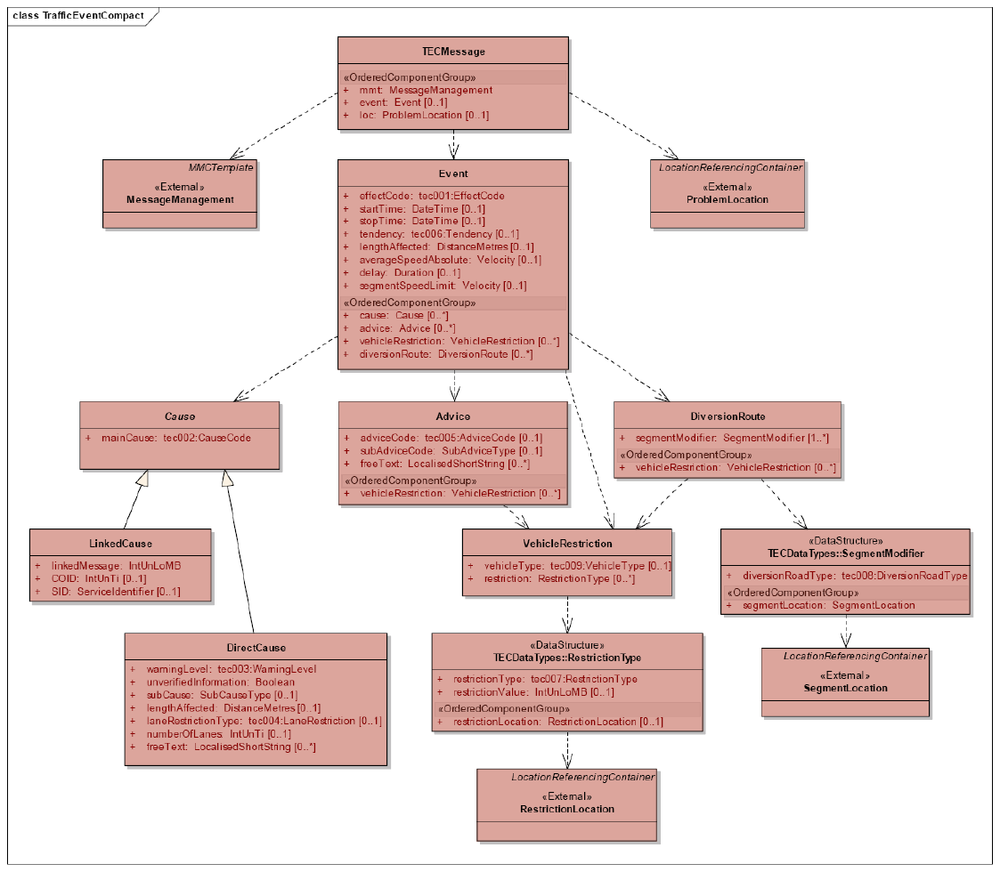
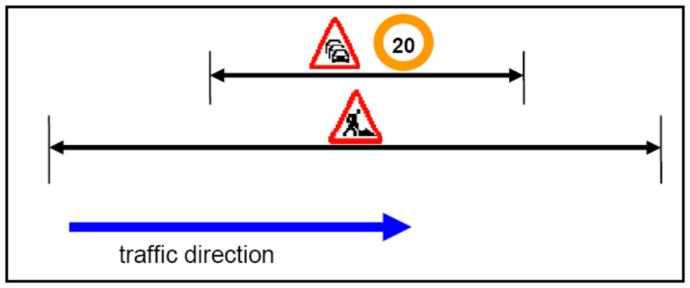
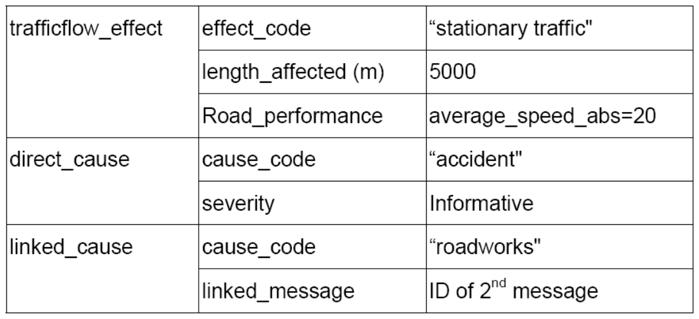
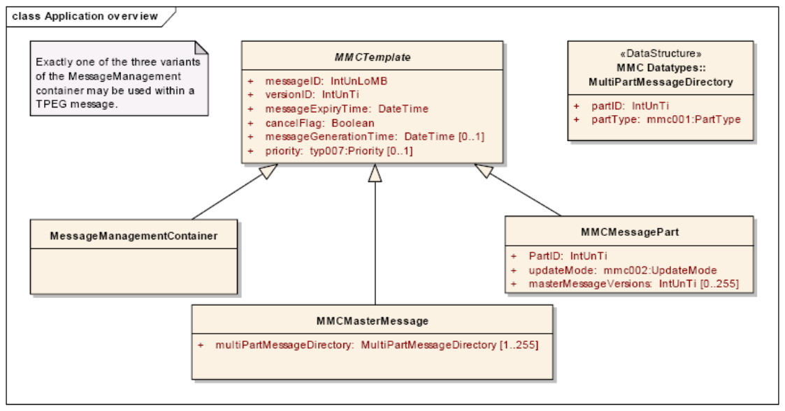

## Úvod

Sedmá část technické specifikace je součástí technických specifikací zaměřených na inteligentní dopravní systémy a poskytování dopravních informací. ISO/TS 18234 se skládá z následujících dílčích částí, pod obecným názvem Inteligentní Dopravní Systémy - Dopravní a cestovní informace (TTI) – Zprávy TTI předávané označovacím jazykem s možností rozšíření Expertní skupiny protokolů pro dopravu (TPEG)

  - Část 1: Úvod, číslování a verze (TPEG-INV)

  - Část 2: Syntax, sémantika a rámování struktura (TPEG-SSF)

  - Část 3: Aplikace služeb a informační sítě (TPEG-SNI)

  - Část 4: Použití zpráv silniční dopravy (TPEG-RTM)

  - Část 5: Informace o veřejné dopravě (TPEG-PTI)

  - Část 6: Odkazování na polohu, používané v souvislosti s ostatními způsoby využití (TPEG‑LOC)

  - Část 7: Informace o parkování (TPEG-PKI)

  - **Část 9: Aplikace pokrývající dopravní události (TPEG-TEC)**

  - Část 10: Podmíněný přístup k informacím (TPEG-CAI)

  - Část 11: Lokace označených kontejnerů (TPEG-LRC)

Tato specifikace definuje TPEG aplikaci: Stručné dopravní události. Tato aplikace byla speciálně navrhnuta tak, aby podporovala informace o dopravních událostech (např. práce na silnici, dopravní zácpy). Aplikace slouží k místní upozornění na nebezpečí, která souvisí s bezpečností a zprávy jsou odeslány s vysokou prioritou v případě, kdy se účastník provozu může setkat neočekávaně s nebezpečnou situací (např. nehoda za křížením, překážka na silnici). Obecně platí, že stručné dopravní události se zaměřují na tyto požadavky:

  - zajistit bezpečnost pro řidiče;

  - umožnit využití alternativní trasy;

  - vyhnout se zpoždění (např. dopravní zácpy);

  - varovat řidiče na překážky na trase;

  - informace o problémech na silniční infrastruktuře (např. uzavřené čerpací stanice, nefunkční SOS hlásky).

Základní myšlenkou modelu TEC je to, že dopravní situace je popsána základní strukturovanou informací, která popisuje nejdůležitější informace pro řidiče a sekundární popisy a příčiny. Tento model umožňuje popsat složité události modulárním způsobem. Zaslaná informace může být prezentovaná graficky, textově, hlasově nebo kombinací všech tří. Vedle výše uvedených požadavků, je velmi důležité, aby navržený kódovací systém byl účinný zejména:

  - pro koncová zařízení s omezenými zdroji;

  - byl schopen získat včas informace, které jsou bezpečnostně důležité pro řidiče.

Poznámka: Extrakt uvádí vybrané kapitoly popisovaného dokumentu a přejímá původní číslování kapitol.

## Užití

Technická specifikace překládá možnost zasílání informací o dopravních událost na pozemních komunikacích a je jednou z nejstěžejnějších aplikací TPEG. Jedná se o aplikaci, která snižuje riziku nehodovosti na pozemních komunikacích a dokáže zároveň eliminovat vznik dopravních kongescí.

Technická specifikace definuje strukturu zpráv obsahující informace o dopravních excesech, jako jsou dopravní kolony, nehody anebo o mimořádných událostech jako jsou práce na silnici, nadrozměrný náklad.

Technická specifikace je určena správcům a provozovatelům telematických systémů na pozemních komunikacích. Tato aplikace je také prioritně určena pro dopravně informační centra a pro správní orgány jako je PČR, kteří mohou včasném zadání mimořádné události či dopravní nehody a předání dalším účastníkům provozu snížit míru nebezpečí během nastalých událostí.

Hlavním předpokladem je nahrazení systémů na bázi RDS-TMC využívající ALERT-C kód. TEC naproti RDS-TMC lépe popisuje vzniklé nebezpečné situace na pozemních komunikacích.

## 1 Předmět normy

Tato technická specifikace definuje formu předávaných informací pomocí definovaného protokolu TPEG-TEC. Je pevně stanovena struktura zprávy, která jsou podávány a jsou striktně definovány způsoby komprese předávané informace do binární formy dat, která dále přenáší zmiňovanou strukturou samotné zprávy. Samotné komunikační rozhraní po technické stránce není řešeno. Technická specifikace obsahuje i základní tabulky pro práci s informacemi a zpětné dekomprese komprimované informace ve zprávě u uživatele. Technická specifikace je dělená do několika kapitol, jejichž obsah je extrahován níže. TPEG-TEC je zaměřen na poskytování informací především pro zvýšení bezpečnosti provozu, jako jsou např. informace o dopravních nehodách, uzavírkách, dopravních omezeních (práce na silnici).

### 1.1 Důvod standardizace

Hlavními důvody pro vývoj norem v této oblasti je zvýšení interoperability koncových zařízení uživatelů, jimiž jsou účastníci silničního provozu. Protokolová standardizace, kterou je popisovaný dokument, je základem pro samotnou technologickou standardizaci vybavení pro příjem a poskytování informací.

Aplikace TEC přináší výraznou inovaci a zlepšení v oblasti předávání informacím účastníkům provozu, které přímo mohou zvýšit i bezpečnost provozu na pozemních komunikacích a minimálně eliminovat následky dopravních excesů. Z těchto důvodů je velmi vhodné normování této technické specifikace.

## Souvisící normy

Následující dokumenty jsou nepostradatelné pro používání této technické specifikace:

  - ISO TS 18234-2:2006 Traffic and Travel Information (TTI) — TTI via Transport Protocol Expert Group (TPEG) data-streams -- Part 2: Syntax, Semantics and Framing Structure (SSF)

  - ISO TS 18234-11 Traffic and Travel Information (TTI) — TTI via Transport Protocol Expert Group¨(TPEG) binary data format -- Location Referencing Container

## 2 Symboly a zkratky

Aplikace TEC definuje pro aplikaci speciální termíny sloužící pouze pro jeho účely.

  - local hazard warning

  - location referencing container

  - location referencing

  - startTime

  - stopTime

Další termíny a zkratky z oboru ITS jsou obsaženy ve slovníku ITS terminology (www.ITSterminology.org).

## 3 Použití identifikace

Slovo "aplikace" je používán ve specifikace TPEG, které popisují specifické podskupiny TPEG struktury. Aplikace definuje omezený slovník pro určitý typ zpráv, informace. Každá aplikace TPEG je přiděleno jedinečné číslo, tzv. Application IDentification (AID). AID je definován vždy, když je vyvinut novou žádost a tyto jsou uvedeny V CEN ISO/TS18234-1. Identifikační číslo aplikace používané v TPEG-SNI ukazují, jak zpracovat obsahu TPEG zprávy a usnadňuje směrování informací do příslušné jednotky koncového uživatele. Hexadecimální hodnota AID je uvedena v kapitole 5 technické specifikace.

## 5 Aplikační třízení

Tato část technické specifikace definuje strukturu třízení TPEG-TEC zpráv aplikace informování v závislosti především na prioritě informace a bližšího zatřízení. Bližší informace o struktuře a třídění je příloze A. Třízení a struktuře zpráv je věnována větší pozornost z důvodu zaručení předání relevantní události.

## 6 Komponenty zpráv

Obsahem této části je přesná definice a struktura zasílaných zpráv. Jedná se o stěžejní kapitolu technické specifikace normalizující protokol, zkraty a management zasílaných zpráv pro kompresi a dekompresi informací. Struktury jsou definovány pomocí UML modelů (viz obrázek 1).



**Obr. 1** UML model TPEG-TEC

Jsou definovány nové komponenty aplikace, které vstupují do samotné zprávy a pro aplikaci TEC mají zásadní význam:

  - TECMessage 0

  - MessageManagement 1

  - ProblemLocation 2

  - Event 3

  - DirectCause 4

  - LinkedCause 5

  - Advice 6

  - VehicleRestriction 7

  - DiversionRoute 8

  - RestrictionLocation 9

  - SegmentLocation 10

Jako v ostatních aplikací je zde definován management zpráv a struktura zprávy TPEG-TEC ve které je definován minimální požadavek na vkládání informací o omezení na pozemních komunikacích a zároveň jsou popsány definitivně nově použité termy jako je např. startTime, stopTime.

Technická specifikace obsahuje také názorné příklady použití např. v případě uzavření komunikace. Příklad definice komponenty DirectCause je ve výpisu 1.

```
<DirectCause<Cause(4)>>:=

<IntUnTi>(4),                                 : Identifier

<IntUnLoMB>(lengthComp),                      : Length of component in bytes, excluding the id and
                                                length indicator

<IntUnLoMB>(lengthAttr),                      : Length of attributes of this component in bytes

<tec002:CauseCode>(mainCause),                : Main categorization of the cause according to table
                                                tec002

<tec003:WarningLevel>(warningLevel),          : The level informative should be used for all traffic
                                                events, which may influence the drivers' route in any
                                                way and might require normal attention from the driver.
                                                The danger levels 1 to 3 should only be used for really
                                                dangerous situations, e.g. ghost-driver. The danger
                                                levels 1 to 3 in combination with unverifiedInformation
                                                = True should be used in case of an unverified danger.
                                                For example, a traffic management centre receives a
                                                call from a private "jam buster" that there is a "ghost-
                                                driver", but the event is still not confirmed by the
                                                police.

<BitArray>(selector),                         : 1 byte containing 6 switches.

If (bit 0 of selector is set)

    <Boolean>(unverifiedInformation),         : If element is set to 1 the given information has not
                                                been verified.

If (bit 1 of selector is set)

    <SubCauseType>(subCause),                 : Carries the value in the sub cause table defined by
                                                the mainCauseCode.

If (bit 2 of selector is set)

    <DistanceMetres>(lengthAffected),         : Length of the event in metres.

If (bit 3 of selector is set)

    <tec004:LaneRestriction>(laneRestrictionType), : Specifies whether lanes are closed or opened.

If (bit 4 of selector is set)

    <IntUnTi>(numberOfLanes),                 : Specifies how many lanes are closed or opened. If
                                                this element is not given, the plural form shall always
                                                be used.

If (bit 5 of selector is set){

    <IntUnLoMB>(n),                           : Number of entries in array attribute, between 0 and
                                                infinity.

    n * <LocalisedShortString>(freeText)

};
```

**Výpis 1** Příklad definice komponenty DirectCause (přímá příčina události)

V rámci protokolu TPEG-TEC jsou vytvořena pravidla pro označování míst s dopravním omezením. Je definována např. tabulka pro přepočet rychlosti vozidel, max. povolené rychlosti a vzdálenosti k dopravnímu omezení. Základní pravidla, tak mohou vytvořit pravidla pro zasílání informací vybraným účastníkům provozu. Technická specifikace názorně ukazuje na příkladech struktury zpráv (viz obrázek 2).



**Obr. 2** Příklad struktury zpráv reagující na vzniklou situaci

## 7 Datové typy

V TPEG-TEC technické specifikaci jsou nadefinovány datové typy a jsou přesně stanoveny hodnoty, které mohou nabývat. Patří mezi ně zejména takové datové, u kterých j nutné stanovit jakousi škálu nebo měřítko, dle které bude možno objektivně stanovit např. závažnost události a následně i prioritu zprávy. Tabulka 1 znázorňuje příklad definované tabulky pro stupně dopravy.

**Tab. 1** Tabulka TPEG-TEC pro stupně dopravy (traffic flow)

| Code | CEN English ‘Word’ | Comment | Example |
|---|---|---|---|
| 001 | traffic flow unknown | Must be used if traffic flow is unknown. This is often the case for local hazard warnings. |  |
| 002 | free traffic flow | The traffic is not disturbed. |  |
| 003 | heavy traffic | Heavy traffic causes problems in the traffic flow. |  |
| 004 | slow traffic | The traffic is moving slower than normal. |  |
| 005 | queuing traffic | The traffic is in queues but still slowly floating. |  |
| 006 | stationary traffic | The traffic is jammed. |  |
| 007 | no traffic flow | The cause-component may give more information about the reason for “no traffic flow”. | - The road has been closed by police as a “regulatory measure” or<br>- The road is blocked by a temporary incident |

## Příloha A (normativní)

Normativní přílohu A, popisuje byt orientovanou strukturu protokolu a na příkladech ukazuje způsob členění generovaných zpráv pro kompresi a zpětnou dekompresi zprávy pro účastníky provozu. Definuje, jak mají vypadat zasílané zprávy v protokolu TPEG a jsou detailně popsány jednotlivé položky obsahující informace o parkování včetně hexadecimálního kódování zprávy a zpětné CRC kontroly.

Příloha A dále nabízí použití šablon pro používání protokolu TPEG, která napomáhá k implementaci protokolu aplikace TEC.

## Příloha B (normativní)

Normativní přílohu B, popisuje management zasílaných zpráv, který bude použit v tomto a všech budoucích TPEG aplikací. Budoucí aktualizace týkající se managementu zpráv budou oznamovány a ohlašovány pomocí změn.

Management zpráv se zejména zabývá prioritami zasílaných zpráv jak je vidět např. na obrázku 3.



**Obr. 3** Struktura managementu zpráv
