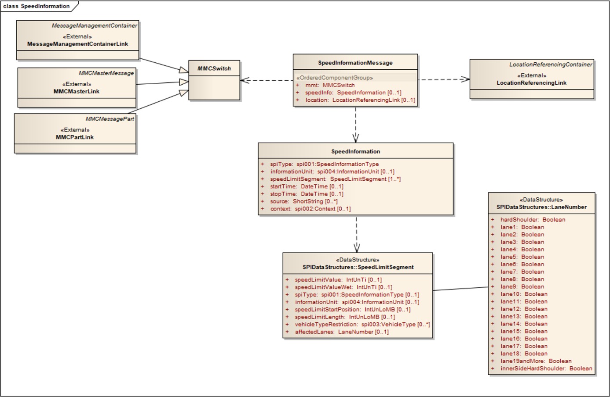
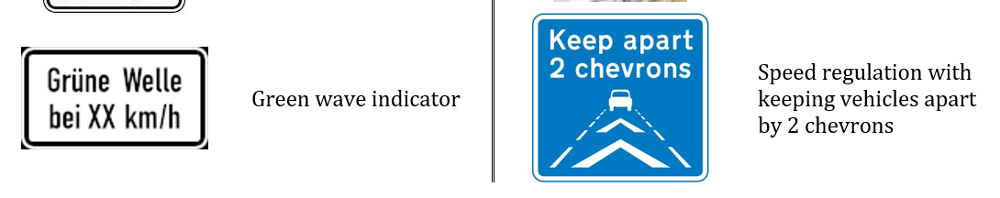
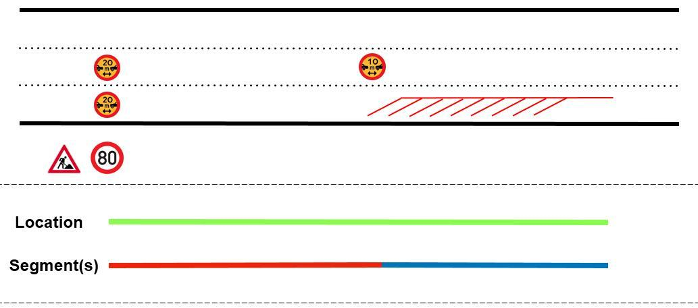

## Úvod

Technická specifikace ISO 21219 stanovuje formát a protokol TPEG určený pro poskytování informací o dopravě koncovým uživatelům. TPEG je určen pro média s vysokou přenosovou kapacitou, umožňuje informace členit strukturovaně se zvyšující se mírou detailů a komplexně popisovat polohu.

Jednotlivé oblasti dopravních událostí jsou v TPEG popsány odděleně, pomocí platformě nezávislého modelu (UML) a dvou odvozených platformě závislých modelů (binární a XML). Části specifikace stanovují pravidla tvorby modelu a jeho převodu do platformě závislé podoby.

Více informací o kontextu TPEG je obsaženo v úvodu extraktu k části 1 normy TPEG (21219-1).

Technická specifikace ISO 21219 se zabývá druhou generací protokolu TPEG, označovaným zkratkou TPEG2. Rozlišení TPEG/TPEG1/TPEG2 se většinou uvádí pouze v úvodní části norem/specifikací, zatímco ostatní kapitoly již mezi TPEG a TPEG2 nerozlišují – to je implicitní dle kontextu.

Tento extrakt (dále jen “popisovaný dokument”) popisuje část 17 normy TPEG „Aplikace pro informace o rychlostních omezeních (TPEG2-SPI)”, která specifikuje strukturu pro popis rychlostních limitů daných dopravními značkami a legislativními limity.

Poznámka: Extrakt uvádí vybrané kapitoly popisovaného dokumentu a přejímá původní číslování kapitol.

## Užití

Popisovaný dokument stanovuje způsob poskytování informací o regulatorních rychlostních limitech, daných buď explicitně dopravní značkou či implicitně přikázaným odstupem mezi vozidly. Je nezbytný pro analytiky poskytovatele služby informací o rychlostních limitech a pro analytiky výrobce uživatelského terminálu (aplikace), kteří mají na starost návrh datového modelu systému a návrh pravidel, se kterými systém pracuje. Použije se při návrhu systému.

## 1 Předmět normy

Popisovaný dokument definuje aplikaci TPEG SPI „Aplikace pro informace o rychlostních omezeních“. Ta umožňuje poskytování a interpretaci informací o regulatorních rychlostních limitech, daných buď explicitně dopravní značkou či implicitně přikázaným odstupem mezi vozidly. Informace o omezení rychlosti jsou navrženy s maximální efektivitou využití přenosového pásma. Používá se vždy (delší) liniová lokace (způsob odkázání se na polohu se neřeší) a na ní jsou definovány úseky s platností omezení rychlosti dle jízdního pruhu, typu vozidla či časové platnosti. Jedná se například o popis dočasného omezení rychlosti dané nehodou v pravém jízdním pruhu.

## 2 Souvisící normy

Popisovaný dokument uvádí 5 normativních odkazů na normu TPEG2 ISO 21219 části 1 (INV), 3, 4, 5 (SFW) a 9 (SNI). Jedná se o obecné normy definující základní strukturu zprávy, číslování a sestavení XML a binární serializace.

## 3 Termíny a definice

Tato kapitola definuje 1 termín.

**Omezení rychlosti** _(speed limit)_ maximální (či v některých případech minimální) rychlost jízdy vozidel na dané části pozemní komunikace.

Další termíny a zkratky z oboru ITS jsou obsaženy ve slovníku ITS terminology.

## 4 Symboly a zkratky

Tato kapitola stanovuje 19 zkratek, důležité z pohledu tohoto extraktu jsou:

**MMC** kontejner pro management zpráv _(Message Management Container)_

**ADC** kontejner pro popis aplikace _(Application Data Container)_

**LRC** kontejner pro odkazování na polohu _(Location Referencing Container)_

**TPEG** framework poskytující formáty a protokoly pro poskytování dopravních informací, optimalizovaných na šíření prostřednictvím digitálního rozhlasu či Internetu

Další termíny a zkratky z oboru ITS jsou obsaženy ve slovníku ITS terminology (www.ITSterminology.org).

## 5 Podmínky a omezení aplikace

Tato kapitola (rozsah 1 strana) vymezuje:

  - **Identifikátor aplikace**, který je stanovený pro všechny aplikace v TS 21219-1.

  - **Verzi aplikace**. Verze je klíčová z pohledu dekodéru, jednotlivé verze stejné aplikace se totiž mohou od sebe lišit strukturou, obsahem atp.

  - **Pořadí kontejnerů**, ze kterých je zpráva složena. Zpráva se skládá z kontejneru pro management zpráv (MMC), volitelně kontejneru pro popis aplikace (ADC) a kontejneru pro odkazování na polohu (LRC).

  - **Rozšiřitelnost a zpětnou kompatibilitu**, jako požadavek na přeskočení neznámých částí zprávy dekodérem a specifikaci v budoucnu rozšiřitelných částí struktur TPEG zprávy.

  - **Rámec komponent služby TPEG** dle ISO/TS 21219-5.

## 6 Struktura SPI

Tato kapitola (rozsah 1 obrázek) obsahuje UML model zprávy aplikace SPI (viz obrázek 1).



**Obr. 1** UML model tříd aplikace SPI (obrázek 2 normy)

## 7 Komponenty zprávy SPI

Tato kapitola (rozsah 3 strany, 2 tabulky) popisuje jednotlivé komponenty zprávy SPI.

Stanovuje základní strukturu zprávy SPI, „SpeedInformationMessage“ může obsahovat informaci o omezení rychlosti (včetně typu, času, platnosti, a úseků) a informaci o poloze, ne nezbytně té samé zprávě. Popis polohy není specifikován.

## 8 Datové typy SPI

Tato kapitola (rozsah 2 stran, 2 tabulky) obsahuje **definice** 2 použitých datových struktur (typů), **LaneNumber** a **SpeedLimitSegment**. V tabulce 1 je pro ilustraci obsahu a sloupců uvedena část tabulky popisující datovou strukturu **SpeedLimitSegment**.

**Tab. 1** Ukázka části struktury SpeedLimitSegment (tabulka 4 normy)

| Name | Type | Multiplicity | Description |
|---|---|---|---|
| speedLimitValue | IntUnTi | 0..1 | The speed limit value. The unit can be found in the enclosing component. If no value is given the default value should be “no limit” or “end of speed limit”. A speed limit value is valid until a segment with the next higher offset and same lane replaces it or the end of the segment or the end of the location is reached. |
| speedLimitValueWet | IntUnTi | 0..1 | Speed limit value to be used in wet conditions. The unit can be found in the enclosing component. |
| spiType | spi001:SpeedInformationType | 0..1 | The speed information type shall provide information on the general sort of a speed limit message. If given, the value overrides the attribute in the SpeedInformation for this segment. |
| informationUnit | spi004:InformationUnit | 0..1 | The information unit provides the unit in which the speed limit information provided in this segment is dimensioned. If given, the value overrides the attribute in the SpeedInformation for this segment. |
| … | | | |

Struktury se skládají ze složitých či jednoduchých datových objektů, výskyt každé položky datové struktury (tj. její multiplicita) je doplněn datovým typem a popisem. Tabulka níže uvádí datové struktury stanovené v této kapitole.

## 9 Tabulky SPI

Tato kapitola (rozsah 4 strany) obsahuje definice výčtových typů aplikace SPI (v 4 tabulkách). Tabulka 2 jmenovitě uvádí jednotlivé tabulky a doplňuje je popisem a příkladem obsahu.

**Tab. 2** Seznam tabulek SPI (výčtů hodnot) (zdroj: autor extraktu)

| Tabulka SPI                 | Popis                                    | Obsah                            |
| --------------------------- | ---------------------------------------- | -------------------------------- |
| spi001:SpeedInformationType | Výčet různých typů rychlostního omezení. | př.:001: static speed limit sign |
| spi002:Context              | Výčet kontextů pro informaci řidiči      | Př.: 003: weather                |
| spi003:VehicleType          | Výčet typů vozidel                       | Př.: 002: bus                    |
| spi004:InformationUnit      | Výčet typů jednotek                      | Př.: 003: metresPerSecond        |

Tabulka 3 obsahuje ukázku tabulky „SPI002:Context“ z popisovaného dokumentu.

**Tab. 3** Příklad části definice výčtového typu SPI002:Context (tabulka 6 normy)

| Kód | Fráze             | komentář                           |
| --- | ----------------- | ---------------------------------- |
| 001 | neznámý (unknown) | Neznámý důvod rychlostního omezení |
| 002 | doprava (traffic) | Omezení rychlosti z důvodu dopravy |
| 003 | nehoda (accident) | Omezení rychlosti z důvodu nehody  |

## Příloha A (normativní) TPEG-bin reprezentace SPI

Tato příloha (rozsah 4 strany) stanovuje binární reprezentaci aplikace SPI pro použití v DAB. Pro popis binární reprezentace je použit pseudokód, kde pro každé klíčové slovo zapsané struktury je znám jeho binární tvar.

Příloha obsahuje samostatně uvedené binární reprezentace rámce TPEG, zprávy SPI a jejích součástí, prvků určených pro budoucí rozšíření a datových typů. Dále obsahuje identifikátory komponent zprávy a vysvětlení použití obecných atributů TPEG. Příklad pseudokódu binární specifikace prvku SpeedInformationMessage je uveden ve výpisu 1.

```
<SpeedInformationMessage(0)>:=
    <IntUnTi>(0),                                     : Id této komponenty
    <IntUnLoMB>(lengthComp),                          : Počet bajtů v komponentě, kromě indikátorů id a lengthComp
    <IntUnLoMB>(lengthAttr),                          : Počet bajtů v atributech
    ordered {
        <MMCSwitch>(mmt),                             : kontejner pro management zpráv
        n *<SpeedInformation>(speedInfo)[0..1],       : popis informace s omezením rychlosti
        n *<LocationReferencingLink>(location)[0..1]  : kontejner pro odkazování na polohu
    };
```

**Výpis 1** Příklad pseudokódu binární specifikace prvku SpeedInformationMessage (článek A.4 normy)

## Příloha B (normativní) TPEG-ML reprezentace SPI

Tato příloha (rozsah 4 strany) obsahuje nejprve samostatně uvedené XML schéma rámce TPEG, dále zprávy SPI a jejích součástí, prvků určených pro budoucí rozšíření, datových typů a tabulek SPI (definovaných jako xs:complexType), viz příklad ve výpisu 2. Následně uvádí vše výše zmíněné v jednom funkčním XML schématu.

```xml
<xs:complexType name="LaneNumber">
<xs:sequence>
<xs:element name="hardShoulder" type="tdt:Boolean"/>
<xs:element name="lane1" type="tdt:Boolean"/>
<xs:element name="lane2" type="tdt:Boolean"/>
<xs:element name="lane3" type="tdt:Boolean"/>
<!-- zkráceno -->
<xs:element name="lane19andMore" type="tdt:Boolean"/>
<xs:element name="innerSideHardShoulder" type="tdt:Boolean"/>
</xs:sequence>
</xs:complexType>
```

**Výpis 2** Výstřižek schématu XSD stanovujícího strukturu prvku LaneNumber (článek B.3.1 normy)

## Příloha C (informativní) Příklady dopravních značek omezujících rychlost

Tato příloha (rozsah 9 stran) obsahuje 10 obrázků značek omezujících rychlost (i nepřímo, podle rychlosti vozidla vpředu) a jejich krátký popis. Ukázka je na obrázku 2.



**Obr. 2** Ukázka části tabulky s příklady dopravních značek (tabulka C.19 normy)

## Příloha D (informativní) Modelové příklady

Tato příloha (rozsah 1 stránka) obsahuje 10 modelových příkladů zakódování rychlostního omezení pro různé situace. Každý příklad je popsán schématem rozložení dopravních značek omezujících rychlost na pozemní komunikaci, promítnutím tohoto rozmístění do segmentů a tabulkou s hodnotami struktur SPI pro tento příklad.

Příklad D9 (omezení rychlosti s kontrolou vzdálenosti vozidel) je na obrázku 3, vyplnění struktury SPI pro tento příklad v tabulce 4.



**Obr. 3** Modelový příklad 9, omezení rychlosti s kontrolou vzdálenosti vozidel (obrázek D.9 normy)

**Tab. 4** vyplnění struktury SPI pro příklad 9 (tabulka D.9 normy)

| SpeedLimitSegment       | 1                           | 2                                                    | 3                                                    |
| ----------------------- | --------------------------- | ---------------------------------------------------- | ---------------------------------------------------- |
| speedLimitValue         | 80                          | 20                                                   | 10                                                   |
| spiType                 | static speed limit sign (1) | minimum allowed distance to predecessor vehicle (12) | minimum allowed distance to predecessor vehicle (12) |
| informationUnit         | kiloMetresPerHour (1)       | metres (4)                                           | metres (4)                                           |
| speedLimitStartPosition | undef                       | undef                                                | 200                                                  |
| speedLimitLength        | 1500                        | 200                                                  | 1300                                                 |
| vehicleTypeRestriction  | undef                       | undef                                                | undef                                                |
| affectedLanes           | undef                       | 1+2                                                  | 2                                                    |

**Literatura**

Tato část (rozsah 1 strana) obsahuje odkazy na literaturu i normy použité v popisovaném dokumentu.
