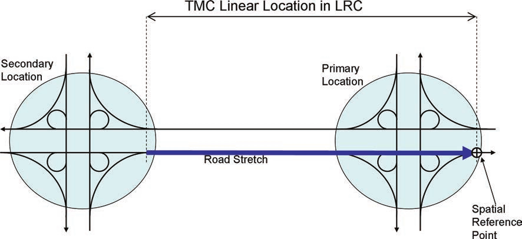

## Úvod

Technická specifikace ISO 21219 se zabývá druhou generací protokolu TPEG pro poskytování informací o dopravě koncovým uživatelům, označovaným zkratkou TPEG2.

ISO/TS 21219 obsahuje řadu částí, které pokrývají úvod, pravidla, nástroje (toolkity) a jednotlivé aplikace. TPEG2 je postaven na modelování v UML, se sadou základních pravidel stanovujících strategii modelování a pravidla konverze modelu do dvou fyzických formátů: binárního pro vysílání v DAB a XML pro šíření Internetem (části 2, 3, 4 normy). Pro snazší udržovatelnost specifikace se změny provádí pouze na úrovni obecného modelu v UML (XMI soubor) a následně pomocí automatizovaných nástrojů převádějí do popisů jednotlivých fyzických formátů (dokument s přílohami pro každý fyzický formát). Tato koncepční témata jsou řešena částmi, které se nazývají nástroje (toolkity).

Zpráva TPEG2 se skládá ze tří dílčích částí zpráv (kontejnerů): kontejner managementu zprávy (část 6 normy), kontejner s dopravní aplikací (mnoho částí) a kontejner s odkazem na polohu (část 7 normy).

Technická specifikace ISO/TS 21219 se skládá z těchto částí:

  - Nástroje (toolkity): TPEG2-INV (část 1: Úvod, číslování a verze), TPEG2-UML (část 2: Pravidla modelování pomocí UML), TPEG2-UBCR (část 3: Pravidla pro konverzi z UML do binárního kódu), TPEG2-UXCR (část 4: Pravidla pro konverzi UML do XML), TPEG2-SFW (část 5: Rámec pro služby TPEG), TPEG2-MMC (část 6: Kontejner pro management zpráv), TPEG2-LRC (část 7: Kontejner pro odkazování na polohu)

  - Speciální aplikace: TPEG2-SNI (část 9: Informace o službách a síti), TPEG2-CAI (část 10: Informace o podmíněném přístupu), TPEG2-LTE (část 24: Slabé šifrování)

  - Odkazování na polohu: TPEG2-ULR (část 11: Odkazování na polohu v aplikacích), TPEG2-ETL (část 20: Odkazování na polohu metodou rozšířeného TMC), TPEG2-GLR (část 21: Geografické odkazování na polohu), TPEG2-OLR (část 22: Odkazování na polohu metodou OpenLR)

  - Aplikace: TPEG2-RTM (část 12: Aplikace pro zprávy o silniční dopravě), TPEG2-PTI (část 13: Aplikace pro informace o veřejné dopravě), TPEG2-PKI (část 14: Aplikace pro informace o parkování), TPEG2-TEC (část 15: Aplikace pro vybrané dopravní události), TPEG2-FPI (část 16: Aplikace pro informace o cenách pohonných hmot), TPEG2-SPI (část 17: Aplikace pro informace o rychlostních omezeních), **TPEG2-TFP (část 18: Aplikace pro informace o stavu dopravního proudu a jeho predikci)**, TPEG2-WEA (část 19: Aplikace pro informace o počasí), TPEG2-RMR (část 23: Aplikace pro informace o multimodálních trasách), TPEG2-EMI (část 25: Nabíjecí infrastruktura pro elektromobily) a další.

Na rozdíl od RDS-TMC, které je svým způsobem popisu události jednoúrovňové, umožňuje TPEG informace členit strukturovaně se zvyšující se mírou detailu. Dopravní události popisuje TPEG úzkoprofilově, je vždy zaměřen na jeden konkrétní typ situací (například na ceny pohonných hmot, dojezdové doby atd.), které popisuje do větší hloubky, každému typu je věnována samostatná část specifikace (tzv. ”aplikace TPEG”).

Rozlišení TPEG/TPEG1/TPEG2 se většinou uvádí pouze v úvodní části norem/specifikací, zatímco ostatní kapitoly již mezi TPEG a TPEG2 nerozlišují - to je implicitní dle kontextu. Stejným způsobem k tomu přistupujeme i v tomto extraktu.

Tento extrakt popisuje část 18 „Aplikace pro informace o stavu dopravního proudu a jeho predikci (TFP)” (dále jen “popisovaný dokument”), která specifikuje 3 metody popisu stavů dopravy na sledovaném úseku v čase.

Poznámka: Extrakt uvádí vybrané kapitoly popisovaného dokumentu a přejímá původní číslování kapitol.

## Užití

Popisovaný dokument stanovuje strukturu aplikace pro **informace o stavu dopravního proudu a jeho predikci**. Popisovaný dokument je nezbytný pro **poskytovatele i příjemce** **dopravních informací**, jejich programátory, kteří pracují se samotným formátem XML či programují datové proudy pro DAB.

## 1 Předmět normy

Popisovaný dokument definuje aplikaci TPEG TFP „informace o stavu dopravního proudu a jeho predikci“. Ta umožňuje distribuovat informace o stavu dopravy spolu s dopravními excesy pro předem definovanou skupinu poloh. Tato předem definovaná skupina poloh je vysílána s nižší frekvencí než část s aktuálními stavy dopravy, nejedná se tedy o klasickou předdefinovanou skupinu poloh sdílenou offline mezi poskytovatelem a odběratelem. Informace o provozu jsou poskytovány několika způsoby, jako stav na úseku, posloupnost stavů na úseku v předdefinovaných časových rozmezích či spojitý diagram dráha-čas obsahující polygonové vyjádření stavů.

## 2 Souvisící normy

Klíčové normy, na které tento dokument odkazuje, jsou: specifikace předdefinovaných popisů poloh (17572-2), geografického odkazování na polohu (21219-21, TPEG2-GLR) a odkazování na polohu metodou OpenLR (21219-22, TPEG2-OLR), dále popisy přidružených událostí (21219-15, TPEG2-TEC). Pro sestavení zpráv z kontejnerů, odvození z modelu UML, vysílání zpráv a jejich signalizaci jsou použity další části normy TPEG, viz nástroje v úvodu extraktu.

## 3 Termíny a definice

Tato kapitola definuje 3 termíny. Jedná se o definici kontejneru pro management zpráv, odkazy na polohu a definici odkazování na polohu, která je uvedena níže.

**odkazování na polohu** _(Location Referencing)_ – prostředky umožňující systému přesně identifikovat polohu

Další termíny a zkratky z oboru ITS jsou obsaženy ve slovníku ITS terminology.

## 4 Symboly a zkratky

Tato kapitola stanovuje 20 zkratek reprezentujících jednotlivé části zprávy, z nichž klíčové jsou:

**MMC** kontejner pro management zpráv _(Message Management Container)_

**ADC** kontejner pro popis aplikace _(Application Data Container)_

**LRC** kontejner pro odkazování na polohu _(Location Referencing Container)_

V popisovaném dokumentu je uvedena většina zkratek částí specifikace TPEG. Tyto zkratky i jejich vysvětlení uvádíme jako součást výčtu částí specifikace v úvodu tohoto extraktu, proto je zde dále neuvádíme.

Další termíny a zkratky z oboru ITS jsou obsaženy ve slovníku ITS terminology (www.ITSterminology.org).

5 Podmínky a omezení aplikace

Tato kapitola (rozsah 1,5 strany) vymezuje:

  - Identifikátor aplikace, stanovený pro všechny aplikace v TS 21219-1.

  - Verzi aplikace. Verze je klíčová z pohledu dekodéru, jednotlivé verze stejné aplikace se totiž mohou od sebe lišit strukturou, obsahem atp.

  - Pořadí kontejnerů, ze kterých je zpráva složena. Zpráva se skládá z kontejneru pro management zpráv (MMC), kontejneru s dopravní aplikací (ADC) a kontejneru pro odkazování na polohu (LRC).

  - Rozšiřitelnost a zpětnou kompatibilitu, jako požadavek na přeskočení neznámých částí zprávy dekodérem a specifikaci v budoucnu rozšiřitelných částí struktur TPEG zprávy (např. struktury „FlowVectorSection“)

  - Rámec komponent služby TPEG dle ISO/TS 21219-5.

6 Struktura TFP

Tato kapitola (rozsah 1 obrázek) obsahuje UML model aplikace TFP (viz obrázek 1).


**Obr. 1** UML model tříd aplikace TFP (obrázek 2 normy)

7 Komponenty zprávy TFP

Tato kapitola (rozsah 12 stran, obrázky a tabulky) popisuje jednotlivé komponenty zprávy TFP. Stanovuje **několik různých struktur zprávy TFP**, a to z důvodů dvou rozdílných obsahů, popisu polohy a popisu stavu. Popis polohy v kontejneru pro odkazování na polohu (LRC) je potřeba méně často než popis stavu kontejneru s dopravní aplikací (ADC). Vše je řízeno kontejnerem pro management zpráv (MMC). Stanoveny jsou tyto formy zprávy TFP, struktura obsahuje:

  - pouze MMC pro rušící zprávy,

  - jeden MMC, několik ADC a jeden LRC v případě monolitického managementu zpráv

  - a v případě managementu zpráv po částech:

      - pouze MMC s rozcestníkem na části zpráv,

      - jeden MMC a několik ADC,

      - jeden MMC a jeden LRC.

Dále popisovaný dokument používá **3 metody pro popis stavu dopravy** na sledované síti, ty mohou být použity současně či jednotlivě:

  - metoda **flow-polygon**,

  - metoda **flow-status**,

  - metoda **flow-martix**.

Pro zjednodušení a zmenšení přenášených struktur je prostorové uspořádání stavů u metod flow-polygon a flow-martix odkazované pomocí staničení vůči počátku sledovaného úseku popsaného v LRC. LRC tak obsahuje jeden směr celého sledovaného úseku silniční sítě.

V kapitole je stanoven obsah komponent:

  - MMC, MessageManagementContainer, způsob řízení zpráv, po částech, monoliticky.

  - LRC, LocationReferencingContainer, povoleny jsou pouze liniové lokace.

  - a ADC, TFPMethod, kde jsou popsány všechny metody.

Odkazování na polohu pomocí TMC je na obrázku 2.



**Obr. 2** Ukázka odkazování na polohu pomocí TMC (obrázek 3 normy)

Metoda Flow-Polygon

V článku 7.8 a 7.9 je popisována metoda flow-polygon, která modeluje stav dopravy v diagramu dráha-čas pomocí několika prostorově-časových objektů „FlowPolygonObjects“. Počátek platnosti se nachází v počátku osy souřadnic a časové souřadnice polygonů mohou ležet v minulosti či budoucnosti. Tato metoda implicitně pracuje s predikcí dopravního stavu. Metoda je znázorněna na obrázku 3.


**Obr. 3** Ukázka metody flow-polygon (obrázek 4 normy)

Metoda Flow-Status

V článku 7.10 je stanovena metoda flow-status, která popisuje stav dopravy v definovaném časovém intervalu na jednom konkrétním místě (sledovaném úseku silniční sítě stanoveném v LRC).

Metoda Flow-Matrix

V článku 7.11 je stanovena metoda flow-martix, která popisuje stav dopravy pomocí posloupnosti stavů dopravy „FlowVector“ rozprostřených prostorově po sledovaném úseku silniční sítě stanoveném v LRC. „FlowMatrix“ se poté skládá z několika těchto prostorových úseků, z nichž každý popisuje stav v konkrétním čase, např. po 15ti minutách. Metoda je znázorněna na obrázku 4.


**Obr. 4** Ukázka metody flow matrix popisující jeden úsek silniční sítě ve čtyřech různých časech (obrázek 5 normy)

8 Datové typy TFP

Tato kapitola (rozsah 5,5 stran) obsahuje **definice** použitých datových struktur (typů). Struktury se skládají ze složitých či jednoduchých datových typů, výskyt každé položky datové struktury je doplněn popisem. Použité struktury uvádí tabulka 1.

**Tab. 1** Seznam stanovených datových typů (zdroj: autor extraktu)

| **Struktura TFP**       | **Popis**                                                                                                       |
| ----------------------- | --------------------------------------------------------------------------------------------------------------- |
| PolygonPoint            | Prostorově-časový bod v objektu „flowPolygon“, skládající se z časového a prostorového odsazení od počátku osy. |
| FlowVectorSection       | Stav dopravy na určitém úseku silniční sítě obsahující mj. i níže uvedené datové typy (struktury).              |
| _StatusParameters_      | Stav dopravy, min. stupně dopravy či průměrná rychlost či zdržení.                                              |
| _Restrictions_          | Restrikce pro konkrétní typy vozidel na konkrétní jízdní pruhy segmentu silniční sítě.                          |
| _StatisticalParameters_ | Statistické parametry a kvalita odhadu/výpočtu informace.                                                       |
| _LinkedCause_           | Odkaz na příčinu specifikovanou v jiné zprávě TPEG.                                                             |

9 Tabulky TFP

Tato kapitola (rozsah 11 stran) obsahuje tabulky s definicemi výčtových typů aplikace TFP. Jejich seznam je v tabulce 2, příklad části definice výčtového typu v tabulce 3.

**Tab. 2** Seznam použitých tabulek TFP (zdroj: autor extraktu)

| **Tabulka TFP**            | **Popis**                                                | **Obsah**                    |
| -------------------------- | -------------------------------------------------------- | ---------------------------- |
| tfp001: VehicleClass       | Výčet různých typů vozidel                               | Př.:010:trailer              |
| tfp002: VehicleCredentials | Výčet tříd vozidel dle privilegií                        | Př.: 002: disabled passenger |
| tfp003: LevelOfService     | Výčet (48) popisů plynulosti dopravy                     | Př.: 048: wide moving jam    |
| tfp004: SpatialResolution  | Výčet typů přesnosti použité lokalizace                  | Př.: 002:50-m-resolution     |
| tfp005:laneRestriction     | Výčet kombinací jízdních pruhů určených pro dané omezení | Př.: 008: driving lane 8     |
| tfp006: CauseCode          | Výčet různých příčin (68) omezení                        | Př.: 002:accident            |
| tfp007: SectionType        | Výčet typů úseků                                         | Př.: 002:exit                |
| tfp008: FlowDataQuality    | Výčet úrovní kvality dat                                 | Př: 005:high                 |

**Tab. 3** Příklad části definice výčtového typu tfp006:CauseCode (část tabulky 19 normy)

| **Kód** | **Fráze**                              | **komentář**     |
| ------- | -------------------------------------- | ---------------- |
| 000     | stav neznámý (unknown)                 |                  |
| 001     | dopravní kongesce (traffic congestion) | …                |
| 002     | nehoda (accident)                      | V případě nehody |

## Příloha A (normativní) – TPEG-bin reprezentace TFP

Tato příloha (rozsah 10 stran) stanovuje binární reprezentaci aplikace pro informace o stavu dopravního proudu a jeho predikci (TFP) TPEG pro použití v DAB. Pro popis binární reprezentace je použit pseudokód, kde pro každé klíčové slovo zapsané struktury je znám jeho binární tvar.

Příloha obsahuje samostatně uvedené binární reprezentace rámce TPEG, zprávy TFP a jejích součástí, prvků určených pro budoucí rozšíření a datových typů. Dále obsahuje identifikátory komponent zprávy a vysvětlení použití obecných atributů TPEG. Příklad pseudokódu binární specifikace prvku FlowStatus je ve výpisu 1.

```
<FlowStatus(5)<TFPMethod(5)>>:=
<IntUnTi>(5),                           : Id of this component
<IntUnLoMB>(lengthComp),                : Number of bytes in component, excluding the id and lengthComp indicator
<IntUnLoMB>(lengthAttr),                : Number of bytes in attributes
<DateTime>(startTime),                  : The start of the time period for which the provided content is valid.
BitArray(selector),
if (bit 0 of selector is set)
  <IntUnLoMB>(duration);                : The duration [min] of the time period for which the provided content is valid. The period starts at 'startTime' and ends at 'startTime'+'duration'. This attribute shall be used by the 'PolygonFlowObject' component and may be used if required otherwise.
<StatusParameters>(status),             : Attributes describing the traffic flow status at the related location
if (bit 1 of selector is set)
  <Restrictions>(restriction),          : Information on restrictions related to the reported traffic flow
if (bit 2 of selector is set)
  <StatisticalParameters>(statistics),  : Statistical information related to the reported flow status
if (bit 3 of selector is set)
  <tfp006:CauseCode>(cause),            : A simple cause for the reported traffic flow status may be added by this attribute; this parameter shall be omitted if a detailed cause is available by an external message (see attribute 'linked cause')
if (bit 4 of selector is set)
  <LinkedCause>(detailedCause);         : A detailed cause may be reported by a linked message (e.g. a TEC-message)
```

**Výpis 1** Výstřižek pseudokódu binární specifikace prvku FlowStatus (článek A.2.11 normy)

## Příloha B (normativní) – TPEG-ML reprezentace TFP

Tato příloha (rozsah 10 stran) obsahuje nejprve samostatně uvedené XML schéma rámce TPEG, zprávy TFP a jejích součástí, prvků určených pro budoucí rozšíření a datových typů a tabulek TFP (definovaných jako xs:complexType). Následně uvádí výše zmíněné samostatně uvedené XML schema v jednom funkčním XML schématu. Příklad je ve výpisu 2.

```xml
<xs:complexType name="FlowMatrix">
   <xs:sequence>
      <xs:element name="startTime" type="tdt:DateTime"/>
      <xs:element name="duration" type="tdt:IntUnLoMB" minOccurs="0"/>
      <xs:element name="spatialResolution" type="tfp004_SpatialResolution"/>
      <xs:element name="vectors" type="FlowVector" maxOccurs="unbounded"/>
   </xs:sequence>
</xs:complexType>
```

**Výpis 2** Výstřižek schématu XSD stanovujícího strukturu prvku FlowMatrix (článek B.2.6 normy)

Literatura

Tato kapitola uvádí dva v textu použité odkazy na normy, první na TPEG2-INV a druhý na definici UML.
