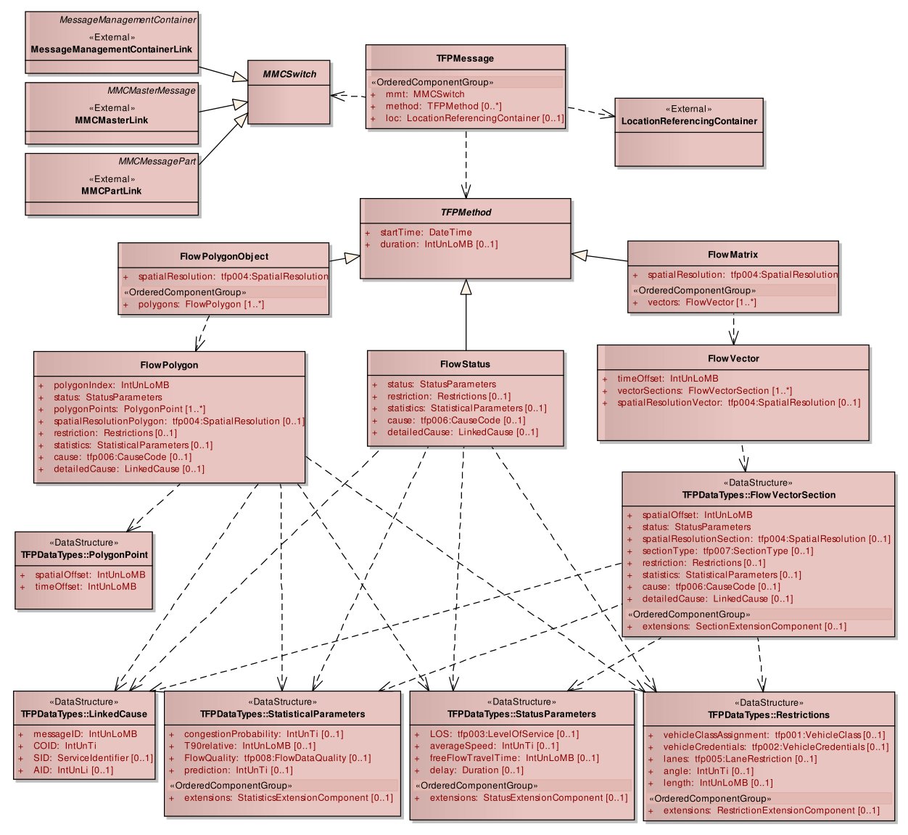
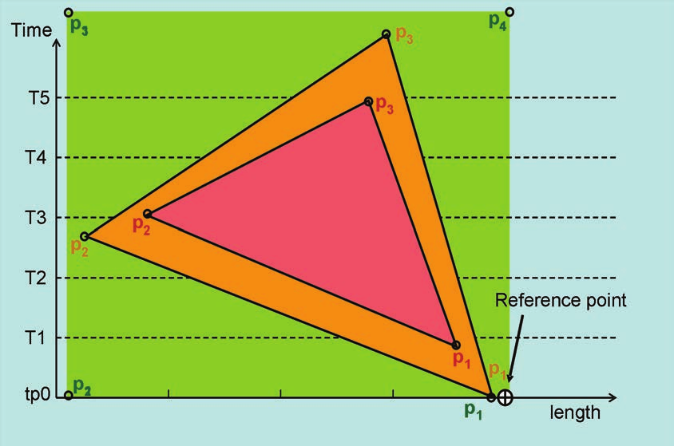
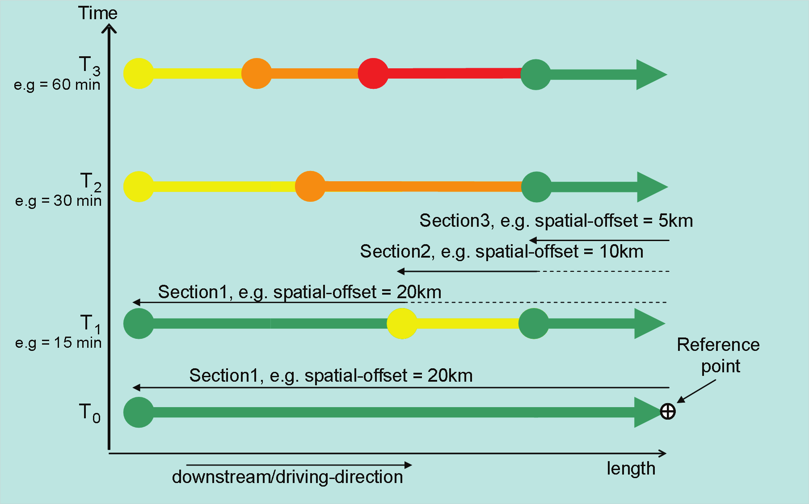

## Úvod

Technická specifikace ISO 21219 stanovuje formát a protokol TPEG určený pro poskytování informací o dopravě koncovým uživatelům. TPEG je určen pro média s vysokou přenosovou kapacitou, umožňuje informace členit strukturovaně se zvyšující se mírou detailů a komplexně popisovat polohu.

Jednotlivé oblasti dopravních událostí jsou v TPEG popsány odděleně, pomocí platformě nezávislého modelu (UML) a dvou odvozených platformě závislých modelů (binární a XML). Části specifikace stanovují pravidla tvorby modelu jeho převodu do platformě závislé podoby.

Více informací o kontextu TPEG je obsaženo v úvodu extraktu k části 1 normy TPEG (21219-1).

Technická specifikace ISO 21219 se zabývá druhou generací protokolu TPEG, označovaným zkratkou TPEG2. Rozlišení TPEG/TPEG1/TPEG2 se většinou uvádí pouze v úvodní části norem/specifikací, zatímco ostatní kapitoly již mezi TPEG a TPEG2 nerozlišují – to je implicitní dle kontextu.

Tento extrakt (dále jen “popisovaný dokument”) popisuje část 18 normy TPEG „**Aplikace pro informace o stavu dopravního proudu a jeho predikci** (TFP)”, která specifikuje 3 metody popisu stavů dopravy na sledovaném úseku v čase.

Poznámka: Extrakt uvádí vybrané kapitoly popisovaného dokumentu a přejímá původní číslování kapitol.

## Užití

Popisovaný dokument stanovuje strukturu pro **informace o stavu dopravního proudu a jeho predikci** a pravidla pro tvorbu obsahu těchto struktur. Je nezbytný pro analytiky poskytovatele i příjemce dopravních informací, kteří mají na starost návrh datového modelu systému a návrh pravidel se kterými systém pracuje. Použije se při návrhu systému.

**Tab. 1** Původní mapování mezi stavy a stupni provozu (zdroj: autor extraktu)

| level | Stupeň | Popis EN | Popis CZ | Alert C |
|---|---|---|---|---|
| 1 | - | road closed | komunikace uzavřena | 28 |
| 7 | 1 | traffic flowing freely | plynulý provoz | 124 |
| 6 | 2 | traffic building up | houstnoucí provoz | 125 |
| 5 | 3 | heavy traffic | silný provoz | 122 |
| 4 | 3-4 | slow traffic | pomalý provoz | 115 |
| 3 | 4 | queuing traffic | tvorba kolon vozidel | 108 |
| 2 | 5 | stationary traffic | dopravní kolaps | 101 |

Stavy dopravního proudu (free, heavy, slow, queuing a stationary) se mírně liší od “stupňů provozu” používaných v ČR (1-5, [https://cs.wikipedia.org/wiki/Stupeň\_provozu](https://cs.wikipedia.org/wiki/Stupe%C5%88_provozu)). Oba systémy používají 5-ti bodovou stupnici ale liší se ve významu 2. stupně, viz tabulka 1.

## 1 Předmět normy

Popisovaný dokument definuje aplikaci TPEG TFP „Aplikace pro informace o stavu dopravního proudu a jeho predikci“. Ta umožňuje distribuovat informace o stavu dopravy spolu s dopravními excesy pro předem definovanou sadu míst. Tato předem definovaná sada může být vysílána s nižší frekvencí než část aktualizované stavy dopravy, nemusí se tedy vždy jednat o klasickou předdefinovanou sadu poloh sdílenou off-line mezi poskytovatelem a odběratelem. Informace o stavu dopravního proudu jsou poskytovány několika způsoby od stavů na úsecích, přes časové „řezy“ sledů stavů na úsecích až po spojitý diagram dráha čas obsahující polygonové vyjádření stavů.

## 2 Souvisící normy

Popisovaný dokument uvádí 11 normativních odkazů na normu TPEG2 ISO 21219 části 1-7,9,15,21 a 22. Klíčové normy jsou: geografické odkazování na polohu (21219-21, TPEG2-GLR) a odkazování na polohu metodou OpenLR (21219-22, TPEG2-OLR), dále kompaktní popis dopravních událostí (21219-15, TPEG2-TEC). Pro sestavení zpráv z kontejnerů, odvození z modelu UML, vysílání zpráv a řízení toku jsou použity další části normy TPEG (1-7,9).

## 3 Termíny a definice

Tato kapitola definuje 3 termíny. Jedná se o definici kontejneru pro management zpráv (MMC), kontejneru pro odkazování na polohu (LRC) a definici odkazování na polohu. Viz. Zkratky

**odkazování na polohu** _(Location Referencing)_ – prostředky umožňující systému přesně identifikovat polohu

Další termíny a zkratky z oboru ITS jsou obsaženy ve slovníku ITS terminology.

## 4 Symboly a zkratky

Tato kapitola stanovuje 20 zkratek, důležité z pohledu tohoto extraktu jsou:

**MMC** kontejner pro management zpráv _(Message Management Container)_

**ADC** kontejner pro popis aplikace _(Application Data Container)_

**LRC** kontejner pro odkazování na polohu _(Location Referencing Container)_

**TFP** Informace o stavu dopravního proudu a jeho predikce _(Traffic Flow and Prediction)_

**UML** Unifikovaný modelovací jazyk _(Unified Modelling Language)_

Další termíny a zkratky z oboru ITS jsou obsaženy ve slovníku ITS terminology (www.ITSterminology.org).

## 5 Podmínky a omezení aplikace

Tato kapitola (rozsah 1,5 strany) vymezuje:

  - **Identifikátor aplikace**, který je stanovený pro všechny aplikace v TS 21219-1.

  - **Verzi aplikace**. Verze je klíčová z pohledu dekodéru, jednotlivé verze stejné aplikace se totiž mohou od sebe lišit strukturou, obsahem atp.

  - **Pořadí kontejnerů**, ze kterých je zpráva složena. Zpráva se skládá z kontejneru pro management zpráv (MMC), kontejneru s dopravní aplikací (ADC) a kontejneru pro odkazování na polohu (LRC).

  - **Rozšiřitelnost a zpětnou kompatibilitu**, jako požadavek na přeskočení neznámých částí zprávy dekodérem a specifikaci v budoucnu rozšiřitelných částí struktur TPEG zprávy (např. struktury „FlowVectorSection“).

  - **Rámec komponent služby TPEG** dle ISO/TS 21219-5.

## 6 Struktura TFP

Tato kapitola (rozsah 1 obrázek, viz Obrázek 1) obsahuje UML model aplikace TFP.



**Obr. 1** UML model tříd aplikace TFP (obrázek 2 normy)

## 7 Komponenty zprávy TFP

Tato kapitola (rozsah 12 stran, obrázky a tabulky) popisuje jednotlivé komponenty zprávy TFP.

Stanovuje **několik různých struktur zprávy TFP**, a to z důvodů dvou rozdílných obsahů, popisu polohy a popisu stavu. Popis polohy v kontejneru pro odkazování na polohu (LRC) je potřeba méně často než popis stavu kontejneru s dopravní aplikací (ADC), vše je řízeno kontejnerem pro management zpráv (MMC). Stanoveny jsou tyto formy zprávy TFP, struktura obsahuje:

  - pouze MMC, pro rušící zprávy,

  - jeden MMC, několik ADC a jeden LRC v případě tzv. monolitického managementu zpráv

  - a v případě tzv. managementu zpráv po částech:

      - pouze MMC s rozcestníkem na části zpráv,

      - jeden MMC a několik ADC,

      - jeden MMC a jeden LRC.

Dále popisovaný dokument používá **3 metody pro popis stavu dopravy** na sledované síti, ty mohou být použity současně či jednotlivě:

  - metoda **flow-polygon**,

  - metoda **flow-status**,

  - metoda **flow-matrix**.

pro zjednodušení a zmenšení velikosti přenášených struktur je prostorové uspořádání stavů u metod flow-polygon a flow-matrix odkazované pomocí staničení vůči počátku sledovaného úseku popsaného v LRC. LRC tak obsahuje jeden směr celého sledovaného úseku silniční sítě.

V kapitole je stanoven obsah komponent:

  - pro MMC je stanoven způsob řízení zpráv, po částech, monoliticky.

  - pro LRC jsou povoleny jsou pouze liniové lokace.

  - pro ADC jsou popsány všechny metody popisu stavu dopravy.

Pro každou metodu je definována datová struktura, a pro její položky je stanoven typ, multiplicita a popis. Jednotlivé metody jsou popsány níže.

**Metoda Flow-Polygon**

V článku 7.8 a 7.9 je popisována metoda flow-polygon, která modeluje stav dopravy v diagramu dráha čas pomocí několika prostorově-časových objektů „FlowPolygonObjects“, viz Obrázek 2. Počátek platnosti se nachází v počátku osy souřadnic a časové souřadnice polygonů mohou ležet v minulosti či budoucnosti. Tato metoda implicitně pracuje s predikcí dopravního stavu.



**Obr. 2** Ukázka metody flow-polygon (obrázek 4 normy)

**Metoda Flow-Status**

V článku 7.10 je stanovena metoda flow-status, která popisuje stav dopravy v definovaném časovém intervalu na jednom konkrétním místě (sledovaném úseku silniční sítě stanoveném v LRC).

**Metoda Flow-Matrix**

V článku 7.11 je stanovena metoda flow-matrix, která popisuje stav dopravy pomocí několika stavů dopravy „FlowVector“ rozprostřených prostorově po sledovaném úseku silniční sítě stanoveném v LRC. „FlowMatrix“ se poté skládá z několika těchto prostorových úseků každý popisující stav v konkrétním čase, např. po 15ti minutách, viz Obrázek 3.



**Obr. 3** Ukázka metody flow matrix popisující jeden úsek silniční sítě ve čtyřech různých časech (obrázek 5 normy)

Prostorové umístění stavů dopravy je na síti vytvořeno pomocí offsetů vůči referenčnímu bodu, kterým je konec sledovaného úseku ve směru dopravního proudu. Tato metoda umožňuje popisovat jednotlivé jízdní pruhy i další komunikace, které se připojují, resp. odpojují od popisovaného úseku.

## 8 Datové typy TFP

Tato kapitola (rozsah 6 stran) obsahuje **definice** použitých datových struktur (typů). V tabulce 2 je pro ilustraci obsahu a sloupců uvedena část tabulky popisující datovou strukturu StatusParameters.

**Tab. 2** Ukázka části struktury StatusParameters (část tabulky 11.5 normy)

| Name | Type | Multiplicity | Description |
|---|---|---|---|
| LOS | tfp003:LevelOfService | 0..1 | The 'LOS' (Level-of-Service) attribute indicates the current traffic quality and (optionally) its tendency. The LOS level is dependent on the road category; e.g. an average speed of 40km/h may be 'Free Traffic' on a city road and may be 'Queuing Traffic' on a highway. The tendency shall be the predicted LOS level in the next time period, which starts at startTime + duration of this the current period. |
| averageSpeed | inUnTi | 0..1 | The achievable average speed in km/h. This value may differ from the measured average speed on the related road section as it should exclude vehicle classes with inherent speed limitations (e.g. lorries). |
| … | | | |

Struktury se skládají ze složitých či jednoduchých datových objektů, výskyt každé položky datové struktury (tj. její multiplicita) je doplněn datovým typem a popisem. Tabulka 3 uvádí datové struktury stanovené v této kapitole.

**Tab. 3** Seznam stanovených datových typů (zdroj: autor extraktu)

| **Struktura TFP**       | **Popis**                                                                                                     |
| ----------------------- | ------------------------------------------------------------------------------------------------------------- |
| PolygonPoint            | Prostoro-časový bod v objektu „flowPolygon“. Skládající se z časového a prostorového odsazení od počátku osy. |
| FlowVectorSection       | stav dopravy na určitém úseku silniční sítě obsahující mj. i níže uvedené datové typy (struktury)             |
| _StatusParameters_      | stav dopravy, min. stupně dopravy či průměrná rychlost či zdržení.                                            |
| _Restrictions_          | Restrikce pro konkrétní typy vozidel na konkrétní jízdní pruhy segmentu silniční sítě.                        |
| _StatisticalParameters_ | Statistické parametry a kvalita odhadu informace                                                              |
| _LinkedCause_           | Odkaz na příčinu specifikovanou v jiné zprávě TPEG                                                            |

## 9 Tabulky TFP

Tato kapitola (rozsah 11 stran) obsahuje definice výčtových typů aplikace TFP (v 8 tabulkách). Tabulka 4 jmenovitě uvádí jednotlivé tabulky a doplňuje je popisem a příkladem obsahu.

**Tab. 4** Seznam tabulek TFP (výčtů hodnot) (zdroj: autor extraktu)

| **Tabulka TFP**            | **Popis**                                                | **Obsah**                    |
| -------------------------- | -------------------------------------------------------- | ---------------------------- |
| tfp001: VehicleClass       | Výčet různých typů vozidel.                              | př.:010:trailer              |
| tfp002: VehicleCredentials | Výčet tříd vozidel dle privilegií                        | Př.: 002: disabled passenger |
| tfp003: LevelOfService     | Výčet (48) popisů plynulosti dopravy                     | Př.: 048: wide moving jam    |
| tfp004: SpatialResolution  | Výčet typů přesnosti použité lokalizace                  | Př.: 002:50-m-resolution     |
| tfp005:laneRestriction     | Výčet kombinací jízdních pruhů určených pro dané omezení | Př.: 008: driving lane 8     |
| tfp006: CauseCode          | Výčet různých příčin (68) omezení                        | Př.: 002:accident            |
| tfp007: SectionType        | Výčet typů úseků                                         | Př.: 002:exit                |
| tfp008: FlowDataQuality    | Výčet úrovní kvality informace                           | Př: 005:high                 |

Tabulka 5 obsahuje ukázku tabulky „tfp006:CauseCode” z popisovaného dokumentu.

**Tab. 5** Příklad části definice výčtového typu tfp006:CauseCode (nečíslovaná část)

| **Kód** | **Fráze**                              | **komentář**     |
| ------- | -------------------------------------- | ---------------- |
| 000     | stav neznámý (unknown)                 |                  |
| 001     | dopravní kongesce (traffic congestion) | …                |
| 002     | nehoda (accident)                      | V případě nehody |

## Příloha A (normativní) TPEG-bin reprezentace TFP

Tato příloha (rozsah 10 stran) stanovuje binární reprezentaci aplikace pro informace o stavu dopravního proudu a jeho predikci (TFP) TPEG pro použití v DAB. Pro popis binární reprezentace je použit pseudokód, kde pro každé klíčové slovo zapsané struktury je znám jeho binární tvar.

Příloha obsahuje samostatně uvedené binární reprezentace rámce TPEG, zprávy TFP a jejích součástí, prvků určených pro budoucí rozšíření a datových typů. Dále obsahuje identifikátory komponent zprávy a vysvětlení použití obecných atributů TPEG. Příklad pseudokódu binární specifikace elementu FlowStatus je uveden ve výpisu 1.

```
<FlowStatus(5)<TFPMethod(5)>>:=
    <IntUnTi>(5),                             : Id této komponenty
    <IntUnLoMB>(lengthComp),                  : Počet bajtů v komponentě, kromě indikátorů id a lengthComp
    <IntUnLoMB>(lengthAttr),                  : Počet bajtů v atributech
    <DateTime>(startTime),                    : Začátek časového období, po které je poskytovaný obsah platný.
    BitArray(selector),
    if (bit 0 of selector is set)
        <IntUnLoMB>(duration);                : Délka [min] časového období, po které je poskytovaný obsah platný. Období začíná v „startTime“ a končí v „startTime“ + „trvání“. Tento atribut musí být používán komponentou „PolygonFlowObject“ a může být použit i jinde.
    <StatusParameters>(status),               : Atributy popisující stav provozu na daném místě
    if (bit 1 of selector is set)
        <Restrictions>(restriction),          : Informace o omezeních souvisejících se stavem dopravního proudu
    if (bit 2 of selector is set)
        <StatisticalParameters>(statistics),  : Statistické informace týkající se stavu dopravního proudu
    if (bit 3 of selector is set)
        <tfp006:CauseCode>(cause),            : Tento atribut může přidat jednoduchou příčinu pro hlášený stav dopravního proudu; tento parametr se vynechá, pokud je k dispozici podrobná externí zpráva (viz atribut „propojená příčina“)
    if (bit 4 of selector is set)
        <LinkedCause>(detailedCause);         : Podrobná příčina může být nahlášena propojenou zprávou (např. Zprávou TEC)
```

**Výpis 1** Příklad pseudokódu binární specifikace elementu FlowStatus (nečíslovaná část)

## Příloha B (normativní) TPEG-ML reprezentace TFP

Tato příloha (rozsah 10 stran) obsahuje nejprve samostatně uvedené XML schéma rámce TPEG, dále zprávy TFP a jejích součástí, prvků určených pro budoucí rozšíření, datových typů a tabulek TFP (definovaných jako xs:complexType), viz příklad ve výpisu 2. Následně uvádí vše výše zmíněné v jednom funkčním XML schématu.

```xml
<xs:complexType name="FlowMatrix">
<xs:sequence>
<xs:element name="startTime" type="tdt:DateTime"/>
<xs:element name="duration" type="tdt:IntUnLoMB" minOccurs="0"/>
<xs:element name="spatialResolution" type="tfp004_SpatialResolution"/>
<xs:element name="vectors" type="FlowVector" maxOccurs="unbounded"/>
</xs:sequence>
</xs:complexType>
```

**Výpis 2** Výstřižek schématu XSD stanovujícího strukturu elementu FlowMatrix (článek B.2.6 normy)

**Literatura**

Tato kapitola uvádí dva, v textu použité, odkazy na normy, první na TPEG2-INV a druhý na definici UML.
