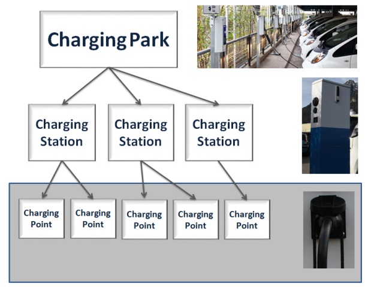
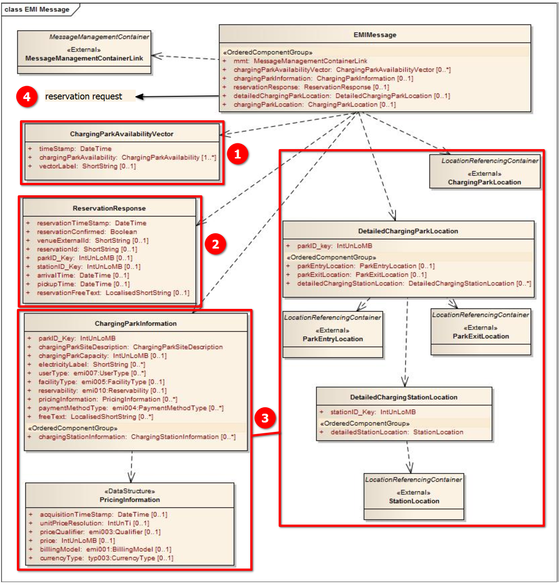
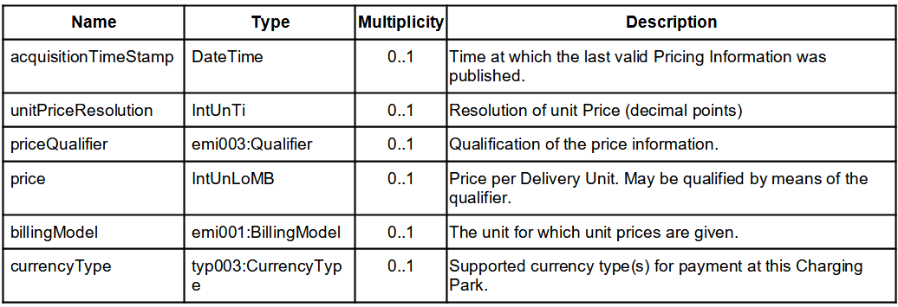

## Úvod

Technická specifikace ISO 21219 stanovuje formát a protokol TPEG určený pro poskytování informací o dopravě koncovým uživatelům. TPEG je určen pro média s vysokou přenosovou kapacitou, umožňuje informace členit strukturovaně se zvyšující se mírou detailů a komplexně popisovat polohu.

Jednotlivé oblasti dopravních událostí jsou v TPEG popsány odděleně, pomocí platformě nezávislého modelu (UML) a dvou odvozených platformě závislých modelů (binární a XML). Části specifikace stanovují pravidla tvorby modelu jeho převodu do platformě závislé podoby.

Více informací o kontextu TPEG je obsaženo v úvodu extraktu k části 1 normy TPEG (21219-1).

Technická specifikace ISO 21219 se zabývá druhou generací protokolu TPEG, označovaným zkratkou TPEG2. Rozlišení TPEG/TPEG1/TPEG2 se většinou uvádí pouze v úvodní části norem/specifikací, zatímco ostatní kapitoly již mezi TPEG a TPEG2 nerozlišují – to je implicitní dle kontextu.

Tento extrakt (dále jen “popisovaný dokument”) popisuje část 25 normy TPEG “Nabíjecí infrastruktura pro elektromobily (EMI)”, která specifikuje statické a dynamické informace o nabíjecí infrastruktuře a umožňuje její rezervaci..

Poznámka: Extrakt uvádí vybrané kapitoly popisovaného dokumentu a přejímá původní číslování kapitol.

## Užití

Popisovaný dokument stanovuje strukturu pro **nabíjecí infrastrukturu pro elektromobily (EMI)** a pravidla pro tvorbu obsahu těchto struktur. Počítá s pravidelným vysíláním (broadcast) statických informací o parkovištích s nabíjecími stanicemi a nabíjecích stanicích a častějším vysíláním informací o obsazenosti těchto parkovišť a stanic.

Dále v režimu klient server (mezi terminálem uživatele a serverem služby EMI) stanovuje možnost si vyžádat rezervaci nabíjecího místa a stanovuje, jak mají být strukturovány požadavek a odpověď. Je nezbytný pro analytiky provozovatele elektromobility a pro analytiky výrobce uživatelského terminálu (aplikace), kteří mají na starost návrh datového modelu systému a návrh pravidel, se kterými systém pracuje. Použije se při návrhu systému.

## 1 Předmět normy

Popisovaný dokument stanovuje aplikaci TPEG EMI „Nabíjecí infrastruktura pro elektromobily“. Podporuje informace o nabíjecí infrastruktuře pro elektrická vozidla, umístění nabíjecích míst (v hierarchii místo/stanice/parkoviště) a jejich vhodnosti pro příslušné vozidlo (např. typ konektoru, způsob nabíjení). Vzhledem k tomu, že elektrická vozidla budou "nabíjecí místo" zabírat delší dobu, jsou informace o dostupnosti / čekací době a možnostech rezervace pro uživatele elektrického vozidla velmi důležité, aby mohl optimálně naplánovat svou trasu/jízdu.

Popisovaný dokument umožňuje (pravidly, popisem datových struktur):

  - Identifikaci vhodných nabíjecích míst, čímž se zabrání zbytečnému objíždění za účelem nalezení vhodného nabíjecího místa (má rovněž přínos pro životní prostředí).

  - Ověření dostupnosti nabíjecích míst v reálném čase.

  - Možnost plánovat dopředu a rezervace místa na parkovišti s nabíjecími stanicemi, a tím optimalizovat plánování cesty.

  - Možnost vybrat si finančně atraktivní nabíjecí místo v parkovišti s nabíjecími stanicemi, jehož provozovatel má uzavřenou smlouvu o vyúčtování s poskytovatelem služby elektromobility uživatele.

Popisovaný dokument ponechává tvůrci publikace volnost k tomu, jak nadefinuje nabíjecí stanice a jimi obsažená nabíjecí místa. Klíčové pro nabíjecí místo totiž není počet nabíjecích konektorů, ale přítomnost vyhrazeného parkovacího místa. Nabíjecí místo není v normalizovaných strukturách použito a může na ní být odkázáno pouze v žádosti o rezervaci nabíjecího místa pomocí externího ID. Ve statické publikaci i dynamické publikaci se uvádí pouze počet konektorů na nabíjecí stanici, který není totožný s počtem nabíjecích míst na stanici.

## 2 Souvisící normy

Popisovaný dokument uvádí 9 normativních odkazů. Pro sestavení zpráv z kontejnerů, odvození z modelu UML, vysílání zpráv a řízení datového toku jsou použity další části normy TPEG2 ISO 21219 (1-6,9) a TPEG1 ISO 18234 část 11 pro popis kontejneru na polohu a klíčovou normu DIN 91286 specifikace identifikátorů elektrických konektorů.

## 3 Termíny a definice

Tato kapitola stanovuje 8 termínů. Jedná se o definici terminologie související s nabíjecí infrastrukturou pro elektromobily.

**parkoviště s nabíjecími stanicemi** _(charging park)_ – parkoviště s více fyzickými nabíjecími stanicemi, které technicky a/nebo logicky patří k sobě a jsou provozovány společně

**nabíjecí stanice** _(charging station)_ – stanice tvořená fyzickou jednotkou (obvykle sloupem nebo konstrukcí skříňového vzhledu), která obsahuje a řídí jedno nebo více nabíjecích míst a nabízí koncovému uživateli možnost autorizace (obvykle pomocí čtečky karty) a aktivaci jednoho z nabíjecích míst v nabíjecí stanici, připojení elektromobilu a zapnutí nabíjení

**nabíjecí místo** _(charging point)_ – součást nabíjecí stanice, kde lze elektromobil nabít. Obsahuje jeden či více elektrických nabíjecích konektorů; při obsazení jednoho konektoru je obsazeno celé nabíjecí místo. Typicky je pro každé nabíjecí místo k dispozici právě jedno parkovací místo.

**poskytovatel elektromobility** _(electromobility provider)_ – obchodní partner koncových uživatelů, který nabíjí jejich elektromobily

**provozovatel parkoviště s nabíjecími stanicemi** _(charging park operator)_ – provozovatel, který spravuje jedno nebo více parkovišť s nabíjecími stanicemi

Další termíny a zkratky z oboru ITS jsou obsaženy ve slovníku ITS terminology.

## 4 Symboly a zkratky

Tato kapitola stanovuje 17 zkratek, důležité z pohledu tohoto extraktu jsou:

**EVSEID** identita příslušenství k nabíjení elektromobilu _(Electric Vehicle Supply Equipment Identity)_

**MMC** kontejner pro management zpráv _(Message Management Container)_

**ADC** kontejner pro popis aplikace _(Application Data Container)_

**LRC** kontejner pro odkazování na polohu _(Location Referencing Container)_

**EMI** nabíjecí infrastruktura pro elektromobily _(ElectroMobility Charging Infrastructure)_

**UML** Unifikovaný modelovací jazyk _(Unified Modelling Language)_

**TPEG** framework poskytující formáty a protokoly pro poskytování dopravních informací, optimalizovaných na šíření prostřednictvím digitálního rozhlasu či Internetu

Další termíny a zkratky z oboru ITS jsou obsaženy ve slovníku ITS terminology (www.ITSterminology.org).

## 5 Podmínky a omezení aplikace

Tato kapitola (rozsah 1,5 strany) vymezuje:

  - **Identifikátor aplikace**, který je stanovený pro všechny aplikace v TS 21219-1.

  - **Verzi aplikace**. Verze je klíčová z pohledu dekodéru, jednotlivé verze stejné aplikace se totiž mohou od sebe lišit strukturou, obsahem atp.

  - **Pořadí kontejnerů**, ze kterých je zpráva složena. Zpráva se skládá z kontejneru pro management zpráv (MMC), kontejneru pro popis aplikace (ADC) a kontejneru pro odkazování na polohu (LRC).

  - **Rozšiřitelnost a zpětnou kompatibilitu**, jako požadavek na přeskočení neznámých částí zprávy dekodérem a specifikaci v budoucnu rozšiřitelných částí struktur TPEG zprávy.

  - **Rámec komponent služby TPEG** dle ISO/TS 21219-5.

## 6 Struktura EMI

Tato kapitola (rozsah 10 stran, obrázky a text) obsahuje UML model aplikace EMI s obrázky a příklady.

**Článek 6.2** uvádí jak je struktura zprávy EMI rozložena a z jakých důvodů. Základní struktura pro popis a identifikaci nabíjecí infrastruktury je (nabíjecí) parkoviště\>stanice\>místo, viz následující obrázek.



**Obr. 1** Struktura nabíjecí infrastruktury (Obrázek 2 normy)

Dále článek uvádí koncepci, která je dále aplikována v následujících kapitolách. Zpráva EMI musí být dostatečná, aby uživateli umožnila zjistit, kde se stanice nachází, jestli je pro řidiče vhodná (rozměry) a jestli je či není obsazená.

Zprávy EMI umožňují poskytnout detailní informace o parkovišti ve “statické” zprávě, která je vysílána s nízkou frekvencí, a ty odkázat v “dynamické” zprávě popisující obsazenost na úroveň konektorů v nabíjecích místech. Konceptuálně popisuje tyto typy zpráv i s příkladem:

  - zpráva se **statickými informacemi** o parkovišti (co zpráva, to jedno parkoviště), stanicích a nabíjecích místech, obsahuje veškeré informace nutné pro popis polohy, typu nabíjecích stanic, včetně konektorů, provozovatelů, polohy parkoviště, informace o cenách/fakturaci, podporované typy vozidel, omezení velikosti vozidel atp. Statická část je vysílána s výrazně nižší frekvencí než dynamická. (MMC, ADC a LRC, kde ADC obsahuje statické informace o parkovišti a volitelně detailní popis parkoviště)

  - zpráva s **dynamickými informacemi** o dostupnosti nabíjecích míst pro více parkovišť najednou, počet volných parkovacích míst, počet volných míst pro jednotlivé typy konektorů (pouze MMC a “dostupnost nabíjecí infrastruktury”)

  - zpráva se žádostí o rezervaci nabíjecí stanice / místa, konektoru podle identifikátoru parkoviště a stanice, externího identifikátoru stanice či polohy (pouze MMC a “žádost o rezervaci”)

  - zpráva obsahující odpověď na žádost o rezervaci (pouze MMC a “odpověď na žádost o rezervaci”)

**Článek 6.3** uvádí konceptuální informace o platebním modelu a platebních možnostech, volně diskutuje možnosti a volby provozovatele nabíjecí infrastruktury a možnosti uživatele.

**Článek 6.4** stanovuje strukturu a uvádí UML model tříd pro jednotlivé typy zpráv EMI (1-4 na obrázku níže). Zpráva EMI je navržena tak, aby obsahovala buď popisné (převážně statické) informace, nebo informace o dostupnosti (převážně dynamické) pro parkoviště s nabíjecími stanicemi a/nebo nabíjecí stanici.

Křížové odkazování by mezi statickými a dynamickými informacemi mělo být prováděno pomocí unikátních identifikátorů parkID\_Key a stationID\_Key.

Je stanoven minimální informační obsah pro uživatele. Struktura ChargingParkInformation obsahující parkID\_Key a ChargingParkSiteDesription, doplněné o ChargingParkAvailabilityVector obsahující časovou značku a minimální informace o ChargingParkAvailability (parkID\_Key a celkový počet volných míst na parkovišti s nabíjecími stanicemi).



**Obr. 2** UML model tříd aplikace EMI (obrázek 7 normy)

## 7 Komponenty zprávy EMI

Tato kapitola (rozsah 12 stran, obrázky a tabulky) stanovuje pro zprávu EMI její základní strukturu a detailně popisuje její jednotlivé součásti:

  - zpráva “EMIMessage” obsahující **ideálně rozděleně** vysílané:

      - statické informace o parkovišti s nabíjecími stanicemi, obsahuje veškeré informace nutné pro popis polohy, typu nabíjecích stanic, včetně konektorů, provozovatelů, polohy parkoviště. Statická část je vysílána s výrazně nižší frekvencí než dynamická.

      - dynamické informace o dostupnosti, či doby čekání na jejich uvolnění, atp.

      - informace o provedené rezervaci (ReservationResponse)

  - zpráva “ReservationRequest”: žádost o rezervaci nabíjecí stanice / místa, konektoru podle parkoviště, polohy či identifikátoru zařízení.

Jednotlivé články uvádějí části datových struktur.

Parkoviště s nabíjecími stanicemi je popsáno vlastními metadaty dle struktury uvedené na obrázcích výše obsahující id parkoviště, id stanice, externí id stanice, typ konektoru, počet konektorů, polohu stanic na parkovišti, název parkoviště, polohu vjezdu a výjezdu, platební informace atp.

Dostupnost parkovacích a nabíjecích míst (ChargingParkAvailabilityVector) je hierarchická struktura seskupující více parkovišť s nabíjecími stanicemi, kdy pro každé parkoviště je uveden počet volných parkovacích míst a počet volných nabíjecích konektorů seskupených po nabíjecích stanicích.

Žádost o rezervaci (ReservationRequest) je speciální typ zprávy, obsahující různé informace poptávané rezervaci, minimálně metodu platby a typ konektoru, volitelně další upřesňující informace k parkovišti/stanici (polohou, id či externím id), k provozovateli, k vozidlu: identifikátor vozidla, omezení velikosti vozidla a odhadovaný čas příjezdu atp.

Zpráva o rezervaci (ReservationResponse) obsahuje informace o garantování rezervace, zejména čas rezervace, čas od kdy bude stanice dostupná, identifikaci stanice a volný text.

Popis polohy není specifikován.

## 8 Datové typy EMI

Tato kapitola (rozsah 5 stran) obsahuje **definice** použitých datových struktur (typů). Na obrázku níže je, pro ilustraci obsahu a sloupců, uvedena část tabulky popisující datovou strukturu PricingInformation.



**Obr. 3** Ukázka části struktury PricingInformation (tabulka 18 normy)

Struktury se skládají ze složitých či jednoduchých datových objektů, výskyt každé položky datové struktury (tj. její multiplicita) je doplněn datovým typem a popisem. Tabulka níže uvádí datové struktury stanovené v této kapitole.

**Tab. 1** Seznam stanovených datových typů (zdroj: autor extraktu)

| **Datový typ EMI**          | **popis**                                                                                                                                                  |
| --------------------------- | ---------------------------------------------------------------------------------------------------------------------------------------------------------- |
| ChargingParkAvailability    | dostupnost stanic na daném parkovišti s nabíjecími stanicemi (daná strukturou o řádek níže)                                                                |
| ChargingStationAvailability | dostupnost nabíjecí stanice a jednotlivých typů nabíjecích konektorů na dané stanici (dané strukturou o řádek níže)                                        |
| FreePlacesForConnectorType  | počet neobsazených konektorů na nabíjecí stanici pro připojení vozidla podle typu konektoru, součet přes všechna neobsazená nabíjecí místa na dané stanici |
| ChargingParkSiteDescription | popis parkoviště s nabíjecími stanicemi, název, adresa, logo, provozovatel, otevírací doba, další služby atp.                                              |
| Logo                        | obrázek (logo)                                                                                                                                             |
| OperatorContactInformation  | kontakt na provozovatele                                                                                                                                   |
| SizeRestrictions            | maximální délka, šířka, výška a váha vozidla a délka kabelu                                                                                                |
| PricingInformation          | Informace o platebním modelu a metodách                                                                                                                    |

## 9 Tabulky EMI

Tato kapitola (rozsah 7 stran) obsahuje definice výčtových typů aplikace EMI (v 11 tabulkách). Následující tabulka jmenovitě uvádí jednotlivé tabulky a doplňuje je popisem a příkladem obsahu.

**Tab. 2** Seznam tabulek EMI (výčtů hodnot) (zdroj: autor extraktu)

| **Tabulka EMI**              | **Popis**                        | **Obsah**                      |
| ---------------------------- | -------------------------------- | ------------------------------ |
| emi001:BillingModel          | Výčet typů platebních modelů     | Př.: 002: price per hour       |
| emi002:ConnectorType         | Výčet typů konektorů (33)        | Př.: 017: NEMA 6-20, 240V, 20A |
| emi003:Qualifier             | Výčet typů kvalifikátoru         | Př.: 003: approximately        |
| emi004:PaymentMethodType     | Výčet typů platebních metod      | př.:008:prepaid card           |
| emi005:FacilityType          | Výčet typů parkovišť             | Př.: 003: private              |
| emi006:AssociatedServiceType | Výčet typů přidružených služeb   | Př.: 005: hotel                |
| emi007:UserType              | Výčet typů uživatelů             | Př.: 007: employees            |
| emi008:StationType           | Výčet typů stanic                | Př.: 003: charge\&park         |
| emi009:VehicleType           | Výčet typů vozidel               | Př.: 007:paddleboat            |
| emi010:Reservability         | Výčet typů “možnosti rezervace”  | Př.: 003:not reservable        |
| emi011:ContactType           | Výčet typů kontaktních informací | Př: 005:priority telephone     |

Následující tabulka obsahuje ukázku tabulky „emi002:ConnectorType” z popisovaného dokumentu.

**Tab. 3** Příklad části definice výčtového typu konektoru emi002:ConnectorType (tabulka 20 normy)

| **Kód** | **Fráze**                         | **komentář** |
| ------- | --------------------------------- | ------------ |
| 000     | stav neznámý (unknown)            |              |
| 001     | Typ2 (EU IEC 62196-2), 400V, 16A  |              |
| 002     | Typ2 (EU IEC 62196-2), 400V, 32A  |              |
| ...     | ...                               | ...          |
| 012     | MK Commando K9785, 200-250V, 32 A |              |
| 013     | Tesla Connector                   |              |
| ...     | ...                               | ...          |
| 032     | SAE J1772 DC Level3               |              |
| 255     | nestanoveno (undefined)           |              |

## Příloha A (normativní) TPEG-bin reprezentace EMI

Tato příloha (rozsah 16 stran) stanovuje binární reprezentaci aplikace EMI pro použití v DAB. Pro popis binární reprezentace je použit pseudokód, kde pro každé klíčové slovo zapsané struktury je znám jeho binární tvar.

Příloha obsahuje samostatně uvedené binární reprezentace rámce TPEG, zprávy EMI a jejích součástí, prvků určených pro budoucí rozšíření a datových typů. Dále obsahuje identifikátory komponent zprávy a vysvětlení použití obecných atributů TPEG. Příklad pseudokódu binární specifikace prvku ChargingParkAvailabilityVector je uveden v následující tabulce.

**Tab. 4** Příklad pseudokódu binární specifikace prvku ChargingParkAvailabilityVector (článek A.1.6 normy)

| \<ChargingParkAvailabilityVector(5)\>:=                      |                                                                                                                                                                              |
| ------------------------------------------------------------ | ---------------------------------------------------------------------------------------------------------------------------------------------------------------------------- |
| \<IntUnTi\>(5),                                              | : Id této komponenty                                                                                                                                                         |
| \<IntUnLoMB\>(lengthComp),                                   | : Počet bajtů v komponentě, kromě indikátorů id, lengthComp                                                                                                                  |
| \<IntUnLoMB\>(lengthAttr),                                   | : Počet bajtů v atributech                                                                                                                                                   |
| \<DateTime\>(timeStamp),                                     | : Začátek časového období, po které je poskytovaný obsah platný.                                                                                                             |
| \<IntUnLoMB\>(n),                                            |                                                                                                                                                                              |
| n \* \<ChargingParkAvailability\>(chargingParkAvailability), | : Informace o dostupnosti nabíjecích míst v konkrétním parkovišti s nabíjecími stanicemi. Volitelně mohou být informace o dostupnosti rozděleny na úroveň nabíjecích stanic. |
| BitArray(selector),                                          |                                                                                                                                                                              |
| if (bit 0 of selector is set)                                |                                                                                                                                                                              |
| \<ShortString\>(vectorLabel);                                | : Popis parkovišť s nabíjecími stanicemi patřících do tohoto vektoru (např. všechny nabíjecí stanice v Garmisch-Partenkirchenu)                                              |

## Příloha B (normativní) TPEG-ML reprezentace EMI

Tato příloha (rozsah 18 stran) obsahuje nejprve samostatně uvedené XML schéma rámce TPEG, dále zprávy EMI a jejích součástí, prvků určených pro budoucí rozšíření, datových typů a tabulek EMI (definovaných jako xs:complexType), viz příklad na obrázku níže. Následně uvádí vše výše zmíněné v jednom funkčním XML schématu.

```xml
<xs:complexType name="ChargingStationInformation">
<xs:sequence>
<xs:element name="stationID_Key" type="tdt:IntUnLoMB"/>
<xs:element name="stationExternalId" type="tdt:ShortString" minOccurs="0"/>
<xs:element name="connectorType" type="emi002_ConnectorType" minOccurs="0" maxOccurs="unbounded"/>
<xs:element name="stationType" type="emi008_StationType" minOccurs="0"/>
<xs:element name="vehicleType" type="emi009_VehicleType" minOccurs="0" maxOccurs="unbounded"/>
<xs:element name="sizeRestrictions" type="SizeRestrictions" minOccurs="0"/>
</xs:sequence>
</xs:complexType>
```

**Obr. 4** XML Schéma stanovujícího strukturu prvku ChargingStationInformation (část B.1.4 normy)
