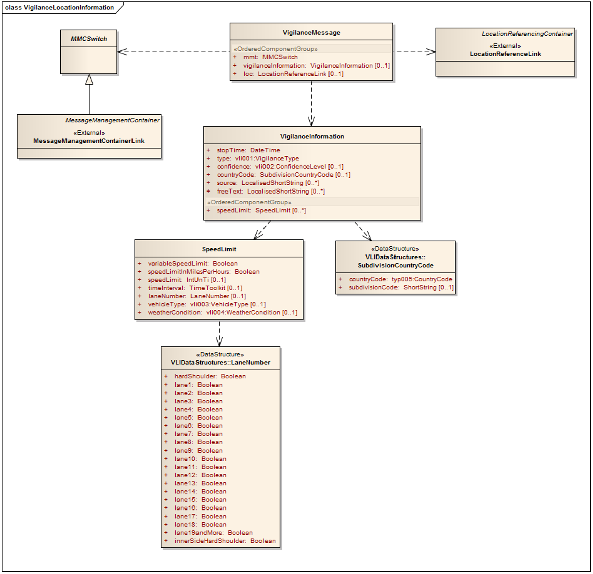

## Úvod

Technická specifikace ISO 21219 stanovuje formát a protokol TPEG určený pro poskytování informací o dopravě koncovým uživatelům. TPEG je určen pro média s vysokou přenosovou kapacitou, umožňuje informace členit strukturovaně se zvyšující se mírou detailů a komplexně popisovat polohu.

Jednotlivé oblasti dopravních událostí jsou v TPEG popsány odděleně, pomocí platformě nezávislého modelu (UML) a dvou odvozených platformě závislých modelů (binární a XML). Části specifikace stanovují pravidla tvorby modelu a jeho převodu do platformě závislé podoby.

Více informací o kontextu TPEG je obsaženo v úvodu extraktu k části 1 normy TPEG (21219-1).

Technická specifikace ISO 21219 se zabývá druhou generací protokolu TPEG, označovaným zkratkou TPEG2. Rozlišení TPEG/TPEG1/TPEG2 se většinou uvádí pouze v úvodní části norem/specifikací, zatímco ostatní kapitoly již mezi TPEG a TPEG2 nerozlišují – to je implicitní dle kontextu.

Tento extrakt (dále jen “popisovaný dokument”) popisuje část 26 normy TPEG „Informace o místech vyžadujících zvýšenou pozornost (TPEG2-VLI)“, která specifikuje informační strukturu pro informování řidiče o místech kde má věnovat zvýšenou pozornost.

Poznámka: Extrakt uvádí vybrané kapitoly popisovaného dokumentu a přejímá původní číslování kapitol.

## Užití

Popisovaný dokument stanovuje způsob poskytování informací o místech, kde je potřeba zvýšená pozornost řidiče. Je nezbytný pro analytiky poskytovatele služby informací o rychlostních limitech a pro analytiky výrobce uživatelského terminálu (aplikace), kteří mají na starost návrh datového modelu systému a návrh pravidel, se kterými systém pracuje. Použije se při návrhu systému.

## 1 Předmět normy

Tato technická specifikace je zaměřená na informování řidičů o úsecích pozemní komunikace, kde je zapotřebí jejich zvýšené pozornosti. Tyto úseky mohou být místa se zvýšenou nehodovostí, ale také místa s přítomností dohledových systémů. Při uplatňování / používání této normy je nutné dbát zvýšenou pozornost na národní legislativu tak, aby nedocházelo k jejímu porušení.

## 2 Souvisící normy

Popisovaný dokument uvádí 5 normativních odkazů na normu TPEG2 ISO 21219 části 1 (INV), 3, 4, 5 (SFW) a 9 (SNI). Jedná se o obecné normy definující základní strukturu zprávy, číslování a sestavení XML a binární serializace.

## 3 Termíny a definice

Tato kapitola definuje 8 termínů, m.j.

**Informace o zvýšené pozornosti** (_Vigilance information_) informace, kterým má řidič věnovat zvýšenou pozornost

**Úroveň důvěryhodnosti** (_Confidence Level_) nepovinný údaj o správnosti a přesnosti atributů informací o zvýšené pozornosti.

Další termíny a zkratky z oboru ITS jsou obsaženy ve slovníku ITS terminology.

## 4 Symboly a zkratky

Tato kapitola stanovuje 12 zkratek, důležité z pohledu tohoto extraktu jsou:

**MMC** kontejner pro management zpráv _(Message Management Container)_

**ADC** kontejner pro popis aplikace _(Application Data Container)_

**LRC** kontejner pro odkazování na polohu _(Location Referencing Container)_

**TPEG** framework poskytující formáty a protokoly pro poskytování dopravních informací, optimalizovaných na šíření prostřednictvím digitálního rozhlasu či Internetu

Další termíny a zkratky z oboru ITS jsou obsaženy ve slovníku ITS terminology (www.ITSterminology.org).

## 5 Podmínky a omezení aplikace

Tato kapitola (rozsah 1,5 strany) vymezuje:

  - **Identifikátor aplikace**, který je stanovený pro všechny aplikace v TS 21219-1.

  - **Verzi aplikace**. Verze je klíčová z pohledu dekodéru, jednotlivé verze stejné aplikace se totiž mohou od sebe lišit strukturou, obsahem atp.

  - **Pořadí kontejnerů**, ze kterých je zpráva složena. Zpráva se skládá z kontejneru pro management zpráv (MMC), kontejneru pro popis aplikace (ADC) a kontejneru pro odkazování na polohu (LRC).

  - **Rozšiřitelnost a zpětnou kompatibilitu**, jako požadavek na přeskočení neznámých částí zprávy dekodérem a specifikaci v budoucnu rozšiřitelných částí struktur TPEG zprávy.

  - **Rámec komponent služby TPEG** dle ISO/TS 21219-5.

## 6 Struktura VLI

Tato kapitola (rozsah 1 obrázek) obsahuje UML model zprávy aplikace VLI.



**Obr. 1** UML model tříd aplikace VLI (obrázek 2 normy)

## 7 Komponenty zprávy VLI

Tato kapitola (rozsah 2 strany, 3 tabulky) popisuje jednotlivé komponenty zprávy VLI.

Stanovuje pro zprávu VLI její základní strukturu „VigilanceMessage“ která může obsahovat informaci o potřebě zvýšené pozornosti (VigilanceInformation) a informaci o poloze (LocationReferenceLink) ne nezbytně v jedné zprávě.

Struktura VigilanceInformation obsahuje informace o typu situace, času, důvěryhodnosti, rychlostním omezení (SpeedLimit) a volný text. Struktura SpeedLimit obsahuje informace o čase, typu rychlostního omezení, jízdním pruhu, typu vozidla a souvisejících povětrnostních podmínkách.

Popis polohy není specifikován.

## 8 Datové typy VLI

Tato kapitola (rozsah 2 stran, 2 tabulky) obsahuje definice 2 použitých datových struktur (typů), **LaneNumber** stanovující výčet ovlivněných jízdních pruhů (laneX) a **SubdivisionCountryCode** stanovující kód země a státu, např. pro USA stát Massachusetts US MA.

Struktury se skládají ze složitých či jednoduchých datových objektů, výskyt každé položky datové struktury (tj. její multiplicita) je doplněn datovým typem a popisem. Tabulka níže uvádí datové struktury stanovené v této kapitole.

## 9 Tabulky VLI

Tato kapitola (rozsah 5 stran) obsahuje definice výčtových typů aplikace VLI (v 4 tabulkách). Následující tabulka jmenovitě uvádí jednotlivé tabulky a doplňuje je popisem a příkladem obsahu.

**Tab. 1** Seznam tabulek VLI (výčtů hodnot) (zdroj: autor extraktu)

| **Tabulka VLI**         | **Popis**                                                  | **Obsah**                          |
| ----------------------- | ---------------------------------------------------------- | ---------------------------------- |
| vli001:VigilanceType    | Typ zvýšené pozornosti (0-31)                              | Př.: 013: congestion charge camera |
| vli002:ConfidenceLevel  | Úroveň důvěryhodnosti (0-3)                                | Př.: 002: high                     |
| vli003:VehicleType      | Typ vozidla (0-6)                                          | Př.: 002: caravan                  |
| vli004:WeatherCondition | Povětrnostní podmínky platnosti rychlostního omezení (0-5) | Př.: 001: high winds               |

Následující tabulka obsahuje ukázku tabulky „vli001:VigilanceType” z popisovaného dokumentu.

**Tab. 2** Příklad části definice výčtového typu vli001:VigilanceType (tabulka 7 normy)

| **Kód** | **Fráze**                                                                 | **komentář**                                                                                               |
| ------- | ------------------------------------------------------------------------- | ---------------------------------------------------------------------------------------------------------- |
| 000     | Neznámý (unknown)                                                         |                                                                                                            |
| 001     | pevná rychlostní kamera (fixed speed camera)                              | Kamera na stálém místě, která se aktivuje při překročení povolené rychlosti.                               |
| 002     | rychlostní kamera s detekcí průjezdu na červenou (red light speed camera) | Kamera na stálém místě, která se aktivuje při průjezdu na červenou nebo při překročení povolené rychlosti. |
| 003     | kamera s detekcí průjezdu na červenou (red light camera)                  | Kamera na stálém místě, která se aktivuje při průjezdu na červenou.                                        |
| 004     | mobilní rychlostní kamera (mobile speed camera)                           | Kamera na dočasném místě, která se aktivuje při překročení povolené rychlosti.                             |

## Příloha A (normativní) TPEG-bin reprezentace VLI

Tato příloha (rozsah 5 stran) stanovuje binární reprezentaci aplikace VLI pro použití v DAB. Pro popis binární reprezentace je použit pseudokód, kde pro každé klíčové slovo zapsané struktury je znám jeho binární tvar.

Příloha obsahuje samostatně uvedené binární reprezentace rámce TPEG, zprávy VLI a jejích součástí, prvků určených pro budoucí rozšíření a datových typů. Dále obsahuje identifikátory komponent zprávy a vysvětlení použití obecných atributů TPEG. Příklad pseudokódu binární specifikace prvku VigilanceMessage je uveden v následující tabulce.

**Tab. 3** Příklad pseudokódu binární specifikace prvku VigilanceMessage (článek A.2.4 normy)

| \<VigilanceMessage(0)\>:=                                    |                                                              |
| ------------------------------------------------------------ | ------------------------------------------------------------ |
| \<IntUnTi\>(0),                                              | : Id této komponenty                                         |
| \<IntUnLoMB\>(lengthComp),                                   | : Počet bajtů v komponentě, kromě indikátorů id a lengthComp |
| \<IntUnLoMB\>(lengthAttr),                                   | : Počet bajtů v atributech                                   |
| ordered {                                                    |                                                              |
| \<MMCSwitch\>(mmt),                                          | : kontejner pro management zpráv                             |
| n \* \<VigilanceInformation\>(vigilanceInformation)\[0..1\], | : popis informace s omezením rychlosti                       |
| n \* \<LocationReferenceLink\>(loc)\[0..1\]                  | : kontejner pro odkazování na polohu                         |
| };                                                           |                                                              |

## Příloha B (normativní) TPEG-ML reprezentace VLI

Tato příloha (rozsah 6 stran) obsahuje nejprve samostatně uvedené XML schéma rámce TPEG, dále zprávy VLI a jejích součástí, prvků určených pro budoucí rozšíření, datových typů a tabulek VLI (definovaných jako xs:complexType), viz příklad na obrázku níže. Následně uvádí vše výše zmíněné v jednom funkčním XML schématu.

```xml
<xs:complexType name="SpeedLimit">
<xs:sequence>
<xs:element name="variableSpeedLimit" type="tdt:Boolean"/>
<xs:element name="speedLimitInMilesPerHours" type="tdt:Boolean"/>
<xs:element name="speedLimit" type="tdt:IntUnTi" minOccurs="0"/>
<xs:element name="timeInterval" type="tdt:TimeToolkit" minOccurs="0"/>
<xs:element name="laneNumber" type="LaneNumber" minOccurs="0"/>
<xs:element name="vehicleType" type="vli003_VehicleType" minOccurs="0"/>
<xs:element name="weatherCondition" type="vli004_WeatherCondition" minOccurs="0"/>
</xs:sequence>
</xs:complexType>
```

**Výpis 1** Výstřižek schématu XSD stanovujícího strukturu prvku SpeedLimit (článek B.2.4 normy)
