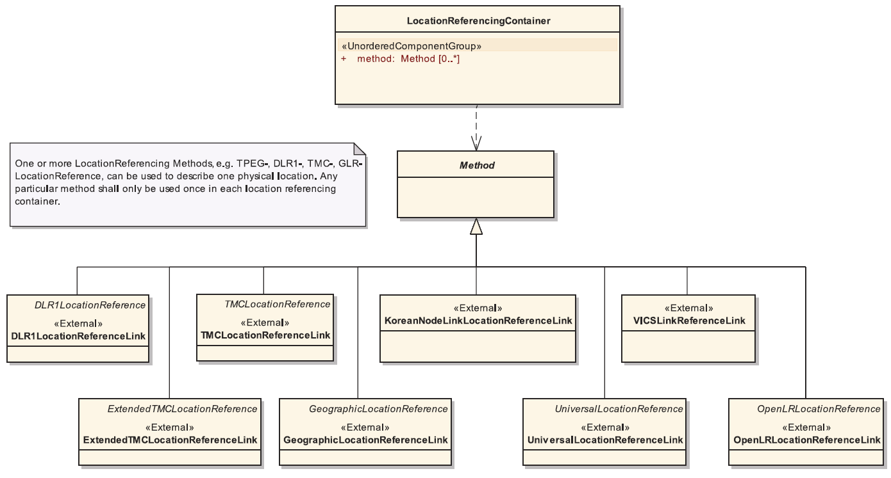

## Úvod

Technická specifikace ISO 21219 stanovuje formát a protokol TPEG určený pro poskytování informací o dopravě koncovým uživatelům. TPEG je určen pro média s vysokou přenosovou kapacitou, umožňuje informace členit strukturovaně se zvyšující se mírou detailů a komplexně popisovat polohu.

Jednotlivé oblasti dopravních událostí jsou v TPEG popsány odděleně, pomocí platformě nezávislého modelu (UML) a dvou odvozených platformě závislých modelů (binární a XML). Části specifikace stanovují pravidla tvorby modelu jeho převodu do platformě závislé podoby.

Více informací o kontextu TPEG je obsaženo v úvodu extraktu k části 1 normy TPEG (21219-1).

Technická specifikace ISO 21219 se zabývá druhou generací protokolu TPEG, označovaným zkratkou TPEG2. Rozlišení TPEG/TPEG1/TPEG2 se většinou uvádí pouze v úvodní části norem/specifikací, zatímco ostatní kapitoly již mezi TPEG a TPEG2 nerozlišují - to je implicitní dle kontextu.

Tento extrakt (dále jen “popisovaný dokument”) popisuje část 7 normy TPEG, která specifikuje jednu ze tří důležitých částí zprávy, tzv. Kontejner pro odkazování na polohu a související způsob indikace typu popisu polohy. Zprávy TPEG dle typu aplikace mohou či nemusí obsahovat tento kontejner (LRC), každý takový kontejner může obsahovat jeden či více různých metod popisu polohy jednoho fyzického místa.

Poznámka: Extrakt uvádí vybrané kapitoly popisovaného dokumentu a přejímá původní číslování kapitol.

## Užití

Popisovaný dokument stanovuje strukturu kontejneru pro odkazy na polohu, jednotlivé metody zavádí identifikátorem a externí referencí. Dokument je důležitý pouze jako specifikace obálky s indikací obsahu, který je stanoven v jiných normách, většinou pro každou metodu jiná norma. Dokument ke každé metodě uvádí její zdrojovou normu, kde by měl existovat její standardizovaný popis. Kontejner pro odkazování na polohu nelze použít samostatně, je vždy součástí zprávy obsahující dle typu aplikace kontejner pro management zpráv a kontejner pro popis aplikace.

Kontejner pro odkazy na polohu je důležitou součástí předávaných zpráv, proto je tato norma nezbytná pro **poskytovatele i příjemce** dopravních informací, jejich programátory, kteří pracují se samotným formátem XML či programují datové proudy pro DAB. Identifikátor použitých metod, obsažený právě v LRC, je zásadní pro správnou interpretaci obsahu LRC a tedy správné dekódování polohy v přijímači a pro prezentaci uživateli.

## 1 Předmět normy

Popisovaný dokument stanoví způsob signalizace (klientskému zařízení) použité metody odkazování na polohu ve všech aplikacích TPEG2, které požadují přenos podrobných informací o poloze do klientských zařízení, jako je například TPEG2-TEC. Dále popisuje kontejner pro odkazování na polohu TPEG2-LRC a jeho použití k signalizaci použité metody odkazování na polohu pro danou zprávu TPEG. LRC obsahuje informace umožňující dekodéru určit typ popisu polohy a použít správný algoritmus dekódování.

## 2 Souvisící normy

Tento dokument uvádí 11 normativních odkazů, 8 na normu TPEG2 ISO 21219 části 1-5, 15 a 21 (geografické odkazování na polohu) a 22 (odkazování na polohu metodou OpenLR) ISO 17572 části 2 (předdefinovaný popis polohy) a 3 (dynamický popis polohy) a normu TPEG1 18234-11 stanovující kontejner pro odkazování na polohu.

## 3 Termíny, definice a zkratky

Popisovaný dokument stanovuje 8 termínů. Klíčovými jsou tyto termíny:

**kontejner pro odkazování na polohu** _(location referencing container)_ – koncept sloužící pro seskupení všech komponent odkazování na polohu v rámci jedné zprávy TPEG na jednom místě

**dynamický odkaz na polohu** _(dynamic location reference)_ – odkaz na polohu vygenerovaný nezávisle na mapových podkladech, vycházející z geografických vlastností/atributů digitální mapové databáze

**předdefinovaný odkaz na polohu** _(pre-coded location reference)_ – odkaz na polohu používající jedinečný identifikátor, který je dopředu dohodnutý v přijímacích a vysílacích systémech za účelem výběru polohy ze souboru dohodnutých předdefinovaných poloh

Tato kapitola dále stanovuje 24 zkratek reprezentujících jednotlivé části / kontejnery zprávy:

**MMC** kontejner pro management zpráv _(message management container)_

**ADC** kontejner pro popis události _(Application data container)_

**LRC** kontejner pro popis místa _(Location referencing container)_

V popisovaném dokumentu je uvedena většina zkratek částí specifikace, zabývajících se odkazy na polohu. Tyto zkratky i jejich vysvětlení uvádíme jako součást výčtu částí specifikace v úvodu tohoto extraktu, proto je zde dále neuvádíme.

Další termíny a zkratky z oboru ITS jsou obsaženy ve slovníku ITS terminology (www.ITSterminology.org).

## 5 Podmínky a omezení toolkitu

Kapitola (rozsah 2 odstavce) obsahuje ujištění o použití všech popisů polohy z TPEG1, kromě těch, které byly v mezidobí vyřazeny, a zároveň přidává nové popisy. Dále kapitola informuje o povaze obsahu dokumentu, který není „aplikací“, je důležitou součástí aplikací, ale nemá vlastní identifikátor aplikace (AID).

## 6 Struktura kontejneru LRC

Kapitola (rozsah 1 strana) informuje o možnostech kontejneru pro odkazování na polohu:

  - použít dynamické popisy polohy, předdefinované popisy polohy či jejich kombinaci

  - použít více než jeden popis polohy uvnitř kontejneru jedné TPEG zprávy

  - použít nové metody popisu polohy (stanovené v dalších verzích tohoto dokumentu)

Popisovaný dokument nestanovuje konkrétní metody popisu polohy, ty jsou stanoveny v jiných normách. Nicméně umožňuje tyto externě stanovené datové koncepty použít v kontejneru pro odkazy na polohu (viz. Obrázek 1).



**Obr. 1** Možnosti popisu polohy v kontejneru Obecná struktura zprávy TPEG (obr. 2 normy)

## 7 LRC komponenty zprávy

Tato kapitola (rozsah 2 strany) nejprve popisuje strukturu samotného kontejneru pro odkazování na polohu (tedy to, že se skládá z jednoho či více popisů polohy pomocí různých metod) a potom krátce popisuje každou z možných metod popisů polohy i s uvedením zdrojové normy:

  - DLR1LocationReferenceLink – dynamický popis polohy stanovený v ISO 17572-3

  - TMCLocationReferenceLink – předdefinovaný popis polohy dle ISO 14819-1 a ISO 17572-2

  - KoreanNodeLinkLocationReferenceLink – předdefinovaný popis polohy dle ISO 17572-2

  - VICSLinkReferenceLink – předdefinovaný popis polohy dle ISO 17572-2

  - ExtendedTMCLocationReferenceLink – předdefinovaný popis polohy dle ISO 14819-1 a ISO 17572-2

  - GeographicLocationReferenceLink – dynamický popis polohy dle ISO/TS 21219-21

  - UniversalLocationReferenceLink – dynamický popis polohy dle TISA spec. SP13008

  - OpenLRLocationReferenceLink – dynamický popis polohy dle ISO/TS 21219-22

## Příloha A (normativní) TPEG-bin reprezentace Kontejneru pro odkazování na polohu

Příloha o rozsahu 2 stran je současně s následující přílohou klíčovou částí normy, stanovuje binární reprezentaci Kontejneru pro odkazování na polohu v pseudokódu.

V této příloze jsou jednotlivým metodám přiděleny identifikátory (1 = DLR1LocationReferenceLink až 8 = OpenLRLocationReferenceLink) nezbytné pro signalizaci použitých metod popisu polohy. Dále je zde pevně stanovena struktura kontejneru (viz výpis 1) a abstraktní třída “metoda”, ke které jsou potom stanoveny instance pro jednotlivé metody.

```
<LocationReferencingContainer(x)>:=
<IntUnTi>(x),             : id of this component
<IntUnLoMB>(lengthComp),  : number of bytes in component
<IntUnLoMB>(lengthAttr),  : number of bytes in attributes
unordered {
  n * <Method>(method)
};
```

**Výpis 1** Ukázka struktury šablony binární reprezentace Kontejneru pro odkazování na polohu (nečíslovaná tabulka Přílohy A)

## Příloha B (normativní) TPEG-ML reprezentace Kontejneru pro odkazování na polohu

Příloha o rozsahu 2 stran je současně s Přílohou A klíčovou částí normy, stanovuje XML reprezentaci Kontejneru pro odkazování na polohu formou XML schématu.

Identifikátory metod byly přiděleny v předchozím dodatku (viz výše), tento se jimi již nezabývá a stanovuje strukturu kontejneru (viz výpis 2) a komplexní třídu “metoda”, a následně uvádí celé XML schéma.

```xml
<xs:element name="LocationReferencingContainer" type="LocationReferencingContainer"/>
<xs:complexType name="LocationReferencingContainer">
<xs:sequence>
<xs:choice maxOccurs="unbounded">
<xs:element name="method" type="Method" minOccurs="0" maxOccurs="unbounded"/>
</xs:choice>
</xs:sequence>
</xs:complexType>
```

**Výpis 2** Ukázka struktury šablony (XML schéma) XML reprezentace Kontejneru pro odkazování na polohu (výřez XML kódu z Přílohy B)

XML schémata jednotlivých metod popisování polohy jsou odkazována pomocí instrukce _schemaLocation_. Tedy nejsou součástí popisovaného dokumentu, existují v jiných částech této normy (část 21 a 22) či v jiných zdrojových normách (ISO 17572), viz výpis 3.

Schémata je zapotřebí buď opatřit, nebo při sestavování šablony vypustit, jinak není možné šablonu použít.

```xml
<xs:import namespace="http://www.tisa.org/TPEG/DLR_4_0" schemaLocation="DLR_4_0.xsd"/>
<xs:import namespace="http://www.tisa.org/TPEG/TLR_2_0" schemaLocation="TLR_2_0.xsd" />
<xs:import namespace="http://www.tisa.org/TPEG/ETL_1_0" schemaLocation="ETL_1_0.xsd"/>
<xs:import namespace="http://www.tisa.org/TPEG/GLR_1_0" schemaLocation="GLR_1_0.xsd"/>
<xs:import namespace="http://www.tisa.org/TPEG/ULR_1_0" schemaLocation="ULR_1_0.xsd"/>
<xs:import namespace="http://www.tisa.org/TPEG/OLR_1_0" schemaLocation="OLR_1_0.xsd"/>
<xs:element name="LocationReferencingContainer" type="LocationReferencingContainer"/>
<xs:complexType name="LocationReferencingContainer">
...
```

**Výpis 3** Ukázka části XML schématu Kontejneru pro odkazování na polohu s odkazy na specifikace poloh (výřez XML kódu z Přílohy B)

## Literatura

Tato příloha obsahuje 19 normativních odkazů.
