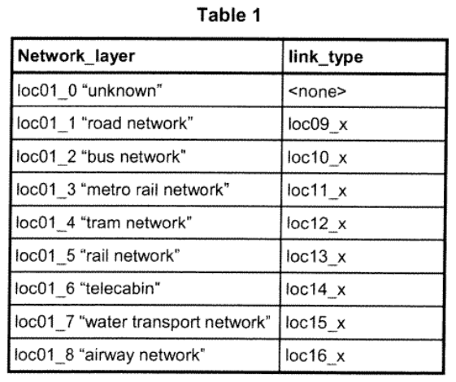
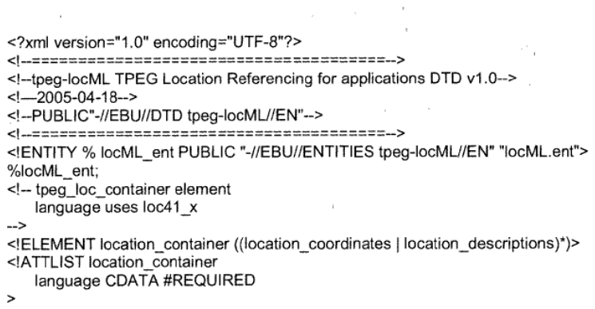

## Úvod

Tato norma je 2. částí souboru norem věnující se standardizaci protokolu pro dopravu TPEG. Detailně popisuje požadavky na odkazy polohy uživatele a jeho místa nalezení pomocí protokolu TPEG popsaném v jazyce XML pomocí aplikace tpeg-locML. Z podstaty tpeg - locML poskytuje zprávy, resp. data polohy pro navigační systémy a určuje a zobrazuje v mapě polohu vozidla za jízdy. Je možné také použití dalších metod pro určení polohy, jako je „link-id“ vhodné pro modifikaci tpegML.dtd (viz obrázek 1).

**Obr. 1** Deklarace entity link-idML pro rozšíření tpegML.dtd

Součástí normy jsou dvě přílohy, jejichž příklad je uveden v závěru extraktu. Příloha A obsahuje normativ DTD pro tpeg-locML. Příloha B obsahuje normativ pro tpeg-locML.ent.

Poznámka: Extrakt uvádí vybrané kapitoly popisovaného dokumentu a přejímá původní číslování kapitol.

## Užití

TPEG aplikace byly prvotně vytvořeny za účelem poskytování dopravních informací tak, aby bylo umožněno jejich kódování, dekódování, filtrování a následná interpretace jak vizuální, tak hlasová. Původní technologie TPEG využívá bitový formát popisované v XML. Vývoj této původní binární technologie TPEG byl určen především pro přenos prostřednictvím digitálního rádia (DAB) a případně internetem s přenosovou rychlostí do 10 kbit/s.

## 2 Souvisící normy

Čtenářům se doporučuje seznámit se s technickými specifikacemi ISO/TS 24530-1, ISO/TS 24530-3, ISO/TS 24530-4, případně s dalšími publikovanými pracemi na téma TPEG. Vhodnými specifikacemi jsou i ISO/TS 18234-1, ISO/TS 18234-2 a ISO/TS 18234-6.

## 3 Symboly a zkratky

Norma pracuje zejména s těmito zkratkami: ARIB, ATSC, DAB, DTD, DVB, EBU, IPR, PTI, RTM, SSF, TPEG, tpegML, tpeg-loc, tpeg-ilc, TTI, WGS84, XML.

Další termíny a zkratky z oboru ITS jsou obsaženy ve slovníku ITS terminology (www.ITSterminology.org).

## 4 Formát technické specifikace

Každá kapitola normy popisuje použití tpegML v XML. Každá má své představení a vysvětlení, co obsahuje a co popisuje, stanovuje příslušnou typovou definici dokumentu (DTD) a uvádí příklad. Úplný seznam DTD souborů je uveden v přílohách A a B.

Seznamy atributů jednotlivých prvků používaných v tpegML najdeme v tabulkách specifikací TPEG. V XML struktuře jsou jednotlivé vstupy kódovány. Atributy prvků v této technické specifikaci jsou převzaté z příslušné části CEN ISO/TS 18234.

Pro kódování prvků je používán formát rtmX\_Y, kde X vyjadřuje číslo tabulky a Y číslo řádku v dané tabulce (například rtm01\_1).

V kapitole je uveden příklad kódu napsaného v jazyce XML pro uzavírku na pozemní komunikaci z důvodu nehody na A12 a na následné přesměrování na objízdnou trasu.

## 5 tpeg-locML

Kapitola definuje pojmy a zápisy souboru tpegML.dtd a tpeg-locML.ent pro jazyk XML. Příklady jsou uvedeny v příloze A a B.

Kapitola popisuje jednotlivé hodnoty a možnosti přenosu, polohu, druh dopravního prostředku (viz příklad níže), popisu polohy, jazyk, směr, reference k oblasti, typ oblasti, síťový popis a další.

Příklad hodnot prvku „druh dopravy“ je na obrázku 2.

**Obr. 2** Hodnoty prvku mode\_of\_transport (druh dopravy)

Síťová vrstva používá objekty reference podle tabulky 1.

**Tab. 1** Objekty reference síťové vrstvy (tabulka 1 popisovaného dokumentu)

## Příloha A (normativní)

DTD pro tpeg-locML – TPEG odkaz na polohu v aplikaci (tpeg-locML.dtd)

Příklad zápisu jednotlivých prvků v části vzorové struktury XML

**Obr. 3** Ukázka DTD pro tpeg-locML (tpeg-locML.dtd, příloha A popisovaného dokumentu)

## Příloha B (normativní)

Reference externích prvků DTD pro tpeg-locML – TPEG odkaz na polohu v aplikaci (tpeg-locML.ent)

Příklad zápisu jednotlivých prvků v části vzorové struktury XML

**Obr. 4** Ukázka referencí externích prvků pro tpeg-locML (tpeg-locML.ent, příloha B popisovaného dokumentu)
