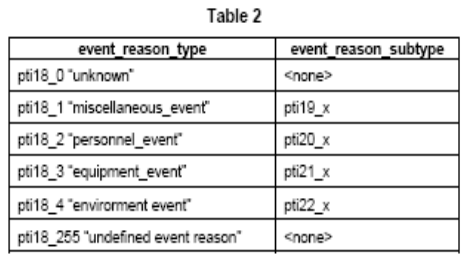
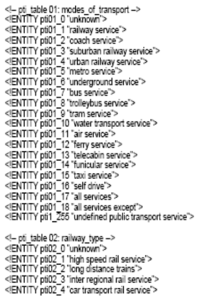
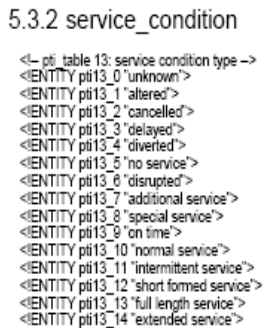
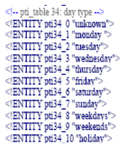
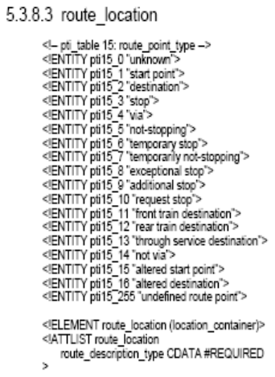

## Úvod

Tato norma je 4. částí souboru norem věnujících se standardizaci protokolu pro dopravu TPEG. Detailně popisuje aplikaci tpeg-ptiML: Informace o veřejné dopravě, za použití XML protokolu, její základní datovou strukturu a dále způsoby kódování a dekódování zpráv s informacemi o veřejné dopravě.

Cílem aplikace tpeg-ptiML je postihnout všechny druhy veřejné dopravy a to jak dopravy v rámci města tak i meziměstské. Aplikace byla vytvořena s ohledem na efektivitu a jazykovou nezávislost předávání informací o veřejné dopravě přímo od poskytovatele koncovému uživateli, dalším poskytovatelům služeb, vysílacím stanicím, apod.

Pro správné porozumění tomuto dokumentu je důležité se seznámit se specifikací binární TPEG-PTI (CEN ISO/TS 18234-5).

TPEG aplikace byly prvotně vytvořeny za účelem poskytování dopravních informací tak, aby bylo umožněno jejich kódování, dekódování, filtrování a následná interpretace jak vizuální, tak hlasová. Původní technologie TPEG využívá bitový formát. Vývoj této původní binární technologie TPEG byl určen především pro přenos prostřednictvím digitálního rádia (DAB) a případně internetem s přenosovou rychlostí do 10 kbit/s.

V současnosti existují další nosiče, např. ARIB, ATSC, DAB, DVB či internet, které umožňují daleko rychlejší přenosovou rychlost a ekonomický a technický užitek. Právě pro tento účel byl vytvořen formát TPEGu XML (tpegML). TpegML je dále určen poskytovatelům služeb, kteří mají standardizované rozhraní pro vysílání zpráv _(standardised message generation interface)_ a dále by jim bylo umožněno vyvíjet systém, který by uspokojil jejich požadavky. Tento způsob umožní poskytovatelům služeb vyměňovat předpřipravené informace bez ohledu na systémy generování zpráv _(message generation systems)_. TpegML dále umožňuje poskytovat jazykově nezávislou službu. To znamená, že v rámci tpegML lze předávat zprávy v kterémkoli jazyce, který zná daný internetový prohlížeč.

Poznámka: Extrakt uvádí vybrané kapitoly popisovaného dokumentu a přejímá původní číslování kapitol.

## Užití

Technologie TPEG je určena pro poskytovatele služeb, neboť byla navržena pro širokou škálu aplikací, které vyžadují efektivní přenos z jednoho bodu do více bodů přes veskrze nespolehlivé širokopásmové vysílání.

## 1 Předmět normy

TPEG-PTI umožňuje popis jednotlivých služeb a dále také obecný popis trasy, služeb a širší oblasti. Informace o veřejné dopravě jsou většinou využívány v jednom z následujících případů:

  - elektronické informační tabule na zastávkách veřejné dopravy,

  - zprávy o stavu sítě,

  - popis jednotlivých služeb,

  - aktuální zprávy.

Zprávy TPEG-PTI mohou být seskupovány tak, aby výsledná „prezentace“ měla charakter na který je uživatel zvyklý, např.:

  - zprávy o nehodách,

  - informace o zastávkách a konečných stanicích,

  - informace o trase,

  - informace o jednotlivých službách.

## 2 Souvisící normy

Pro lepší pochopení této normy je vhodné projít analogickou normu v binárním kódu CEN ISO/TS 18234-5.

## 3 Symboly a zkratky

Tato kapitola uvádí 14 zkratek, podstatné z nich jsou uvedeny níže:

**3.1 ARIB** association of radio industries and business – Japonská asociace průmyslu a obchodu rádií

**3.2 ATSC** American television standards committee – americká televizní standardizační komise

**3.3 DAB** digital audio broadcasting – digitální audio vysílání

**3.5 DVB** digital video broadcasting – digitální vysílání videosignálu

**3.6 EBU** European broadcasting union – Evropská vysílací unie

**3.8 PTI** public transport information – dopravní informace o veřejné dopravě

**3.9 TPEG** Transports protocol experts group – Expertní skupina dopravních protokolů, forma strukturovaného zápisu informací o dopravě

**tpegML** aplikace tpeg XML psaná malými písmeny, což ji odlišuje od binárních aplikací TPEG, psané s velkými písmeny.

**tpeg-loc** location referencing for applications – označování polohy pro aplikace

**TTI** traffic and travel information – dopravní a cestovní informace

**XML** extensible markup language – rozšiřitelný značkovací jazyk

Další termíny a zkratky z oboru ITS jsou obsaženy ve slovníku ITS terminology (www.ITSterminology.org).

## 4 Struktura normy

Tato norma je rozdělena do částí, které popisují každá jeden prvek, používaný v rámci tpegML. Článek vždy specifikuje účel daného prvku, příslušnou DTD definici a příklad. Úplný seznam .dtd a .ent souborů je uveden v přílohách A a B.

Seznamy atributů jednotlivých prvků, používaných v tpegML, jsou uvedeny v tabulkách specifikací TPEG. V XML struktuře jsou jednotlivé vstupy kódovány. Atributy prvků v této technické specifikaci jsou převzaté z příslušné části CEN ISO/TS 18234.

Pro kódování prvků je používán formát ptiX\_Y, kdy X vyjadřuje číslo tabulky a Y číslo řádku v dané tabulce (například pti01\_1).

**Tab. 1** Typy a podtypy důvodu události (tabulka 2 popisovaného dokumentu)

Kapitola dále obsahuje 2 vzorové XML: „ Bezpečnostní výstraha na King´s Cross – všechny služby přerušeny“ a „Informace o speciální službě Expresu Hogwart“.

## 5 Aplikace tpeg-ptiML

Popis tpeg-ptiML je uveden v přílohách A a B: tpeg-ptiML.dtd a tpeg-ptiML.ent soubory.

Tato kapitola přináší seznam hodnot, jakých může dosahovat a způsoby, jakými je možné prostřednictvím tpeg-ptiML předat informaci o:

  - frekvenci veřejné dopravy,

  - způsobu veřejné dopravy (dopravním prostředku, typu prostředku, typu dopravy, názvu dopravce),

  - informacích o službách (např. stav dané služby, možnost rezervace, frekvence, potřebná jízdenka, stavu služby, další poskytované služby, status rezervace, informace o jízdence, důvod události, druh jízdního řádu, popisu trasy - místo a čas doručení služby, specifikace, formát uvedeného času, den služby, specifikace trasy, atp.),

  - doplňujících informacích,

  - odkazu na navazující služby.

Příklad seznamu hodnot, kterých může nabývat prvek „druhy dopravy“, je na obrázku 1.

**Obr. 1** Hodnoty prvku „druhy dopravy“ (tabulky pti01 a pti02)

Příklady hodnot pro prvek „stav služby“ jsou na obrázku 2.

**Obr. 2** Hodnoty prvku „stav služby“ (tabulka pti13)

## Příloha A (normativní) DTD pro tpeg-ptiML aplikace TPEG Informace o veřejné dopravě (tpeg-ptiML.dtd)

Tato příloha obsahuje příklady zápisu jednotlivých prvků v XML struktuře. Část vzorové XML struktury je uvedena níže: chybí originál

## Příloha B (normativní) Reference externích prvků pro tpeg-ptiML – aplikace TPEG Informace o veřejné dopravě (tpeg-ptiML.ent).

Příloha obsahuje seznamy kódů jednotlivých atributů prvků, používaných v rámci tpeg-ptiML.

Příklad hodnot pro „typ dne“ je na obrázku 3.

**Obr. 3** Hodnoty prvku „typ dne“ (tabulka pti34)

Příklad hodnot pro „lokalizaci trasy“ je na obrázku 4.

**Obr. 4** Hodnoty prvku „lokalizace trasy“ (tabulka pti15)
