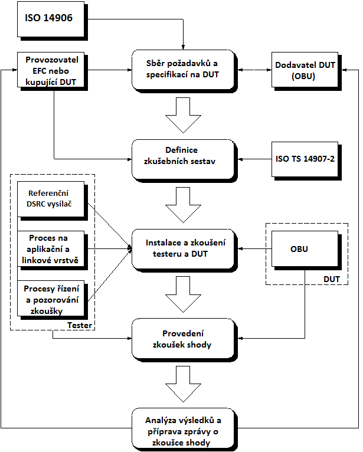
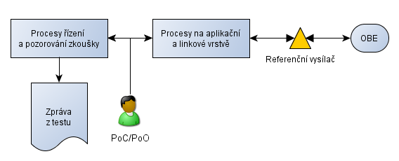
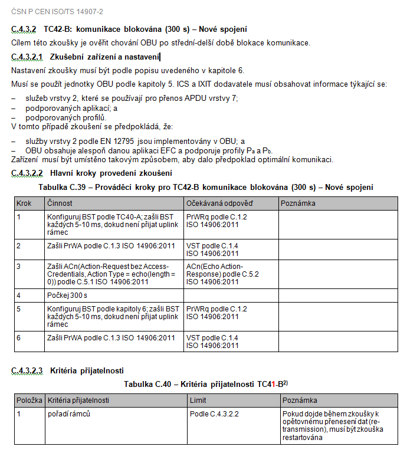

## Úvod

ISO/TS 14907 sestává z těchto částí pod společným názvem Elektronický výběr poplatků (EFC) – Zkušební postupy pro mobilní a pevná zařízení:

  - Část 1: Popis zkušebních postupů

  - Část 2: Specifikace zkoušek pro posouzení shody na rozhraní systému EFC

Tato část ISO/TS 14907 popisuje zkoušky, které ověří shodu implementací funkcí OBU a jejích datových struktur pro aplikace EFC dle prohlášení o shodě implementace založeném na ISO 14906:2011 pro aplikace elektronického vybírání poplatků (EFC). Je zde stanoveno jakým způsobem mají vypadat dokumenty ICS (příloha A) a IXIT (příloha B), jak vypadají zkušební sestavy a z jakých se mohou skládat zkoušek (**příloha C**).

Důležité části této normy jsou zejména příloha C stanovující případy zkoušek, příloha A a B stanovující formuláře, jež musí dodavatel zkoušené OBU vyplnit a poskytnout zkušební laboratoři a kapitola 6 těla normy stanovující požadavky na jednotlivé aktéry i zařízení.

Poznámka: Extrakt uvádí vybrané kapitoly popisovaného dokumentu a přejímá původní číslování kapitol.

## Užití

Tato zpráva je důležitá hlavně pro **výrobce / dodavatele OBU**, kterému stanovuje povinnosti vůči zkušebním laboratořím a udává mu strukturu formulářů ICS a IXIT. Dále je norma důležitá pro **zkušební laboratoře**, které budou na jejím základě posuzovat shodu zařízení s normou 14906 (hlavně příloha C, která uvádí příklady testů) a v neposlední řadě je tato norma důležitá pro **výběrčí mýtného**, kteří budou po OBU jednotkách shodu s normou 14906 vyžadovat, a bez přesně stanovených testů by toto nebylo možné.

## 1 Předmět normy

Tato část ISO/TS 14907 **popisuje zkoušky pro ověření shody** **implementací** funkcí palubní jednotky (OBU) a jejích datových struktur, dle prohlášení o shodě implementace založeném na ISO 14906 pro aplikace elektronického vybírání poplatků (EFC). Po zkouškách izolovaných datových položek a funkcí (C.1-C. 2), norma uvádí také příklad zkoušení celé transakce EFC (C.3).

Zkoušky jsou zde stanoveny za **účelem posouzení možností a chování OBU**, vytvoření návodu pro posouzení shody OBU a schválení typu, umožnění srovnávat výsledky odpovídajících zkoušek aplikovaných na různých místech v různých časech, a usnadňují komunikace mezi zúčastněnými stranami.

**Obr. 1** Proces zkoušení shody (zdroj norma 14907-2, Obrázek 2)

Zkoušky OBU pro posouzení shody zahrnují základní funkcionalitu aplikační vrstvy DSRC, funkce aplikace EFC, atributy EFC, postupy jejich adresování, rozhraní člověk-stroj, transakční model EFC a chování daného rozhraní. Do předmětu ISO/TS 14907-2 **nespadá** definice zkoušek, které posuzují funkční charakteristiky, robustnost, a spolehlivost dané implementace. Ty jsou definovány v normě CEN ISO/TS 14907-1.

## 2 Souvisící normy

Mezi hlavní normy související s tématem této technické zprávy patří:

ČSN P CEN ISO/TS 14907-1 (01 8381) Elektronický výběr poplatků (EFC) – Zkušební postupy pro mobilní a pevná zařízení – Část 1: Popis zkušebních postupů

ČSN EN ISO 14906:2012 (01 8382) Elektronický výběr mýtného (EFC) – Stanovení aplikačního rozhraní pro vyhrazené spojení krátkého dosahu

ČSN EN 12834 (01 8202) Dopravní telematika (RTTT) – Vyhrazené spojení krátkého dosahu (DSRC) – Aplikační vrstva

V této části jsou uvedeny 2 nezbytné dokumenty potřebné pro správné použití tohoto dokumentu ČSN EN ISO 14906 a ČSN EN 12834.

## 3 Termíny a definice

Tato norma uvádí 23 termínů, mezi nejdůležitější termíny uvedené v této normě patří:

**Autentikátor –** data přidaná ke zprávě nebo kryptografická transformace dat, která příjemci dat umožňuje ověřit si zdroj a integritu dat a ochránit tak data proti padělání

**prohlášení o shodě implementace, *ICS*** _–_ stanovisko vydané dodavatelem implementace nebo systému, požadující shodu s danými specifikacemi, stanovující, které možnosti byly implementovány

**dodatečné informace pro zkoušení implementace, *IXIT*** _–_ prohlášení dodavatele nebo realizátora zkoušené implementace (IUT), které obsahuje nebo odkazuje na všechny informace týkající se zkoušené implementace (IUT) a jejího zkušebního prostředí, které umožní zkušební laboratoři provést na IUT příslušnou sestavu zkoušek

Další termíny a zkratky z oboru ITS jsou obsaženy ve slovníku ITS terminology.

## 4 Symboly a zkratky

Norma uvádí 48 zkratek termínů, mezi nejdůležitější zkratky normy patří, kromě těch zmíněných výše, **DUT** zkoušené zařízení a **IUT** zkoušená implementace.

Další termíny a zkratky z oboru ITS jsou obsaženy ve slovníku ITS terminology (www.ITSterminology.org).

## 5 OBU a podpůrné informace

Tato kapitola uvádí informace, které musí dodavatel poskytnout o OBU, kterou chce testovat a v jakém stavu by měl OBU pro testy dodat. Například, že musí dodat OBU personalizované tak, aby mohlo provést zkoušky podle ICS a IXIT, dodat nejméně pět zkušebních vzorků včetně uživatelského manuálu a plně a poctivě vyplnit příslušné formuláře ICS a IXIT.

Dále tato kapitola uvádí co je to ICS a IXIT, k jakým dalším normám se vztahují a jaké informace musí obsahovat. Například: výpočet pověření k přístupu ve službách DSRC a výpočet autentikátorů v EFC funkcích. Viz články 5.1 a 5.2.

### 5.1 ICS

ICS je prohlášením dodavatele, že nárokuje shodu s určitou specifikací. ICS stanoví, které možnosti byly v daných specifikacích implementovány. Také stanoví možná omezení v implementaci specifikace.

### 5.2 IXIT

IXIT je prohlášením dodavatele nebo implementátora dané IUT, které obsahuje nebo odkazuje se na všechny informace, navíc k těm, jež jsou stanoveny v prohlášení o shodě implementace, související s daným DUT a jeho zkušebním prostředím. IXIT umožní zkušební laboratoři provést příslušnou zkušební sestavu na DUT.

## 6 Požadavky na zkoušení

Tato kapitola v části 6.1 velmi stručně (obrázkem) stanovuje **konceptuální zkušební architekturu**. V ní jsou stanoveny pro funkci testera tzv. body řízení a body pozorování (PoC a PoO), které slouží k řízení a spouštění zkoušek a k odečítání měřených hodnot zkoušek.

### 6.2 Systém zkoušení shody

V části 6.2 je uveden **systém zkoušení shody**, který se skládá (viz Obrázek 2) z OBE, referenčního vysílače, procesů na aplikační a linkové vrstvě, procesů řízení a pozorování zkoušky za účelem generování zkušebních sestav, vlastního řízení zkoušek a reportování.

**Obr. 2** Zkušební pomůcky (zdroj norma 14907-2, Obrázek 5)

Dále jsou v tomto článku stanoveny jednoznačné požadavky na dodavatele DUT, zkušební laboratoř, samotné zkušební zařízení a zkoušené zařízení DUT v dané konfiguraci IUT:

  - Zkoušky prováděné zkušebním zařízením musí být schopny se zaměřit na aspekty komunikačního protokolu EFC.

  - DUT musí být provozováno v řízeném prostředí podle instrukcí výrobce

  - Zkušební sestavy musí striktně odpovídat evropským nebo mezinárodním normám na DSRC a ISO 14906:2011, dále musí být generovány podle specifikace výrobce.

  - Nástroj pro generování zkoušky musí být schopen zkontrolovat zprávy oproti evropským nebo mezinárodním normám na DSRC. Všechny události DUT jsou zkušebním zařízením uloženy.

  - Výsledky zkoušek musí být navázány pouze na danou IUT daného DUT. Musí se zkoušet pouze správnost dané implementace; jakékoliv posouzení funkčních charakteristik, robustnosti nebo spolehlivosti je vyloučeno.

  - atd.

### 6.3 Zkušební dokumentace

Část 6.3 popisuje **zkušební dokumentaci**. Ta musí poskytovat nosné informace o použitém zkušebním zařízení, o DUT, o provedených zkouškách a získaných výsledcích zkoušky.

  - Veškerá dokumentace musí být dostupná před zahájením zkoušky DUT a jeho výrobce/dodavatel musí poskytnout ICS a IXIT.

  - Pro ověření shody mezi IUT a specifikací, včetně odkazovaných norem, se požaduje kompletnost a správnost zkušební sestavy tedy, že musí pokrývat všechny implementované a stanovené funkce DUT (na základě poskytnutých ICS a IXIT).

  - Každý provedený případ zkoušení musí být dokumentován zařízením pro generování zkoušek. Pro každý případ zkoušení musí být udán verdikt: vyhověl, neprůkazný nebo nevyhověl. Výsledky všech případů zkoušení musí vytvořit zprávu o zkoušce shody.

## Příloha A  (normativní)  Formulář prohlášení o shodě implementace

Příloha A obsahuje formulář prohlášení o shodě implementace ve formě předvyplněných tabulek A.1 až A.44 (viz ukázka tabulky A.6 níže). Tyto tabulky obsahují seznam atributů souvisejících s určitou funkcionalitou (s určitým aspektem komunikačního protokolu) s možností vyplnění zda jsou či nejsou implementovány, či v jaké míře.

**Tab. A.6** GET.req

| Datový prvek      | Datový typ               | Použitý/nepoužitý, omezení |
| ----------------- | ------------------------ | -------------------------- |
| eid               | Dsrc-EID                 |                            |
| accessCredentials | OCTET STRING OPTIONAL    |                            |
| iid               | DsrcEID OPTIONAL         |                            |
| attrIdList        | AttributeIdList OPTIONAL |                            |

Tuto přílohu (**po vyplnění se stává ICS**) musí vyplnit dodavatel / výrobce DUT a dodat ji před zahájením testů do zkušební laboratoře.

## Příloha B  (normativní)  Dodatečné informace pro zkoušení implementace

Příloha B definuje rozšířenou funkcionalitu ve formě předvyplněných tabulek B.1 až B.11 (viz ukázka tabulky B.8 níže). Tyto tabulky stanovují rozšířenou funkcionalitu a nastavení parametrů, které jsou nezbytné pro provedení zkoušek s možností vyplnění, zda je či není implementována, či v jaké míře. ¨

**Tab. B.8** Výpočet pověření k přístupu v různých službách L7

| Služba L7         | Algoritmus pro výpočet pověření k přístupu |
| ----------------- | ------------------------------------------ |
| GET.req           |                                            |
| SET.req           |                                            |
| ACTION.req        |                                            |
| EVENT\_REPORT.req |                                            |

Tuto přílohu (**po vyplnění se stává IXIT**) musí vyplnit dodavatel / výrobce DUT a dodat ji před zahájením testů do zkušební laboratoře.

## Příloha C  (informativní)  Případy zkoušení OBU

Příloha C uvádí **příklady případů zkoušení** pro funkcionalitu DSRC a EFC.

Tato příloha není určena ke stanovení úplné sestavy zkoušek pro určitou implementaci. K sestavení sestavy zkoušek pro konkrétní EFC implementaci **mohou být případy zkoušení změněny a mohou být definovány nové případy zkoušení**, které se přidají ke stávajícím tak, aby zkoušení shody bylo úplné.

**Obr. 3** Ukázka stanovení procesu zkoušení shody (zdroj norma 14907-2)

Případy zkoušení jsou rozděleny do 4 kategorií (zkušebních sestav):

  - zkušební sestavu pro zkoušení základních znaků aplikační vrstvy,

  - zkušební sestavu pro zkoušení základních funkcí EFC,

  - zkušební sestavu pro zkoušení transakce EFC, na aplikační vrstvě a aplikačním rozhraní a

  - zkušební sestavu pro zkoušení rozšířených znaků DSRC EFC

Každá zkušební sestava obsahuje jednotlivé případy zkoušení. Ty se skládají z:

  - popisu zkušebního zařízení a jeho nastavení,

  - postupu provedení zkoušek,

  - úplného výčtu činností a nastavení v jednotlivých krocích zkoušky i s očekávaným výsledkem uvedených v tabulkách C. 5, 7, 9, …, 39 a

  - kritérií přijatelnosti uvedených v tabulkách C. 6, 8, …, 40 (tedy jaké výsledky zkoušky znamenají, že zařízení splnilo test)

Více informací o konkrétní zkoušce je uvedeno na následujícím obrázku, ze kterého si čtenář může udělat obrázek, jakým způsobem jsou zkoušky definovány.

## Příloha D

Příloha D uvádí informativní přehled japonských zkoušek shody OBE, které se zakládají na souboru norem ISO/TS 14907, aby ilustrovaly způsob, jak je lze zavést v praxi.
