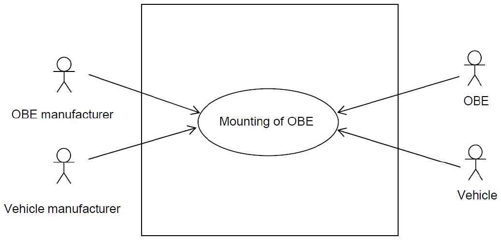
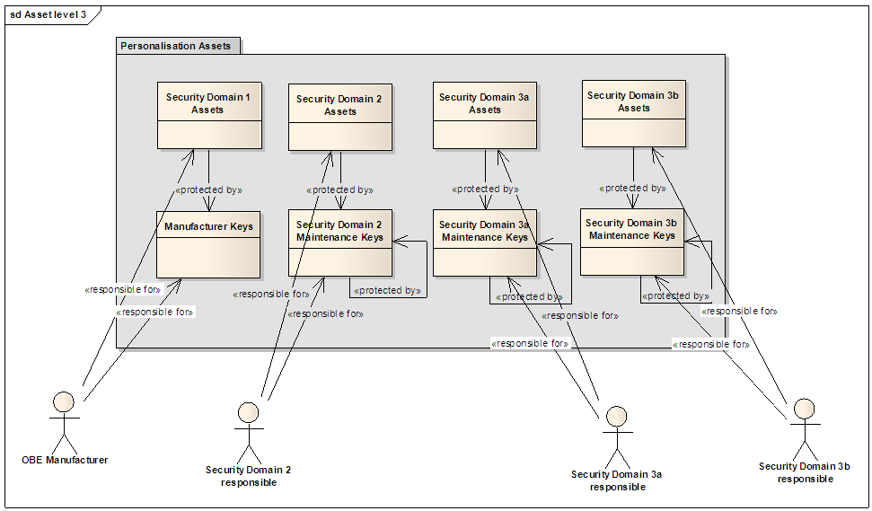

## Úvod

Tato technická zpráva se zaměřuje na personalizaci a požadavky na montáž OBE předinstalovaných ve vozidle již z výroby. V případě, že by výrobce vozidla předinstaloval OBE do vozidla, bude muset poskytovatel služby EETS řešit její personalizaci. To se týká jak satelitní, tak i mikrovlnné palubní jednotky. Zpráva tedy zavádí a popisuje

  - požadavky a omezení na **rozhraní ve vozidle**

      - sběrnice dat vozidla

      - podmínky a omezení automobilového průmyslu (například elektronické, mechanické…)

      - bezpečnostní požadavky

      - požadavky na zabezpečení

  - požadavky a omezení na **personalizaci**

      - přístup k chráněným datům uvnitř OBE, např. číslo smlouvy

      - umístění EETS a dat o smlouvě (uvnitř OBE nebo v čipové kartě)

      - aktivace a deaktivace OBE

Poznámka: Extrakt uvádí vybrané kapitoly popisovaného dokumentu a přejímá původní číslování kapitol.

## Užití

Tato zpráva je důležitá hlavně pro **poskytovatele služby EETS** jako konceptuální dokument stanovuje co v jakých případech práce s předinstalovanou OBE dělat a co požadovat, očekávat od výrobce vozidla, OEM dodavatele OBE a dalších zúčastněných subjektů. Tato technická zpráva nenahrazuje směrnice a normy, kterými by se výrobci měli vždy řídit a používat je.

Pro **orgány státní správy** je tato zpráva zajímavá z pohledu požadavků n OBE, které se budou používat na území státu. Vzhledem k tomu, že neukládá žádné povinnosti, není tato zpráva pro orgány státní správy zásadní. Je zaměřena na praktické aspekty personalizace a nezavádí nové postupy, které by bylo třeba na správní úrovni akceptovat.

Pro **výrobce zařízení** a dodavatele telematických systémů tato norma obsahuje důležité pokyny, jak mají společně postupovat, a co by neměli opomenout při práci s přeinstalovanou jednotkou OBE.

## 1 Předmět normy

Montáž OBE do vozidla jeho výrobcem je nejpravděpodobnější a nejefektivnější odpovědí na požadavek masového rozšíření OBE. Aby předinstalace byla možná, musí výrobce zapojit jednotku podle předem stanovených pravidel, tak aby k ní (a datům na ní uloženým) mohl přistupovat poskytovatel služby EETS. Zabudovaná jednotka také bude těžit z přístupu k informacím dostupných přes vozidlovou sběrnici.

Personalizací se v této zprávě míní sled úkonů zahrnujících inicializaci, přizpůsobení a aktivaci interoperabilní služby EFC v OBE pro uživatele s či bez existujícího účtu. Personalizace může probíhat buď prostřednictvím bezdrátového rozhraní, nebo připojením úložného média přímo k OBE. Obě metody mají svoje principy použití, například zabezpečení bezdrátové komunikace proti narušení; tato zpráva shrnuje klíčové aspekty principu použití při personalizaci jednotky OBE.

## 2 Souvisící normy

Tato zpráva odkazuje jak na normy elektronického mýta, EN ISO 14906, CEN ISO/TS 17575–1, prEN ISO 17573, tak i na další dokumenty v bibliografii.

V této části jsou uvedeny 4 normy používané / odkazované touto technickou zprávou.

## 3 Termíny a definice

Tato norma uvádí 5 termínů, jsou zde standardní termíny z oblasti EETS (evropský elektronický mýtný systém), jako je

**poskytovatel služby**\[1\] (toll service provider) – právní subjekt poskytující svým zákazníkům služby spojené s mýtným v jedné či více mýtných doménách pro jedno či více tříd vozidel

**výběrčí mýtného** (toll charger) – právní subjekt, který vybírá mýtné v nějaké mýtné doméně

Další termíny a zkratky z oboru ITS jsou obsaženy ve slovníku ITS terminology.

## 4 Symboly a zkratky

Tato norma uvádí 28 zkratek. Mezi jinými například:

**CC** společná kritéria _(Common Criteria)_

**ECU** elektronická řídicí jednotka vozidla _(Electronic Control Unit)_

**MAC** autentizační kód zprávy _(Message Authentication Code)_

**AID** stanovení aplikačního rozhraní _(Application Interface Definition)_

**OBE** palubní zařízení _(On-Board Equipment)_

**EFC** elektronický výběr mýtného _(Electronic Fee Collection)_

Další termíny a zkratky z oboru ITS jsou obsaženy ve slovníku ITS terminology (www.ITSterminology.org).

## 5 Popis kontextu

Tento článek v části 5.2 popisuje **aktéry a jejich role** v procesu personalizace jednotky OBE zabudované do vozidla výrobcem vozidla. Kromě těch zřejmých (viz kapitola 3) jsou zde

  - OEM výrobce OBE,

  - výrobce vozidla,

  - registrační autorita vozidla,

  - poskytovatel mobilního připojení a

  - samozřejmě uživatel.

Na rozdíl od situace kdy jednotku do vozidla dodává poskytovatel služby a je tedy většinou plně zodpovědný za personalizaci OBE u předinstalované jednotky to již není tak zřejmé.

Jednu jednotku totiž může v průběhu životnosti vozidla využívat více poskytovatelů služby. Tato zpráva kvůli tomu zavádí **role bez předem určeného aktéra** (vydavatel OBE, vlastník OBE, vydavatel dat vozidla atd.). Tyto role jsou použity dále v textu v diagramech případů užití.

Článek 5.3 identifikuje „aktiva“ v OBE jako něco co má hodnotu a potřebuje ochranná opatření (např. verifikaci). Aktiva mohou být data či autorizační klíče uložené v jednotce. Aktiva jsou zde rozdělena do 3 kategorií podle toho, kdy se s nimi manipuluje,

  - **do kategorie aktiv dat transakce**: spadají ta data, která se mění, je k nim přistupováno, během průjezdu OBE čtecí zónou DSRC.

  - Z hlediska **kategorie aktiv personalizace** jsou důležité aplikační klíče, aplikační data a vozidlová data, příkladem aplikačních dat jsou data o smlouvě zavedená v normě CEN ISO/TS 17575-1.

  - Naproti tomu mezi do kategorie **specifických aktiv výrobce OBE,** patří datová struktura, aplikační software v jednotce a další.

V případě předinstalované jednotky, výrobce OBE zodpovídá za její oživení, vydavatel OBE za dodání specifických částí umožňujících personalizaci do jednotky a až v poslední řadě poskytovatel služby zodpovídá za nastavení přístupových práv a rozhoduje, kdo může přistupovat k aktivům jednotky.

Článek 5.4 definuje případy užití, zde jsou právě použity „neobsazené“ role stanovené dříve ve zprávě. Jedná se o tyto případy užití (každému je věnován separátní článek):

  - inicializace: montáž jednotky do vozidla,

  - inicializace: přidělení (nahrání) individuálních dat,

  - inicializace: přidělení (nahrání) vozidlových dat,

  - propojení OBE ke smlouvě mezi uživatelem a poskytovatelem služby,

  - umožnění dálkové mobilní komunikace,

  - výměna vozidla při zachování stávající smlouvy,

  - zrušení (aktivní) smlouvy,

  - změna smlouvy vztahující se k jednomu vozidlu,

  - standardní případy užití z EFC: výběr mýtného a dohled,

  - oprava či aktualizace OBE,

  - změna vlastností vozidla,

  - vyřazení z provozu a výměna OBE.

Například článek 5.4.1 „inicializace: montáž jednotky do vozidla“ uvádí ve formě lineárního textu, co vše obnáší proces montáže OBE do vozidla. Tj. že by měl výrobce vozidla zajistit samotnou montáž, že by neměl opomenout připojení OBE na datovou sběrnici vozidle, na uživatelské rozhraní, k anténám pro komunikaci s okolím atd. Obrázek níže (ve zprávě obr. č. 2) uvádí, kteří aktéři se tohoto případu užití zúčastňují.

**Obr. 2** aktéři podílející se na případu užití inicializace: montáž jednotky do vozidla

## 6 Koncept personalizace

Tato kapitola obsahuje v části 6.1 přehledně seřazené obecné požadavky, do kterých spadají

  - funkční požadavky (např: RF7.1 OBE musí zveřejnit záznamy o událostech souvisejících s životním cyklem pouze autorizované osobě) a

  - bezpečnostní požadavky. U bezpečnostních požadavků kde je mj. proveden rozbor hrozeb, jsou stanoveny podkategorie jako bezpečnostní koncept protiopatření, ochrana přístupu k aktivům OBE umožňujícím personalizaci, ochrana proti odposlouchávání, správa přístupových klíčů (kódů) a kryptografické algoritmy, počet potřebných klíčů, množství dat, výkon a další.

Na následujícím obrázku (ve zprávě obr. č. 16) ukazuje distribuovanou zodpovědnost za klíče mezi více bezpečnostních domén spravujících přístupové klíče. Tento scénář není jediný, mezi další nastíněné v této zprávě patří výchozí stav, kdy klíče ke všem aktivům spravuje výrobce OBE a stav, kdy klíče spravuje důvěryhodná 3 osoba

**Obr. 16** aktéři podílející se na případu užití inicializace: montáž jednotky do vozidla

Důležitou částí této kapitoly je část 6.2 „bezpečnostní požadavky“, kde jsou vyjmenovány důvody pro integraci OBE do vozidla (např. možnost dodávat energii z vozidlové sítě) a postupy instalace (např. že žádná část OBE nesmí překážet řidiči ve výhledu na situaci na silnici).

## 7 Personalizační údaje

V této kapitole jsou vyjmenovány nezbytné údaje potřebné pro personalizaci jednotky. Jedná se zejména o atributy EFC (např. EFC-ContextMark, VehicleClass, PaymentMeans a další), data OBE (např. identifikátor výrobce OBE, sériové číslo OBE a další), informace o ochraně přístupu k datům (např. AccessCredentials, Certificates a další) a jako poslední registrační data vozidla (např. Registrační značka, váhové limity a další).

Jde o údaje z norem EN ISO 14906 a CEN ISO/TS 17575-1.

## 8 Doporučení

Tato kapitola obsahuje doporučení vztahující se na fyzickou integraci jednotky OBE do vozidla. Je zde zmíněna norma ISO 16750, která stanovuje provozní napětí, nominální napětí, provozní teplotu, klidovou teplotu a další.

Dále je v kapitole zmíněno, že některým aspektům fyzické integrace by měla být věnována vyšší pozornost, a to proto, že se jim nevěnují normy (jsou většinou plně v režii výrobce OBE). Jsou to, mimo jiné chování v režimu snížené spotřeby a chování OBE v mezních situacích, např bez nahrané smlouvy.

## Literatura

Tato část je zejména důležitá, protože vyjmenovává všechny důležité normativní i nenormativní dokumenty vztahující se k integraci OBE do vozidla. Jde o zprávy evropské komise, směrnice a rozhodnutí.

Například:

1.  EETS-EG6 Zpráva : INTEGRACE PALUBNÍCH JEDNOTEK DO VOZIDEL – ZÁVĚREČNÁ ZPRÁVA – Připravená: Expertní skupinou 6 : Integrace OBE zařízení do vozidel, pracující na podpoře Evropské komise DG TREN

2.  RSI\_WP3\_D3.4 : RCI projekt – Výsledek D3.4 – Bezpečnostní architektura interoperability zpoplatnění silnic pro interoperabilitu

<!-- end list -->

1.  V kontextu kapitoly 3 je použit termín „toll service provider“, který ale nikde jinde v zprávě není. Ve zprávě je použit termín „service provider“ překládaný v kontextu EETS jako poskytovatel služby.
