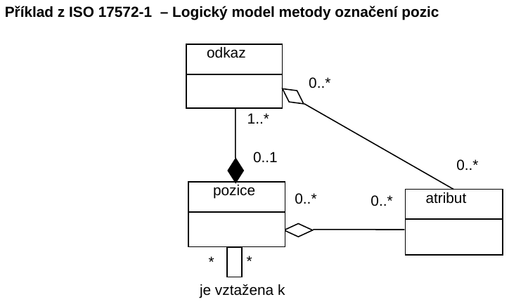

## Úvod

Tato norma je součástí norem zaměřených na oblast navigačních a lokačních systémů a souvisejících aplikací. Její uplatnění nalezneme zejména v oblasti navigačních a lokačních systémů, poskytování dopravních služeb, dopravním zpravodajství a systémech řízení dopravy.

Poznámka: Extrakt uvádí vybrané kapitoly popisovaného dokumentu a přejímá původní číslování kapitol.

## Užití

Tato norma je důležitá pro pochopení současných metod v oblasti lokalizačních prostředků při navigování. Jedná se zejména o metody podporující dynamickou formu navigace, tedy o poskytování dopravních zpráv v reálném čase. Z tohoto pohledu je norma vhodná pro tvůrce či provozovatele dopravních informačních center, správce významných dopravních objektů (tunelové stavby, dálniční stavby apod.). Norma umožňuje reprezentovat stejné geografické jevy v různých geografických databázích odlišných distributorů, v různých aplikacích a na odlišných SW/HW platformách.

**Pro orgány státní správy** tato norma představuje přehled současných technologií v oblasti poskytování aktuálních dopravních informací včetně výkladu základních pojmů vyjadřovacích prvků modelovacího jazyka UML.

## 1 Předmět normy

Norma je členěna do tří částí: všeobecné požadavky a konceptuální model, předem kódované označení pozic a dynamické označení pozic.

Tato první část normy specifikuje všeobecné metody pro označování pozic. Jedná se zejména o stanovení požadavků na metody označování pozic a příslušného konceptuálního datového modelu. Výrazně větší prostor je pak věnován v přílohové části popisu jednotlivých metod pro označení pozic.

Označením pozice (LR) rozumíme jedinečnou identifikaci geografického objektu. V digitálním světě je takový objekt reprezentován jako geoprvek (feature) v příslušném geografickém souboru dat. Příkladem běžně známé LR je poštovní adresa domu. Z důvodu vyšší efektivity přenosu jsou LR kódovány. Zvláště významné je to při přenosu informací o různých objektech mezi různými systémy.

To, co jednotlivý uživatel navigačního resp. informačního systému nevidí, jsou metody stanovení polohy a jejich propojení s databázovými systémy, a to je předmětem této normy.

## Příklad z ISO 17572-1 – Logický model metody označení pozic

**Obr. 1** Konceptuální model metody označení pozic

## 2 Souvisící normy

Norma vychází a je plně slučitelná s normou EN ISO 14825:2004 Geografické datové soubory (GDF 4.0). Čtenářům je též doporučeno seznámit se s normami ISO/TC204 WG11.

## 3 Termíny a definice

Norma uvádí 50 termínů a definicí a pro účely tohoto extraktu jsou doplněny další:

**3.1.4 atribut** _(atribute)_ charakteristika geoprvku, jež je nezávislá na jiných geoprvcích

**3.1.26 LRM metoda označení pozic** *(**location referencing metod)*** metoda označení pozic za účelem snadné výměny informací o pozicích mezi různými systémy

**3.1.32 bod** _(point)_ bezrozměrný prvek, který specifikuje geometrickou polohu; je určen dvojicí či trojicí souřadnic

**CRA** Centrální registrační administrátor, úřad spravující registry národních registračních administrátorů (NRA/I a NRA/T) a registr výrobců. Je jím Nizozemský normalizační institut.

**geoprvek** _(feature)_ databázová reprezentace objektu reálného světa

**TPEG** protokol přenosu dat používaný u vysokorychlostních přenosových kanálů

**RDS-TMC** RDS rádiový datový systém – digitální informační kanál na vlnách FM; TMC kanál pro přenos dopravních informací

**UML** nástroj pro popis a návrh informačních systémů. V této normě je UML použito jako nástroj k vyjádření strukturálních vztahů a specifických vazeb s využitím grafických prvků. Úplná definice UML je obsažena v normě ISO 19501.

**VICS** vozidlový informační a komunikační systém. Byl vytvořen pro účely digitálních mapových databází jako základ pro poskytovatele mapových děl k začlenění odlišných mapových identifikátorů do jejich vlastních digitálních map. Digitální mapový základ na nulté úrovni tvoří uzly a linie, které pokrývají celou uliční síť.

Další termíny a zkratky z oboru ITS jsou obsaženy ve slovníku ITS terminology.

## 4 Symboly a zkratky

Norma uvádí 19 zkratek.

Další termíny a zkratky z oboru ITS jsou obsaženy ve slovníku ITS terminology (www.ITSterminology.org).

## 5 Cíle a požadavky na metodu označování pozic

ITS aplikace mají odlišné cíle týkající se požadavků na lokační odkazy, které z jejich přirozené povahy nemohou být zcela splněny. Teoreticky nejlepší metoda označení pozic by vyžadovala aby každý systém měl v daném čase stejně přesný mapový podklad a všechny odkazy by byly identifikovatelné bez dalšího dodatečného úsilí. Okolnosti specifické pro každý systém označení pozice mohou dát odlišné váhy následujícím cílům. První cíl proto zavádí, že vynaložené úsilí je v každém případě nákladová položka, jež má být minimalizována.

**O-1** LRM metoda by měla být tak jednoduchá, aby se dala v daném čase realizovat.

Označení pozice zahrnuje přinejmenším dva systémy jež vzájemně komunikují. Komunikace rovněž vyvolává náklady, a tedy by tyto náklady měly být minimalizovány.

**O-2** LRM by neměla neopodstatněně navyšovat objem přenášených dat.

Dalším cílem je přesné označení jak na straně vysílacího tak přijímacího systému. Ve většině případů bude záviset právě na přijímači, jak dekóduje označenou pozici nejlépe jak umí. Aby se tak stalo musí být ve vysílacím systému implementováno zasílání označení pozice takové přesnosti jaká je možná.

**O-3** LRM by měla poskytovat označení pozice v nejlepší možné přesnosti.

### 5.2 Požadavky na metodu označení pozic

Kromě uvedených cílů i některé další minimální požadavky by měly LRM splňovat.

Jednou z nejdůležitějších datových charakteristik ITS aplikací je prostorová přesnost. Prostorová přesnost je aspektem kvality dat a je popsána v normě GDF. Požadavky na prostorovou přesnost dat pro ITS se liší v závislosti na aplikaci. Tím není myšlena pouze kategorizace aplikací ale jak aplikace operativně pracuje. Některé aplikace, jmenovitě vozidlové systémy pro pokročilou bezpečnost vyžadují velmi přesná data. Dokonce i v rámci jedné aplikace se mohou lišit požadavky na různé úrovně přesnosti dat.

Jeden základní požadavek napříč všemi metodami však je,Bez ohledu na užitou metodu tato nesmí vnášet dodatečnou chybu v prostorové lokalizaci mimo té, která je již v datech zahrnuta. Nicméně označení pozice u informací týkajících se oblasti, například informace o počasí nebo kontaminaci životního prostředí určitá prostorová chyba je povolena z důvodu nepřesné(„fuzzy“) povahy takovéto informace. Klíčový požadavek pro takovéto odkazy je, že mají být vytvořeny s takovou přesností aby se uživatel mohl této oblasti vyhnout či zvolil jiné vhodné řešení

## 6 Konceptuální datový model pro metody označování pozic

Konceptuální model poskytuje obecně rámec pro popis a definici LRM Konceptuální model má obecnou platnost, čímž není vázán na LRM definovanou v normě. Z tohoto důvodu jsou zde pro ilustraci uvedeny další LRM, viz příloha B

### 6.3 Popis konceptuálního modelu

**Označení** je návěstí, které je přiřazeno **pozici**. Pozice je jednoduchý, nebo složený geografický object, který je spojen s databází objektů pomocí lokačních definic, které specifikují co je míněno konkrétní pozicí. Pozice může slučovat rozdílné atributy, které umožňují pro potřeby identifikace metod zpracovat a posoudit informace o pozici. Relační vztahy spojují rozdílné pozice aby umožnily jejich sofistikované využití zejména z pohledu jejich topologické či hierarchické struktury.

### 6.4 Kategorie pozic

Pozice mohou být rozděleny následovně: pozice bodu, pozice linie, pozice oblasti. Tyto kategorie pozic reprezentují objekty reálného světa, které mohou být popsány následovně:

  - existují pro jednotlivou pozici (Pozice bodu);

  - mezi dvěma pozicemi jako úsek PK (Pozice liniové či lineární);

  - skládající se ze dvou či více liniových pozic (Pozice lineární);

  - vybrané úseky PK definované oblasti (Implicitní pozice oblasti);

  - v rámci hranic definovaných oblastí (Explicitní pozice oblastí).

Bodové pozice mohou být popsány jako jednotlivě se vyskytující. Bodové pozice zahrnují například zájmové body, služby veřejné vybavenosti, komerční objekty a další. Liniové pozice jsou liniové objekty ohraničené dvěma bodovými pozicemi. Lineární pozice jsou dvě nebo vice po sobě následujících liniových pozic ohraničené třemi nebo vice po sobě jdoucími bodovými pozicemi, které definují spojený lineární úsek v síti pozemních komunikací. Implicitní pozice oblasti je vice než jedna lineární pozice určité oblasti spojených do jednoho svazku. Explicitní pozice oblasti jsou dvourozměrné geoprvky jako vládní administrativní oblasti či poštovní okrsky nebo jen definované vnější obrysy ploch na daném místě na mapě.

### 6.5 Konceptuální model silniční sítě

Jedním z důvodů pro označování pozic je vazba na částí sítě PK. Z tohoto důvodu je zde na obrázku 6.2 znázorněn konceptuální model včetně upřesnění některých termínů a jejich vazeb To je nutné zejména z důvodu složitého popisu sítě PK a křižovatek v normě GDF jež nesplňuje požadavky na konceptuální model pro označování pozic.

Obecně se síť PK skládá z PK. PK jsou reprezentovány jménem jako celkem a skládají se z množiny úseků PK. Úseku PK může být přiděleno číslo. Úsek PK se skládá z uzlů a hran, je ohraničen křižovatkami a může obsahovat mezilehlé křižovatky (kde se nemění název komunikace) Křižovatka je spojnicí křižujících se PK. Nejjednodušší varianta křižovatky se skládá z jednoho uzlu. V případě, že křižovatku tvoří dva a více uzlů s jednou či více hranami, je takováto křižovatka považována za složenou.

## Příloha A (informativní) Přehled používaných metod pro označení pozic

Příloha uvádí lokalizace pomocí adres, dopravních uzlů, rastrové sítě, dynamická lokalizace metodou TPEG (Transport Protocol Expert Group) či kombinace uvedených metod.

## Příloha B (informativní) Příklad metod pro označení pozic v praxi

Příloha uvádí metody RDS-TMC a VICS. Metoda RDS-TMC využívá prostředky digitálně kódované dopravní informace, které jsou dostupné uživateli prostřednictvím jeho rádiového přijímače. Metoda využívá protokol ALERT-C (EN ISO 14819‑1).

**Příklad z ISO 17572-1 – RDS-TMC Systém označení pozic**

**Tab. 1** Alert-C protokol pro označení pozic

| **pozicečíslo** | **typ** | **PK/ křižovatkačíslo** | **první název**        | **druhý název** | **odkaz na oblast** | **odkaz na lineární pozici** | **negativní ofset** | **pozitivní ofset** |
| --------------- | ------- | ----------------------- | ---------------------- | --------------- | ------------------- | ---------------------------- | ------------------- | ------------------- |
| 4457            | Aqua.   | A12                     | Gouwe Aquaduct         |                 | 2009                | 949                          | 4456                | 4458                |
| 4458            | Exit    | A12                     | Gouda                  | N207            | 30089               | 949                          | 4457                | 4470                |
| 4470            | Park.   | A12                     | Parkeerplaats de Andel |                 | 30089               | 949                          | 4458                | 4460                |
| 4460            | Exit    | A12                     | Reeuwijk               |                 | 2009                | 949                          | 4470                | 4461                |

**Metoda VICS** (Vehicle Information and Communication System )

Jedná se o japonskou alternativu k evropské metodě RDS-TMC. Formát lokační informace (LI) skládající se z hlavičky a vlastní lokační zprávy je v části 2 normy. Všechny nebo jakákoliv část LI mohou být volitelně vynechány, pokud je možné se odkázat mezi databázemi na polohu pomocí jednoznačně definovaných pravidel fyzického formátu. Rozšíření datové struktury může být stanoveno pomocí uživatelsky definovaného rámce uvnitř LSI (Local Section Information). Každá hlavička specifikuje informační obsah následujícího úseku - typ, definici a jednotky. Absolutní souřadnice, relativní souřadnice, souřadnicová síť a jejich kombinace mohou být zvoleny volitelně v informační části Souřadnice úseku (Coordinates Section). Identifikátor uzlu (Node\_ID), identifikátor spojení (Link\_ID), název PK, číslo PK, označení křižovatky aj., stejně tak jejich kombinace a informace o ofsetu, mohou být volitelně uvedeny v informační části deskriptoru úseku PK.

## Příloha C (informativní) Popis UML modelovacích vyjadřovacích prvků

Z důvodu jednotné interpretace UML vyjadřovacích prvků jsou zde definovány použité prvky UML diagramů (třída, asociace, kompozice aj.).

## Příloha D (informativní) Srovnání užitých definic termínů s terminologií užívanou v technické komisi TC 211

Jedná se o srovnání významového obsahu definic termínů užívaných v této části normy a normách technické komise TC 211 (přesnost, souřadnice, atribut apod.).

## Příloha E (informativní) Fyzický formát popisující všeobecnou část

Označení pozic specifikované v této normě může být využito pro různé ITS aplikace. V této příloze jsou popsány fyzické formáty, binární formáty, datové typy, schéma definice XML pro označení pozic metodou TPEG a další.

Příklad lokační reference ve formátu XSD

```xml
<?xml version="1.0" encoding="UTF-8"?>
<xs:schema xmlns:xs="http://www.w3.org/2001/XMLSchema" xmlns="TPEG" targetNamespace="TPEG"
elementFormDefault="qualified">
<xs:include schemaLocation="tpegTYP.xsd"/>
<xs:include schemaLocation="tpegDLR.xsd"/>
<xs:include schemaLocation="tpegTLR.xsd"/>
<xs:include schemaLocation="tpegKLR.xsd"/>
<xs:include schemaLocation="tpegLOC.xsd"/>
<xs:element name="LocationReferenceContainer" type="LocationReferenceContainer"/>
<xs:complexType name="LocationReferenceContainer">
<xs:sequence>
<xs:element name="TPEGLocationReference" type="TPEGLocationReference"
minOccurs="0"/>
<xs:element name="DLR1LocationReference" type="DLR1LocationReference" minOccurs="0"/>
<xs:element name="TMCLocationReference" type="TMCLocationReference" minOccurs="0"/>
<xs:element name="KoreanNodeLinkLocationReference"
type="KoreanNodeLinkLocationReference" minOccurs="0"/>
</xs:sequence>
</xs:complexType>
</xs:schema>
```
