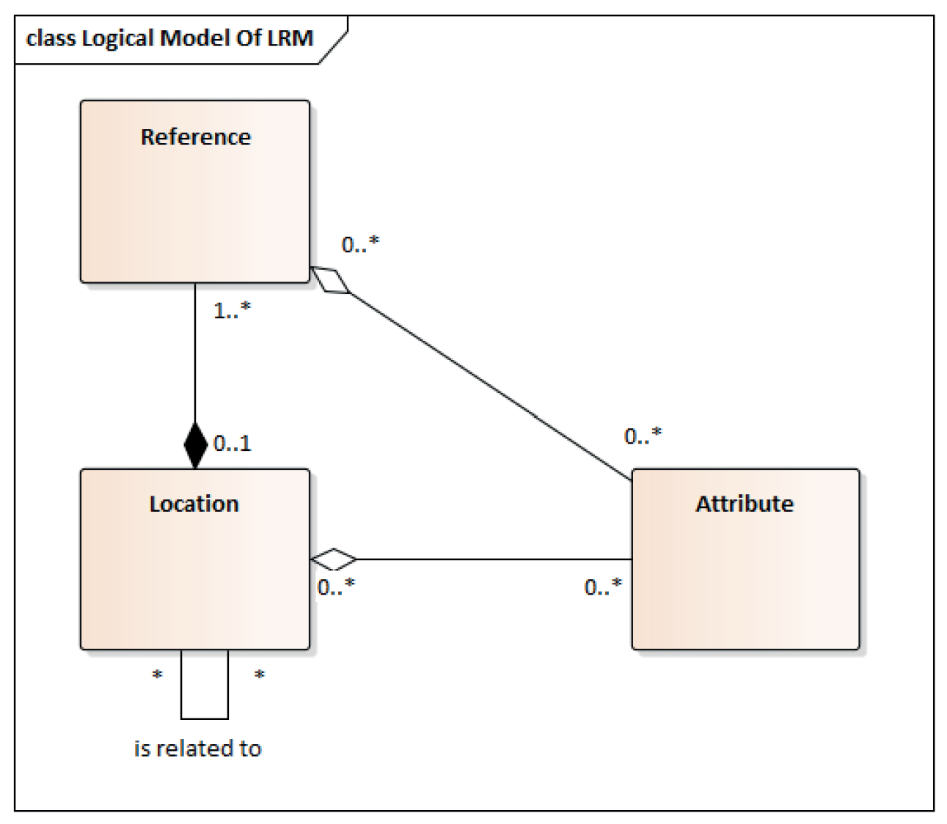
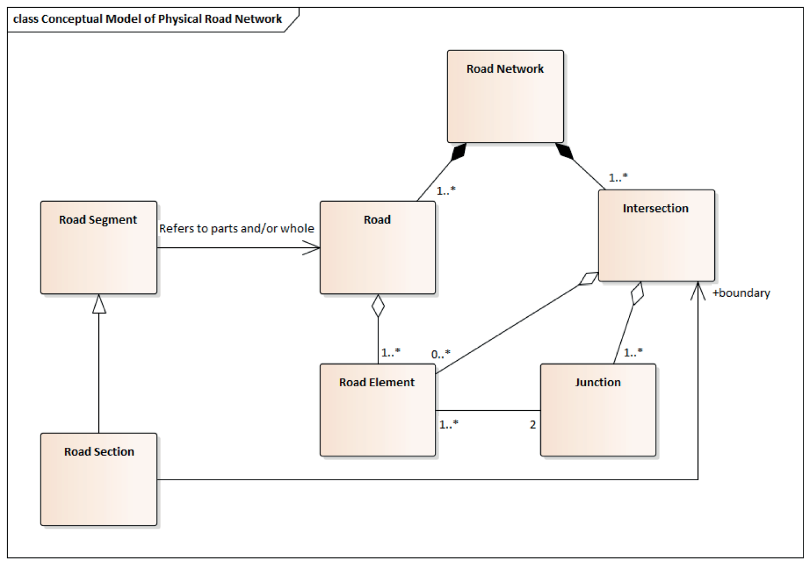
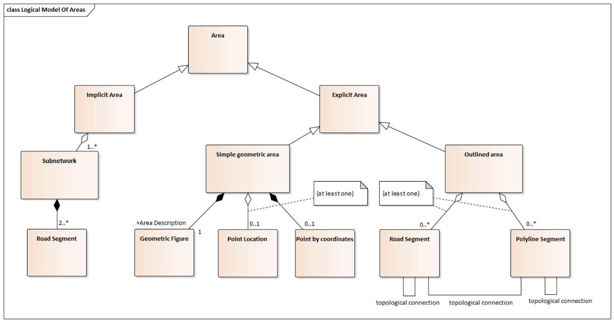

<!-- Extrakt nahrazuje extrakt vydání 2008. Zdrojem byl text ISO/DIS 17572-1 s úpravami po DIS v režimu sledování změn (ISO/TC 204/WG 3 N1760, 28. 2. 2022), čtený s přijatými změnami; v záhlaví návrhu je uvedeno „ISO 17572-1:2021“. Publikované vydání je ISO 17572-1:2022 (3. vydání, 2022-07, 21 stran podle standards.iteh.ai). Obsah, čísla stran v obsahu, předmluva a termíny 3.1 až 3.33 jsou ověřeny proti ukázce publikovaného vydání na iteh; seznam hlavních změn je převzat z předmluvy publikovaného vydání (v N1760 je v předmluvě jen aktualizace bibliografie). Rozsahy kapitol a příloh jsou odvozeny ze stránek obsahu publikovaného vydání. Zpracování schválil Petr Bureš 27. 11. 2026. Převzetí jako EN ISO podle iteh neexistuje; dokument je ve stadiu 60.60 (publikováno). -->

<!-- Terminologie podle pokynu Petra (30. 10. 2026): location reference = odkaz na polohu, location referencing = odkazování na polohu, location = poloha, LRS = polohový referenční systém, intersection = křížení, junction = propojení. Podle slovníku ITS terminology (ověřeno 30. 10. 2026): poloha spojnice, přiřazení, explicitní/implicitní plocha, podsíť, komplexní křížení (ČSN ISO 17572-1), úsek/segment pozemní komunikace (ISO/TS 14812). Kategorie poloh podle pokynu Petra: bodová – liniová – plošná poloha (slovník uvádí poloha bodu – liniová poloha – poloha oblasti). Navržené (ve slovníku nejsou): definice polohy, identifikátor spojnice, geodetické datum, geodetický referenční rámec. Obrázky 1 až 3 jsou z N1760 (anglické popisy); obrázek starého extraktu 17572-1_2008_image1.png používá starou terminologii („pozice“, „označení pozic“), proto nebyl převzat. -->

## Úvod

Popisovaný dokument je částí 1 souboru norem ISO 17572 Odkazování na polohu pro geografické databáze, který stanovuje metody odkazování na polohu (LRM) pro jednoznačnou výměnu informací o objektech reálného světa mezi systémy ITS s digitálními mapami různých dodavatelů. Odkaz na polohu jedinečně identifikuje geografický objekt (např. výjezd z dálnice, křížení nebo hotel) tak, aby informace připravená v jednom systému, např. dopravní zpráva, označovala tentýž objekt i v databázích přijímajících systémů. Část 1 stanovuje obecné požadavky a konceptuální datový model, na které se odkazují části 2 až 4 s konkrétními profily.

Popisovaný dokument je třetím vydáním. Proti vydání 2015 doplňuje přesný relativní profil (část 4), zkracuje přílohu se srovnáním definic s ISO/TC 211, vypouští přílohy D až F a aktualizuje odkazy na souvisící dokumenty.

Poznámka: Extrakt uvádí vybrané kapitoly popisovaného dokumentu a přejímá původní číslování kapitol.

## Užití

Popisovaný dokument je určen autorům specifikací a profilů odkazování na polohu (TPEG2, DATEX II, C-ITS, tabulky poloh), výrobcům map a vývojářům kodérů a dekodérů jako jednotná terminologie a konceptuální rámec, přičemž sám žádnou konkrétní metodu ani fyzický formát nestanovuje. Provozovatelům dopravních informačních center, správcům tabulek poloh a orgánům státní správy poskytuje přehled kategorií poloh, požadavků na metody a používaných metod (přílohy A a B).

## 1 Předmět normy

Soubor ISO 17572 specifikuje tři metody odkazování na polohu v kontextu geografických databází: předem kódovanou (část 2, tabulky poloh TMC, VICS aj.), dynamickou (část 3, AGORA-C) a přesnou relativní (část 4, úroveň jízdních pruhů a vnitřek křižovatek). Fyzický formát ani podrobnosti polohového referenčního systému (LRS) nestanovuje, stanovuje však požadavky na ně.

Popisovaný dokument vymezuje odkazované objekty a povinné a volitelné složky odkazu a stanovuje požadavky na metodu odkazování na polohu a její konceptuální datový model.

## 2 Souvisící normy

Popisovaný dokument nemá normativní odkazy. Bibliografie (18 položek) uvádí zejména ostatní části ISO 17572, EN ISO 14819-3 (ALERT-C), ISO/TS 21219-21 a -22 (TPEG2-GLR a -OLR), ISO 20524-1 a -2 (GDF5.1), ISO/TR 19169 (rozdíly mezi GDF a konceptuálními modely ISO/TC 211), ISO/IEC 19505 (UML) a dokumenty ISO/TC 211 o odkazování souřadnicemi, geografickými identifikátory a lineárním odkazování (ISO 19111, ISO 6709, ISO 19112, ISO 19148).

## 3 Termíny a definice

Kapitola (rozsah 6 stran) obsahuje 43 termínů a definic, z nichž nejdůležitější jsou následující:

**odkaz na polohu** (_location reference_) – návěští přiřazené poloze, které v rámci jedné metody odkazování na polohu jednoznačně definuje právě jednu polohu a předává se mezi implementacemi polohového referenčního systému (zkratka LR)

**metoda odkazování na polohu** (_location referencing method_) – metodika přiřazování odkazů na polohu polohám (zkratka LRM)

**polohový referenční systém** (_location referencing system_) – úplný systém (normy, definice, programové a technické vybavení, databáze), kterým se podle metody odkazování na polohu vytvářejí a předávají odkazy na polohu (zkratka LRS)

**poloha** (_location_) – určité místo nebo pozice, přičemž není-li uvedeno jinak, jde o liniovou polohu, tj. souvislý úsek sítě bez smyček a přerušení (podle ISO 19112, upraveno)

**definice polohy** (_location definition_) – vymezení toho, co se určitou polohou v konkrétní databázi míní, např. prvky pozemní komunikace GDF tvořící polohu ALERT-C

**předem kódovaný odkaz na polohu** (_pre-coded location reference_) – odkaz na polohu s identifikátorem dohodnutým ve vysílajícím i přijímajícím systému, kterým se vybírá z množiny předem kódovaných poloh, zatímco **dynamický odkaz na polohu** (_dynamic location reference_) se vytváří za běhu z geografických vlastností v digitální mapě

**přiřazení** (_matching_) – převedení odkazu na polohu na konkrétní objekt v dané mapové databázi, navazující na dekódování odkazu

Kapitola dále definuje mj. kategorie poloh, spojnici a uzel, křížení a propojení a úsek a segment pozemní komunikace. Proti vydání 2008 přibyly termíny z geodézie (geodetické datum, referenční rámec ITRF). <!-- Norma má i termín 3.37 road crossing – český překlad nezvolen, aby nekolidoval s „křížení“ (intersection). -->

Další termíny a zkratky z oboru ITS jsou obsaženy ve slovníku ITS terminology.

## 4 Symboly a zkratky

Kapitola obsahuje celkem 14 zkratek, z nichž nejdůležitější jsou následující:

**AGORA** zavedení přístupu ke globálnímu odkazování na polohu (_Implementation of Global Location Referencing Approach_), evropský projekt 2000–2002

**ALERT-C** doporučení a poloha problému v evropském silničním provozu – kompaktní (_Advice and Problem Location for European Road Traffic – Compact_)

**GDF** geografické datové soubory (_Geographic Data Files_)

**RDS** rádiový datový systém (_Radio Data System_)

**TMC** kanál pro přenos dopravních informací (_Traffic Message Channel_)

**VICS** vozidlový informační a komunikační systém (_Vehicle Information and Communication System_)

Další termíny a zkratky z oboru ITS jsou obsaženy ve slovníku ITS terminology (www.ITSterminology.org).

## 5 Cíle a požadavky na metodu odkazování na polohu

Kapitola (rozsah 2 strany) stanovuje formou číslovaných výčtů s krátkým zdůvodněním cíle a požadavky, které musí splnit každá metoda odkazování na polohu souboru ISO 17572, nikoli však měřitelná kritéria pro jejich ověření.

Článek 5.1 stanovuje tři vzájemně si odporující cíle, a to jednoduchost implementace, malý objem přenášených dat a co nejvyšší přesnost odkazu pro dekódování, které je nutné vyvažovat, protože shodnou a zcela přesnou mapu ve všech systémech nelze zajistit.

Na cíle navazuje článek 5.2, který stanovuje sedm požadavků. Metoda mimo jiné nesmí vnášet do polohy další chybu proti zdrojové databázi ani měnit topologické vztahy (např. pořadí bodů podél trasy), musí dodržovat terminologii a konceptuální model popisovaného dokumentu a musí v zásadě umožnit odkázat na každé místo silniční sítě, přičemž odkaz musí být strojově čitelný.

## 6 Konceptuální datový model pro metody odkazování na polohu

Kapitola (rozsah 5 stran) stanovuje pomocí 3 diagramů UML konceptuální model nezávislý na konkrétní metodě.

Články 6.1 až 6.3 stanovují pět složek, které má v nějaké podobě každá metoda: polohu, definici polohy (ta se u vysílajícího a přijímajícího systému může lišit), odkaz, atributy a vztahy k jiným polohám, přičemž atributy a vztahy nejsou nutné u všech metod. Konceptuální model znázorňuje obrázek 1.

**Obr. 1** Konceptuální model metody odkazování na polohu (obr. 1 popisovaného dokumentu)

Článek 6.4 dělí polohy na bodové (zájmové body, služby), liniové, složené z poloh spojnice, a plošné, které jsou buď implicitní (souhrn liniových poloh oblasti), nebo explicitní (dvourozměrný geoprvek nebo obrys, např. správní obvod).

Článek 6.5 stanovuje konceptuální model silniční sítě (viz obrázek 2), protože model GDF požadavkům odkazování na polohu nevyhovuje. Síť tvoří pozemní komunikace, které se skládají z úseků ohraničených kříženími, a samotná křížení, přičemž nejjednodušší křížení je jediný uzel (propojení), kdežto křížení s více uzly je komplexní.

**Obr. 2** Konceptuální model fyzické silniční sítě (obr. 2 popisovaného dokumentu)

Článek 6.6 stanovuje konceptuální model oblastí (viz obrázek 3), v němž se implicitní plocha skládá z podsítí segmentů pozemní komunikace, zatímco explicitní plocha je geometrický útvar nebo obrys. Oba typy musí mít alespoň jednu vazbu na zemský povrch, aby dekodér mohl oblast přesně umístit.

**Obr. 3** Konceptuální model oblastí (obr. 3 popisovaného dokumentu)

## Příloha A (informativní) Přehled metod odkazování na polohu

Příloha o rozsahu 4 stran rozlišuje nepřímé odkazování, které využívá topologii nebo atributy silniční sítě, a odkazování souřadnicemi, na reprezentaci sítě nezávislé. Princip obou přístupů znázorňují dva obrázky. Na toto rozlišení navazuje popis sedmi metod a jejich kombinací v rozsahu jednoho až dvou odstavců (princip, varianty, případně norma, která metodu stanovuje), mj. odkazování identifikátorem spojnice, zeměpisnými souřadnicemi (ISO 19111, ISO 6709), rastrem, lineární odkazování podle ISO 19148, odkazování adresou a odkazování na polohu TPEG. Např. spojnici lze odkázat buď jejím jedinečným identifikátorem, nebo identifikátory počátečního a koncového uzlu a odkaz lze doplnit ofsety od uzlů nebo stranou komunikace.

## Příloha B (informativní) Příklady používaných metod odkazování na polohu (mapování na konceptuální datový model pro polohové referenční systémy)

Příloha o rozsahu 2 stran mapuje konceptuální model na dva předem kódované systémy, a to tak, že u každého systému přiřazuje složkám modelu (definice polohy, odkaz, atributy, vztahy) konkrétní prvky systému a znázorňuje je obrázkem. Článek B.1 popisuje RDS-TMC (ALERT-C) podle EN ISO 14819-3 na příkladu nizozemské dálnice A12, přičemž výňatek z tabulky poloh uvádí tabulka 1. Odkazem je zde číslo polohy, atributem typ polohy a vztahy tvoří odkaz na oblast, na liniovou polohu a záporný a kladný ofset na předcházející a následující polohu, zatímco definici bodové polohy tvoří číslo komunikace nebo křížení a názvy. Druhým příkladem je článek B.2, který popisuje odkazování identifikátory spojnic systému VICS nad japonskou digitální mapou JDRM.

**Tab. 1** Výňatek z tabulky poloh ALERT-C pro dálnici A12 (podle obr. B.1 popisovaného dokumentu)

| Číslo polohy | Typ | Číslo komunikace / křížení | První název | Druhý název | Odkaz na oblast | Odkaz na liniovou polohu | Záporný ofset | Kladný ofset |
|---|---|---|---|---|---|---|---|---|
| 4457 | akvadukt | A12 | Gouwe Aquaduct | | 2009 | 949 | 4456 | 4458 |
| 4458 | výjezd | A12 | Gouda | N207 | 30089 | 949 | 4457 | 4470 |
| 4470 | parkoviště | A12 | Parkeerplaats de Andel | | 30089 | 949 | 4458 | 4460 |
| 4460 | výjezd | A12 | Reeuwijk | | 2009 | 949 | 4470 | 4461 |

## Příloha C (informativní) Srovnání definic s ISO/TC 211

Příloha o rozsahu 1 strany nahrazuje srovnávací tabulku předchozích vydání odkazem na přílohu A ISO/TR 19169:2021 (společná skupina ISO/TC 204/WG 3 a ISO/TC 211) a na terminologickou tabulku ISO/TC 211. <!-- Rozsah přílohy (1 strana, s. 20–21) ověřen v obsahu publikovaného vydání (ukázka standards.iteh.ai, 27. 11. 2026). -->

## Bibliografie

Bibliografie uvádí 18 dokumentů (viz kapitola 2).
