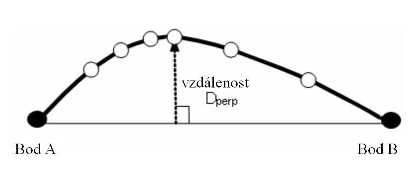
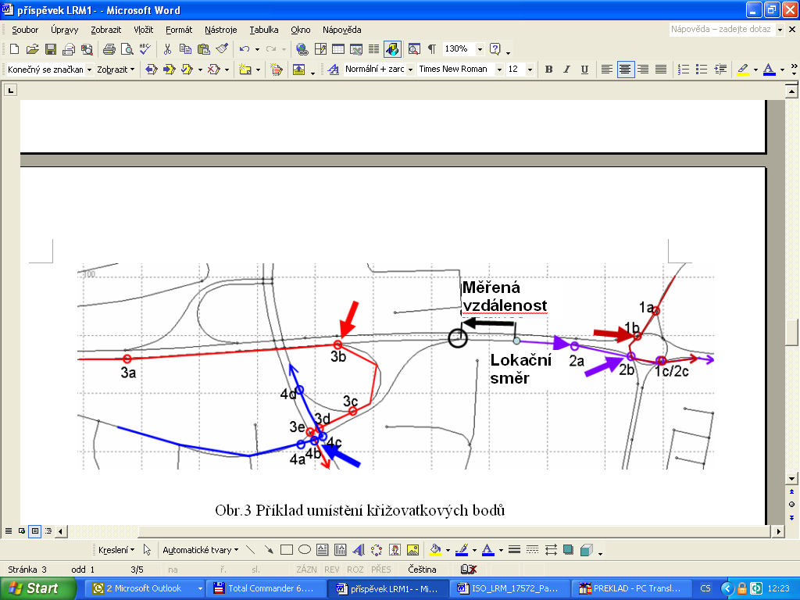
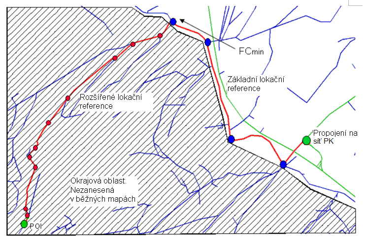
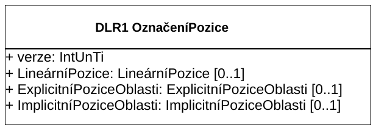
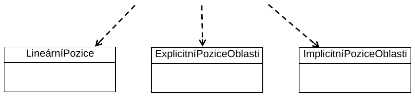
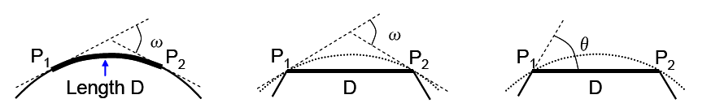

## Úvod

Tato norma je součástí norem zaměřených na oblast navigačních a lokačních systémů a souvisejících aplikací. Její uplatnění nalezneme zejména v oblasti navigačních a lokačních systémů, poskytování dopravních služeb, dopravním zpravodajství a systémech řízení dopravy.

Poznámka: Extrakt uvádí vybrané kapitoly popisovaného dokumentu a přejímá původní číslování kapitol.

## Užití

Tato třetí část je věnována popisu dynamických forem označení pozic a předem kódovaných označení pozic. Tyto metody jsou užívány ve vozidlové navigaci a v navigačních produktech společností Teleatlas, Navteq apod. Stejně tak v lokačních produktech řady jiných dodavatelů (Tranis, CCS, apod.).

Jedná se zejména o metody podporující dynamickou formu navigace, tedy o poskytování dopravních zpráv v reálném čase. Z tohoto pohledu je norma vhodná i pro tvůrce či provozovatele dopravních informačních center, správce významných dopravních objektů (tunelové stavby, dálniční stavby apod.). Norma umožňuje reprezentovat stejné geografické jevy v různých geografických databázích odlišných distributorů, v různých aplikacích a na odlišných SW/HW platformách. Norma vytváří základ pro on-line aktualizaci mapových podkladů. V této souvislosti vychází z výsledků mezinárodního výzkumného projektu AGORA.

**Pro orgány státní správy** tato norma představuje popis současných technologií v oblasti poskytování aktuálních dopravních informací jako jsou metody VICS či RDS/TMC.

## 1 Předmět normy

Norma 17572 je členěna do tří samostatných částí: část 1 Všeobecné požadavky a konceptuální model, část 2 Předem kódované označení pozic a část 3 Dynamické označení pozic. Tato třetí část normy specifikuje metodu DLR (Dynamic Location Referencing) také známou jako AGORA-C, která je závislá na specifických atributech dostupných v běžných mapových databázích.

Tato metoda je vhodná pro systémy, které mají fyzický formát založen na GDF (Geographic Data Files). Metoda vychází z přístupu aplikace v reálném čase k původním nebo přeloženým hodnotám příslušných atributů z vlastní digitální mapy. Metoda DLR bývá také nazývána “on-the-fly referencing”, protože umístění referenčního kódu může být okamžitě vymazáno, jakmile je interní definice umístění dekódována.

## 2 Souvisící normy

ISO 14825:2004 Geografické datové soubory (GDF 4.0)

ISO 17572-1 Označení pozic pro geografické databáze – Část 1: Obecné požadavky a konceptuální model

ISO 17572-2 Označení pozic pro geografické databáze – Část 2: Předem kódované označení pozic

Čtenářům se doporučuje seznámit se s výsledky evropského výzkumného projektu AGORA či AGORA-C.

## 3 Termíny a definice

Norma uvádí 26 termínů a definicí a pro účely tohoto extraktu jsou doplněny další:

**hlavní bod** _(core point)_ bod patřící do množiny hlavních lokačních bodů jež mohou být typu: zdroj/cíl, křižovatkové body, body významné pro výpočet polohy z navigační trasy

**rozšířený bod** _(extension point)_ všechny ostatní body z množiny rozšířených lokačních odkazů jsou definovány jako rozšířené body

**deskriptor PK** _(road descriptor)_ celé číslo pozemní komunikace či její významný znakový řetězec v délce 3-5 znaků oficiálního názvu

**atribut** _(atribute)_ charakteristika geoprvku, jež je nezávislá na jiných geoprvcích

**LRM metoda označení pozic** *(**location referencing metod)*** metoda označení pozic za účelem snadné výměny informací o pozicích mezi různými systémy

**bod** _(point)_ bezrozměrný prvek, který specifikuje geometrickou polohu; je určen dvojicí či trojicí souřadnic

**geoprvek** _(feature)_ databázová reprezentace objektu reálného světa

Další termíny a zkratky z oboru ITS jsou obsaženy ve slovníku ITS terminology.

## 4 Symboly a zkratky

Norma uvádí 37 zkratek.

**TPEG** protokol přenosu dat používaný u vysokorychlostních přenosových kanálů

**RDS-TMC** RDS rádiový datový systém – digitální informační kanál na vlnách FM; TMC kanál pro přenos dopravních informací

**UML** nástroj pro popis a návrh informačních systémů. V této normě je UML použito jako nástroj k vyjádření strukturálních vztahů a specifických vazeb s využitím grafických prvků. Úplná definice UML je obsažena v normě ISO 19501.

**VICS** vozidlový informační a komunikační systém. Byl vytvořen pro účely digitálních mapových databází jako základ pro poskytovatele mapových děl k začlenění odlišných mapových identifikátorů do jejich vlastních digitálních map. Digitální mapový základ na nulté úrovni tvoří uzly a linie, které pokrývají celou síť místních komunikací.

**GDF** datový model, datová specifikace a výměnný standard pro geografická data silničních aplikací

**Agora** název evropského výzkumného projektu řešeného v letech 1992 - 2002

Kapitoly 5 Požadavky na standardní metodu označování pozic a kapitola 6 Konceptuální datový model pro metody označování pozic jsou odkazovány na část 1 této normy.

Další termíny a zkratky z oboru ITS jsou obsaženy ve slovníku ITS terminology (www.ITSterminology.org).

## 7 Specifikace předem kódovaného označení pozic

### 7.1 Základní popis

DLR koncept je vytvořen tak, aby vyrovnával rozdílnosti, které mohou být mezi mapou vysílacího systému (kódovací částí) a mapou přijímacího systému (dekódovací částí). Tyto rozdílnosti v mapě mohou být zapříčiněny tím, že přijímací systém používá starší mapu od stejného poskytovatele nebo, že přijímací systém používá mapu od jiného poskytovatele.

Koncept definuje dva stavební bloky:

  - Základní označení pozic _(Location reference core)_

  - Rozšířené označení pozic _(Location reference extension)_

Dynamický adresní odkaz je vytvořen jako soubor informačních prvků, které obsahují body a jim příslušející atributy. Každý bod může mít jeden nebo více atributů.

Na straně příjemce označení pozice systém potřebuje rekonstruovat pozici, tak jak bylo zamýšleno na straně vysílače. Pravidla pro kódování poskytují potřebnou sémantickou podporu jak pro vytvoření lokačního kódu na straně vysílače, tak i interpretaci tohoto kódu na straně přijímače.

Tato kapitola popisuje základní stavební prvky pro potřeby dynamického označení pozice a specifikuje různé typy atributů.

### 7.2 Stavební prvky metody označení pozic

Mezi základní stavební prvky popisované v této kapitole patří body, viz. kapitola 7.2.1 a atributy, kapitola 7.2.2.

### 7.2.2 Atributy

Tabulka 7.1 v kapitole 7.2.4 uvádí soupis definovaných typů atributů pro dynamické označování pozic a jejich možné hodnoty. Čtenář si povšimne, že některé atributy jsou vztaženy k bodům a jiné k částem silniční sítě PK mezi těmito body. Nicméně všechny atributy v dynamických odkazech jsou vztaženy k bodům. Atribut, který popisuje charakteristiku liniového úseku PK je obsažen v kódu označení pozice bodu, který se nachází na počátku tohoto úseku.

### 7.2.2.1 Funkční třída komunikace (FC)

GDF definuje tento atribut za účelem přiřazení důležitosti daného úseku PK, jež plní v rámci celé sítě PK.

  - hlavní silniční tahy: nejdůležitější cesty v dané síti PK

  - silnice prvních až osmých tříd

  - silnice devátých tříd: nejméně důležitá cesta v dané síti PK

### 7.2.2.7 Příznak směru jízdy

Tento příznak představuje další upřesnění směru jízdy v souvislosti s informací o orientaci. Příznak je nastaven na hodnotu nula (false), jestliže směr jízdy je opačný. Ve všech ostatních případech má příznak hodnotu 1 (true) – směr je nedefinovaný, obousměrný či žádný.

### 7.2.2.8 Indikátor paralelních pruhů

V případě, že máme více souběžných jízdních pruhů ve stejném směru jízdy, které se nedají rozeznat pomocí předem daných pravidel, tak je v tomto případě využíván tzv. indikátor paralelních pruhů k rozlišení jednotlivých částí komunikace.

Indikátor paralelních pruhů je počítán v horizontálním nebo vertikálním směru a definuje pořadí a ukazatel jízdního pruhu, ve kterém se objekt nachází.

### 7.2.2.9 Kolmá vzdálenost

„Kolmá vzdálenost“ je definována jako maximální rozdíl geometrického tvaru definovaného v databázi a přímé spojnice mezi body A a B. V pravidlech 10 a 31 se od „kolmé vzdálenosti“ vyžaduje, aby byla menší než předem definovaná hodnota.

Pro přiblížení čtenáři jsou na obrázku vidět po sobě jdoucí body na daném úseku PK mezi body trasy A a B. Kolmá vzdálenost Dperp na spojnici bodů A a B by měla být menší než parametr Dperp-max. Jestliže tomu tak není, je potřebné vložit jeden nebo více mezilehlých bodů.

**Obr. 1** Výpočet kolmé vzdálenosti (obr. 7-4 popisovaného dokumentu)

## 8 Pravidla kódování

Pravidla kódování jsou rozdělena podle příslušnosti k funkci lokačního referenčního systému. Pro využití v dopravní telematice poskytuje základní označení pozic kompletní a dostatečnou množinu pravidel pro všechny případy lokace. Rozšířená část pak doplňuje pravidla užívaná pro cílové lokality. Každý bod využitý při označení pozice může obsahovat doplňkové atributy pro zvýšení přesnosti. Pravidla definovaná v základní i rozšířené části jsou závazná a každý dynamický profil označení pozice by se jimi měl řídit.

**Příklady pravidel:**

**Pravidlo 12**

Je zaměřeno na křižovatky a to zejména na body, které danou křižovatku reprezentují. Jestliže máme klasickou průsečnou křižovatku, tak pozice jejich křížení je identická bodu křižovatky. Naopak, jestliže máme určitý komplex křižovatek, tak pozice styčného bodu je volena uvnitř tohoto komplexu křižovatek. Na obrázku je vidět umístění bodů v komplexu křižovatek. Body s označením „b“ budou zvoleny jako křižovatkové body příslušející označení pozic (location references). V praxi to znamená umístění na prvním křížení počítaném ve směru lokace, kde se označení úseku PK mění (mění se hodnota atributu - funkční třída komunikace, typ komunikace, deskriptor PK, směr jízdy).

**Obr. 2** Příklad umístění křižovatkových bodů (obr. 8-1 popisovaného dokumentu)

**Pravidlo 17**

Váhový faktor podle funkční klasifikace dané komunikace se používá k výpočtu váhové vzdálenosti pro dekódování cílů. Váhová vzdálenost se definuje jako váhový faktor x vzdálenost. V případě chybějícího atributu FC (viz definice GDF), je použito srovnatelné ohodnocení (viz příloha B.2 normy), která zajistí, že na dané trase nebude použito „zkratek“ přes neobvyklé či krátké ulice.

**Tab. 1** Váhový faktor podle funkční klasifikace pozemní komunikace (tab. 8.1 popisovaného dokumentu)

| Funkční třída PK | Hlavní PK | silnice první třídy | silnice druhé třídy | silnice třetích a vyšších tříd |
| ---------------- | --------- | ------------------- | ------------------- | ------------------------------ |
| Váhový faktor    | 2         | 3                   | 4                   | 6                              |

**Rozšířená pravidla kódování lokačních odkazů**

V této části normy jsou popsána další pravidla pro rozšířené lokační odkazy. Rozšířené lokační odkazy jsou určeny pro lokalizaci míst, jež budou použita jako cílová místa ve vozidlové navigační aplikaci. V tomto případě je důležité umožnit místu, které není obsaženo v mapě dekodéru, propojení s hlavní sítí PK, která je vždy obsažena v dekodéru map a to tak, aby bylo umožněno alespoň základní navigování. Obrázek ukazuje příklad navigování do oblasti, jehož cíl je například v prostoru národního parku. Přijímač bude naváděn tak, aby nalezl cestu v nedigitalizované oblasti pomocí následujících cest kódovaných v přesně geometricky popsaném tvaru.

**Obr. 3** Příklad využití rozšířené lokační reference (atribut FC – funkční třída komunikace) (obr. 8-4 popisovaného dokumentu)

## 9 Specifikace logického datového formátu

Tato kapitola popisuje minimální požadavky v případě, že je využit fyzický formát jež není popsán v informativních přílohách tohoto dokumentu. Dává náležitý přehled všech dat potřebných pro různá pravidla definovaná v kapitole 8.

Data jsou dále dělena do třech základních typů: bodů, atributů a jejich vzájemných vztahů. V případě bodů nestačí pouze uložit souřadnice těchto bodů ale i jejich odpovídající pořadí korespondující jejich topologické pozici v reálném světě.

Body a úseky PK jsou nositeli atributů jež je odlišují od ostatních sousedních úseků PK. Z téhož důvodu musí být možné ukládat atributy různých typů definovaných v tomto dokumentu.

Předpokládá se, že dynamické označení pozice čítá více než jeden bod či úsek PK.

### 9.1 Definice datového modelu

Tato kapitola souhrnně popisuje datové struktury a jejich minimální a maximální hodnoty užité v dynamických profilech metod pro označení pozic. Přičemž atributy jsou definovány v kapitole 7.2.4. Přiložené diagramy definují všechny prvky dynamického označení pozic s vyznačením zda se jedná o prvky volitelné či povinné.

## Příloha A (informativní) TPEG Specifikace fyzického formátu pro dynamické označení polohy

V této příloze je popsána základní struktura protokolu TPEG. Tento protokol představuje rozšíření stávajícího systému RDičemž S/TMC, jež je běžně využíván pro potřeby aktuálního dopravního zpravodajství. TPEG definuje datové struktury ve formátu UML diagramů a definuje pravidla, která umožňují automaticky vytvářet výsledné formáty v binárním či XSD tvaru. To umožňuje, že XML zprávy na jejich cestě řetězcem služeb mohou být konvertovány do binárního tvaru a naopak.

Obecně jsou v této příloze specifikována data uložená ve zprávě pro metodu AGORA-C, definovaná v kapitole 8 této normy. Následující obrázek popisuje datovou strukturu na nejnižším stupni podrobnosti, který vychází z lineárního kódování pozice.

**Obr. 4** „Zásobník" dynamické označení pozice, třída DLR1 PřehledOznačeníPozice (obr. A.1 popisovaného dokumentu)

## Příloha B (informativní) Pravidla kódování pro dynamické označení polohy

Tato část normy slouží jako nápověda pro implementaci metod označení pozice co nejjednodušším způsobem. Pro tento účel jsou poskytnuty doplňkové informace a kódovací procedury založené na pravidlech popsaných v kapitole 8. Procedury mohou být využity jako základ pro vývoj kódovacích algoritmů. Protože počet dekódovacích metod je proměnný a závisí na implementaci užitých digitálních mapových databází, nemohou být stanovena žádná pravidla pro dekódování označení pozic.

Dynamické označení pozice využívá klasifikaci pro charakteristické části sítě PK, mající vyšší pravděpodobnost existence v různých databázích. Běžné mapové databáze zachovávají tyto atributy v souladu s definicí GDF. Nicméně atributy jsou docela rozdílně užívány v různých zemích a různými operátory. Metody označení pozice toto zohledňují ve svých pravidlech, přičemž se opírají o kategorizaci s vyšší shodou mezi různými mapovými databázemi. Atribut FC (funkční třída PK) nemusí být obsažen ve všech databázích, ale kodér i dekodér musí být schopni ho z ostatních dostupných informací (rychlost, jízdní pruhy, směrové tabule apod.) odvodit. Pro tento účel následující tabulka poskytuje výklad v pravidlech pro nejvíce užívané funkční třídy pozemní komunikace.

**Tab. 2** Popis interpretace funkční třídy pozemní komunikace (tab. B.1 popisovaného dokumentu)

| **Funkční třída PK** | **hlavní PK**                                                                         | **silnice první třídy**                                                           | **silnice druhé třídy** | **≥ silnice třetí třídy** |
| -------------------- | ------------------------------------------------------------------------------------- | --------------------------------------------------------------------------------- | ----------------------- | ------------------------- |
| Interpretace popisu  | Spojení zemí či metropolitních oblastí, zejména se směrově oddělenými jízdními pruhy. | Národní hlavní PK spojující centra, zejména se směrově oddělenými jízdními pruhy. | Národní nebo hlavní PK  | Ostatní PK                |

## Příloha C (informativní) Specifikace komprimovaného datového formátu

V případech přenosu velkého množství dat v jednom paketu označující pozici, přicházejí v úvahu další požadavky. To vede ke snaze redukovat celkovou velikost dat na přiměřenou hodnotu. Experimenty s označeními pozic ukázaly, že jedním z vhodných přístupů takovéhoto řešení je zakódování všech pozemních komunikací sítě PK do jednoho paketu. Získáním homogenní množiny dat velmi efektivní komprimací pak pomáhá k výrazné redukci velikosti přenášených dat. To vysvětluje potřebu datového formátu komprimovaného ukládání označení pozice s topologickými body a geometrickými prvky pozemní komunikace. Tato příloha popisuje jen binární datové formáty. Je zde vycházeno ze specifikace komunikace mezi centry a terminály jako jsou vozidlové jednotky, kde je zohledněna malá kapacita přenosového média v podobě rozhlasového vysílání.

Jednou z cest komprimace je například predikce zakřivení či poloměru zakřivení a následná redukce bodů. V tomto případě se jedná o predikci hodnot rozdílů úhlů za několik stupňů (dle rozlišení). Zakřivení je definováno ve dvourozměrné rovině, body jsou znázorněny na křivce délky L měřeno od pevného bodu a úhel ω je definován s využitím bodů P1 a P2 a vzdálenosti ΔL.

definice zakřivení jednoduchá výpočetní metoda (1) jednoduchá výpočetní metoda (2)

**Obr. 5** Případ komprimace dat u zakřivení (obr. C.2 popisovaného dokumentu)
