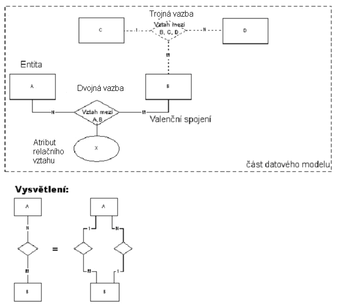
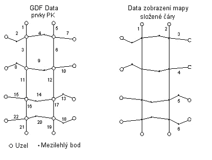
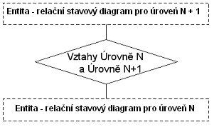
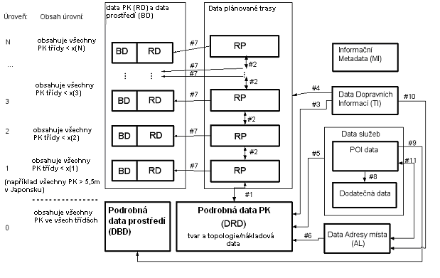

## Úvod

Tato norma je součástí norem zaměřených na oblast navigačních a lokačních systémů a souvisejících aplikací.

Výchozím podkladem byla norma ISO/NP 14826 "Fyzický formát pro TICS databázové technologie". Ta byla zavedena do ISO TC 204 s cílem standardizace fyzického formátu ukládání dat (PSF) pro navigační mapová data a související informace uložené na fyzických datových nosičích využívaných ve vozidlových navigačních systémech. Záměrem bylo usnadnit interoperabilitu navigačních systémů v tržním prostředí návrhem normy PSF jež umožní využití navigačním médií od různých dodavatelů v odlišných navigačních systémech a navigačním systémům navrženým různými vývojáři umožnit číst stejná média. Na počátku bylo rozhodnuto, že žádný z existujících formátů nebude uzpůsoben pro trh jako standard pro fyzické ukládání dat. Funkční požadavky existujících systémů budou předloženy a sjednoceny do univerzální množiny a uspořádány do hlavních kategorií podle převažujícího funkčního využití ve vozidlových navigačních systémech.

Tato technická specifikace popisuje funkční požadavky a logický datový model pro PSF a API a organizaci logických dat pro PSF, které byly provedeny pod ISO/NP 14826. Nespecifikuje fyzické uspořádání dat.

Poznámka: Extrakt uvádí vybrané kapitoly popisovaného dokumentu a přejímá původní číslování kapitol.

## Užití

Norma svým obsahem patří do oblasti navigačních a lokačních systémů a souvisejících aplikací. Její uplatnění nalezneme zejména v oblasti navigačních a lokačních systémů, poskytování dopravních služeb, dopravním zpravodajství, systémech řízení dopravy a aktivních vozidlových systémů, či aplikací ADAS (pokročilé asistenční systémy podpory řidiče).

**Pro orgány státní správy** tato norma stanovuje formát a rozsah dat poskytovaných správci pozemních komunikací pro potřeby nejrůznějších aplikací a služeb.

**Pro výrobce zařízení a dodavatele telematických systémů** ulehčuje tato specifikace efektivnější využití mapových databází poskytnutím pravidel pro vytváření vhodné architektury navigačních systémů. To umožňuje vývoj aplikací v kratším časovém rámci a zároveň zkrácení času pro přechod produktu na trh. Ačkoliv byla tato specifikace původně vytvořena pro aplikace navigačních systémů, může rovněž usnadnit i jiné vývojové aktivity poskytnutím náhledu na běžná řešení datového modelování telematických úloh a služeb vázaných na polohu.

## 2 Souvisící normy

ISO 14825 zavedena v ČSN EN ISO 14825 (01 8281) Inteligentní dopravní systémy – Geografické datové soubory (GDF) – Celková datová specifikace

V této části normy je uvedeno 5 informativních odkazů na webové stránky.

## 4 Termíny a definice

Pro účel tohoto dokumentu je uvedeno 52 termínů a definic

**4.1 přiřazení adresy** _(address location)_ kategorie aplikace, která se zabývá úlohami vyjadřujícími reálnou pozici na zemi v rámci PSF datové reprezentace

POZNÁMKA Jedná se o jednu ze šesti kategorií aplikace podporovaných PSF a API.

**4.2 typ adresy** *(address type***)** atribut entity úseku PK; stanoví typ rozsahu čísel domů Příklad rozdíl mezi základní adresou, adresou okresu, obchodní adresou apod., nebo žádnou adresou

**4.3 kategorie aplikace** _(application category)_ základní podfunkce v rámci funkční množiny pro aplikace vozidlové navigace a systému cestovních informací

POZNÁMKA Tato specifikace rozlišuje 6 kategorií aplikace: nastavení polohy, plánování cesty, navádění na trasu, zobrazení mapy, přiřazení adresy, služby a zájmové body P.O.I. přístupu k informacím

**4.4 aplikační programové rozhraní** _(Application Program Interface (API))_ v kontextu ISO odpovídá standardnímu rozhraní a množině volacích funkcí mezi aplikačním softwarem a daty přistupujících knihoven vozidlových navigačních systémů

**4.5 základní mapa** _(base map)_ souhrn všech dopravních prvků a všech služeb včetně jejich vazeb k dopravním prvkům

Další termíny a zkratky z oboru ITS jsou obsaženy ve slovníku ITS terminology.

## 5 Symboly a zkratky

### 5.1 Zkratky

Pro účely této normy je definováno 19 zkratek.

### 5.2 Syntaktické značení používané v diagramech datových modelů

**Obr. 1** Příklad datového modelu záznam

Rozlišujeme zde šest komponent:

  - Entita (libovolná logická datová entita)

  - Dvojná vazba (libovolný vztah mezi dvěma entitami)

  - Trojná vazba (libovolný vztah mezi třemi entitami)

  - Spojení (zápis komponent spojující entity valenčním vztahem stanoveným číslem)

  - Relační atribut (specifikuje vztah podrobněji)

  - Část datového modelu (koncepční dílčí jednotka celého modelu)

Další termíny a zkratky z oboru ITS jsou obsaženy ve slovníku ITS terminology (www.ITSterminology.org).

## 6. Aplikační kategorie

### 6.1 Stanovení polohy

### 6.1.1 Úvod

Funkce stanovení polohy se používá k určení místa, např. zeměpisné šířky a délky entity silniční sítě a pro Map Matching. Map Matching je metoda stanovení pohybu navigačního systému na silniční síti v závislosti na předcházející poloze navigačního systému a datech o pohybu navigačního systému z externích vstupů.

### 6.1.2 Funkční popis

"Určení polohy" hledá relativní pozici navigačního systému na silniční síti s ohledem na mapová data reprezentující objekty reálného světa. Aplikace může dynamicky stanovit aktuální polohu navigačního systému, zatímco se navigační systém pohybuje. Map Matching může běžet na pozadí dokonce i když další funkce jsou vykonávány, tím navigační systém vždy ví, kde se nachází. Popis metody _Map Matching_ je mimo rozsah tohoto dokumentu.

### 6.2 Plánování trasy

### 6.2.1 Úvod

Tuto funkci uživatel používá k naplánování trasy z jednoho místa k jinému místu.

### 6.2.2 Funkční popis

Navigační aplikace mohou vypočítat trasy založené na atributech silniční sítě. Aplikace může umožnit koncovému uživateli specifikovat kritéria cesty jako "nejkratší vzdálenost", "mimo dálnice" apod. Jako základní úkon, uživatel stanoví místo odjezdu, což může být aktuální poloha navigačního systému a vybere cíl (místo kam se jede) a případně jeden nebo více mezilehlých bodů. Vhodná trasa je následně vypočítána. Výpočet trasy není omezen pouze na automobilovou dopravu. Tato funkce podporuje výpočet trasy prostřednictvím režimů reprezentovaných v databázi. To může zahrnovat železnice, vodní cesty, taxi a PK dostupné pouze na kole či pěší chůzí. Další formy veřejné dopravy mohou být zváženy v budoucnu.

### 6.2.5 Entity logického datového modelu

Entity logického datového modelu využívané v silničním plánování jsou popsány následovně v abecední pořadí:

  - Komplexní křížení – tato entita se používá k ukládání informací o zobecněném silničním křížení zahrnujícím spojení a uzly související s křížením - vnitřními prvky jako jsou úseky směrově rozdělené komunikace či kruhové křižovatky. Tato informace zahrnuje navigační atributy. Komplexní křížení odpovídá konceptu GDF křížení.

  - Komplexní PK – tato entita se používá k ukládání informací o (zobecněném) topologickém spojení mezi „Komplexními kříženími“ zahrnující navigační atributy. Odpovídá konceptu GDF PK.

  - Podmínka – tato entita se používá k ukládání informací o omezení nebo dodatečných atributech souvisejících s jízdními manévry. Tato informace zahrnuje podmíněný typ, který definuje typ informace uložené v záznamu stejně tak jako modifikátor polí, který poskytuje dodatečné informace o podmínce. Podmínka může specifikovat jednotlivé spojení nebo sled souvisejících spojení označovaných jako manévr.

  - Spojení – tato entita je používána k ukládání informace o prvcích PK a ostatních dopravních prvcích. Dopravní prvek je jakýkoliv prvek PK, PK, trajekt či trajektové spojení. Tato informace zahrnuje identifikátory pro koncové uzly spojení, stejně tak i soubor navigačních atributů. Navigační atributy poskytují všechny potřebné informace pro aplikaci k určení váhového faktoru spojení během výpočtu trasy.

  - Uzel – tato entita představuje propojení uvnitř dopravní sítě. Reprezentuje topologickou křižovatku mezi dvěma nebo více spojeními nebo koncem/hranicí spojení.

### 6.3 Navádění na trasu

### 6.3.1 Úvod

Funkce navádění na trasu se využívá pro generování instrukcí sledování tratě.

### 6.3.2 Funkční popis

Funkce navádění na trasu generuje krok za krokem instrukce pro sledování trasy. Tyto instrukce mohou zahrnovat kurz daný kompasem, vzdálenost, jméno PK, text značení, horizontální značení a pohyblivé či stacionární symboly. Tyto instrukce mohou rovněž zahrnovat podrobnosti manévrů jako úhel otočení, spojení a změny označení PK. Navádění na trasu může být realizováno s využitím textu, hlasu či grafiky.

### 6.3.3 Navádění na trasu a součinnost se stanovením polohy

Aplikace navádění na trasu mohou přijímat vstup z dalších aplikací k uskutečnění následujících funkcí:

1)  poskytovat navádění zatímco se navigační systém pohybuje, založené na vypočítané trase a funkci map matching

2)  sledovat vývoj podél PK a poskytovat instrukce k manévrům ve vhodném okamžiku koncovému uživateli.

### 6.3.4 Zobrazení na mapě a součinnost s naváděním na trasu

Aplikace může zvýraznit bod na zobrazené mapě pro konkrétní navigační manévr (z vypočítané trasy).

### 6.3.5 Požadavky pro Logický datový model

Je požadováno, aby logický datový model podporoval alespoň data identifikovaná v popisu funkcí. Ostatní požadavky na logický datový model jsou popsány níže.

1)  navádění na trasu je organizováno do parcel

2)  za účelem umožnění rychlého přístupu k parcelám by parcely být zpřístupněny pomocí jejich ohraničujících pravoúhelníků.

3)  pro účely optimálního vyplnění parcel, parcely mohou mít různou velikost pokrytí oblasti

### 6.3.6 Datový model entit

Entity logického datového modelu pro navádění na trasu jsou popsány níže v abecedním pořadí. Entity uvedené bezprostředně níže byly popsány v odstavcích uvedených v poznámce.

  - **Podmínka** (viz. 6.2 plánování trasy)

  - **Komplexní křížení** (viz. 6.2 plánování trasy)

  - **Spojení** (viz. 6.2 plánování trasy)

  - **Uzel** (viz. 6.2 plánování trasy)

Kromě entit uvedených výše, jsou pro navigování na trasu využívány následující entity.

  - Orientační bod – tato entita je využívána k asociaci spojení nebo uzlu s libovolnými atributy Bodu, Linie či Plochy, které mohou být využity k upřesnění směru, jež je generován k popisu trasy. Entita Orientační bod obsahuje ID geoprvku Bod, Linie nebo Plocha, který je umístěn podél spojení nebo uzlu a informace o umístění geoprvku s ohledem ke spojení či uzlu. Orientačními body nejsou geoprvky ze Služeb, Administrativních oblastí a Veřejné dopravy geoprvku Témata. Nicméně, objekt ve kterém je služba umístěna může být orientačním bodem.

  - Ukazatel směru (Signpost) – tato entita poskytuje logický relační vztah mezi dvěma spojeními a aktuální informaci ukazatele směru asociovanou se dvěma spojeními. První spojení (povinný prvek) reprezentuje prvek PK, podél kterého je ukazatel směru umístěn. Druhé spojení (nepovinný prvek) je asociováno s cílem uvedeným na ukazateli směru. Je to právě první prvek PK, který směřuje výlučně k cíli, určeném na ukazateli směru (například město). Entita Ukazatel směru obsahuje atribut obsahu ukazatele směru.

  - Obsah ukazatele směru – tento atribut popisuje obsah ukazatele směru např. geografická jména, čísla vozovek, směrové šipky, piktogramy (například symbol letiště), atd.

### 6.4 Zobrazení mapy

### 6.4.1 Úvod

Tato funkce se používá pro zobrazení mapy specifické geografické oblasti. Aplikace může rovněž přijímat vstupy od koncového uživatele, které se odkazují na zobrazení mapy (od bodových po „klikací“ zařízení)

### 6.4.2 Funkční popis

Aplikace může znázornit geoprvky Bodů, Linií, Ploch, kartografický text a symboly specifické geografické oblasti. To může zahrnovat PK, fyzické geoprvky, administrativní hranice a jména pro všechny uvedené položky. Text a symboly mohou být umístěny na displeji pro potřeby komentování mapy. Funkce znázornění mapy poskytuje kartografická data, která mohou být využita pro znázornění mapy libovolné aplikace - specifikované libovolně - orientovaný pravoúhelník v databázi. Data se skládají z následujících databázových entit, tak aby podpořily variabilitu mapových kreslících stylů: kartografické geoprvky, kartografický text a symboly. Aplikace by měla umožňovat „zoomování“ mapy. Aplikace by dále měla umožňovat znázorňovat různé úrovně podrobnosti mapového podkladu v závislosti na úrovni zvětšení. Aplikace by měla umožnit rotaci a rolování mapy. Pokud při rolování nejsou k dispozici podrobná data, může aplikace automaticky zvětšit mapu na úroveň, kde jsou data k dispozici. Aplikace může umožnit koncovému uživateli přístup k dodatečným informacím výběrem objektů na mapě. Aplikace může znázornit i vícenásobná okna. Generování mapových obrazů a správa displeje je mimo rozsah této funkce.

### 6.4.5 Logický datový model entit

Tato kapitola obsahuje požadavky na logický datový model aplikační kategorie Zobrazení mapy.

**Kartografický geoprvek**

Entita Kartografický geoprvek je složena ze tří typů - zobrazený bod, složená čára a mnohoúhelník.

  - Typ „Zobrazený bod“ je využíván pro reprezentaci Služeb, Orientačních bodů a dalších geoprvků typu bod jako mýtné brány. V závislosti na úrovni zevšeobecnění Zobrazený bod může být rovněž využit k reprezentaci geoprvku Plocha.

  - Typ „Složená čára“ je využíván k reprezentaci liniových geoprvků jako jsou prvky PK či železnice. Kartografická složená čára nemusí nutně korespondovat jednotlivému prvku PK či liniovému geoprvku. V závislosti na úrovni zevšeobecnění, Složená čára může být rovněž využita k reprezentaci geoprvku Plocha. Pro znázorněná mapová data topologická souvislost není významná. Jedna kartografická Složená čára může odpovídat mnoha liniovým geoprvkům, jak je znázorněno na obrázku 2 níže:

**Obr. 2** Příklad reprezentace složené čáry

  - Typ „Mnohoúhelník“ je využíván k reprezentaci geoprvků Plocha jako jsou parky a jezera. Z důvodu usnadnění vyplňování mnohoúhelníků, jsou tyto pozice vráceny v pevném pořadí pro vnější hranice mnohoúhelníku a libovolné uzavřené oblasti.

  - Kartografický text – tato entita je využívána k ukládání jmenného textu, který je asociován s kartografickým geoprvkem nebo jeho částí. Kromě textu, tato entita může obsahovat navržené umístění, orientaci, kód jazyka, prioritu (nebo důležitost), doporučený rozsah měřítka a ohraničující rámeček, který může být využit k umístění textu na znázorněné mapě. Entity Kartografického textu jsou jazykové závislé a různé entity Kartografického textu mohou být spojeny se stejným kartografickým geoprvkem pro různé jazyky. Existuje mnoho relačních vztahů mezi entitami Kartografického textu a kartografickými geoprvky.

  - Symboly – grafické prvky asociované s kartografickým geoprvkem.

### 6.5 Adresa místa

### 6.5.1 Úvod

Tato funkce je využívána ke zpřístupnění dat, která jsou využívána ke stanovení polohy, jak v reálném světě, tak i mapové reprezentaci tohoto světa.

### 6.5.2 Funkční popis

Adresa místa představuje stanovení polohy založené na informacích popisujících či pojmenovávajících polohu. Aplikace může ke stanovení polohy využít různé typy informací. Například takovouto informací může být adresa či příčná ulice. Rozlišujeme dvě základní metody stanovení adresy místa:

  - **Geokódování (Geocoding)** představuje určení spojnice, uzlu, mnohoúhelníku nebo reprezentativního bodu pomocí jejich adresného popisu.

  - **Zpětné Geokódování (Reverse Geocoding)** představuje popis adresy spojnice nebo uzlu nebo reprezentativního bodu nebo oblasti.

Koncový uživatelé nebo aplikace nemusí znát kompletní specifikaci místa. Například nemusí znát kompletní adresu a administrativní oblast, nebo nemusí vědět, zda daná ulice je ulicí či třídou. Mohou potřebovat vyhledávat v databázi na základě informace, kterou znají a vyzkoušet množinu lokalit, které odpovídají jejich kritériu.

### 6.6 Služby a informační přístup P.O.I. (bodů zájmu)

### 6.6.1 Úvod

Služby jsou jednotlivé body nebo oblasti území, které jsou typicky známé svým jménem než adresou. Služby zahrnují komerčně orientované služby z pohledu cestujícího, takové jako hotely, restaurace a čerpací stanice. Služby rovněž zahrnují místa či zájmové body jako národní parky, národní památky a turistické atrakce. Služby mohou být členěny podle typu (například letiště, městské centrum, hotel apod.) a mohou nést další různorodé atributové informace (například tarif, akceptaci kreditních karet, apod.).

### 6.6.2 Funkční popis

Aplikace může poskytovat data o službách koncovým uživatelům. Rovněž může aplikace umožnit využít služby při určení adresy, plánování trasy a znázornění mapy. Aplikace může poskytovat informace o službách včetně dat třetích stran (TPD). Služby mohou být rozlišené podle typu, zeměpisné oblasti (například obdélník, nebo v rámci definované vzdálenosti od bodu), místa (například administrativní oblast, okres či poštovní okrsek), atributů služby, či zda je služba vázána na data třetích stran. Služby mohou být spojeny s prvkem PK nebo ostatními prvky dopravní sítě založené na pozici. To poskytuje umístění na prvek PK, jež umožňuje přístup ke službám.

### 6.6.4 Data třetích stran (TPD)

### 6.6.4.1 Obecný popis

Všechny funkční požadavky na Služby jsou aplikovány na specifický TPD typ služeb. Dále, pokud se jedná o vícenásobné TPD entity (od různých dodavatelů) pro konkrétní definované služby, měla by být umožněna pro vícenásobné TPD entity jejich vzájemná souvislost.

## 7. Logický datový model

### 7.1 Celkový model

Celkový model zobrazený na obrázku 8, viz norma, představuje vztah mezi následujícími částmi datového modelu:

  - **Mapové prvky** – jsou tvořeny následujícími částmi:

  - **Dopravní prvky** – soubor těchto dat se používá pro určování polohy, plánování trasy a navigování na trasu pro různé úrovně zobecnění a agregace.

  - **Kartografické prvky** – soubor těchto dat se používá k ukládání mapových dat pro zobrazování rozdílných mapových měřítek.

  - **Entity adresy místa** – soubor dat, jež je využíván k přiřazení pojmenovaných geoprvků k prvkům dopravních entit za účelem upřesnění cíle.

  - **Služba/Entity zájmových bodů** – soubor dat, jež obsahuje informace týkající služeb, zájmových bodů a dat třetích stran (TPD).

  - **Entity dynamických dopravních informací** – soubor dat, jež se používá k vyjádření souvislosti mezi dopravními informacemi (např. RDS-TMC, VICS) a místy silniční sítě.

Každá část datového modelu je prezentována jako oddělené pole. Pouze nejvýznamnější prvky částí datového modelu jsou znázorněny a to ty, které se vztahují k ostatním částem datového modelu. Nicméně, celkový model nepokrývá relační vztahy, které odpovídají všem relacím mezi entitami v rámci polí ani relacím mezi různými úrovněmi zevšeobecnění a agregace. Takovéto relační vztahy jsou popsány v individuálních částech datových modelů.

### 7.2 Dopravní entity

Obecně existuje mnoho datových úrovní reprezentovaných ER diagramem a mnoho relací mezi úrovněmi. To je znázorněno na obrázku 3.

**Obr. 3** Relační vztah mezi úrovněmi (obr. 9 popisovaného dokumentu)

Vzhledem k tomu, že ER diagramy budou mít stejné úrovně N a N+1, tak každá úroveň může být představována jedním a týmž ER diagramem viz norma, s výjimkou atributů: kde nejnižší úroveň může obsahovat více atributů než vyšší úrovně.

### 7.3 Entita adresy místa

Adresa místa je určující pro stanovení polohy založené na informacích popisujících či pojmenovávajících místo, například poštovní adresa nebo jména dvou křižujících se ulic. Za účelem přiřazení pojmenovaných informací k odpovídajícímu místu resp. místům dopravní sítě, musí být vytvořen vhodný datový model entit s přiřazením všech položek, tak aby byly poskytnuty flexibilní metody pro zpřístupnění a ověření datových vstupů.

## 8. Logické uspořádání dat LDO

### 8.1 Celková architektura

Na obrázku 4 je znázorněn konceptuální pohled na celkovou architekturu LDO a v něm identifikované logické stavební bloky. Obecný popis úloh a koncepce každého stavebního bloku je uvedena v části 8.1.1. Tento konceptuální pohled nepředpokládá žádné zvláštní rozdělení metod, jež má být využito při tvorbě bloků nebo úrovní.

**Obr. 4** Logické stavební bloky LDO (obr. 18 popisovaného dokumentu)
