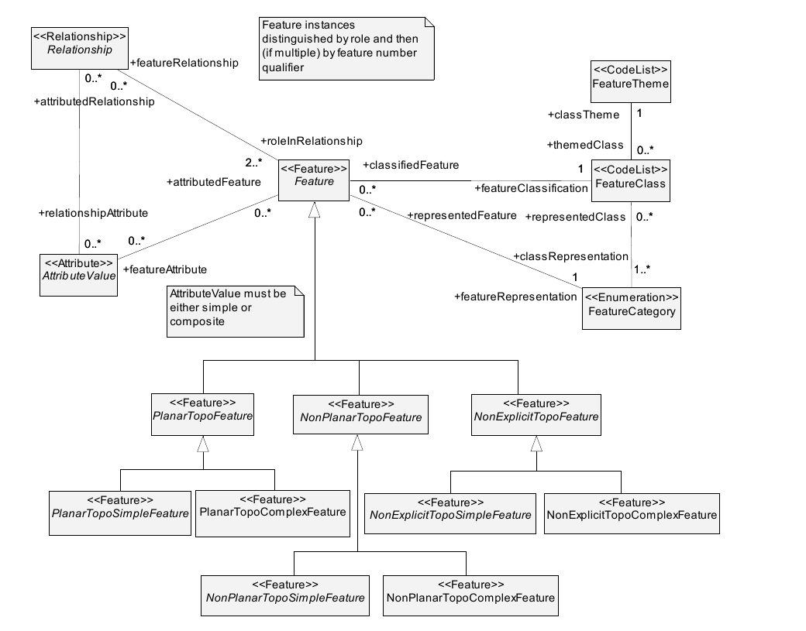
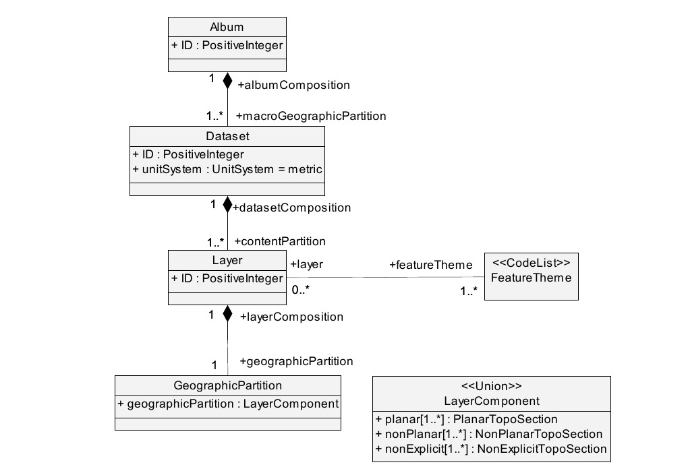

<!-- Počet stran 1046 ověřen v textu normy (patička poslední strany, „Price based on 1046 pages“); ICS podle poslední strany normy. -->
<!-- Označení a rok podle rozhodnutí Petra (27. 11. 2026): vydání ISO 2020 (CEN převzal beze změn jako EN ISO 20524-1:2022). Nahrazení ISO 14825:2011 potvrzeno v katalogu ISO (iso.org/obp, ISO 20524-1 ed. 1). -->

## Úvod

Popisovaný dokument je částí 1 souboru norem ISO 20524 Geografické datové soubory (GDF5.1), který stanovuje konceptuální a logický datový model a výměnné formáty geografických dat pro aplikace a služby inteligentních dopravních systémů (ITS). Formát GDF (Geographic Data Files) pro výměnu dat digitálních silničních map vznikl jako evropský a dále jej rozvíjela ISO/TC 204 jako ISO/TR 14825 (1996), ISO 14825:2004 (GDF 4.0) a ISO 14825:2011 (GDF5.0).

Soubor ISO 20524 navazuje na GDF5.0, přičemž zavádí sdílené geoprvky (Sharable Features), zohledňuje kooperativní ITS a je harmonizován s EN 12896:2012 (TRANSMODEL). Popisovaný dokument, který připravila ISO/TC 204 (WG 3), nahrazuje ISO 14825:2011 (GDF5.0). CEN jej převzal jako EN ISO 20524-1:2022 (CEN/TC 278/WG 7), která nahradila EN ISO 14825:2011.

Poznámka: Extrakt uvádí vybrané kapitoly popisovaného dokumentu a přejímá původní číslování kapitol.

## Užití

Popisovaný dokument je určen dodavatelům digitálních map, výrobcům navigačních systémů a vývojářům aplikací ITS, přičemž cílovými aplikacemi jsou vozidlové a přenosné navigační systémy, dopravní řídicí centra a služby navázané na systémy správy pozemních komunikací včetně veřejné dopravy. **Orgánům státní správy a správcům pozemních komunikací** poskytuje jednotný model a formát pro popis silniční sítě, jejích atributů (např. dopravní omezení) a vztahů k okolí a pro předávání dat.

Povinný obsah GDF přitom nepředepisuje, protože obsah datové sady (kromě minimální množiny metadat) je věcí dohody odběratele a dodavatele, a umožňuje zavést uživatelsky definované geoprvky, atributy a vztahy.

## 1 Předmět

Popisovaný dokument specifikuje konceptuální a logický datový model a fyzické formáty kódování geografických databází pro aplikace a služby ITS, tedy potenciální obsah databází (katalogy geoprvků, atributů a vztahů), jeho reprezentaci a metadata. Těžiště aplikačně nezávislého modelu je v silničních informacích, pokrývá však i např. administrativní členění, krajinný pokryv nebo body zájmu (POI).

Popisovaný dokument přejímá specifikaci GDF5.0 s výjimkou tématu Veřejná doprava, označeného jako zrušené (deprecated) s odkazem na část 2 (ISO 20524-2), která stanovuje sdílené geoprvky, prvky pro kooperativní ITS a revidované téma Veřejná doprava.

Přibližně čtvrtinu rozsahu popisovaného dokumentu tvoří výpisy schémat XML a další čtvrtinu katalogy atributů a vztahů.

## 2 Souvisící normy

Popisovaný dokument se odkazuje na 3 normativní dokumenty, a to ISO 690 (bibliografické odkazy a citace), ISO 639-2 (kódy jazyků) a ISO 3166-1 (kódy zemí), a nahrazuje ISO 14825:2011 (GDF5.0). Bibliografie obsahuje dalších 52 dokumentů, mj. ISO 19148 (lineární referencování), ISO 19115-1:2014 (metadata), ISO 20524-2 a EN 12896:2012 (TRANSMODEL).

## 3 Termíny a definice

Kapitola obsahuje 69 termínů a definic ve čtyřech skupinách (obecné, matematické, geodetické a termíny GDF), z nichž nejdůležitější jsou následující:

**geoprvek** (_Feature_) – databázová reprezentace objektu reálného světa

**atribut** (_Attribute_) – charakteristika geoprvku, která je nezávislá na jiných geoprvcích

**vztah** (_Semantic Relationship_, _Relationship_) – charakteristika geoprvku zahrnující jiné geoprvky

**třída geoprvku** (_Feature Class_) – kategorizace geoprvku; **téma geoprvků** (_Feature Theme_) – určená skupina souvisejících geoprvků

**kategorie geoprvku** (_Feature Category_) – typ reprezentace geoprvku (bodový, liniový, plošný a složený geoprvek)

**hrana** (_Edge_) – orientovaná posloupnost neprotínajících se úseček s uzly na obou koncích

**album** (_Album_) – soubor souvisejících datových sad a případně svazků; **vrstva** (_Layer_) a **sekce** (_Section_) – podmnožina datové sady vymezená informačním obsahem, resp. prostorově <!-- Termíny geoprvek, třída geoprvku, kategorie geoprvku, hrana, vrstva, sekce a propojení (junction) podle slovníku ITS terminology (ČSN EN ISO 14825, ČSN ISO 14296); téma geoprvků, album a pás ve slovníku nejsou. -->

Popisovaný dokument neobsahuje samostatnou kapitolu zkratek.

Další termíny a zkratky z oboru ITS jsou obsaženy ve slovníku ITS terminology (www.ITSterminology.org).

## 4 Symbolika a notační prvky

Krátká kapitola (méně než 1 strana) stanovuje UML jako jazyk konceptuálního modelování GDF a odkazuje na přílohu I.

## 5 Celkový konceptuální datový model

Kapitola (rozsah 17 stran) stanovuje textem a diagramy UML obecný datový model GDF, který slouží jako metamodel pro kap. 6 až 8. Každý geoprvek v něm náleží právě do jedné třídy, jednoho tématu a jedné kategorie (bod, linie, plocha, složený geoprvek) a může mít atributy a vztahy s jinými geoprvky. Celkový model je znázorněn na obrázku 1.

{width=8.5cm}

**Obr. 1** Celkový konceptuální datový model (obr. 1 popisovaného dokumentu)

Článek 5.2 (9 stran) stanovuje tři typy topologie grafu, a to rovinnou, nerovinnou, v níž se hrany mohou křížit bez uzlu (např. na mostě), a neexplicitní bez topologických vazeb. Dále stanovuje tři úrovně objektů, kde úroveň 0 tvoří topologická primitiva uzel, hrana a plocha, úroveň 1 jednoduché geoprvky a úroveň 2 složené geoprvky. Na něj navazují články 5.3 až 5.7, které stanovují model atributů a vztahů, lineární referencování, reprezentaci geoprvků a modelování času. Článek 5.8 (3 strany) pak stanovuje organizaci dat do alb, datových sad, vrstev a sekcí (vrstva obsahuje geoprvky jednoho nebo více témat vždy jen v jednom typu topologie), znázorněnou na obrázku 2.

{width=8.5cm}

**Obr. 2** Organizace dat do alb, datových sad, vrstev a sekcí (obr. 14 popisovaného dokumentu)

## 6 Katalog geoprvků

Kapitola (rozsah 79 stran) definuje geoprvky. Článek 6.1 stanovuje obecné zásady, podle nichž se geoprvky seskupují do témat a pro výměnu dat se používají čtyřmístné kódy tříd a dvoumístné kódy témat, přičemž se rozlišují jednoduché a složené geoprvky a lze definovat i uživatelské geoprvky. Články 6.2 až 6.15 pak podrobně definují geoprvky jednotlivých témat uvedených v tabulce 1, z nichž nejrozsáhlejší jsou Silnice a přívozy (16 stran) a Krajinný pokryv a využití území (28 stran). Každé téma je popsáno přehledovým diagramem a podrobným popisem jednotlivých geoprvků (definice, popis, podmínky a další specifické vlastnosti), podle potřeby doplněným příklady s grafickým vymezením.

**Tab. 1** Témata geoprvků GDF5.1 část 1 (sestaveno podle čl. 6.2 až 6.15 a přílohy A.1 popisovaného dokumentu)<!-- Tabulka je sestavena autorem extraktu, v popisovaném dokumentu nemá číslo; kódy, anglické názvy a články ověřeny v normě, české názvy témat jsou návrhem překladu -->

| Kód tématu | Téma (anglicky) | Téma (česky) | Článek | Příklady geoprvků |
| --- | --- | --- | --- | --- |
| 41 | Roads and Ferries | Silnice a přívozy | 6.2 | prvek silnice (Road Element), propojení (Junction), silnice, křižovatka, mimoúrovňové křížení, kruhový objezd, trajektové spojení |
| 11 | Administrative Areas | Administrativní oblasti | 6.3 | nadnárodní oblast, země, oblasti řádu 1 až 9 (přiřazení národních celků viz příloha G) |
| 31 | Named Areas | Pojmenované oblasti | 6.4 | zastavěné území, poštovní, policejní, školní či volební obvod |
| 71 | Land Cover And Use | Krajinný pokryv a využití území | 6.5 | budova, městský blok, chodník, les, zemědělská plocha (členění podle CORINE Land Cover) |
| 60 | Terrain Elevation | Výškopis terénu | 6.6 | povrch TIN (nepravidelná trojúhelníková síť), vrstevnice, pravidelná mřížka výšek |
| 75 | Structures | Stavby | 6.7 | stavba (Structure) |
| 42 | Railways | Železnice | 6.8 | prvek železnice, propojení železnice |
| 43 | Waterways | Vodstvo | 6.9 | řeka, jezero, kanál, moře |
| 72 | Road Furniture | Vybavení pozemní komunikace | 6.10 | dopravní značka, světelné signalizační zařízení, směrový ukazatel, přechod pro chodce |
| 73 | Services | Služby | 6.11 | bez normativních geoprvků (viz příloha C) |
| 50 | Public Transport | Veřejná doprava | 6.12 | zrušeno, viz ISO 20524-2 |
| 49 | Linear Referencing Features | Geoprvky lineárního referencování | 6.13 | dráha (Path), referenční bod (Referent) |
| 48 | Linear Datum Features | Geoprvky lineárního datumu | 6.14 | lineární datum, kotevní bod, kotevní úsek |
| 80 | General Features | Obecné geoprvky | 6.15 | středový bod geoprvku, dopravní lokalizace, vstupní bod |

Základem tématu Silnice a přívozy je prvek silnice, tedy nejmenší liniová jednotka silniční sítě s propojením na každém konci. Geoprvky lineárního referencování přejímají koncept ISO 19148, v němž je poloha určena vzdáleností od referenčních bodů na liniové entitě, nikoli v topologické síti.

## 7 Katalog atributů

Kapitola (rozsah 188 stran) definuje atributy. Článek 7.1 (45 stran) stanovuje obecné zásady, mj. jednoduché a složené atributy a matici použitelnosti podle témat, přičemž složený atribut lze omezit restriktivními podatributy, např. platností pro jízdní pruh, směrem a dobou platnosti nebo druhem vozidla. Článek 7.2 (143 stran) na tyto zásady navazuje a definuje abecedně 286 typů atributů, z nichž každý je popsán v jednotné struktuře definicí a oborem hodnot, resp. měrnou jednotkou. Např. maximální povolená výška vozidla (Maximum Height Allowed) se vyjadřuje v centimetrech, v palcích nebo v jednotce uživatele.

## 8 Katalog vztahů

Kapitola (rozsah 70 stran) definuje sémantické vztahy mezi geoprvky, a to i mezi geoprvky různých témat, sekcí a vrstev. Článek 8.1 (26 stran) stanovuje obecné zásady (mj. typy a kódy vztahů, arita, role) a článek 8.2 (44 stran) definuje 64 typů vztahů, z nichž každý je popsán definicí, rolemi zúčastněných geoprvků s uvedením, zda je role povinná a opakovatelná, a odkazem na diagram konceptuálního modelu. Např. vztah dopravní značka podél prvku silnice (Traffic Sign Along Road Element) má dvě povinné neopakovatelné role, dopravní značku a prvek silnice.

## 9 Pravidla reprezentace geoprvků

Kapitola (rozsah 30 stran) stanovuje, jakými kategoriemi a primitivy se geoprvky reprezentují v jednotlivých typech topologie, a to v článcích 9.2 až 9.15 po tématech na úrovních 0, 1 a 2 (např. prvek silnice je liniový geoprvek z jedné nebo více hran vedených osou komunikace). Podporována jsou přitom nula- až dvourozměrná primitiva a souřadnice až se čtyřmi rozměry.

## 10 Katalog metadat

Kapitola (rozsah 55 stran) stanovuje metadata, která činí datovou sadu GDF samopopisnou a jsou v souladu s ISO 19115-1:2014, neboť obsahují všechny její povinné a vybrané volitelné prvky. Články 10.2 až 10.8 stanovují mj. záhlaví a ukončení, datový slovník, obsah, zdrojový materiál, geodetické parametry a informace o aktualizaci, a to výčtem položek každého metadatového prvku.

## 11 Logické datové struktury

Kapitola (rozsah 76 stran) stanovuje v jazyce pro popis dat ESN logické datové struktury GDF nezávislé na fyzické realizaci (mj. album, datové sady, vrstvy, sekce, časové domény), které lze použít jako základ programu pro načítání GDF. Každá struktura je zapsána jako seznam složek s typem a odkazem na článek, v němž je složka definována, a je doplněna omezeními, jak je patrné z výpisu 1.

```
[
    Album Identifier      : ALBUM ID         11.8.7.9
    Album Metadata        : ALBUM HEADER     11.2.3
    Datasets              : [DATASET]+       11.3.2
]
Constraints
C2: Each Dataset shall belong to exactly one Album.
```

**Výpis 1** Logická struktura alba v ESN (čl. 11.2.2 popisovaného dokumentu)

## 12 Specifikace záznamů na médiu

Kapitola (rozsah 123 stran) stanovuje první fyzickou realizaci výměnného formátu, kterou je textový soubor záznamů (ASCII flat file) s délkou záznamu 81 nebo 82 znaků. Stanovuje jeho dělení na informační jednotky a svazky, specifikace polí a formát 26 globálních záznamů, 20 datových záznamů (mj. uzel, hrana, geoprvky, atribut, vztah) a 3 záznamů aktualizace. Každý záznam je specifikován tabulkou polí s názvem, délkou, typem, povinností, rozsahem hodnot a popisem. Např. záznam uzlu (NODEREC) obsahuje identifikátor a stav uzlu, odkaz na souřadnice a zpětné odkazy na hrany a bodové geoprvky.

## 13 Specifikace schématu XML

Nejrozsáhlejší kapitola (272 stran) stanovuje druhou fyzickou realizaci, kterou je schéma XML pro předávání úplných databází GDF s kořenovým prvkem gdf, a to jako překlad specifikace z kapitoly 12, v němž jsou geoprvky, atributy a vztahy převedeny na komplexní a jednoduché typy XSD s výčty kódů a rolí. Kromě toho obsahuje úplné výpisy schémat GDF_Main.xsd, GDF_data_dict.xsd a GDF_userDefined.xsd s diagramy komplexních typů.

## Příloha A (normativní) Sémantické kódy

Příloha o rozsahu 26 stran stanovuje kódy témat a tříd geoprvků (A.1), typů atributů a jejich hodnot (A.2) a typů vztahů (A.3).

## Příloha B (informativní) Kódy metadat

Příloha o rozsahu 25 stran obsahuje kódy geodetických systémů a číselníky převzaté z ISO 19115.

## Příloha C (informativní) Služby

Příloha o rozsahu 9 stran obsahuje definice a kódy služeb (např. bankomat, autobusové nádraží) pro téma Služby.

## Příloha D (normativní) Syntaxe časových domén GDF5.1 části 1 (popisovaný dokument)

Příloha o rozsahu 26 stran stanovuje syntaxi časových domén, tedy počáteční datum s dobou trvání nebo koncovým datem, jejich kombinace a zkrácené zápisy a vyhodnocení časové rovnice. Základní domény se zapisují počátkem v kulatých a trváním ve složených závorkách a kombinují se sjednocením (+) a průnikem (*) (výpis 2).

```
[ [ [(h9){h3}] + [(h13m30){h5m30}] ] * [(t2){d6}] ]
```

**Výpis 2** Zápis otevírací doby po–so 9:00–12:00 a 13:30–19:00 (příklad z přílohy D popisovaného dokumentu)

## Příloha E (normativní) Sekcionování datových sad GDF

Příloha (rozsah 3 strany) stanovuje pravidla rozdělení záznamů do sekcí včetně geoprvků přesahujících hranici sekce, přičemž sekcionování slouží jen k organizaci dat.

## Příloha F (informativní) Pravidla pro vytváření geoprvků úrovně 2 z tématu Silnice a přívozy

Příloha o rozsahu 10 stran obsahuje zásady sestavení složených geoprvků silnice, křižovatka a mimoúrovňové křížení z prvků silnice a propojení.

## Příloha G (informativní) Příklady geopolitických struktur

Příloha o rozsahu 18 stran obsahuje pro řadu zemí přiřazení národních administrativních oblastí obecným oblastem řádu 1 až 9.

## Příloha H (informativní) Specifikace možného použití atributů zápisu a výslovnosti řetězců znaků

Příloha (rozsah 3 strany) obsahuje příklady použití atributů pro zápis a výslovnost názvů.

## Příloha I (informativní) Notace UML

Příloha o rozsahu 7 stran shrnuje konvence diagramů tříd UML použité v popisovaném dokumentu.
