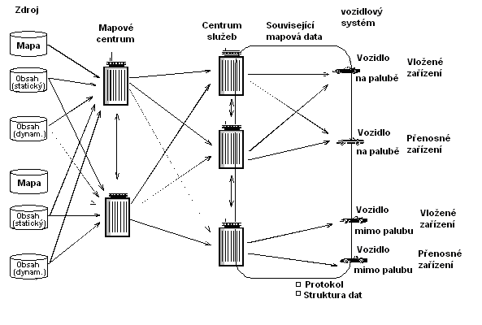
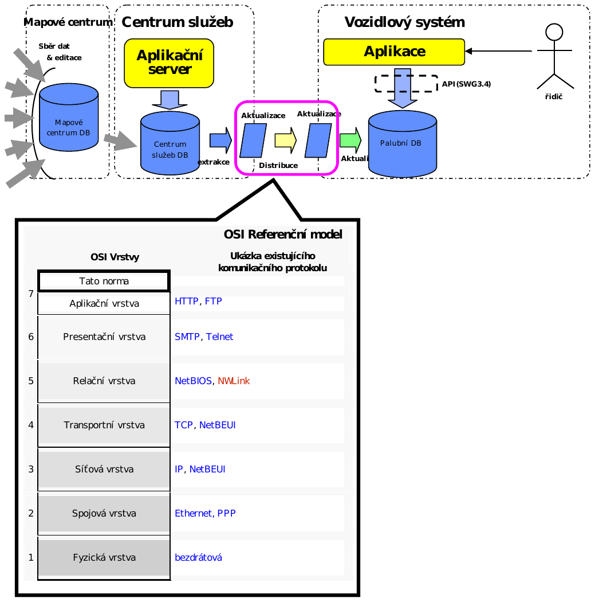
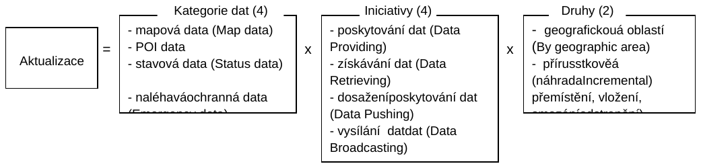
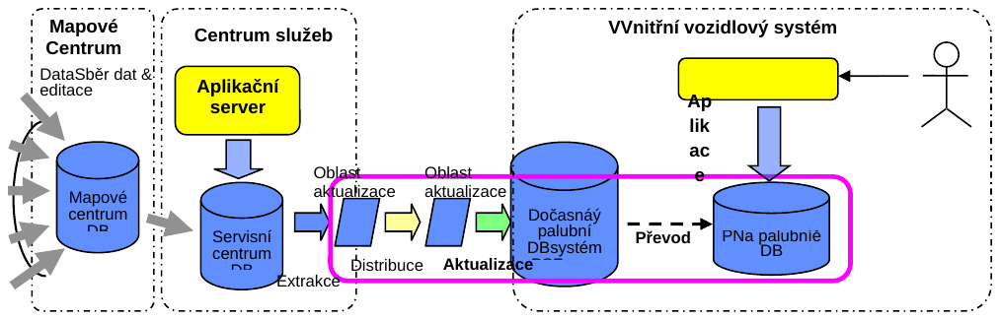
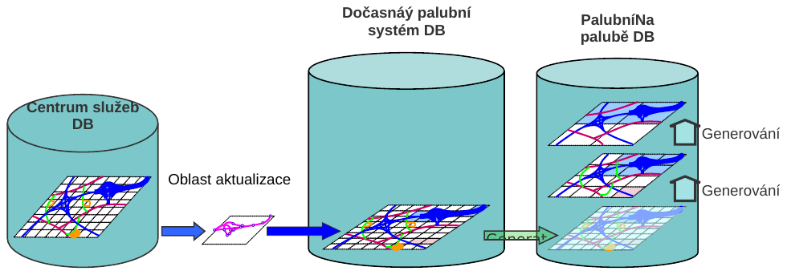
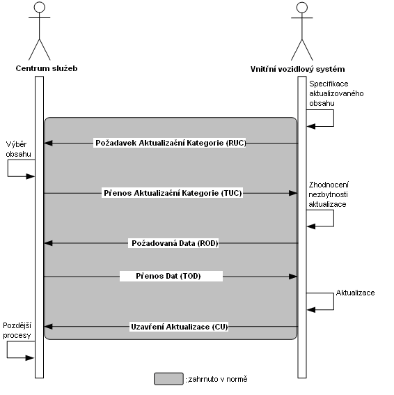
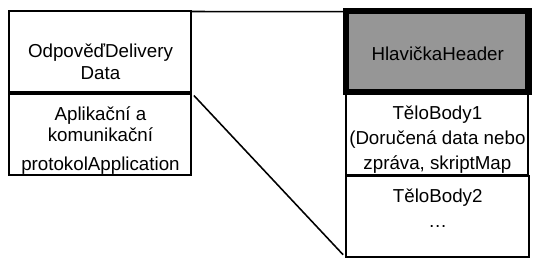

## Úvod

Tato norma nebyla dosud zavedena do ČSN. Původ této normy souvisí s rostoucím požadavkem trhu po dynamické aktualizaci služeb s mapově orientovanými daty navigačních systémů. Mapově orientovaná data nezahrnují jen hlavní části geometrie a atributů ale také data o zájmových bodech například hotely, restaurace a dynamický obsah jako doprava, počasí, dostupnost parkování apod. V současné době je nejvíce aktualizací mapových dat poskytováno na fyzických nosičích, jejichž datový obsah od okamžiku doručení uživateli velice rychle stárne. V budoucnu se očekává, že přenos těchto dat bude nejčastěji, ale ne výlučně bezdrátovým způsobem. Výhoda bezdrátového doručování dat spočívá ve zjednodušení organizace distribuce přenosu a tím urychlení schopnosti zákazníka přijmout aktuální data. Tato norma vytváří potenciál pro aktualizaci na vyžádání palubních mapových databází. Aktualizace ne nutně vyžaduje obměnu celé mapové databáze. Aktualizace může být omezena jen na část datové množiny, specifický seznam atributů nebo poskytnutí změn zájmových bodů.

Poznámka: Extrakt uvádí vybrané kapitoly popisovaného dokumentu a přejímá původní číslování kapitol.

## Užití

Norma může být využita jako běžný formát pro přenos dat z pohledu tvůrců mapových podkladů, poskytovatelů dopravních či navigačních informací, pro tvůrce vozidlových asistenčních systémů či správce dopravních informačních center.

## 1 Předmět normy

Tato norma definuje datové struktury a protokol(y) používané v ITS aplikacích pro doručování a aktualizaci mapově vztažených dat z centra služeb k uživatelům (vozidlovým systémům).

Mapové centrum představuje dodavatele mapových dat a centrum služeb poskytuje data a služby zařízením uživatelů. Termín protokol užívaný v této normě vyjadřuje časovou posloupnost datových interakcí mezi prvky systému, které realizují doručování mapově souvisejících dat a aktualizací. Tato norma je navržena v souladu s využitím komunikačních protokolů vytvářených v rámci pracovní skupiny TC 204/WG 16. Tvůrci tohoto standardu si uvědomují možnou potřebu bezpečnostních mechanizmů při poskytování těchto dat.

Protokoly pro komunikační technologie a jiné aplikační řídicí protokoly a mapově nesouvisející data, například obrázky ke znázornění nezávislé mapové databáze formou HTML stránky, jsou mimo rámec této normy. Definice zabezpečovacích mechanizmů a mechanizmů obchodních případů nejsou předmětem této normy.

Obrázek 1 ilustruje předmět této normy.

**Obr. 1** Rozsah normy

Norma je členěna do devíti základních kapitol a šesti příloh z nichž pouze příloha A má normativní charakter. Ostatní mají informativní podobu.

## 3 Souvisící normy

ISO 14825:2004 Inteligentní dopravní systémy – Geografické datové soubory – Celková datová specifikace (GDF4.0).

ISO/TS 20452:2007 Požadavky a logický datový model pro formát fyzické skladování dat (PSF) a rozhraní aplikačního programu (API) a logická organizace dat pro PSF používaná v inteligentních dopravních systémech

ISO 17572 Inteligentní dopravní systémy – Označení pozic pro geografické databáze

ISO 17267 Standardní API navigačního systému

## 4 Termíny a definice

Norma obsahuje 22 termínů a definicí.

**adresování polohy** _(address location)_ – aplikační kategorie, která se zabývá úlohami vyjadřujícími skutečnou pozici na zemi v rámci PSF datové reprezentace

Poznámka: jedna ze šesti aplikačních kategorií podporovaných PSF a API

**aplikační kategorie** _(application category)_ – základní podfunkce v rámci funkční množiny pro vozidlovou navigaci a aplikace cestovního informačního systému

Poznámka: tato specifikace rozlišuje šest aplikačních kategorií: zobrazení mapy, stanovení polohy, plánování trasy, navádění na trasu, adresování polohy, služby a P.O.I. informační přístup

**datové vysílání** _(data broadcasting)_ – jednostranná komunikace z centra služeb

**poskytování dat** _(data providing)_ – obousměrný datový přenos iniciovaný vozidlovým systémem, ve kterém je verze kontrolována centrem služeb

**dosažení dat** _(data pushing)_ – obousměrný datový přenos iniciovaný centrem služeb

Další termíny a zkratky z oboru ITS jsou obsaženy ve slovníku ITS terminology.

## 5 Symboly a zkratky

Norma obsahuje 21 pojmenovaných symbolů.

Další termíny a zkratky z oboru ITS jsou obsaženy ve slovníku ITS terminology (www.ITSterminology.org).

## 6. Požadavky

### 6.1 Uživatelské požadavky

Datové doručovací struktury a protokoly budou podporovat šest aplikačních tříd: zobrazení mapy (Map Display), stanovení polohy (Positioning), plánování trasy (Route Planning), navádění na trasu (Route Guidance), adresování polohy (Address Location), služba P.O.I. informační přístup (Service and P.O.I information Access). Protokoly a datové struktury by měly být navrženy takovým způsobem, aby nevyvolávaly zhoršení charakteristik systému před, během či po jejich použití. Výměna dat mezi centrem služeb a vozidlovými systémy (In-Vehicle Systems) by měla využívat otevřený (bez právní ochrany) datový formát například XML.Specifikace odchozí adresy dat je popsána v otevřeném tvaru, nicméně popis obsahu může být realizován binární reprezentací.

### 6.2 Datové požadavky

Data by měla v sobě zahrnovat minimálně, mapová data (jako geoprvky, geometrii a atributy). Mohou rovněž zahrnovat některá stavová dat (jako reálný čas geografických dopravních dat) a POI data. ADAS mapová data mohou být zahrnuta jako jejich rozšíření.. Některá data mohou být rozlišena jako naléhavá data. Datová struktura by měla být snadno zpracovatelná vozidlovými systémy. Datové struktury by měly minimalizovat velikost datové množiny, jak jen je to možné, pro přenos i zpracování ve vozidlových systémech uváděných na trh.

### 6.3 Požadavky na protokol

\- aktualizovaný protokol(y) mají být kompatibilní jak s bezdrátovými metodami, tak i s metodami

využívajícími pevných linek

\- protokol by neměl vyžadovat více paměti na ukládání nebo více výpočetního výkonu, než jaký je

očekávaný, že bude dostupný ve vozidlových systémech přicházejících na trh

\- protokol v této normě by měl být napsán s dostatečnou flexibilitou jak pro podporu existujících

komunikačních technologií, tak pro zlepšení schopnosti oslovit budoucí komunikační technologie

\- protokol definuje, jak doručit mapově orientovaná data mezi centrem služeb a vozidlovými systémy

\- předpokládané využití protokolu je v mobilním prostředí ve kterém komunikace může být

přerušována například jízdou v tunelech nebo jízdou v oblastech se špatným či žádným příjmem.

Protokol by měl podporovat úplné a efektivní obnovení při přerušení komunikace: například by se

měl vyhnout opětovnému přenosu celé aktualizace v případě, kdy pouze malá část nebyla doručena

\- protokol by měl minimalizovat velikost datové množiny, jak jen je to možné, jak pro přenos tak i pro

zpracování ve vozidlových systémech přicházejících na trh

### 6.4 Komunikační požadavky

Obecný proces aktualizace by měl být nezávislý na technických prostředcích spojení mezi centrem služeb a vozidlovými systémy.

V odůvodněných případech by proces aktualizace měl podporovat komunikační spojení s omezenou šířkou pásma.

### 6.5 Strategie aktualizace

Návrh procesu aktualizace by měl být nezávislý na poskytovateli dat (mapovém centru).

Návrh procesu aktualizace by měl být nezávislý na vozidlové aplikaci.

Norma by měla podporovat aktualizaci různých kategorií dat (mapové geoprvky a atributy, stavová data a zájmová data) s různou četností.

Funkcionalita vozidlových systémů je ovlivněna změnami prostorových geoprvků a jejich atributů v reálném světě. Například výstavba nových PK či změna označení PK, nebo oprava doposud se vyskytující chyby. Z tohoto důvodu by data dostupná ve vozidlových systémech měla být udržována aktuální.

Tato norma podporuje dvě metody zajištění aktualizace:

\- aktualizace zeměpisnou oblastí: tato metoda umožňuje kompletní nahrazení dat pro

konkrétní geografickou oblast nebo pro celou datovou množinu

\- inkrementální aktualizace prostorových geoprvků a atributů: tato metoda umožňuje

nahrazení, vložení či zrušení geoprvků a/nebo atributů pouze v případě, že dojde k jejich

změně oproti předcházející verzi datové množiny

Tato norma podporuje čtyři strategie zajištění aktualizace: poskytování dat, získávání dat, dosažení dat a datové vysílání

## 7. Referenční architektura a rámcový koncept

### 7.1 Referenční architektura

Následující obrázek reprezentuje obecnou architekturu, která podporuje doručování navigačních dat servisním centrem k vozidlovým systémům v souladu s touto normou.

Tato norma může být využita v široce používaných protokolech jako jsou TCP/IP a HTTP. Doručená data se skládají z hlavičky (header) a těl (bodies). Tato norma definuje zejména informace v hlavičce, užívané ve vozidlových systémech, k posouzení skutečnosti, zda doručená data mohou či nemohou být využita. (Vozidlový systém může, při čtení informace obsažené v hlavičce, tato nadbytečná data přeskočit). Data zaslaná v těle zprávy jsou mapová data, stavová data, POI či naléhavá data.

**Obr. 2** Referenční architektura

### 7.2 Rámcový koncept

### 7.2.1 Varianty aktualizací

Varianty aktualizací jsou definovány jako dvojice iniciativ, typů a datových kategorií.

Třídění iniciativ a typů kategorií dat je uvedeno v kapitole 6 a v příloze B - užité případy

**Obr. 3** Varianty aktualizací (obr. 4 popisovaného dokumentu)

##### 7.2.1.1 Případ aktualizace geografickou oblastí

Pokud aktualizace je vytvořena geografickou oblastí, všechna data geografické oblasti jsou poslána, což znamená, že soubor dat rovněž obsahuje nezměněné informace.

Rozlišujeme dvě metody aktualizace (Mód 1) provádí post-kompilaci ve vozidlových systémech, (Mód 2) provádí některé způsoby před-kompilace v centru služeb (například generování potřebných vrstev apod.) z důvodu redukce zpracování na straně vozidlového systému. Většina současných systémů představuje hybridní spojení Módu 1 a Módu 2.

Úplná aktualizace je specifický případ aktualizace geografickou oblastí. Úplná aktualizace se provádí aby nahradila celou datovou množinu vozidlového systému.

###### 7.2.1.1.1 Případ post-kompilace Mód 1

Vozidlový systém přijímá data oblasti aktualizace z centra služeb komunikační cestou. Kompilace a generování vrstvy je realizováno ve vozidlovém systému.

Poznámka: Obecně post-kompilační Mód má tendenci dosahovat nižší objem přenášených dat.

**Obr. 4** Případ post-kompilace (Mód 1) (obr. 5 popisovaného dokumentu)

##### 7.2.1.2 Případ inkrementální aktualizace

V případě, že je aktualizace provedena inkrementálně, budou poslány jen různé části datového souboru. Tak, jak je to vidět při aktualizaci geografickou oblastí, jsou i zde dva Módy inkrementální aktualizace: (Mód 1) pro kompilování dat ve vozidlovém systému (post-kompilace). (Mód 2) pro kompilaci dat v centru služeb a poskytnutí požadovaných vrstev (před-kompilace).

Většina skutečných systémů představuje hybridní spojení Módu 1 a Módu 2.

Mód 1 Post-kompilace

Vozidlový systém přijme komunikačními prostředky minimální množství aktualizovaných dat (například pouze změny) z centra služeb. Každý vozidlový systém zkompiluje a vygeneruje datovou podmnožinu.

Mód 2 Před-kompilace

Vozidlový systém přijme komunikační cestou aktualizovaná data z centra služeb. Kompilace dat je provedena v centru služeb. Aktualizovaná data jsou zaslána do vozidlového systému a integrována bez palubní kompilace.

Poznámka: obecně je kompilace ve vozidlovém systému minimalizována. Integrace dat do palubní DB je v podstatě jediný proces potřebný k realizaci ve vozidlovém systému. Zatížení procesoru bude pravděpodobně menší než u systému post-kompilace (Mód 1) ačkoliv se množství aktualizovaných dat pravděpodobně zvýší.

##### 7.2.2 Popis procesu výměny aktualizačních dat

##### 7.2.2.1 Úplný proces aktualizace

Při aktualizaci mapy, centrum služeb a vozidlový systém musí zkontrolovat stav před a po aktualizaci.

Proces je rozdělen do třech kroků

1\) předzpracování: připravit aktualizovaná data a ověřit záměr uživatele

2\) doručení aktualizovaných dat: poslání a příjem dat

3\) dodatečné zpracování: ověření ukončení a dalších souvisejících úloh

Níže je znázorněn celý proces.

**Obr. 5** Úplný proces aktualizace (obr. 7 popisovaného dokumentu)

Datový tok znázorněný ve tmavém okně obrázku 6 je definován touto normou.

**Obr. 6** Základní datová struktura (obr. 8 popisovaného dokumentu)

## 8. Protokoly

### 8.1 Úvod

Tato kapitola definuje protokoly pro aktualizaci dat ve vozidlových systémech v souladu s koncepty definovanými v kapitole 7. Zde jsou uvedeny čtyři protokoly. Dva z nich jsou užívány v případech, kdy je vozidlový systém aktivačním členem. Zbylé dva jsou využity pokud je centrum služeb aktivačním prvkem. Tyto protokoly mohou pracovat s několika datovými kategoriemi. Vztah mezi těmito protokoly a variantou aktualizace definovaný v podkapitole 7.2.1 je popsán v tabulce 1.

Protokoly jsou definovány jako uspořádaná posloupnost mezi centrem služeb a vozidlovým systémem. Reálný systém může přeskočit volitelná pořadí těchto protokolů.

Protokoly ve vozidlových systémech a centru služeb jsou mimo rozsah této normy.

**Tab. 1** Protokoly a relační vztahy s variantami aktualizace

| Protokoly                                                                                          | Varianty aktualizací                |                 |                     |
| -------------------------------------------------------------------------------------------------- | ----------------------------------- | --------------- | ------------------- |
|                                                                                                    | Kategorie dat                       | Iniciativy      | Druhy               |
| Protokol pro vozidlový systém - spouštěcí systémy doručující mapová data nebo POI data.            | Mapová Data, POI data               | Poskytování dat | Geografickou oblast |
|                                                                                                    |                                     |                 | Inkrementálně       |
|                                                                                                    |                                     | Získávání dat   | Geografickou oblast |
|                                                                                                    |                                     |                 | Inkrementálně       |
| Protokol pro vozidlový systém - spouštěcí systémy doručující stavová data                          | Stavová Data                        | Poskytování dat | Geografickou oblast |
|                                                                                                    |                                     |                 | Inkrementálně       |
|                                                                                                    |                                     | Získávání dat   | Geografickou oblast |
|                                                                                                    |                                     |                 | Inkrementálně       |
| Protokol pro centrum služeb - spouštěcí systémy doručující mapová data, POI data nebo stavová data | Mapová Data, POI data, Stavová Data | Dosažení dat    | Geografickou oblast |
|                                                                                                    |                                     |                 | Inkrementálně       |
|                                                                                                    |                                     | Vysílání dat    | Geografickou oblast |
|                                                                                                    |                                     |                 | Inkrementálně       |
| Protokol pro centrum služeb - spouštěcí systémy doručující naléhavá data                           | Naléhavá data                       | Dosažení dat    | Geografickou oblast |
|                                                                                                    |                                     |                 | Inkrementálně       |
|                                                                                                    |                                     | Vysílání dat    | Geografickou oblast |
|                                                                                                    |                                     |                 | Inkrementálně       |

## 9. Datové struktury

### 9.1 Úvod

Datová výměna mezi centrem služeb a vozidlovým systémem je uspořádána pěti zprávami definovanými v kapitole 8.6. Relační vztah mezi zprávami a výměnnými parametry je znázorněn na obrázku 13. Vícečetnost objevující se na každém konci relačního vztahu objasňuje, zda se jedná o parametr volitelný či nikoli, a zda se může vyskytovat vícekrát.

### 9.2 Třída: Place\_identifier (identifikátor\_místa)

Třída _Place\_identifier_ je třída užívaná ve zprávách vycházejících z vozidlového systému do centra služeb pro potřeby specifikace místa, kde je aktualizace požadovaná. To je užíváno v případech, kdy vozidlový systém nemůže identifikovat ID obsah přicházející z centra služeb, když je to vyžadováno.

### 9.3 Třída: Area\_ID (ID\_oblasti)

Třída _Area\_ID_ je třída užívaná poskytovatelem dat k informování příjemce dat o identifikátoru místa, které má být aktualizováno. To je pak užito ke specifikaci identifikátoru místa aktualizovaných dat. Třída je využívána v případech, kdy typ aktualizace je "geografickou oblastí".

## Příloha A Abstraktní testovací soubor (normativní)

Abstraktní testovací soubor platí pro obsažený protokol a data odvozená z této mezinárodní normy.

## Příloha B Případy užití (informativní)

Tato část dokumentu obsahuje užité případy, které popisují závislost mezi vozidlovým systémem a centrem služeb. Účelem vytvoření těchto případů užití, je vyjasnit požadavek této normy objasněním postupu výměny dat mezi vozidlovým systémem a centrem služeb. Autoři vytvořili tyto případy užití za předpokladu, že položky popsané v návrhu normy verze 5.1 Navigační datové doručovací struktury a protokoly, jsou schváleny.

**Obr. 7** Diagram případu užití - nejvyšší úroveň (obr. B1 popisovaného dokumentu)

## Příloha C Příklady protokolů pro jednotlivé varianty aktualizace (informativní)

Tato příloha ukazuje příklad provozního postupu aktualizace dat vozidlového systému, který využívá pojmy obsažené v kapitole 6 a datové struktury popsané v kapitole 8. Tabulka C1 přináší podrobnosti k seznamu ukázkových protokolů. Tyto protokoly jsou definovány pro každou variantu aktualizace definovanou v podkapitole 7.2.1.

## Příloha D Příklad procesu aktualizace dat (informativní)

V této části je popsán soubor základních aktualizací prvků protokolu k zajištění podpory výměny zpráv mezi centrem služeb a vozidlovými systémy. Jsou rozlišovány dva typy aktualizací v závislosti na iniciaci aktualizace, která je buď zahájena centrem služeb nebo vozidlovým systémem. Základní prvky protokolu jsou odvozeny z pozorování těchto dvou procesů.

## Příloha E Popis vyjadřovacích prvků jazyka UML (informativní)

Tato norma využívá nově vytvořené metodologie nazývané UML k vyjádření strukturovaných závislostí. Obsažená tabulka ukazuje krátký popis základních prvků diagramu UML užívaných k odstranění nesprávné interpretace dalšího vývoje jazyka UML 1.4, jež je normalizovaný v dokumentu ISO 19501. Nicméně normalizace UML2 by měla být dokončena pracovní skupinou Object Management Group www.omg.org.

## Příloha F Informativní odkazy (informativní)

Tato část obsahuje dva související odkazy.
