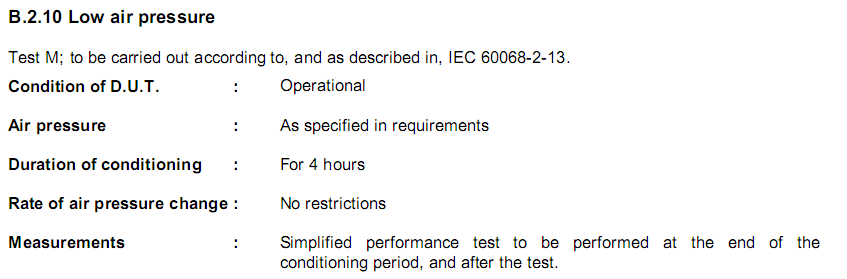

# EXTRAKT z české technické normy

**Extrakt nenahrazuje samotnou technickou normu, je pouze informativním materiálem o normě.**

**ICS 03.220.20, 35.240.60**

**Dopravní telematika – Automatická identifikace vozidel, zařízení a nákladů – Specifikace systému**

ČSN EN ISO 14815 — třídicí znak 01 8337

Platí od 1.1.2006 39 stran

**Úvod**

Tato norma je součástí norem zaměřených na automatickou identifikaci vozidla, nákladu či položky zařízení pro účely telematických aplikací. Jejím účelem je vytvořit specifikaci systému AVI/AEI, a tak umožnit nominální interoperabilitu mezi systémy různých výrobců. Systémy AVI/AEI jsou dle různých požadavků na jejich funkčnost rozděleny v jednotlivých klíčových kategoriích do tříd, podle kterých pak vybírá systém potenciální zákazník. Zároveň s třídami jsou také stanoveny zkoušky, kterými musí systém projít, aby jej bylo možné do dané třídy zařadit. Zkoušky zaměřené na komunikační aspekty systému AVI/AEI staví na schválených frekvencích rozhraní DSRC; pokud by došlo k jejich změně, tak by bylo zapotřebí přezkoumat platnost všech stanovených parametrů.

Poznámka: Extrakt uvádí vybrané kapitoly popisovaného dokumentu a přejímá původní číslování kapitol.

**Užití**

Stanovuje podmínky na systém AVI/AEI a třídí podle nich systém do kategorií. To umožňuje nalézt parametry interoperability dvou různých systémů. Kategorie systému souvisí i s požadavky na jejich zkoušení, hodnocení a certifikaci. Díky stanoveným kategoriím je možné si „sestavit“ vlastní systém AVI/AEI s vlastní požadovanou funkcionalitou.

**Pro orgány státní správy** tato norma stanovuje způsob, aby se mohli rozhodnout, ve kterých kategoriích požadují maximální výkon (nejvyšší třída) a ve kterých zase nejnižší. Od takto stanovených požadavků na systém se potom odvíjí i jeho cena.

**Pro výrobce zařízení a dodavatele telematických systémů** tato norma obsahuje důležité pokyny, aby mohli vyrábět systémy s různými požadavky na funkcionalitu. Stanovuje zkoušky, kterými musí zařízení projít, aby spadalo do určitě kategorie, a v neposlední řadě stanovuje podmínky certifikace zařízení.

**1 Předmět normy**

Norma stanovuje kategorie ve funkčních a nefunkčních požadavcích na systém AVI/AEI, zkoušení těchto požadavků a popis obsahu certifikátů.

Norma obsahuje 5 dodatků stanovujících kategorie parametrů systému (příloha A), environmentální parametry systému (příloha B), popis shody a postup certifikace (příloha C), bezpečnost (příloha D) a označování zařízení AVI/AEI (příloha E).

**2 Souvisící normy**

Vzhledem k charakteru této normy je jednoznačně požadována znalost nebo alespoň přístup k normám IEC na elektromagnetickou kompatibilitu a environmentální zkoušení. Normu je nutno dále číst v kontextu ostatních norem AVI/AEI.

**3 Termíny a definice**

**3.1 automatická identifikace vozidel, nákladů či zařízení** _(system AVI/AEI)_ obor, kterým se zabývá tato skupina norem.

**3.7 pevné zařízení** _(fixed equipment FE)_ zařízení potřebné pro čtení/zapisování, přijímání a interpretaci dat obsažených v palubním zařízení (OBE) za účelem identifikace

**3.14 palubní zařízení OBE** _(on-board equipment OBE)_ zařízení zajišťující funkci AVI/AEI umístěné ve vozidle nebo jeho dalším zařízení

Další termíny a zkratky z oboru ITS jsou obsaženy ve slovníku ITS terminology.

**4 Symboly a zkratky**

**DSRC** vyhrazené spojení krátkého dosahu

GET (?)

SET (?) oboje viz 5.3.4

**MTBF** střední doba mezi výskyty chyby zařízení

Další termíny a zkratky z oboru ITS jsou obsaženy ve slovníku ITS terminology (www.ITSterminology.org).

**5 Požadavky**

**5.1 Obecná specifikace systémů AVI/AEI**

Tato specifikace potvrzuje základní požadavky na datovou a provozní kompatibilitu systémů AVI/AEI vedoucí k zajištění jejich nominální interoperability. Stanovuje, že zařízení na straně infrastruktury musí být schopné fungovat s různými OBE a vyhovující různým provozním a environmentálním třídám. Dále zmiňuje nutnost používat stejné komunikační rozhraní a strukturu dat.

**5.2 Specifikace systému: architektura**

V tomto článku je nastíněna vize systému AVI/AEI a poslání systémové specifikace.

**Vize**: _„Poskytnout metodu (mezinárodní a interoperabilní) pro automatickou identifikaci vozidla či zařízení za použití standardizovaného komunikačního rozhraní DSRC.“_

**Poslání:** _„Stanovit takovou funkcionalitu, environmentální a provozní parametry (specifikace systému AVI/AEI), že je možné dosáhnout vizí stanoveného cíle v prostředí otevřených systémů, umožňující interoperabilitu a zároveň umožňující koexistenci různého vybavení (zařízení).“_

Článek dále odkazuje na architekturu stanovenou v předchozí normě (EN ISO 14815) a rozvádí do podrobnosti fyzickou architekturu, kde stručně popisuje, jak by měl probíhat proces automatické identifikace.

**5.3-4 Specifikace systému AVI/AEI**

Článek 5.3 popisuje „samostatné“ systémy AVI/AEI a stanovuje minimální požadavky na proces výměny dat. Tedy funkci GET a doplňkově (při zápisu dat) funkci SET či případně další funkce, zde odkazuje na normu EN ISO 14816. V článku 5.4 je zmíněna funkce systému AVI/AEI jako subsystému vyššího telematického celku, kde pouze poskytuje prostředky identifikace.

**5.5 Provozní parametry**

V tomto článku jsou stanoveny třídy (tabulky) jednotlivých provozních parametrů s tím, že shoda s normou může být plná pouze tehdy, pokud jsou hodnoceny všechny provozní parametry. Těmi jsou: spolehlivost, udržovatelnost, minimální počet identifikací za rok, životnost OBE a vzdálenost mezi OBE a FE (čtecím zařízením na straně infrastruktury). Ke každému z těchto parametrů, kromě spolehlivosti, jsou definovány tabulky (viz tabulka 4) a do jedné z položek musí dané zařízení spadat.

**Tab. 4** Vzdálenost mezi anténami OBE a FE

|           |                                                   |
| --------- | ------------------------------------------------- |
| **Třída** | **Zkušební body vzdálenosti od čtecího zařízení** |
| C1        | 20 m                                              |
| C2        | 10 m                                              |
| C3        | 6 m                                               |
| C4        | 3 m                                               |
| C5        | 1 m                                               |
| C6        | 0,5 m                                             |

Dále jsou zde stanoveny požadavky na instalaci OBE, elektromagnetické rušení a emise. Poslední položky mají třídy stanoveny vně této normy v doporučeních IEC. Mezi další zvláštní provozní parametry, které jsou stanoveny, dále patří maximální počet antén OBE na krychlový metr, minimální vzdálenost mezi anténami OBE a rychlost průchodu čtecí zónou (viz tabulka 7).

**Tab. 7** Rychlost průchodu čtecí zónou

<table>
<tbody>
<tr class="odd">
<td><strong>Třída</strong></td>
<td>
<strong>Zkušební body rychlosti</strong>

<strong>Km/h m/s</strong>
</td>
<td></td>
</tr>
<tr class="even">
<td>F1</td>
<td>240</td>
<td>66</td>
</tr>
<tr class="odd">
<td>F2</td>
<td>160</td>
<td>44</td>
</tr>
<tr class="even">
<td>F3</td>
<td>120</td>
<td>33</td>
</tr>
<tr class="odd">
<td>F4</td>
<td>72</td>
<td>20</td>
</tr>
<tr class="even">
<td>F5</td>
<td>18</td>
<td>5</td>
</tr>
<tr class="odd">
<td>F6</td>
<td>9</td>
<td>2,5</td>
</tr>
<tr class="even">
<td>F7</td>
<td>3,6</td>
<td>1</td>
</tr>
</tbody>
</table>

Požadavky na strukturu dat (čl. 5.6), soukromí (čl. 5.7) a zabezpečení informací (čl. 5.8) jsou vyřešeny odkazem na normu EN ISO 14816. Článek 5.9 řeší environmentální parametry OBE a FE odkazem na doporučení IEC 721-3-4, respektive 721-3-5. Poslední článek v této kapitole zmiňuje otázku zabezpečení, s poukázáním na přílohu D.

**6 Zkoušky požadavků**

V této kapitole jsou uvedené zkoušky, kterými musí systém AVI/AEI projít, aby mohly být jeho parametry rozřazeny do funkčních tříd. Mezi provozní parametry, které musí výrobce zkoušet, patří spolehlivost, chybovost, poruchovost (MTBF), dostupnost, životnost OBE a FE, udržovatelnost, počet identifikací za rok, vzdálenost mezi OBE a FE, vzdálenost mezi anténami OBE a rychlost průchodu čtecí zónou.

## Příloha A (informativní) Kategorie systémů AVI/AEI

Příloha A stanovuje pro jednotlivé množiny tříd provozních parametrů tzv. kategorie, a to tak, aby mohl výrobce či zadavatel popsat požadavky, které má na systém, pomocí jedné kategorie a ne soustavy čísel a znaků. Kategorie systému jsou následující: zodolněný (a), standardní (b), s vybranými třídami environmentálních parametrů (c), s vybranými třídami provozních parametrů (d), s vybranými třídami environmentálních i provozních parametrů (e) a ne-interoperabilní s vybranými třídami environmentálních i provozních parametrů (f). Kategorie c,d,e zaručují interoperabilitu v limitovaném rozsahu tříd provozních či environmentálních parametrů. Kategorie f nezaručuje plnou nominální interoperabilitu, je pouze schopna provozu v určitých provozních a environmentálních podmínkách.

Podle požadavků na systém (viz tabulka A.3), například při požadavcích na rychlost průjezdu 150 km/h (F2), vzdálenost čtení 8m (C2), životnost OBE 10 let (B2), 10000 čtecích cyklů ročně (A2) a environmentálními požadavky třídy I2 si uživatel vybere „kategorii b“.

Tabulka A.3 – Rozdělení systémů do kategorií podle tříd jednotlivých parametrů, které splňují

|                           |             |             |             |             |             |             |  |
| ------------------------- | ----------- | ----------- | ----------- | ----------- | ----------- | ----------- |  |
|                           | Kategorie a | Kategorie b | Kategorie c | Kategorie d | Kategorie e | Kategorie f |  |
| Identifikace za rok       | (A)         |             |             |             |             |             |  |
| Životnost                 | (B)         |             |             |             |             |             |  |
| Čtecí vzdálenost          | (C)         |             |             |             |             |             |  |
| Rychlost                  | (F)         |             |             |             |             |             |  |
| Environmentální požadavky | (H)         |             |             |             |             |             |  |

V příloze jsou uvedeny čtyři ilustrativní příklady, které výstižně popisují praktické situace při určování možné kategorie, do které systém AVI/AEI spadá.

## Příloha B (informativní) Environmentálních požadavky určené ke zkoušení

Důvodem klasifikace dle environmentálních požadavků je zajištění provozuschopnosti za různých přírodních podmínek. V této příloze jsou uvedeny výtahy z jednotlivých doporučení IEC pro zkoušení následujících environmentálních parametrů: odolnost vůči slunečnímu záření, nízké teplotě, horku, rychlé změně teploty vzduchu, pomalé změně teploty vzduchu, rychlé změně teploty vzduch/voda, nárazu a nestacionárním vibracím či šoku, sinusovým stacionárním vibracím, náhodným stacionárním vibracím, nízkému tlaku vzduchu, vlhkému a horkému cyklu, pomalému vlhkému a horkému cyklu, nízké relativní vlhkosti, prachu a písku, vniku vody a elektromagnetickým výbojům či impulsům. Všechny tyto zkoušky jsou součástí již schválených mezinárodních norem či doporučení.

Ukázka metodiky zkoušení z přílohy B:

## Příloha C (informativní) Certifikace a shoda

Tato příloha stanovuje postup certifikace zařízení AVI/AEI a způsob získání certifikátu shody. Tento certifikát vydává pouze národní akreditovaná zkušební laboratoř po úspěšném provedení všech potřebných zkoušek s poskytnutým zařízením. Je zde stanoveno, jaké parametry podléhají certifikačním zkouškám a jak má vypadat certifikát. Nicméně zde není stanoven způsob podávání přihlášek k certifikaci a ani to, kdo by mohl na národní úrovni touto pověřenou zkušební laboratoří být či kdo by měl tyto zkoušky platit.

## Příloha D (informativní) Bezpečnost

V této příloze je uveden minimální výčet bezpečnostních a ochranných prvků, které by měl mít výrobce či provozovatel systému na zřeteli. Jsou to prvky mechanické, elektrické, vizuální a kontrolní (řídicí – např. tlačítka).

## Příloha E (informativní) Označování zařízení AVI/AEI štítkem

Tato příloha stanovuje obsah informačního štítku, který musí být umístěn vně OBE či FE.
