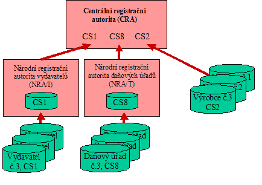

# EXTRAKT z české technické normy

**Extrakt nenahrazuje samotnou technickou normu, je pouze informativním materiálem o normě.**

**ICS 03.220.20, 35.240.60**

**Dopravní telematika – Automatická identifikace vozidel, zařízení a nákladů – Číslování a struktura dat**

ČSN EN ISO 14816 — třídicí znak 01 8338

Platí od 1.1.2007 39 stran

**Úvod**

Tato norma je součástí norem zaměřených na automatickou identifikaci vozidla, nákladu či položky zařízení pro účely telematických aplikací. Konkrétní telematické aplikace jsou sice z normy vyjmuty, ale jako příklad můžeme uvést systém elektronického výběru mýtného. V tomto systému jsou vozy vybaveny elektronickým zařízením obsahujícím údaje sloužící k jejich identifikaci. Jaké jsou tyto údaje, jakým způsobem se přidělují či jak jsou strukturovány určuje právě tato norma. Norma se nezabývá fyzickými aspekty jako je např. rozhraní, není závislá ani na frekvenci či radiovém rozhraní.

**Užití**

Tato norma je naprosto nezbytná na národní úrovni pro přidělování identifikátoru vydavatele a stanovuje postupy jeho přidělování. Bez této normy by nebylo možné na území ČR zavést telematickou aplikaci založenou či používající automatickou identifikaci (téměř všechny aplikace), protože by nebyl stanoven národní úřad, který by identifikátor Vydavatele přiděloval a spravoval. Vše ostatní je již technickou záležitostí vydavatelů či výrobců a dalších, a proto snáze ovlivnitelnou, jelikož se nachází v komerčním prostředí. Přidělováním identifikátoru vydavatele telematických zařízení (CS1) byl v České republice pověřen Český normalizační institut (ČNI); více informací o tom, jak postupovat při žádosti o identifikátor naleznete na internetových stránkách ČNI v této kategorii: [Technická normalizace](http://www.cni.cz/NP/NotesPortalCNI.nsf/key/technicka_normalizace?Open)\>[Informace o normách](http://www.cni.cz/NP/NotesPortalCNI.nsf/key/technicka_normalizace~informace_o_normach?Open)\>[E byznys](http://www.cni.cz/NP/NotesPortalCNI.nsf/key/technicka_normalizace~informace_o_normach~e_byznys?Open)\>[Registrace ... OBU](http://www.cni.cz/NP/NotesPortalCNI.nsf/key/technicka_normalizace~informace_o_normach~e_byznys~registrace_oid__icd__rid__iin_a_obu?Open) adresa stránek je <http://www.cni.cz/>.

**Pro orgány státní správy** tato norma stanovuje způsob přidělování jednoznačných identifikátorů žadatelům a také způsob jejich spravování. Dále stanovuje práva a povinnosti Národního registračního administrátora Vydavatelů (NRA/I) vůči žadatelům a vůči hlavnímu Centrálnímu registračnímu administrátoru (CRA), který má sídlo v Holandsku.

**Pro výrobce zařízení a dodavatele telematických systémů** tato norma obsahuje důležité pokyny, jak mají po datové a obsahové stránce vypadat struktury pro jednoznačnou identifikaci (jejich popis je uveden v ASN.1) a jakým způsobem postupovat při získávání/přidělování jednoznačného identifikátoru. V neposlední řadě také stanovuje jejich povinnosti vůči oficiálně určenému registračnímu úřadu.

**Souvisící normy**

ISO 14814 poskytuje referenční model architektury pro AVI/AEI systémy. Čtenářům je též doporučeno před čtením hlavní části této mezinárodní normy seznámit se s normami ISO/IEC 8824, ISO/IEC 8825-1, ISO/IEC 8825-2 a ISO/IEC 8825-3, případně s dalšími publikovanými pracemi na téma ASN.1.

**1 Předmět normy**

Norma stanovuje osm struktur pro identifikaci či pro činnosti spojené s identifikací (časové a regionální omezení platnosti identifikátorů).

Technický popis identifikátorů je uveden v hlavním těle normy, zatímco procedury žádosti, vydávání a spravování identifikátorů jsou pro svůj netechnický charakter umístěny do přílohy A.

**3 Termíny a definice**

Hlavní termíny a definice jsou obsaženy v příloze A, nejdůležitější z nich jsou uvedeny níže:

**vydavatel** _(issuer)_ osoba či organizace, která vydává/přiděluje identifikátory pro koncové uživatele. Vydavatel musí mít přidělený identifikátor vydavatele od Národního registračního administrátora vydavatelů, potom je identifikátor vydavatele součástí jím vydávaného identifikátoru.

**CRA** centrální registrační administrátor, úřad spravující registry národních registračních administrátorů (NRA/I a NRA/T) a registr výrobců. Je jím Nizozemský normalizační institut.

**NRA/I** národní registrační administrátor vydavatelů, orgán na národní úrovni, ustanovený za účelem autorizace CS1 vydavatelů, aby tito vydavatelé mohli na národní úrovni vydávat identifikátory CS1. NRA/I musí být registrován u CRA.

**registr vydavatelů** _(issuer register) NRA/I musí_ udržovat registr Vydavatelů a struktur na národní úrovni. Registr vydavatelů nesmí obsahovat žádné osobní informace.

**NRA/T** národní registrační administrátor daňových úřadů, orgán na národní úrovni pověřený registrací daňových úřadů a vydáváním identifikátorů daňových úřadů CS8 na celostátní úrovni. NRA/T musí být registrován u CRA.

**registr daňových úřadů** _(register of tax authorities)_ NRA/T musí udržovat registr všech vydaných registrací daňových úřadů včetně jejich daňových kódů na celostátní úrovni.

**Kapitola 4 Požadavky**

Kódovací struktura má mít dle normy následující vlastnosti:

  - je jednoznačná a dostatečně flexibilní, aby pojala relevantní číslovací schémata související s dopravou,

  - stanovuje přesné (exaktní) kódování datových prvků,

  - je připravená pro možné budoucí rozšíření a umožňuje začlenění privátních struktur.

Článek 4.2 obsahuje obecné požadavky na interoperabilitu a zpětnou kompatibilitu zařízení používající struktury stanovené v této normě. Popisuje, jaké normy jsou relevantní (byly použity) pro zápis syntaxe kódovacích struktur (strukturu dat čl. 4.3), a specifikuje požadavky na jejich umístění v koncovém zařízení (čl. 4.5). Článek 4.5 stanovuje osm základních kódovacích struktur CS1-CS8 a jejich datové položky. Tabulka 2 ukazuje 8 definovaných CS (kódovacích struktur) ve zkrácené podobě s podrobným výčtem základních elementů.

**Tab. 2** Kódovací struktury stanovené v normě

<table>
<tbody>
<tr class="odd">
<td><strong>CSI</strong></td>
<td><strong>Délka</strong></td>
<td><strong>datová pole kódovacích struktur</strong></td>
<td></td>
<td></td>
<td></td>
</tr>
<tr class="even">
<td>1</td>
<td>
7 bajtů

(56 bitů)
</td>
<td>kód země</td>
<td>identifikátor Vydavatele</td>
<td>servisní číslo</td>
<td></td>
</tr>
<tr class="odd">
<td></td>
<td></td>
<td>10</td>
<td>14</td>
<td>32</td>
<td></td>
</tr>
<tr class="even">
<td>2</td>
<td>
6 bajtů

(48 bitů)
</td>
<td>identifikátor výrobce</td>
<td>servisní číslo</td>
<td></td>
<td></td>
</tr>
<tr class="odd">
<td></td>
<td></td>
<td>16</td>
<td>32</td>
<td></td>
<td></td>
</tr>
<tr class="even">
<td>3</td>
<td>
22 bajtů

(176 bitů)
</td>
<td>doba začátku</td>
<td>doba ukončení</td>
<td>geografické (územní) omezení</td>
<td>omezení aplikací</td>
</tr>
<tr class="odd">
<td></td>
<td></td>
<td>80</td>
<td>80</td>
<td>8</td>
<td>8</td>
</tr>
<tr class="even">
<td>4</td>
<td>proměnná</td>
<td>kód země</td>
<td>abecední indikátor</td>
<td>registrační značka</td>
<td></td>
</tr>
<tr class="odd">
<td></td>
<td></td>
<td>10</td>
<td>6</td>
<td>nestanoveno</td>
<td></td>
</tr>
<tr class="even">
<td>5</td>
<td>
17 bajtů

(136 bitů)
</td>
<td>Identifikační číslo karosérie (VIN)</td>
<td></td>
<td></td>
<td></td>
</tr>
<tr class="odd">
<td></td>
<td></td>
<td>136</td>
<td></td>
<td></td>
<td></td>
</tr>
<tr class="even">
<td>6</td>
<td>proměnná</td>
<td>Rezervováno pro CEN/ISO</td>
<td></td>
<td></td>
<td></td>
</tr>
<tr class="odd">
<td></td>
<td></td>
<td>Nestanoveno</td>
<td></td>
<td></td>
<td></td>
</tr>
<tr class="even">
<td>7</td>
<td>93 bitů</td>
<td>Číslování nákladních kontejnerů</td>
<td></td>
<td></td>
<td></td>
</tr>
<tr class="odd">
<td></td>
<td></td>
<td>93</td>
<td></td>
<td></td>
<td></td>
</tr>
<tr class="even">
<td>8</td>
<td>proměnná</td>
<td>kód země</td>
<td>daňový kód</td>
<td></td>
<td></td>
</tr>
<tr class="odd">
<td></td>
<td></td>
<td>10</td>
<td>nestanoveno</td>
<td></td>
<td></td>
</tr>
</tbody>
</table>

Konkrétnímu popisu jednotlivých kódovacích struktur jsou věnovány samostatné články. Ty jsou rozděleny do částí, které obsahují obecné požadavky, popis prvků kódovací struktury a stanovení syntaxe celé struktury a jejích částí v jazyce ASN.1.

**4.7 CS 1 – AVI/AEI číslovací schéma**

Struktura CS1 je hlavní číslovací schéma AVI/AEI a umožňuje jednoznačnou identifikaci. Tuto strukturu je možno efektivně využít v mnoha konstruktech. Struktura umožňuje přidělit 256 jednoznačných identifikátorů, které se skládají z datových položek obsahujících kód země, identifikátor vydavatele a tzv. servisní číslo (jednoznačné v rámci číslování vydavatele).

**4.8 CS 2 – Číslo výrobce**

Struktura CS2 je druhou hlavní číslovací strukturou AVI/AEI a umožňuje jednoznačnou identifikaci bez závislosti na zemi použití (není nutný identifikátor Vydavatele); místo identifikátoru vydavatele se používá identifikátor výrobce, přidělovaný centrálně. CS2 může být použita jako skrytá identita zařízení. Struktura se skládá z datových položek obsahujících identifikátor výrobce a tzv. servisní číslo (jednoznačné v rámci číslování výrobce).

**4.9 CS3 – Omezení platnosti**

Struktura CS3 obsahuje položky pro omezení platnosti přidruženého vydaného identifikátoru. Omezení platnosti má aspekty časové (zahájení-ukončení), geografické (oblast platnosti) a aplikační (pro jaké aplikace platí). Struktura se skládá z datových položek obsahujících začátek a konec platnosti, geografické a aplikační omezení.

**4.10 CS4 – Kódování čísla registrační značky**

Struktura CS4 obsahuje reprezentaci registrační značky vozidla. Struktura se skládá z datových položek obsahujících kód země, identifikátor použité abecedy a vlastní zápis registrační značky vozidla.

**4.11 CS5 – Identifikační číslo karosérie (VIN)**

Struktura CS5 obsahuje reprezentaci identifikačního čísla karosérie VIN, jak je stanoveno v ISO 3779 a ISO 3780. Struktura se skládá z datových položek obsahujících celosvětový identifikátor výrobce, sekci deskriptoru vozidla a sekci indikátoru vozidla.

**4.13 CS7 – Číslování nákladních kontejnerů**

Struktura CS7 (struktura CS6 je zatím nestanovena) obsahuje číslování nákladních kontejnerů dle ISO 10374 a ISO 6346. Struktura se skládá z datových položek obsahujících kód vlastníka, sériové číslo, kontrolní součet, délku, výšku a šířku kontejneru, kód typu, maximální plně zatíženou váhu a váhu prázdného kontejneru.

**4.14 CS8 – Kód daňového úřadu**

Struktura CS8 obsahuje kód daňového úřadu, sloužící pro stanovení výše cla/daně. Struktura se skládá z datových položek obsahujících kód země a daňový kód.

## Příloha A (normativní) Management a obecná pravidla pro administraci kódových struktur CS1, CS2 a CS8

V normativní příloze A je popsán postup pro správu a přidělování identifikátorů ke strukturám CS1, CS2 a CS8. Tato příloha v článku A.1 stanovuje hierarchii úřadů (administrátorů) pro přidělování identifikátorů tak, jak je uvedeno na obrázku 1. Hlavní důraz je kladen na zachování konzistence při přidělování identifikátorů, aby nemohlo dojít k přidělení stejného identifikátoru více subjektům zároveň. Příloha A určuje tzv. „Centrálního registračního administrátora“ CRA se sídlem (NNI): P.O.Box 5059, NL-2600 GB Delft, The Netherlands.

Příloha definuje termíny „Národní registrační administrátor Vydavatelů (NRA/I)“, „Vydavatel“, „Registr Vydavatelů“, „Národní registrační administrátor daňových úřadů (NRA/T)“, „Registr daňových úřadů“ a „Centrální registrační administrátor (CRA)“.

Článek A.2 popisuje žádost a registrační procesy CS1 pro vydavatele. Stanovuje práva a povinnosti vydavatele a kritéria pro schválení žádosti o přidělení identifikátoru vydavatele CS1 národním registračním administrátorem vydavatelů (NAR/I). Dále tento článek obsahuje práva a povinnosti NRA/I; ten mimo jiné musí udržovat a zveřejňovat seznam přidělených identifikátorů vydavatele.

***Obrázek A.1* – Rozvržení hierarchie registrace**

Článek A.3 podrobně popisuje žádost a registrační procesy pro CS8: daňové kódy. Uvádí, kdo přiděluje identifikátory pro CS8 v rámci každého státu (předpoklady), jeho povinnosti a působnost. Dále stanovuje, kým jsou v této normě rozuměny „Daňové úřady“, a přesně popisuje identifikátor daňového úřadu.

V článku A.4 jsou stanoveny postupy pro přidělení identifikátoru výrobce CS2. Obsah tohoto článku je obdobný jako v článku A.2, ovšem je zde vypuštěna celostátní úroveň, protože ta není k udělení identifikátoru výrobce nutná. Identifikátory výrobců přiděluje, spravuje a publikuje CRA.

Další velmi důležitou částí této přílohy je dovětek o správním poplatku za přidělení a udržování identifikátorů (čl. A.5) a vyvázání ze zodpovědnosti za neoprávněné použití přiděleného identifikátoru třetí osobou (čl. A.6).

## Příloha B (normativní) Shrnutí definic kódovacích schémat

Obsahuje shrnutí syntaxe kódových struktur v jazyku ASN.1 tak, aby je bylo možné importovat do dalších aplikačních modulů a norem dopravní telematiky.

Uvádíme příklad pro datovou struktur CS4:

CS4 ::= SEQUENCE {

countryCode CountryCode,

alphabetIndicator AlphabetIndicator,

licPlateNumber OCTET STRING

}

## Příloha C (informativní) Příklady použití kódových struktur AVI/AEI

Uvádí konkrétní příklady použití identifikátorů, přesný zápis syntaxe v binární podobě pomocí pravidel PER či BER stanovených v jazyce ASN.1 a binární zápis abecedy dle ITA 2 z ISO 3166-1.

Uvádíme příklad zakódování malého celého čísla. Zpráva ITS (ITSMessage) je malé celé číslo (smallint), jak je to definováno v předchozím modulu, a je nastavena na hodnotu 10.

value ITSMessage ::= usefulType : smallint : 10

Článek C.3 uvádí zakódování kódů země a jejich příklady.

Tabulka C3 – ITA-2 abeceda

|          |                     |          |                     |
| -------- | ------------------- | -------- | ------------------- |
| **Znak** | **Binární hodnota** | **Znak** | **Binární hodnota** |
| A        | 11000               | C        | 01110               |
| B        | 10011               | Z        | 10001               |

Tabulka C4 – Příklady binárních kódů zemí

|                 |                      |                     |
| --------------- | -------------------- | ------------------- |
| **Stát**        | **Kód dle ISO 3166** | **ITA.2 (10 bitů)** |
| Rakousko        | AT                   | 11000 00001         |
| Česká republika | CZ                   | 01110 10001         |
