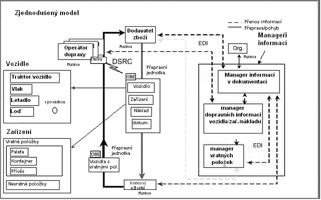
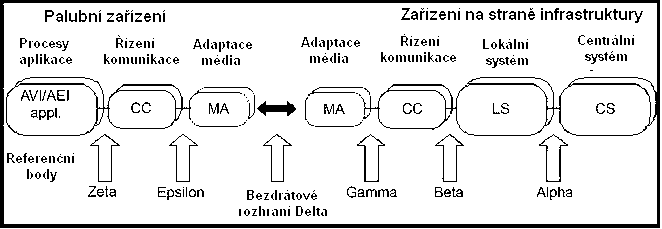
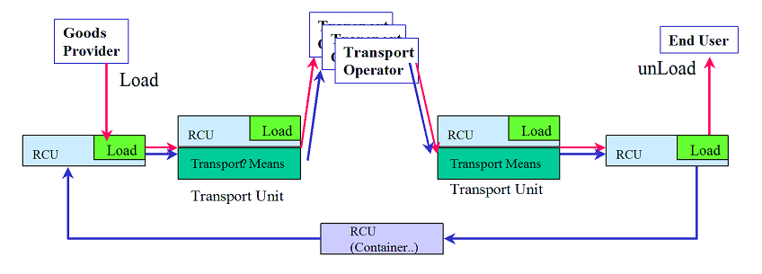
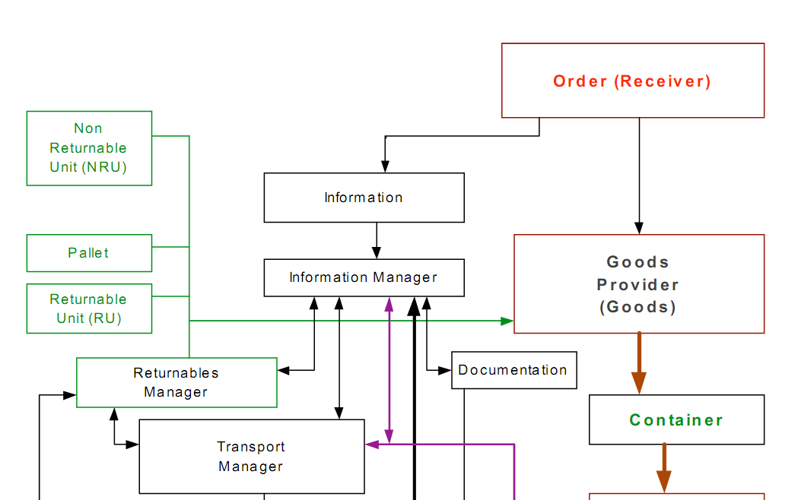

# EXTRAKT z české technické normy

**Extrakt nenahrazuje samotnou technickou normu, je pouze informativním materiálem o normě.**

**ICS 03.220.01, 35.240.60**

**Dopravní telematika – Automatická identifikace vozidel, zařízení a nákladů – Intermodální/multimodální přeprava – Architektura a terminologie**

ČSN EN ISO 17261 — třídicí znak 01 8340

Platí od 1.8.2005 38 stran

**Úvod**

Tato norma je součástí souboru norem zaměřených na automatickou identifikaci vozidla, nákladu či položky zařízení v intermodální přepravě pro účely telematických aplikací. Stanovuje rámcovou architekturu systému automatické identifikace nákladu a zařízení v multimodální/intermodální přepravě za použití bezdrátového rozhraní a sjednocuje použitou terminologii. Dále popisuje klíčové subsystémy, jejich rozhraní, interakce a zakomponování do celkového systému.

**Užití**

Tato norma poskytuje referenční model architektury pro systémy AVI/AEI v intermodálním/multimodálním prostředí a slouží jako základní norma stanovující terminologii. Je důležitá, ale ne nezbytná, pro práci s dalšími normami v oblasti automatické identifikace vozidel a nákladů. Slouží jako „rozcestník“ tím, že popisuje, co v rámci architektury je obsaženo v té které normě AVI/AEI.

Jak pro **orgány státní správy,** tak i pro **výrobce zařízení a dodavatele telematických systémů** má norma stejný, informativní význam. Uživatelé v ní naleznou velmi obecný popis referenční architektury AVI/AEI systémů.

**Souvisící normy**

Tato norma staví na souboru norem ISO 14814, ISO 14815 a ISO 14816, které popisují neintermodální systém automatické identifikace AVI/AEI a vymezuje pole působnosti dalšímu souboru norem pro intermodální prostředí ISO 17261 až ISO 17264. Pro samotnou práci s touto normou není nutné se seznamovat s dalšími normami.

**1 Předmět normy**

Tato norma představuje systémovou architekturu intermodálního/multimodálního systému AVI/AEI. Popisuje klíčové komponenty, jejich rozhraní a vzájemné závislosti. Referenční architektura stanovená v této normě je konzistentním rozšířením architektury popsané v normě určené pro jednoduché systémy AVI/AEI v ISO 14814. Skládá se z: konceptuálního popisu, logické definice, identifikace objektů, struktury interakcí objektů, datové architektury, fyzického popisu, bezpečnosti systému, odolnosti, výkonu, obnovení po katastrofě a migrací (přenositelností). Pro popis architektury je zde zvoleno zjednodušené objektové modelování založené na principech UML.

Norma se věnuje pouze jednotkám AVI/AEI. Krabice, malé nádoby a přepravované zboží jsou mimo rámec této normy. Obecně platí, že obsah uvnitř nákladního prostoru řeší skupina ISO/IEC JTC1 SC31; co je vně řeší skupina CEN TC278 WG12 společně se ISO TC204 WG4.

**3 Termíny a definice**

Vzhledem ke svému zaměření má tato norma velmi rozsáhlou část terminologie, která zabírá plných 6 stránek a obsahuje 65 termínů.

**Kapitola 4 Požadavky**

Tato kapitola je rozdělena do několika článků, z nichž se každý věnuje konkrétnímu typu architektury. Je zde stanovena referenční architektura dle specifikace ISO/TR 14813 obsahující konceptuální pohled (čl. 4.2), logickou definici (čl. 4.3), funkční (čl. 4.4), aplikační (čl. 4.5), informační (čl. 4.6), bezpečnostní (čl. 4.8) a implementační (čl. 4.15) architekturu. Dále popisuje interakci objektů (čl. 4.7) jejich odolnost (čl. 4.9), výkon (čl. 4.10), atd. Obsah těchto článků je popsán níže.

**4.2 Koncepční architektura**

V tomto článku jsou uvedeny, s různou granularitou, koncepční pohledy na architekturu systému AVI/AEI. Architektura systému AVI/AEI může být zobrazována z pohledu přepravy, výroby, distribuce, podpůrných procesů, atd. Nejprve je zde uveden komplexní schematický pohled na klíčové prvky logistického řetězce, poté je tento pohled zpodrobněn z pohledu přepravních potřeb a z pohledu správce informací. Konkretizací těchto pohledů na architekturu systému AVI/AEI pak může být například schéma uvedené jako obrázek 2.

**Obr. 2** Koncepční pohled na systém AVI/AEI, jeho třídy a hlavní klíčové funkce

**4.3 Logický rámec**

Hlavním cílem specifikace systémové architektury je poskytnout nezávislý rámec pro hodnocení/výběr vhodných technických prostředků pro identifikaci a jejich začlenění do celkového řešení, a to jak během budování systému, tak i během jeho provozu. Dále také poskytnout potenciálním výrobcům/uživatelům příklad preferované architektury a nástroj na kontrolu při návrhu takového systému.

Architektura popisovaná na obrázku 2 pod stanovuje referenční body rozhraní komponent systémů AVI/AEI. Hlavním referenčním bodem je bezdrátové rozhraní Delta. Logický rámec, vycházející z obrázku 5, pojmenovává hlavní bloky a rozhraní mezi nimi.

**Obr. 5** Jednoduché koncepční schéma referenčního modelu architektury systému AVI/AEI

**4.4 Funkční architektura**

Tento článek zdůrazňuje poslání systému AVI/AEI a způsob, jakým to provést. Hlavní funkcí je poskytnout jednoznačnou identifikaci prostřednictvím dialogu či monologu jednotky ve vozidle a zařízení na infrastruktuře. Kromě identifikačních dat je také možné přenášet doplňková data.

**4.5 Aplikační architektura**

Tato architektura je zde definována pouze vágně a to hlavně z důvodu, že se norma snaží o implementační a tudíž i aplikační nezávislost. Jsou zde vyobrazení různých aspektů aplikační architektury, ale jejich účel je spíše podat informaci, jak může aplikační architektura vypadat. Příklad je uveden na obrázku 8.

**Obr. 8** Pohyb přepravní jednotky

**4.6 Informační architektura**

V tomto článku se klade důraz na stanovení informační a datové architektury, tak aby byla zajištěna vzájemná interoperabilita zařízení různých výrobců. Stanovuje použití zápisu syntaxe ASN.1 pro popis datových prvků či konstrukcí a také jejich rozšiřitelnost. Poskytuje odkaz na EN ISO 17262, která se datovou architekturou podrobně zabývá.

**4.7 Interakce objektů**

V tomto článku jsou znázorněny procesy probíhající při identifikaci v různých částech referenčního modelu architektury systému AVI/AEI. Jsou rozděleny na inicializaci, monolog a případný dialog OBE a zařízení RSE ve stylu „požadavek-odezva“.

**4.8 Architektura zabezpečení systému**

Zabezpečení sytému identifikace je volitelné a mělo by být provedeno všude, kde jsou přenášena citlivá data uživatele či kde dochází k zápisu do jednotky OBU. A to tak, aby nedošlo k neautorizovanému přístupu. Tato norma umožňuje, aby identifikátor nemusel být pevně spjatý s vozidlem či nákladem; může být například umístěn na čipové kartě.

K zajištění integrity systému se doporučuje používat autorizační kód zprávy MAC.

**Další specifikace (čl. 4.9 – 4.15)**

Dalším částem architektury, tak jak je popisována na začátku této kapitoly, je věnován malý prostor. Pouze se odkazuje na normy, které tuto problematiku řeší podrobněji. Články 4.9 odolnost, 4.10 Výkon, 4.11 Obnova po katastrofě, 4.12 Migrace a 4.14 Rozhraní odkazují na EN ISO 17262. Článek 4.13 Specifikace systému odkazuje na EN ISO 17263. Pouze u implementační architektury (čl. 4.15) je uvedeno, že je záměrně vyjmuta z normy.

## Příloha A (informativní) Pohledy na architekturu logistických a distribučních systémů

Je popsán pohled na architekturu logistických a distribučních systémů. Některé ze schémat v této příloze byly pro ukázku vloženy do hlavního těla normy (viz obrázek 8). Je zde znázorněn logistický distribuční/zásobovací řetězec z pohledu výrobce, dodavatele zboží, příjemce (viz obrázek A.2), přepravované zásilky a přepravy, dále také z pohledu správce informací.

Obrázek A.2 – Ukázka části architektury distribučního/dodavatelského řetězce z pohledu Příjemce
