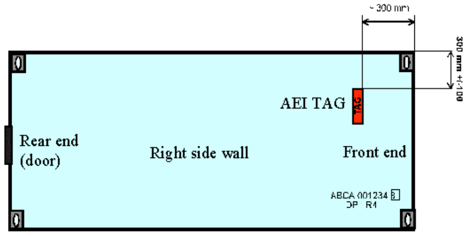

# EXTRAKT z české technické normy

**Extrakt nenahrazuje samotnou technickou normu, je pouze informativním materiálem o normě.**

**ICS 35.240.60**

**Dopravní telematika – Automatická identifikace vozidel, zařízení a nákladů – Intermodální/multimodální přeprava – Specifikace systému**

ČSN EN ISO/TS 17263 — třídicí znak 01 8342

Platí od 1.3.2005 14 stran

**Úvod**

Tato norma je součástí souboru norem zaměřených na automatickou identifikaci vozidla, nákladu či položky zařízení pro účely telematických aplikací. Jejím účelem je vytvořit specifikaci systému AVI/AEI a tím umožnit nominální interoperabilitu mezi různými systémy automatické identifikace nákladu a zařízení v multimodální/intermodální přepravě za použití bezdrátového rozhraní.

**Užití**

Norma stanovuje požadavky na systém AVI/AEI a třídí podle nich systém do kategorií. To umožňuje nalézt parametry interoperability dvou různých systémů. Kategorie systému souvisí i s požadavky na jejich testování, hodnocení a certifikaci. Díky stanoveným kategoriím je možné si „sestavit“ vlastní systém AVI/AEI s vlastní požadovanou funkcionalitou.

**Pro orgány státní správy** tato norma stanovuje způsob, jak se rozhodnout, ve kterých kategoriích požadují maximální výkon (nejvyšší třída) a ve kterých zase nejnižší. Od takto stanovených požadavků na systém se potom odvíjí i jeho cena.

**Pro výrobce zařízení a dodavatele telematických systémů** tato norma obsahuje důležité pokyny, aby mohli vyrábět systémy s různými požadavky na funkcionalitu. Stanovuje testy, kterými musí zařízení projít, aby spadalo do určitě kategorie, a v neposlední řadě stanovuje podmínky certifikace zařízení.

**Souvisící normy**

Vzhledem k charakteru této normy je jednoznačně požadována znalost nebo alespoň přístup k normám IEC na elektromagnetickou kompatibilitu a environmentální zkoušení.

**1 Předmět normy**

Charakteristický rys intermodální/multimodální přepravy je, že části nákladu jsou, více než jednou, nakládány či vykládány z/do přepravní jednotky či vozidla. Systémy AEI v tomto prostředí musí zabezpečit identifikaci během nakládky či vykládky tak, aby o tomto procesu byl proveden záznam.

Cílem normy je stanovit, popsat a specifikovat parametry pro intermodální systémy AVI/AEI a umožnit tak potenciálnímu tvůrci systému vybrat zařízení podle výkonové kategorie a provozních podmínek. Proto tato norma stanovuje parametry a požadavky na vlastní systém identifikace, výkonová kritéria nezbytná pro zajištění konzistentní a spolehlivé služby, umístění a výkon tagů na zařízení a umístění a výkon čtecích zařízení podél infrastruktury.

**3 Termíny a definice**

**3.5 intermodální přeprava** _(intermodal transport)_ pohyb zboží v jedné nebo více přepravních jednotkách nebo vozidle, které postupně používá různé způsoby dopravy bez samotné manipulace se zbožím při procesu změny módu přepravy.

**3.6 interoperabilita** _(interoperability)_ schopnost systémů nabízet a přijímat služby z/do dalších systémů a použít přijímané/poskytované služby tak, aby jejich spolupráce byla efektivní.

**3.10 stínění** _(shadowing)_ stav, kde vozidlo/zařízení zakrývá signály mezi čtečkou a tagem, a tak zabraňuje úspěšné transakci AVI/AEI.

**3.12 tag** _(tag)_ zařízení určené k identifikaci, zabudované do jednotky, vozidla nebo položky, které obsahuje jednoznačný identifikátor a v případě potřeby další doplňková data. Pro zvláštní účely může být tag nainstalovaný na pevném místě a pohyblivá bude čtečka.

**Kapitola 5 Specifikace a architektura systému**

V části obecná specifikace systémů AVI/AEI (čl. 5.1) je uvedeno, že pokud má být zachována interoperabilita vybavení, vozidel a nákladu, musí systém vyhovovat všem normám souboru 1726x.

Následující článek (architektura a datová struktura) přebírá schéma referenční architektury z normy 14814 a dále s ohledem na architekturu a datovou specifikaci odkazuje na normy 17261 resp. 17262.

**Kapitola 6 Požadavky a parametry**

Zde jsou stanoveny kategorie systému „záchytu“ dat, jehož hlavním cílem je zabezpečit jednoznačnou identifikaci zařízení, vozidla či nákladu v různých místech přepravního řetězce za různých environmentálních a provozních podmínek. Pro různé účely použití stanovuje tato norma následující kategorie systému záchytu dat (dále i SZD). Jsou to:

- Pevně umístěný SZD (např. kontrola přístupu)

- SZD umístěný v jízdním pruhu (identifikace na dálnici,…)

- SZD pro dohlížení a manipulaci ve skladu (většinou pohyblivé čtečky)

- Přenosný SZD (pro čtení na krátké vzdálenosti).

Pro zjednodušení prověřovacích procedur jsou parametry v této normě rozděleny podle snadno testovatelných požadavků. Cílem je stanovit pouze nejdůležitější a nejvíce relevantní parametry pro garanci interoperability a celkové funkčnosti systémů. Ze systematického hlediska jsou tyto požadavky rozděleny na požadavky na systém, tag a čtečku.

**6.2 Provozní parametry a požadavky systému**

V tomto článku jsou stanoveny základní parametry, mezi které patří automatické přečtení tagu procházejícího čtecí zónou, nominální poloha čtecího zařízení, seskupování přečtených údajů podle sounáležitosti s vozidlem (např. seskupit identifikátory jízdní soupravy tahače s návěsem a položkami nákladu), rozlišování mezi jízdními pruhy a směrem jízdy atd.

Také jsou zde stanoveny požadavky na spolehlivost a zabezpečení, tj. míru chybovosti v referenčních bodech alfa a delta (míru pokusů, při kterých nedošlo k úspěšnému čtení či došlo k chybnému čtení).

**6.3 Specifické parametry a výkonnostní kritéria čteček**

V tomto článku jsou pro jednotlivé kategorie SZD vyjmenované výše určena výkonnostní kritéria. Těmito kritérii jsou čtecí vzdálenost, separace tagů v čtecí zóně, povolené natočení tagu vůči čtečce a rychlost průchodu čtecí zónou. Ukázkou je část tabulky 1.

**Tab. 1** Určení provozních parametrů pro jednotlivé kategorie SZD

|                              |                      |                                                |                                                                                               |                                   |
|------------------------------|----------------------|------------------------------------------------|-----------------------------------------------------------------------------------------------|-----------------------------------|
| **Kategorie aplikace**       | **Čtecí vzdálenost** | **Separace tagů v čtecí zóně**                 | **Povolené natočení tagu vůči čtečce**                                                        | **Rychlost průchodu čtecí zónou** |
| Pevně umístěný SZD           | 0,5 m – 5,0 m        | vzdálenost 0,10 m mezi tagy v jakémkoliv směru | v konické oblasti v úhlu _γ_ do 20° od středu osy čtečky a od středu osy tagu do úhlu _β_ 20° | 0,0 až 36,0 km/h                  |
| SZD umístěný v jízdním pruhu | 1,0 m – 10,0 m       | vzdálenost 0,10 m mezi tagy v jakémkoliv směru | v konické oblasti v úhlu _γ_ do 20° od středu osy čtečky a od středu osy tagu do úhlu _β_ 20° | 0,0 až 160,0 km/h                 |

**6.4 Specifické provozní parametry a výkonnostní kritéria tagů**

V tomto článku jsou stanoveny požadavky na datový obsah a kapacitu tagů s odkazem na povinný obsah specifikovaný v normě 17262. Dále tato norma předkládá požadavky na umístění tagu na standardizovaném kontejneru ITU. Pro ISO kontejnery řeší umístění tagu norma ISO 10374 a pro lehké kontejnery EN 13044.

**Obr. 3** Oblast umístění tagu na lehkém kontejneru (swap body)
