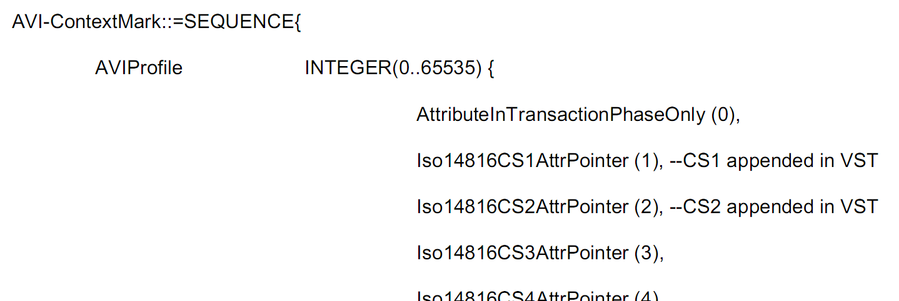
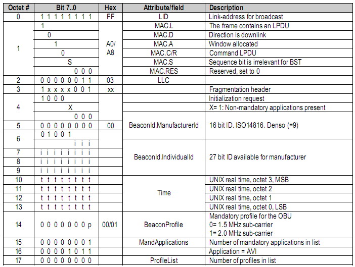

# EXTRAKT z české technické normy

**Extrakt nenahrazuje samotnou technickou normu, je pouze informativním materiálem o normě.**

**ICS 35.240.60**

**Dopravní telematika – Automatická identifikace vozidel, zařízení a nákladů – Intermodální/multimodální přeprava – Rozhraní**

ČSN EN ISO/TS 17264

Vydána 2009, 30 stran

**Úvod**

Tato mezinárodní norma nebyla doposud zavedena do ČSN. Tato norma je součástí souboru norem zaměřených na automatickou identifikaci vozidla, nákladu či položky zařízení pro účely telematických aplikací. Stanovuje aplikační rozhraní systému automatické identifikace nákladu a zařízení v multimodální/intermodální přepravě založené na standardizovaném bezdrátovém komunikačním rozhraní.

Poznámka: Extrakt uvádí vybrané kapitoly popisovaného dokumentu a přejímá původní číslování kapitol.

**Užití**

Norma stanovuje požadavky na transakce, nezávislé na použitém přenosovém médiu.

**Pro orgány státní správy** tato norma stanovuje způsob, jak se rozhodnout, ve kterých kategoriích požadují maximální výkon (nejvyšší třída) a ve kterých zase nejnižší. Od takto stanovených požadavků na systém se potom odvíjí i jeho cena.

**Pro výrobce zařízení a dodavatele telematických systémů** tato norma obsahuje důležité pokyny, aby mohli vyrábět systémy s různými požadavky na funkcionalitu. Stanovuje zkoušky, kterými musí zařízení projít, aby spadalo do určitě kategorie, a v neposlední řadě stanovuje podmínky certifikace zařízení.

**1 Předmět normy**

Tato norma se věnuje popisu rozhraní mezi jednotlivými složkami multimodální/intermodální přepravy. Stanovuje syntax, sémantiku i posloupnost příkazů při automatické identifikaci.

Cílem normy je stanovit rozhraní a zajistit tak interoperabilitu zařízení od různých výrobců. Uvádí termíny BST a VST, což jsou tabulky nesoucí v sobě informace o tom, jaké služby jsou podporovány vozidlem respektive infrastrukturou. Tyto tabulky se na začátku komunikace vymění mezi aktéry a poté dojde k výběru takové služby z nabízených možností, která je podporována na obou stranách komunikace.

Kromě vlastní části má norma dvě normativní a jednu informativní přílohu.

**2 Souvisící normy**

Vzhledem k charakteru této normy je jednoznačně požadována znalost nebo alespoň přístup k normám IEC na elektromagnetickou kompatibilitu a environmentální zkoušení. Pro správné pochopení přílohy A je nutné seznámit se s normou popisující sedmou vrstvu OSI vyhrazeného spojení krátkého dosahu ISO 15628.

**3 Termíny a definice**

**intermodální přeprava** _(intermodal transport)_ pohyb zboží v jedné nebo více přepravních jednotkách nebo vozidle, které postupně používá různé způsoby dopravy bez samotné manipulace se zbožím při procesu změny módu přepravy.

Další termíny a zkratky z oboru ITS jsou obsaženy ve slovníku ITS terminology.

**4 Symboly a zkratky**

Tato kapitola uvádí 24 zkratek, nejdůležitější jsou uvedeny níže:

**4.7 BST** tabulka služeb vysílače; určuje jaké služby (funkce) AVI/AEI jsou podporované ve vysílači

**4.24 VST** tabulka služeb vozidla; určuje jaké služby (funkce) AVI/AEI jsou podporované zařízením ve vozidle

Další termíny a zkratky z oboru ITS jsou obsaženy ve slovníku ITS terminology (www.ITSterminology.org).

**Kapitola 5 Požadavky na transakce AVI/AEI**

Kapitola v rozsahu jedné strany představuje celé tělo normy. Jsou zde specifikovány transakční profily, tj. z jakých činností se sestává identifikační proces. Celkem jsou zde 2 tabulky, z nichž první obsahuje profil pro „čtecí“ transakci a druhá pro „čtecí/zapisovací“ transakci. Dále je zde uveden odkaz na normativní přílohy A a B, které se zabývají definicí bezdrátového rozhraní.

## Příloha A (normativní) Aplikační rozhraní AVI/AEI dle ISO 15628

Je zde popsáno aplikační rozhraní AVI/AEI dle ISO 15628. Tato příloha obsahuje popis inicializace služby, transakční fáze, atributů a zásobníkového modulu dle ASN.1.

**A. 2 Inicializační fáze**

Inicializace dle definice znamená výměnu informací BST a VST. Specifický obsah BST a VST je popsán v této příloze: jaké jsou požadavky na transakce a obsah parametrů souvisejících s AVI ve VST. BST je tabulka služeb vysílače, a proto na rozdíl od VST neobsahuje parametry související s AVI/AEI. Dále je v této části pomocí ASN.1 specifikována datová struktura AVI-ContextMark a VST.

Ukázka definice struktury AVI-ContextMark v ASN.1:

**A.3 Transakční fáze**

Zařízení na straně infrastruktury (RSE) zná po inicializaci z obsahu VST, jaké funkce jsou v palubním zařízení (OBE) podporovány a ty potom dále využívá v procesu identifikace. Je zde stanoveno pět typů transakcí AVI/AEI, jak to umožňuje DSRC a funkcionalita vlastního OBE. Tyto typy jsou:

  - Profil pro čtení za použití příkazu INICIALIZATION

  - Profil pro čtení za použití příkazů INICIALIZATION a GET

  - Profil pro čtení a zápis za použití příkazů INICIALIZATION, GET a SET

  - Profil pro čtení a zápis za použití příkazů INICIALIZATION, GET, SET nebo ACTION

  - Profil pro čtení a zápis za použití příkazů INICIALIZATION, GET, SET a ACTION

**A.4-5 Definice AVI/AEI atributů a zásobníkového modulu**

Ve zbylé části přílohy A jsou definovány atributy AVI/AEI (viz tabulka 1), je jich celkem 33, zbytek 33 až 127 je rezervován pro budoucí použití.

Tabulka A.1 – Ukázka tabulky atributů AVI/AEI

|                 |                     |                    |
| --------------- | ------------------- | ------------------ |
| **ID atributu** | **Atribut**         | **Odkaz na normu** |
| 0               | AVI-ContextMark     |                    |
| 1               | CS 1                | ISO 14816          |
| 2               | CS 2                | ISO 14816          |
| 3               | CS 3                | ISO 14816          |
| 4               | CS 4                | ISO 14816          |
| 5               | CS 5                | ISO 14816          |
| 6               | CS 6                | ISO 14816          |
| 7               | CS 7                | ISO 14816          |
| 8               | CS 8                | ISO 14816          |
| 9               | AccessControlStatus | ISO/TS 17262       |

V článku A.5 je uvedena plná specifikace zásobníku AVI/AEI tak, aby mohla být přímo naimportována do aplikací pracujících s touto normou. Popis je proveden dle ASN.1.

## Příloha B (normativní) Transakce AVI/AEI za použití ISO/IEC 18000

Stanovuje transakce AVI/AEI dle ISO/IEC 18000, s tím, že pouze odkazuje na normy ze série ISO 18000 a také, že výrobce musí doložit protokol o shodě (PICS) pokud chce uvádět, že „jeho“ zařízení splňuje příslušné normy pro bezdrátový přenos.

## Příloha C (informativní) Příklady transakcí AVI/AEI

Obsahuje příklady transakcí pro snazší pochopení normy. Jsou zde uvedeny příklady obsahu jak BST, tak i VST pro jednoduchou i složitou transakci AVI/AEI (viz Obrázek 3). Složitá transakce používá kromě výměny samotných tabulek služeb také příkaz GET, tedy konkrétně jeho části – žádost a odezvu.

Obsah tabulky služeb vysílače (BST) pro jednoduchou transakci AVI/AEI:

