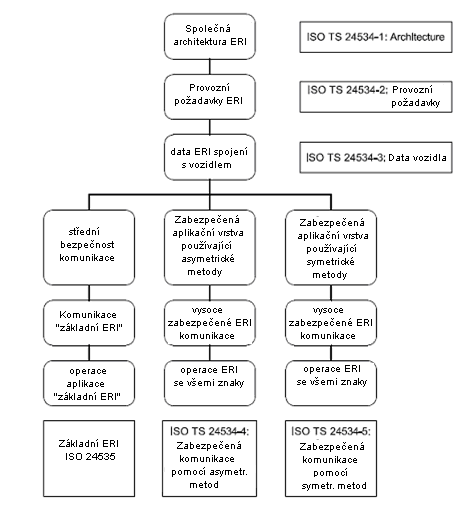
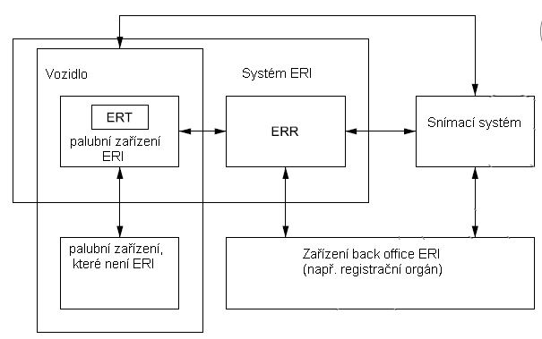

# EXTRAKT z české technické normy

**Extrakt nenahrazuje samotnou technickou normu, je pouze informativním materiálem o normě.**

**ICS 03.220.20, 35.240.60**

**Dopravní telematika – Automatická identifikace vozidel, zařízení a nákladů – Identifikace elektronické registrace (ERI) vozidel – Část 1: Architektura**

ČSN EN ISO 24534-1 — třídicí znak 01 8338

Platí od 15. 12. 2008 18 stran

**Úvod**

Tato norma, která popisuje koncept systému ERI, je úvodní normou série 5 norem z oblasti Identifikace elektronické registrace (ERI) vozidel.

Vlády zvažují povinné požívání ERI, zejména jako právního důkazu identity vozidla; daná norma umožňuje interoperabilní řešení. ERI je prostředkem pro jednoznačnou identifikaci silničních vozidel. Splňuje potřebu správních orgánů a jiných uživatelů PK důvěryhodné elektronické identifikace, a to včetně zahraničních/projíždějících vozidel.

Jednoznačný identifikátor vozidla (upřednostňovaný je VIN) je uchováván v tagu elektronické registrace (ERT). ERT může navíc obsahovat dodatečná data. ERT komunikuje s ERR a volitelně s jinými palubními zařízeními vozidla.

Poznámka: Extrakt uvádí vybrané kapitoly popisovaného dokumentu a přejímá původní číslování kapitol.

**Užití**

Tato norma vznikla „rozpadem“ normy 24534 na 5 samostatných dokumentů. Díky tomu vznikla potřeba, alespoň částečně, seznámit případného čtenáře s tím, co vlastně ERI je, a jakých může nabývat funkcionalit. Obsahuje odkazy na další normy tohoto souboru a přehledná schémata a příklady použití.

Jak pro **orgány státní správy**, tak i pro **výrobce zařízení a dodavatele telematických systémů** uvádí tato norma základní přehled a usnadňuje orientaci v souboru norem. Pro zadávání státních zakázek a tvorbu či správu systému ERI **není tato norma nezbytná**. Do soustavy ČSN byla převzata překladem.

**1 Předmět normy**

Tato mezinárodní norma poskytuje **přehled** konceptu systému ERI, z hlediska komponent palubního zařízení vozidla a externích komponent mimo vozidlo požadovaných pro provoz systému. Podrobné požadavky jsou definovány v částech 2, 3, 4 a 5 souboru ISO 24534 a pro limitované řešení platí relevantní ustanovení ISO 24535. Systém identifikace elektronické registrace je vhodný pro:

  - elektronickou identifikaci místních a zahraničních vozidel státními správními orgány;

  - výrobu vozidla, údržbu vozidla v době životnosti a identifikaci konce životnosti;

  - úpravu dat o vozidle, účely spojené s bezpečností; snížení kriminality, a komerční služby.

**Obr. 1** Funkcionalita ERI a její rozdělení do norem série 24534 (a 24535).

**2 Souvisící normy**

Různé části ISO 24534 obsahují celkový rámec pro ERI a specifikace požadavků pro „plně vybavenou“ ERI, jsou to tyto normy:

  - Část 2: Provozní požadavky;

  - Část 3: Data o vozidle;

  - Část 4: Zabezpečení aplikační vrstvy použitím asymetrického šifrování;

  - Část 5: Zabezpečení aplikační vrstvy použitím symetrického šifrování.

Přidružená mezinárodní norma k tomuto souboru norem ERI, ISO 24535, obsahuje podskupinu těchto požadavků, zajišťující funkčnost „základní ERI”.

**3 Termíny a definice**

**3.1 elektronická identifikace registrace** _(electronic registration identification ERI)_ činnost nebo kroky vedoucí k identifikaci vozidla elektronickými prostředky za účely specifikovanými v této normě

**3.2 čtecí zařízení (čtečka) elektronické registrace** _(electronic registration reader ERR)_ zařízení používané pro čtení/zápis dat z nebo do „tagu elektronické registrace“ ERT

**3.3 tag elektronické registrace** _(electronic registration tag ERT)_ palubní zařízení ERI, které obsahuje data ERI s relevantním zabezpečením a jedno nebo více rozhraní pro přístup k datům

**3.4 palubní zařízení ERI** _(onboard equipment ERI)_ zařízení připevněné do nebo vně vozidla a používané pro účely ERI

Další termíny a zkratky z oboru ITS jsou obsaženy ve slovníku ITS terminology.

**4 Symboly a zkratky**

**ERI** identifikace elektronické registrace

**ERR** čtecí zařízení elektronické registrace

**ERT** tag elektronické registrace

**PK** pozemní komunikace

**VIN** identifikační číslo vozidla

Další termíny a zkratky z oboru ITS jsou obsaženy ve slovníku ITS terminology (www.ITSterminology.org).

**5 Kontext systému identifikace elektronické registrace**

ERI může mít různá použití s různým rozsahem uplatnění. Na nejjednodušší úrovni zahrnuje „základní ERI” sekvence transakce příkazy _Wake up_, _Request ID_ a _Provide ID_. Sekvence transakce pro „plně vybavenou“ ERI (komplexní ERI) je složitější a může mít mnoho forem. Následující obrázek obsahuje kontextový diagram prostředí, ve kterém se vyskytuje ERT, s širšími vazbami na jiné komponenty systému ERI.

**Obr. 2** „Plně vybavený“ systém ERI s palubní komponentou ERT

„Plně vybavený“ systém ERI může zahrnovat palubní ERT, zabezpečené uložení dat ERI, bezdrátové rozhraní mezi ERT vozidla a čtecím/zapisovacím zařízením na straně infrastruktury, palubní rozhraní mezi ERT a zařízením vozidla, které není ERI, snímací systém k detekci přítomnosti vozidla v určitém místě a zahájení komunikace mezi čtečkou a ERT a ERI (back office) k podpoře aplikace ERI, která může být cílem nebo zdrojem dat ERI.

**6 Tag elektronické registrace a bezpečnostní opatření**

Některé aplikace ERI mohou požadovat varianty architektury umožňující ERT fungovat s jedním nebo více rozhraními. ERT pro tato rozhraní poskytuje zabezpečené prostředí pro data ERI za použití symetrického či asymetrického šifrování. Při použití asymetrických metod šifrování stanovuje ISO/TS 24534-4 požadavky na širokou škálu interoperabilních ERT a ERR. Při použití symetrických metod šifrování stanovuje požadavky ISO/TS 24534-5, dodatečné požadavky lze nalézt v ISO 25435.
