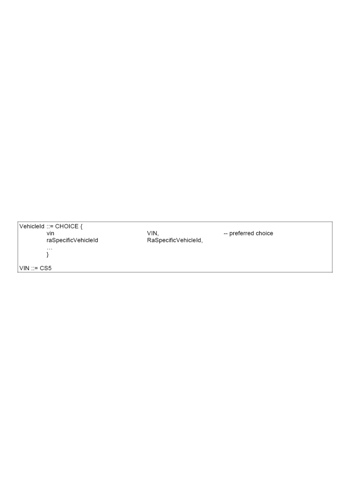
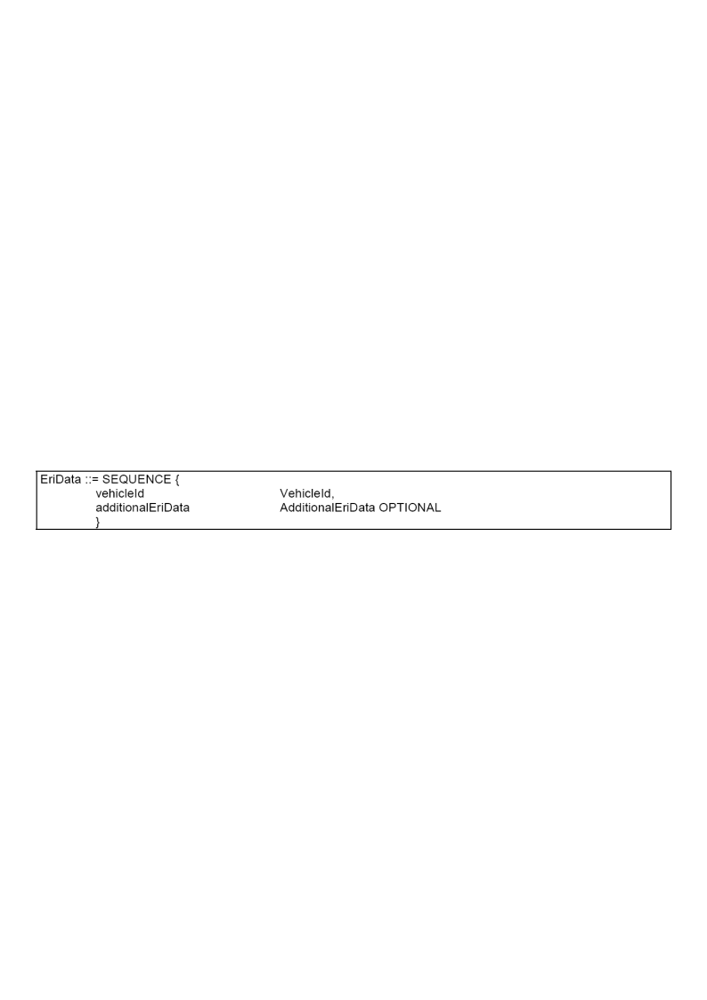

# EXTRAKT z české technické normy

**Extrakt nenahrazuje samotnou technickou normu, je pouze informativním materiálem o normě.**

**ICS 03.220.20, 35.240.60**

**Dopravní telematika – Automatická identifikace vozidel, zařízení a nákladů – Identifikace elektronické registrace (ERI) vozidel – Část 3: Data o vozidle**

ČSN EN ISO 24534-3 — třídicí znak 01 8338

40 stran

**Úvod**

Koncept elektronické identifikace registrace (ERI), tedy zjištění jednoznačné identity vozidla použitím elektronických prostředků, nabývá v posledních letech na významu. ERI lze totiž využít nejen pro vlastní identifikaci, ale také pro potenciální aplikace jako je například monitorování a řízení dopravy.

Vozidlo je v rámci ERI identifikováno svým jednoznačným identifikátorem (upřednostňovaný je VIN) který je uchováván v tagu elektronické registrace (ERT). ERT může navíc obsahovat dodatečná data. ERT komunikuje s čtečkou elektronické registrace ERR a volitelně s jinými palubními zařízeními vozidla.

**Užití**

Tato norma vznikla řízeným rozdělením normy elektronická identifikace registrace na 5 samostatných částí. Každá z částí má pevně daný rozsah působnosti. Tato, třetí, část stanovuje **data o vozidle** obsažená v tagu elektronické registrace ERT.

Tato norma je použitelná pro **výrobce** tagů ERI pro to aby věděli, jaké údaje musí a může tag obsahovat. Uvádí jednoznačný identifikátor vozidla i strukturu doplňkových dat o vozidle, ale zároveň nechává mnoho prostoru pro použití vlastního identifikátoru vozidla a vlastních doplňkových dat v případě, že nebudou z některých důvodů v normě uvedené struktury vyhovovat výrobci, uživateli systému.

Norma je důležitá, díky tomu že stanoví strukturu dat ERI tag i s jednoznačným identifikátorem, i pro **státní sféru** a to hlavně pro zadávání výběrových řízení potenciálního systému ERI. Struktura dat ERI ale umožňuje volbu (viz předchozí odstavec), která může vyústit v nejednoznačnost v implementaci. Tato <u>nejednoznačnost</u> <u>musí</u> být při použití této normy jako dokumentu k zadávací dokumentaci potenciálního systému ERI odstraněna například přesným udáním údajů, stanovených v normě, které musí tag ERT obsahovat.

**Souvisící normy**

Různé části ISO 24534 obsahují celkový rámec pro ERI a specifikace požadavků pro „plně vybavenou“ ERI, jsou to tyto normy:

- Část 1: Architektura, Část 2: Provozní požadavky, Část 4: Zabezpečení aplikační vrstvy použitím asymetrického šifrování a Část 5: Zabezpečení aplikační vrstvy použitím symetrického šifrování

Další souvisící normou je ISO IEC 8824 ASN.1 zápis abstraktní syntaxe.

**1 Předmět normy**

Tato mezinárodní norma zavádí jednoznačný identifikátor vozidla a další data o vozidle v rámci systému elektronické registrace ERI založené na jednoznačném identifikátoru, ten je zejména vhodný pro:

- elektronickou identifikaci místních zahraničních vozidel národními správními orgány

- výrobu vozidla, údržbu vozidla v době životnosti a identifikaci konce životnosti;

- úpravu dat vozidla, účely spojené s bezpečností; snížení kriminality, a komerční služby.

Veškerá doplňková data o vozidle jsou **nepovinná** a je necháno na uvážení registračního orgánu či jiné „lokální“ autority použít či nepoužít ten který datový prvek stanovený v této normě. Norma uvádí pouze syntax těchto datových prvků.

**3 Termíny a definice**

Tato norma pracuje s 10 termíny ve vztahu s ERI. Některé z termínů již byly vysvětleny v extraktu první části toho souboru norem.

**4 Značky a zkratky**

Tato norma pracuje s 10 termíny ve vztahu s ERI se zaměřením na syntax (ASN.1) a pojmenování zařízení pro elektronickou identifikaci vozidel (AEI/AVI).

**5 Požadavky**

V informativní části této kapitoly je zmíněn požadavek na jednoznačný identifikátor vozidla. Běžně se v této situaci používá VIN (vehicle identification number) proto souží jako základní identifikátor. Toto číslo ale není zcela unikátní a může se po30 letech opakovat, jsou známy případy nejednoznačnosti v databázích administrátorů, proto je zde navržena varianta kombinující VIN a kód registrační autority. Tato kombinace by měla být globálně jednoznačná.

Tato norma zavádí také doplňková data, (většinou ta která jsou obsažena v osvědčení registraci vozidla), která mohou být použita pro „navýšení“ důvěryhodnosti identifikátoru vozidla či jako ověřené informace o vozidle pro použití dalšími aplikacemi.

**5.2 Identifikátor vozidla**

Datový prvek „_VehicleId_“ <u>musí</u> být použit pro identifikaci vozidla, jeho definice dle ASN.1 je uvedena na následujícím schématu, ze kterého je zřejmé, že tento datový element může nabývat dvou tvarů. Prvním z nich je samotné VIN odpovídající kódovému schématu CS5, tak jak je stanoveno v normě ISO 14816. Druhým je specifický identifikátor složený z identifikátoru výrobce WMI a jednoznačného (ale blíže nespecifikovaného), řetězce znaků. Norma říká, že tento druhý identifikátor musí být jednoznačný, ale nestanovuje ani jeho strukturu ani jak toho docílit.

**Obr. 1** ASN.1 definice jednoznačného identifikátoru vozidla „_VehicleId_“

V poznámce norma uvádí, že při čtení identifikátoru vozidla externím zařízením z tagu elektronické registrace ERT se vždy předávají také identifikátor registrační autority a jednoznačný kód ERT. Tyto kódy pak „prý“ (není řečeno jak) použity pro rozhodnutí potenciálních pří o VIN vozidla.

**5.3 Datový typ ERI**

Datový prvek „_EriData_“ <u>musí</u> být data ERI. Norma uvádí sekvenci, dle ASN.1 identifikátoru vozidla „_VehicleId“_ a volitelné struktury doplňkových dat o vozidle „_additionallEriData“_.

**Obr. 2** ASN.1 definice datové struktury používané v ERI nejen pro identifikaci vozidla

**5.4 Datový typ doplňková data ERI**

Datový prvek „_AdditionalEriData_“ je volitelný a stejně jako identifikátor vozidla „_VehicleId“_ obsahuje volbu mezi v normě stanovenou strukturou doplňkových dat ERI o registraci a v normě nestanovenou, neznámou, strukturu omezenou pouze velikostí. Tato nestanovená struktura opět dává možnost k použití vlastních dat o vozidle a to pravděpodobně z důvodů zachování kompatibility s místě specifickými systémy.

**5.5 Datový typ doplňková data ERI o registraci**

Datový prvek „_AdditionalEriRegistrationData_“ obsahuje sekvenci informací o vozidle tak jak jsou uvedeny v osvědčení o registraci. Všechny části datové struktury, která je (pouze, nikoliv strukturálně) logicky rozčleněna na:

- administrativní údaje (registrační úřad, datum registrace, číslo karosérie, RZ, a další)

- údaje o typu vozidla (model, typ, popis, barva, kategorie, a další)

- údaje o tvaru vozidla (výška, šířka, délka, typ podle ISO 3833, a další)

- údaje počtu pasažérů, os a váze a

- parametry prostředí (emise, euro typ, hluk, a další) a

- další nezatříděné údaje

jsou volitelné. Popis těchto údajů, jejich význam a hodnoty jakých mohou nabývat je uveden v další části této kapitoly. K zjednodušení interpretace nejčastěji používaných údajů jsou do této kapitoly začleněny stanovení z jiných odkazovaných norem. Pokud by, ale čtenář potřeboval podrobně „rozklíčovat“ všechny údaje uvedené v struktuře „_AdditionalEriRegistrationData“_ musí použít i další normy.

**5.6 Kódování**

Při výměně informací mezi ERR a ERT musí být ERI data zakódována podle kanonických pravidel pro kódování (CANONICAL-PER) varianty ZAROVNANÉ, tak jak je stanoveno v ISO/IEC 8825-2.

**Dodatek A Modul ASN.1**

Tento normativní dodatek obsahuje všechny deklarace typů uvedené v této normě ve formě modulu ASN.1. Tato forma umožňuje snadný import struktury do softwarových nástrojů používaných pro vývoj, validaci a výrobu ERI systémů, (či v jiných normách jiných systémů). Požadavek na zahrnutí Modulu ASN.1 do každé normy je standardní.

**Dodatek B Propojení dat ERI a požadavků „lokální“ registrace**

Tento informativní dodatek ukazuje mapování mezi daty ERI a ustanovením pro osvědčení o registraci vozidel na dvou konkrétních případech z EU a Japonska. Jedná se o mapování (harmonizaci) dvou datových struktur.

Například pod harmonizovaným kódem D. 1, evropského osvědčení o registraci vozidel, se nachází datový prvek „_Make_“, který odpovídá datovému prvku „_vehicleMake_“ ve struktuře ERI dat.
