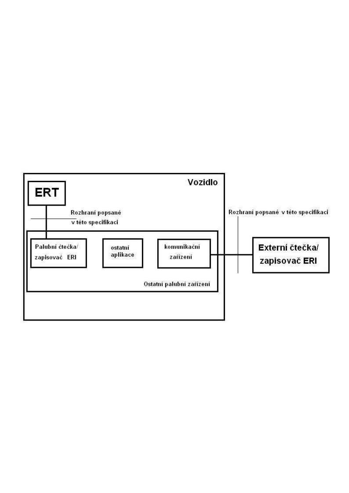

# EXTRAKT z české technické normy

Extrakt nenahrazuje samotnou technickou normu, je pouze informativním materiálem o normě.

**Dopravní telematika – Automatická identifikace vozidel, zařízení a nákladů – Identifikace elektronické registrace (ERI) vozidel – Část 4: Zabezpečení aplikační vrstvy použitím asymetrického šifrování**

ČSN ISO 24534-5 — třídicí znak 01 8338

91 stran

## Úvod

Tato technická specifikace je součástí norem zaměřených na automatickou identifikaci vozidla, nákladu či položky zařízení – elektronickou identifikaci. Třemi předcházejícími částmi jsou architektura, provozní požadavky a data o vozidle. Tato část specifikace popisuje aplikační vrstvu rozhraní mezi zařízením ve vozidle obsahujícím elektronickou identifikaci vozidla (ERT) a čtecím nebo zápisovým zařízením vně nebo uvnitř vozidla. Data vyměněná mezi těmito dvěma zařízeními zabezpečená asymetrickým šifrováním jasně určují dané vozidlo a obsahují často informace z technického průkazu vozidla. Další (5.) norma tohoto souboru se také týká zabezpečení aplikační vrstvy, ale pomocí symetrického šifrování.

## Užití

Specifikace podporuje různé úrovně bezpečnosti s maximální kompatibilitou, velký důraz klade na interoperabilitu mezi zařízením obsahujícím identifikaci vozidla a čtecím zařízením. Podporuje zařízení různého rozsahu od jednoduchého zařízení read-only až po zařízení obsahující historii zápisů na toto zařízení. Elektronická identifikace vozidel může být použita pro identifikaci orgány státní správ y, výrobcem vozidel, při mezinárodním prodeji vozidel, pro bezpečnostní účely, redukci kriminality. Specifikace se zabývá rozhraním mezi za řízením nesoucím informace o vozidle a čtecím zařízením a současně zabezpečením této komunikace.

## Související normy

Specifikace podporuje automatickou identifikaci vozidel popsanou v normách ISO 14814 a ISO 14816.

Mezi související normy lze zahrnout také normy zabývajícími se informačními technologiemi.

## 1 Předmět normy

Koncept komunikace systému.

Na následujícím obrázku je znázorněno, co přesně specifikuje tato část specifikace.

**Obr. 1** Koncept elektronické identifikace

## 3 Termíny a definice

**ERI** – samotný děj elektronické identifikace vozidla

**ERT** – zařízení ve vozidle obsahující identifikační informace

**Čtečka ERI** – zařízení schopné přečíst informace z ERT

**Zapisovač ERI** - zařízení schopné zapisovat informace v ERT

## 5 Požadavky rozhraní

Definice prováděných funkcí

Kapitola obsahuje definici funkcí ERI používajících ASN.1. Základními funkcemi jsou zápis dat na ERT a pozdější získání informací z ERT. Ve specifikaci je popsán různý rozsah podle toho, pro koho jsou dané funkce určené (státní správa, vlastník ERT, výrobce). Je zde několik volitelných funkcí (viz níže). Také je možno vytvořit seznam povolených přístupů a editovat ho, vytvořit různé bezpečnostní úrovně (např. pro různé orgány státní správy). Je vhodné nastavit práva přístupu k určitým funkcím podle „profilu“ jednotlivých uživatelů. Specifikace popisuje jednotlivé případy v programovacím jazyce a konkrétně vypisuje jednotlivé případy, co se při jakém případu stane.

**Získání dat ERI – ¨t**ato funkce je použita při čtení čtečkou dat ERI. Pro státní správu je v následujícím tvaru:

getEriData TRANSACTION ::= {

ARGUMENT GetEriDataArgument

RESULT GetEriDataResult

ERRORS {notCustomized}

CODE 1

}

Pro vlastníka ERT je v následujícím tvaru:

authenticateEriData TRANSACTION ::= {

ARGUMENT AuthenticateEriDataArgument

RESULT AuthenticateEriDataResult

ERRORS {notCustomized}

CODE 2

}

**Nastavení dat ERI –** funkce slouží pro zápis prvních dat nebo editování již zapsaných dat.

SetEriDataArgument ::= CHOICE {

clearTextArgument ClearTextSetEriDataArgument,

encryptedArgument ENCRYPTED {ClearTextSetEriDataArgument}

}

**Získání informací o předchozím nastavení** – tato funkce může poskytnout informace v čistém textu nebo jako zašifrovaný argument. Pro zašifrovaný argument je definována jako:

getCiphertextHistoricEriData TRANSACTION ::= {

ARGUMENT GetCiphertextHistoricEriDataArgument

RESULT SECURED {HistoricEriData}

ERRORS {notCustomized}

CODE 4

}

A pro čistý text je definována:

getCleartextHistoricEriData TRANSACTION ::= {

ARGUMENT GetCleartextHistoricEriDataArgument

RESULT CLEAR-SECURED {HistoricEriData}

ERRORS {notCustomized}

CODE 5

}

**Získání ověřovacího klíče veřejného certifikátu –** použití pro ověření kódu nejvyšší úrovně certifikátu:

getPublicCertificateVerificationKeyId TRANSACTION ::= {

RESULT KeyId

CODE 6

}

**Získání veřejného kódovacího klíče ERT –** tento klíč je nutný k dekódování získaných dat:

getPublicEnciphermentKeyERT TRANSACTION ::= {

ARGUMENT BOE-AUTHENTICATED {vehicleId}

RESULT PublicEnciphermentKey

ERRORS {GetPublicEnciphermentKeyErrors}

CODE 6

}

**Pověření ERT –** funkce pro státní správu pro vytvoření nebo přetvoření bezpečnostních parametrů:

commissionERT TRANSACTION ::= {

ARGUMENT CommissionERTArgument

RESULT NULL

ERRORS { CommissionErtErrors }

CODE 7

}

Další funkce – konec pověření, získání zašifrovaného argumentu nebo čistý text historie pověřování ERT.

**Aktualizace přístupového seznamu**

updateAccessControlList TRANSACTION ::= {

ARGUMENT UpdateAccessControlListArgument

RESULT NULL

ERRORS {UpdateAccessControlListErrors}

CODE 11

}

Další funkce – získání zašifrovaného seznamu nebo v čistém textu.

**Získání výpisu schopností ERT**

getErtCapabilities TRANSACTION ::= {

RESULT ErtCapabilities

CODE 15

}

**Rozhraní elektronické identifikace**

Data ERI a zabezpečená data ERI a ERT samotné mohou být přístupné pouze podle této specifikace. Výměna dat na aplikační vrstvě ERT je v protokolu EriPdu, který je možné dekódovat podle normy ISO 8825-2. Protokoly na nižších vrstvách jsou stanoveny mezinárodními normami.

V případě, že komunikace mezi ERT a čtečkou ERI je založena na ISO 14443, chová se ERT jako PICC typu A nebo B a palubní čtečka/zapisovač ERI jako PCD podporující oba typy (A i B). Jednotka protokolu ERI může být přímo převedena použitím pole INF. Nesmí být zabalena podle ISO 7816-4.

Pokud použijeme pro aplikační vrstvu ERI DSRC, musí být použita norma EN 12834. To umožní ERI DSRC být kompatibilní s ostatními aplikacemi DSRC.

## Příloha A (normativní) Moduly ASN.1

Příloha popisuje výměnný modul ASN.1, který lze najít v ISO 24534-3.

## Příloha B (informativní) Provozní scénáře

Příloha popisuje jednotlivé scénáře, které mohou při zápisu nebo čtení z ERT nastat. Popisuje jednotlivé bezpečnostní úrovně, kdy mohou nastat, kdo je hlavním účastníkem, jaké je potřeba zařízení pro dodržování pravidel a zabránění nabourání systému.

## Příloha C (normativní) Předběžný protokol PICS

Příloha obsahuje nevyplněné prohlášení o shodě implementace protokolu PICS (Protocol Implementation Conformance Statements) k použití pro ERT a čtečky a zapisovače ERI.
