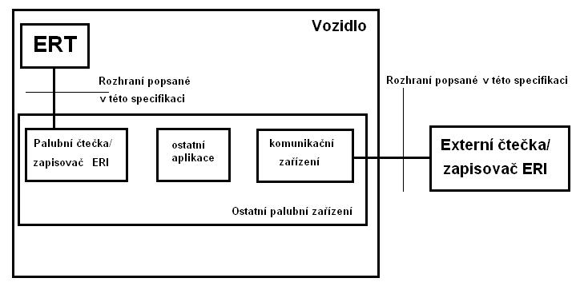

# EXTRAKT z technické specifikace ISO

**Extrakt nenahrazuje samotnou technickou normu, je pouze informativním materiálem o normě.**

ICS 03.220.20, 35.240.60

**Automatická identifikace vozidel, zařízení a nákladů – elektronická identifikace vozidel – Část 5: Symetrické šifrování pro zabezpečenou komunikaci**

ISO/TS 24534-5

Vydána 2008, 38 stran

**Úvod**

Tato technická specifikace je součástí norem zaměřených na automatickou identifikaci vozidla, nákladu či položky zařízení – elektronickou identifikaci. Čtyřmi předcházejícími částmi jsou architektura, provozní požadavky, data o vozidle a asymetrické šifrování pro zabezpečenou komunikaci. Tato část specifikace popisuje aplikační vrstvu rozhraní mezi zařízením ve vozidle obsahujícím elektronickou identifikaci vozidla (ERT) a čtecím nebo zápisovým zařízením vně nebo uvnitř vozidla. Symetrické šifrování je založeno na tajném kódu sdíleném určitou skupinou uživatelů. Asymetrické šifrování je popsáno v části 4.

Poznámka: Extrakt uvádí vybrané kapitoly popisovaného dokumentu a přejímá původní číslování kapitol.

**Užití**

Specifikace se zabývá rozhraním mezi zařízením obsahujícím identifikační informace (ERT) a palubním čtecím nebo zapisovacím zařízením, mezi tímto palubním zařízením a čtecím nebo zapisovacím zařízením na dopravní komunikaci a v neposlední řadě se zabývá bezpečností těchto komunikací.

**1 Předmět normy**

**Koncept komunikace systému**

Tato část specifikace je informativního charakteru pro lepší pochopení celého konceptu elektronické identifikace. Na následujícím obrázku je znázorněno, co přesně specifikuje tato část specifikace.

**Obr. 1** Koncept elektronické identifikace

**2 Souvisící normy**

Specifikace podporuje automatickou identifikaci vozidel popsanou v normách ISO 14814 a ISO 14816. Mezi související normy lze zahrnout také normy zabývajícími se informačními technologiemi.

**3 Termíny a definice**

Další termíny a zkratky z oboru ITS jsou obsaženy ve slovníku ITS terminology.

**4 Symboly a zkratky**

**ERI –** samotný děj elektronické identifikace vozidla

**ERT** – zařízení ve vozidle obsahující identifikační informace

**Čtečka ERI** – zařízení schopné přečíst informace z ERT

**Zapisovač ERI** - zařízení schopné zapisovat informace v ERT

Další termíny a zkratky z oboru ITS jsou obsaženy ve slovníku ITS terminology (www.ITSterminology.org).

**5 Požadavky rozhraní**

Celá komunikace s ERT je fázová. Skládá se z následujících tří fází:

1)  Vzájemná autorizace – jedná se o vzájemnou autorizaci mezi ERT a ERI čtečkou nebo zapisovačem, pokud je ERT v pověřeném stavu. Pokud ERT není v tomto stavu, je tato fáze přeskočena.

2)  Fáze výměny dat – v této fázi probíhá výměna dat ERI nebo bezpečnostních dat, a to v jakémkoliv pořadí.

3)  Ukončovací fáze.

**6 Definice prováděných funkcí**

Většina následujících funkcí probíhá ve fázi výměny dat kromě vzájemné autorizace, které probíhají v autorizační fázi. Funkce jsou v normě popsány s jednotlivými možnostmi, které mohou nastat. A jsou definovány ve formátu ASN.1 viz následující 3 příklady.

**Vzájemná autorizace 1 –** funkce probíhá jako první v první fázi. Vyvolává ji čtečka/zapisovač ERI a odpovídá na ni ERT.

mutualAuthentication1 TRANSACTION ::= {

ARGUMENT OCTET STRING

RESULT OCTET STRING

CODE 1

}

**Získání dat** **ERI** – funkce slouží pro získání dat ERI z ERT, vykonává ji pouze ERT, pouze pokud je v přizpůsobeném a pověřeném stavu:

getSecretKeyEriData TRANSACTION ::= {

ARGUMENT OCTET STRING

RESULT OCTET STRING

CODE 3

}

**Aktualizace přístupového seznamu –** přístupový seznam obsahuje unikátní klíče jednotlivých uživatelů, kteří vstupovali do ERT. Lze ji provést pouze v ERT v pověřeném stavu.

updateAccessControlList TRANSACTION ::= {

ARGUMENT OCTET STRING

RESULT OCTET STRING

CODE 7

}

Další funkce – získání zašifrovaného přístupového seznamu nebo v čistém textu.

**Rozhraní elektronické identifikace**

Data ERI a zabezpečená data ERI a ERT samotné mohou být přístupná pouze podle této specifikace. Výměna dat na aplikační vrstvě ERT je v protokolu SecretKeyEriPdu, který je možné dekódovat podle normy ISO 8825-2. Protokoly na nižších vrstvách jsou stanoveny mezinárodními normami.

V případě, že komunikace mezi ERT a čtečkou ERI je založena na ISO 14443, se ERT chová jako PICC typu A nebo B a palubní čtečka/zapisovač ERI jako PCD podporující oba typy (A i B). Jednotka protokolu ERI může být přímo převedena použitím pole INF. Nesmí být zabalena podle ISO 7816-4.

Pokud použijeme pro aplikační vrstvu ERI DSRC, musí být použita norma ISO 15628. To umožní ERI DSRC být kompatibilní s ostatními aplikacemi DSRC.

Vzdálený přístup musí využívat pro dekódování pravidla PER podle ISO 8825-2. Nižší vrstvy opět podle mezinárodních norem.

## Příloha A (normativní) Moduly ASN.1

Příloha popisuje výměnný modul ASN.1, který můžete najít v ISO 24534-3.

## Příloha B (informativní) Provozní scénáře

Příloha popisuje tři scénáře, které se mohou stát při komunikaci mezi čtečkou/zapisovačem ERI a ERT. Popisuje scénáře při identifikaci vozidla, při čtecí/zapisovací fázi na ERT a zapisovací a pověřovací fázi.

## Příloha C (normativní) Předběžný protokol PICS

Příloha obsahuje nevyplněné prohlášení o shodě implementace protokolu PICS (Protocol Implementation Conformance Statements) k použití pro ERT a čtečky a zapisovače ERI.
