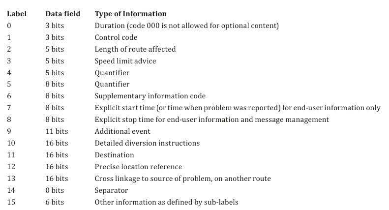
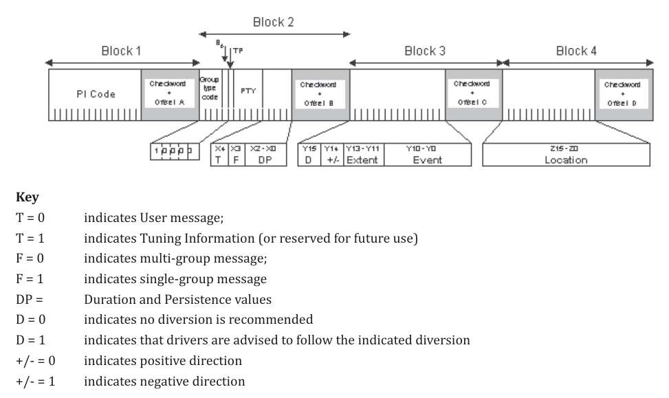

# EXTRAKT z české technické normy

**Extrakt nenahrazuje samotnou technickou normu, je pouze informativním materiálem o normě.**

**Inteligentní dopravní systémy – Zprávy TTI předávané kódováním dopravních zpráv – Část 1: Kódovací protokol pro Rádiový datový systém – Kanál dopravních zpráv (RDS-TMC) s využitím ALERT-C**

ČSN EN ISO 14819-1 — třídicí znak 01 8253

Vydána 2021, 54 stran

1.  Úvod

Soubor norem EN ISO 14819 stanovuje formát a protokol RDS-TMC pro nepřetržité poskytování strukturovaných dopravních informací do navigačních přístrojů a pro jejich interpretaci v jazyce uživatele. Jde o informace o dopravních omezeních na pozemních komunikacích, o pracích na silnici, o povětrnostních podmínkách nebo o dopravních nehodách, a to na hlavních státních a mezinárodních silnicích, na regionálních silnicích i na městských komunikacích.

Dopravní informace jsou vysílány nepřetržitě a řidiči jsou oznamovány pouze události související s jeho trasou. Vzhledem k malé kapacitě přenosového média a s ohledem na strojové zpracování jsou informacím přiřazeny číselné kódy z číselníků (pro popis události i pro popis polohy), které musí být shodné na obou koncích přenosového řetězce. Zprávy TMC jsou proto jazykově nezávislé a mohou být uživateli předkládány v jazyce podle jeho volby.

Protokol ALERT-C, stanovený v popisovaném dokumentu, využívá datový kanál RDS (rádiový datový systém), tedy přenos doplňkových dat v rámci standardního rozhlasového vysílání VKV-FM. Datová propustnost tohoto kanálu je omezená, což limituje počet současně vysílaných zpráv; proto se u služeb RDS-TMC často přistupuje k regionalizaci.

Soubor norem EN ISO 14819 se skládá ze 3 částí. Popisovaná část 1 se zabývá strukturou zprávy, způsobem přenosu a šifrováním obsahu, část 2 popisem událostí předávaných ve zprávě (katalogem událostí) a část 3 způsobem odkazování na polohu (lokační tabulkou).

Poznámka: Extrakt uvádí vybrané kapitoly popisovaného dokumentu a přejímá původní číslování kapitol.

2.  Užití

Popisovaný dokument použije zejména systémový analytik a programátor při tvorbě aplikací pro kódování dopravních informací protokolem ALERT-C a pro jejich dekódování v navigačních přístrojích. Využijí jej také poskytovatelé služby TMC a výrobci koncových zařízení. Samotný přenos zpráv systémem RDS je řešen jiným souborem norem, IEC 62106 (soubor).

Přestože je RDS-TMC starší technologií s nízkou datovou propustností, zůstává v Evropě plošně dostupným a levným kanálem pro doručení dopravních informací do vozidla. Popisovaný dokument je proto nezbytný všude tam, kde je třeba takovou službu zavést, provozovat nebo její obsah dekódovat.

3.  Souvisící normy

Popisovaný dokument uvádí 3 souvisící dokumenty: EN ISO 14819-2 (kódy událostí), EN ISO 14819-3 (odkazování na polohu) a IEC 62106 (soubor) Specifikace rádiového datového systému (RDS) pro rozhlasové vysílání VKV/FM v kmitočtovém pásmu od 64,0 MHz do 108,0 MHz.

4.  1 Předmět normy

Tato kapitola (rozsah 1,5 strany) obsahuje 5 článků: 1.1 Všeobecný předmět normy, 1.2 Obsah, 1.3 Management zpráv, 1.4 Přenos a 1.5 Katalog událostí.

Popisovaný dokument stanovuje protokol ALERT-C určený k poskytování informačních zpráv řidičům vozidel. Stanovuje strukturu zpráv, způsob jejich sestavení a rekonstrukce v koncových zařízeních a způsob řízení obsahu včetně aktualizace či rušení zpráv v přijímači. Dále stanovuje, jak přenášet informace o službě TMC v rozhlasovém vysílání, informace o poskytovateli, o použité lokační tabulce a o případném šifrování obsahu.

Popisovaný dokument je zaměřen na událostně orientované silniční situace s okrajovým začleněním stavových informací. Standardní uživatelská zpráva TMC obsahuje pět základních položek: popis události, místo, směr a rozsah, dobu trvání a doporučení k odklonění provozu. Ke kterékoliv zprávě je možné pomocí dalších datových skupin RDS přidat volitelné informace.

5.  3 Termíny, definice a zkratky

Tato kapitola (rozsah 6 stran) obsahuje 2 články: 3.1 Termíny a definice a 3.2 Zkratky.

Článek 3.1 obsahuje 35 termínů a definic souvisících s popisovaným dokumentem, z nichž nejdůležitější jsou následující:

**katalog událostí** (_event list_) – dohodnutá tabulka popisů a parametrů událostí, kterým je přiřazena hodnota kódu události a které uvádějí podrobnosti o dopravním problému (např. dopravní zácpa způsobená nehodou) a případně jeho závažnost (např. výsledná délka fronty) nebo povětrnostní situaci

**lokační tabulka** (_location table_) – dohodnutá tabulka poloh pro každou službu, která obsahuje údaje označující oblast, úsek pozemní komunikace nebo bodové místo, kde se nachází zdroj problému; každá lokační tabulka je jednoznačně určena třemi prvky – číslem lokační tabulky, kódem země lokační tabulky a rozšířeným kódem země lokační tabulky

**systémové informace** (_system information_) – údaje, které umožňují terminálu RDS-TMC dekódovat a vyhodnotit základní data popisující přijímaný přenos; označují službu RDS-TMC a zahrnují charakteristiky služby potřebné pro její výběr

**ladicí informace** (_tuning information_) – údaje, které umožňují terminálu RDS-TMC přepnout z jednoho vysílače na druhý na hranicích pokrytí vysílače

**uživatelská zpráva** (_user message_) – zpráva, která je potenciálně sdělována koncovému uživateli; obsahuje popis události, místa, směru a rozsahu, doby trvání apod.

Článek 3.2 obsahuje 29 zkratek použitých v popisované části, z nichž nejdůležitější jsou následující:

**RDS** rádiový datový systém (_Radio Data System_)

**TMC** kanál dopravních zpráv (_Traffic Message Channel_)

**TTI** dopravní a cestovní informace (_Traffic and Travel Information_)

**ALERT-C** doporučení a poloha problému v evropském silničním provozu, verze C (_Advice and Problem Location for European Road Traffic, Version C_)

**LTN** číslo lokační tabulky (_Location Table Number_)

**LTNBE** číslo lokační tabulky před zašifrováním (_Location Table Number Before Encryption_)

**ENCID** identifikátor šifrování (_Encryption Identifier_)

Další termíny a zkratky z oboru ITS jsou obsaženy ve slovníku ITS (\<www.ITSterminology.org\>).

6.  4 Aplikace

Tato kapitola (rozsah 3 strany) obsahuje 9 článků a stanovuje důležité termíny, koncepty a principy služby. Článek 4.1 shrnuje výchozí situaci a přínos digitálně a tiše vysílaných dopravních zpráv, článek 4.2 vymezuje službu TMC výčtem výhod, které přináší uživatelům, článek 4.3 pojem virtuální terminál výčtem vlastností koncových zařízení, článek 4.4 popisuje událostně orientované zprávy pro koncového uživatele, článek 4.5 rozlišuje strategickou a taktickou informaci z pohledu rozhodovacího horizontu, článek 4.6 popisuje přístup k vysílání zpráv podle jejich geografického významu, článek 4.7 uvádí kategorie důležitosti zpráv a principy práce s nimi, článek 4.8 zmiňuje katalog událostí a článek 4.9 popisuje obecně způsob budoucího rozšíření.

7.  5 Prezentace

Tato kapitola (rozsah 14 stran) obsahuje 5 článků a je klíčová z pohledu kódování a dekódování obsahu zprávy.

Článek 5.1 uvádí kapitolu do kontextu. Článek 5.2 definuje tzv. virtuální jazyk, kterým se rozumí přenos informací pomocí identifikátorů z předem připravených tabulek. Popsán je proces nalezení identifikátorů události a místa, jejich přenesení do terminálu a zpětné dekódování do srozumitelného popisu.

Článek 5.3 (rozsah 4 strany) detailně stanovuje základní obsah zprávy. Pro jednotlivé položky struktury zprávy je stanoven přesný popis, možné hodnoty (výčtem nebo odkazem), způsob začlenění do zprávy a důsledek takového začlenění pro terminál, respektive způsob dekódování v závislosti na dalších informacích obsažených ve zprávě. V pod-článcích jsou popsány části uživatelské zprávy RDS-TMC a pět základních explicitních informací: popis události, poloha, směr a rozsah, doba trvání a doporučení k objížďce.

Kód události odkazuje do katalogu událostí. Kód polohy je popsán pomocí tzv. primární lokace a odkazem do lokační tabulky. Hodnoty položek směr a rozsah slouží k vyhledání tzv. sekundární lokace v lokační tabulce; sekundární lokace ohraničuje polohu problému a reprezentuje tzv. čelo kolony. Kód trvání je popsán několika výčty podle typu události (dynamická, nebo dlouhotrvající) a je zároveň spjat s životností zprávy v přijímači.

Článek 5.4 (rozsah 1,5 strany) popisuje tzv. implicitní informace, tedy informace, které je třeba dohledat v tabulkách a seznamech přítomných v přijímači. Příkladem takové informace je „typ trvání události“, který je uveden u každé položky v katalogu událostí.

Článek 5.5 (rozsah 9 stran) stanovuje volitelný obsah zprávy (viz tabulka 1), tedy jaký může být, co znamená, jakou má bitovou reprezentaci, jakých může nabývat hodnot, jak může být kombinován s ostatním obsahem zprávy a jak je interpretován v koncovém zařízení. Obsahuje klíčové informace z pohledu sestavování zprávy a vzájemného ovlivňování doplňkových informací.

**Tabulka 1 – Výčet volitelného obsahu zprávy se štítkem, bitovou délkou a popisem (podle článku 5.5.1 popisovaného dokumentu)**

Například pomocí kontrolního kódu (štítek 1) s hodnotami 0 až 7 je možné zvýšit či snížit výchozí prioritu zprávy, změnit výchozí směrovost zprávy, změnit typ trvání zprávy, nastavit příznak objížďky nebo prodloužit rozsah zprávy. Pomocí štítku 9 se přidává dodatečný kód události, takže lze v jedné zprávě předat informace o příčině a následku nebo o souvisejících událostech. Pomocí štítků 7 a 8 lze stanovit konkrétní čas počátku a konce zprávy.

8.  6 Management zpráv

Tato kapitola (rozsah 6 stran) obsahuje 7 článků, které stanovují způsob řízení zpráv RDS-TMC v přijímači.

Článek 6.1 vymezuje položky, které pro tento účel protokol ALERT-C definuje: systémové informace, ladicí informace, vkládání zpráv, opakování zpráv, aktualizace zpráv, rušení zpráv a řídicí kódy. Rozlišuje uživatelské zprávy, které jsou potenciálně oznamovány řidičům, a systémové zprávy, které slouží pouze dekodéru TMC pro účely managementu zpráv.

Článek 6.2 popisuje systémové zprávy a jejich indikaci terminálu; v pod-článcích stanovuje rozsahy lokačních kódů, požadavky na koncové zařízení (jak je indikována přítomnost služby a jaká je kapacita přijímače) a pravidla pro změnu, tedy životní cyklus, identifikátorů odkazovaných tabulek.

Z pohledu terminálu jsou klíčové požadavky na aktualizaci (článek 6.4) a na rušení zpráv (článek 6.5). Popisovaný dokument uvádí podmínky, za kterých nově přijatá zpráva aktualizuje již existující zprávu nebo zprávy v přijímači.

Článek 6.6 stanovuje požadavky na sestavení zpráv v přijímači a na jejich následnou prezentaci uživateli včetně hierarchie prezentace. Článek 6.7 stanovuje požadavky na tzv. zprávy INTER-ROAD, tedy zprávy, jejichž poloha leží mimo referenční lokační tabulku používanou danou službou TMC.

9.  7 Přenos s využitím skupin RDS typu 8A a typu 3A

Tato kapitola (rozsah 5 stran) obsahuje 5 článků a specifikuje mapování zpráv, definovaných prezentační částí a částí managementu zpráv, do skupin RDS síťové a nižších vrstev. Na této úrovni je zajištěna také identifikace počtu skupin RDS použitých k přenosu a kódy pro identifikaci, spojování a synchronizaci sledu dvou nebo více skupin. Doporučuje se, aby skupiny byly přijaty jako platné teprve poté, co byly přijaty dvě bit po bitu shodné kopie téže skupiny; použití korekce chyb RDS je ponecháno na výrobci přijímače.

Článek 7.2 stanovuje schématem základní formát skupin 8A pro přenos dopravních informací, článek 7.3 způsob okamžitého opakování skupin pro potvrzení jejich příjmu a článek 7.4 rozvržení jednoskupinové zprávy RDS-TMC. Ta je díky kódování události i polohy velmi krátká, viz tabulka 2.

**Tabulka 2 – Bitová délka položek jednoskupinové zprávy (tab. 5 popisovaného dokumentu)**

|                            |                  |
| -------------------------- | ---------------- |
| **Položka zprávy RDS-TMC** | **Bitová délka** |
| Kód události               | 11 bitů          |
| Poloha                     | 16 bitů          |
| Směr                       | 1 bit            |
| Rozsah                     | 3 bity           |
| Trvání události            | 3 bity           |
| Doporučení pro objížďku    | 1 bit            |

V článku 7.5 jsou detailně popsány varianty podpůrné skupiny RDS typu 3A. Tato skupina se používá pro přenos informací o použité lokační tabulce, o kódu země tabulky a o rozšířeném kódu země tabulky, o alternativních kmitočtech, o identifikátoru služby TMC a o geografickém rozsahu služby.

Rozvržení bitových polí jednoskupinové zprávy je zobrazeno na obrázku 1 (viz obr. 3 popisovaného dokumentu).

**Obrázek 1 – Schéma jednoskupinové zprávy RDS-TMC s popisem jednotlivých bitových polí (obr. 3 popisovaného dokumentu)**

10. 8 Metoda šifrování služby RDS-TMC

Tato kapitola (rozsah 9 stran) obsahuje 12 článků, ve kterých je uveden způsob šifrování služby. Do popisovaného dokumentu byla převzata ze zrušené normy EN ISO 14819-6:2006. Metoda zašifruje šestnáct bitů, které popisují kód polohy, podle jedné z 256 předem definovaných matematických bitových manipulací. Poskytovatel služby sdělí výrobci koncového zařízení konkrétní algoritmus, který se pro danou službu daný den používá, aby koncové zařízení mohlo službu dešifrovat.

Článek 8.1 stanovuje hodnotu položky LTN ve skupině 3A pro šifrovanou a pro nešifrovanou službu. Pro určení čísla LTN v šifrované službě se používá element LTNBE, který je součástí varianty 0 skupiny typu 8A, tedy skupiny pro správu šifrování (článek 8.2).

Principy použité pro šifrování a podmíněný přístup jsou popsány v článku 8.3 a princip šifrování zpráv poskytovatelem za pomoci takzvaných tabulek klíčů služby v článku 8.4.

Články 8.5 a 8.6 stanovují strukturu skupiny pro správu šifrování, která se používá pro přenos informací o podmíněném přístupu. Stanovují zejména tzv. ENCID, který identifikuje konkrétní klíč z tabulky klíčů služby použitý k zašifrování polohy.

Ukázka tabulky klíčů služby používaných pro zašifrování kódů poloh je stanovena v článku 8.7 a článek 8.8 stanovuje způsob přístupu k zašifrované službě koncovým zařízením, kdy výrobce terminálu potřebuje kopii tabulky klíčů služby a notifikaci o jejím použití od poskytovatele služby, aby byl schopen dekódovat přenášené informace.

Způsob aktivace koncového zařízení je popsán v článku 8.9. Před použitím je nutno každý terminál pro příjem zakódovaných dat aktivovat pomocí PIN kódu. PIN kód zároveň určuje druh služeb, který umožňuje (přístup k dekódovaným datům po určitou dobu, která je individuálně nastavitelná).

Poslední 3 články (8.10 až 8.12) této kapitoly řeší identifikaci šifrované služby, podrobně stanovují postup dešifrování kódů poloh a upozorňují na alternativní strategii šifrování poloh.

11. 9 Sledování služby RDS-TMC

Tato kapitola (rozsah 7 stran) obsahuje 4 články stanovující informace související s kódováním zpráv v RDS.

Úvodní část kapitoly uvádí, kdy může přijímač vyhodnocovat obsah jiných stanic. Slouží k tomu parametr mezery G, který přijímači sděluje, kolik nejméně jiných skupin RDS bude vysíláno mezi dvěma po sobě jdoucími skupinami TMC, tedy skupinami RDS typu 8A.

Článek 9.1 stanovuje způsob vkládání systémových zpráv do vysílání RDS pomocí skupin 3A. Článek 9.2 stanovuje varianty tzv. ladicích zpráv předávaných ve skupinách 8A a stanovuje jejich strukturu, obsah a požadavky na opakování; tyto zprávy obsahují například informace o poskytovateli, o alternativních kmitočtech či o šifrování. Článek 9.3 stanovuje způsob kódování tzv. více skupinových zpráv RDS-TMC, tedy zpráv, které obsahují navíc doplňkové informace. Článek 9.4 uvádí přehledovou tabulku typů zpráv TMC, rozlišených bitovým obsahem na pozicích X4 až X0 ve zprávě RDS.
