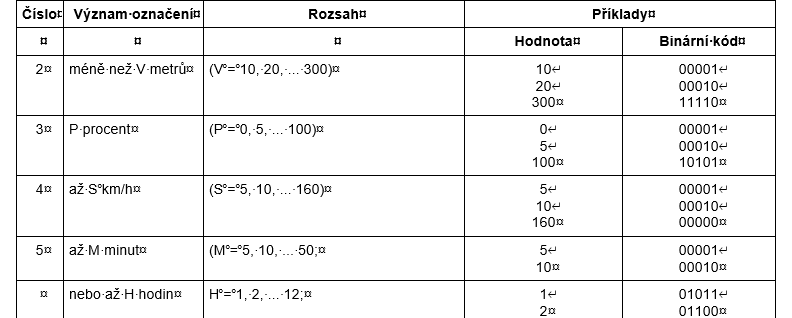
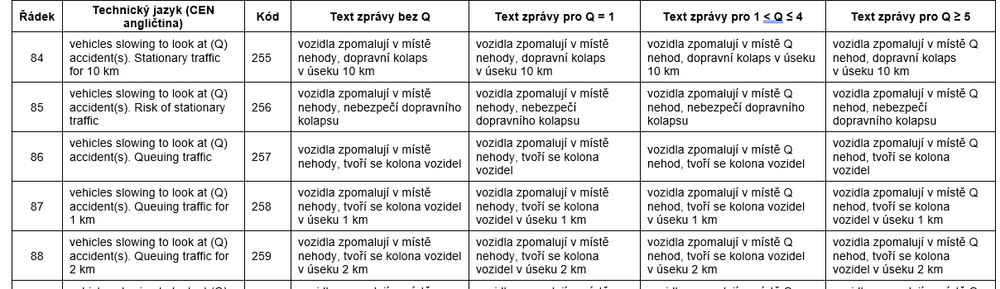
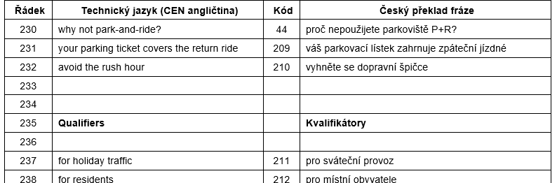
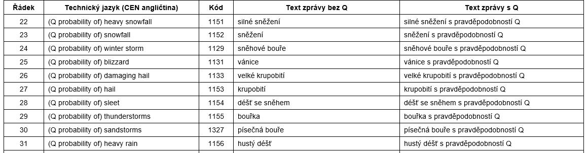

# EXTRAKT z evropské normy

**Extrakt nenahrazuje samotnou technickou normu, je pouze informativním materiálem o normě.**

**Inteligentní dopravní systémy - Zprávy TTI předávané kódováním dopravních zpráv - Část 2: Kódy událostí a informací pro Rádiový datový systém - Kanál dopravních zpráv (RDS-TMC) s využitím ALERT-C**

EN ISO 14819-2

Vydána 2021, 127 stran

Úvod

Soubor norem EN ISO 14819 stanovuje formát a protokol RDS-TMC pro nepřetržité poskytování strukturovaných dopravních informací do navigačních přístrojů a pro jejich interpretaci v jazyce uživatele. Zprávy RDS-TMC nepřenášejí text, ale číselné kódy z předem dohodnutých číselníků – zvlášť pro popis události a zvlášť pro popis polohy – které musí být shodné na obou koncích přenosového řetězce.

Popisovaný dokument stanovuje první z obou číselníků, katalog událostí. Určuje, které dopravní situace lze službou RDS-TMC vůbec popsat, jakou frází se každá z nich sděluje řidiči a jakým kódem se přenáší.

Soubor norem EN ISO 14819 se skládá ze 3 částí. Část 1 stanovuje strukturu zprávy, způsob přenosu a šifrování obsahu, popisovaná část 2 stanovuje kódy událostí a doplňkových informací a část 3 stanovuje způsob odkazování na polohu, tedy lokační tabulku. Protokol ALERT-C je podrobněji popsán v extraktu části 1.

Poznámka: Extrakt uvádí vybrané kapitoly popisovaného dokumentu a přejímá původní číslování kapitol.

Užití

Popisovaný dokument použije zejména systémový analytik a programátor při tvorbě aplikací pro kódování dopravních informací protokolem ALERT-C a pro jejich dekódování v navigačních přístrojích. Dopravní informační centra jej používají jako závazný seznam frází, kterými se dopravní události popisují.

Českým specifikem popisovaného dokumentu jsou národní přílohy B, C a D, které ke každé frázi uvádějí český překlad včetně variant podle hodnoty kvantifikátoru. Tvoří téměř dvě třetiny rozsahu dokumentu a jsou hlavním pracovním podkladem pro provoz české služby RDS-TMC.

1 Předmět normy

Tato kapitola (rozsah 1 odstavec) stanovuje předmět popisovaného dokumentu: katalog událostí používaný při kódování zpráv protokolem ALERT-C, jehož koncept a struktura zprávy jsou stanoveny v EN ISO 14819-1.

Popisovaný dokument stanovuje úplný seznam dopravních situací, které lze službou RDS-TMC předat, přiřazuje každé z nich jedinečný číselný kód a k tomuto kódu vlastnosti, se kterými koncové zařízení dále pracuje: povahu události, přípustný kvantifikátor, typ trvání, směrovost, urgenci a aktualizační třídu.

2 Souvisící normy

Popisovaný dokument uvádí 4 souvisící dokumenty: EN ISO 14819-1 (kódovací protokol a struktura zprávy), EN ISO 14819-3 (odkazování na polohu), EN ISO 14819-6 (šifrování a podmíněný přístup) a IEC 62106 (soubor) Specifikace rádiového datového systému (RDS) pro rozhlasové vysílání VKV/FM v kmitočtovém pásmu od 64,0 MHz do 108,0 MHz.

3 Termíny a definice

Popisovaný dokument neobsahuje termíny ani zkratky. Pro čtení extraktu jsou podstatné tyto 4 termíny, které stanovuje EN ISO 14819-1, respektive vysvětlivky popisovaného dokumentu:

**katalog událostí** (_event list_) – dohodnutá tabulka popisů a parametrů událostí, kterým je přiřazena hodnota kódu události a které uvádějí podrobnosti o dopravním problému (např. dopravní zácpa způsobená nehodou) a případně jeho závažnost (např. výsledná délka fronty) nebo povětrnostní situaci

**fráze** (_phrase_) – jazykově nezávislý popis jedné dopravní situace, kterému je přiřazen kód fráze složený z písmene A až Z a čísla; zpráva TMC je tvořena jednou frází nebo kombinací dvou a více frází

**kvantifikátor** (_quantifier_) – číselný údaj vkládaný do fráze na místo označené Q, například rychlost, délka úseku, teplota nebo doba zdržení

**aktualizační třída** (_update class_) – číslo přiřazené každé události, podle kterého koncové zařízení rozhoduje, kterou uloženou zprávu nově přijatá zpráva nahradí

Další termíny a zkratky z oboru ITS jsou obsaženy ve slovníku ITS terminology (www.ITSterminology.org).

4 Kódy událostí a informací pro kanál dopravních zpráv TMC

Tato kapitola (rozsah 76 stran) je jádrem popisovaného dokumentu a obsahuje 3 články: 4.1 Seznam událostí, 4.2 Doplňkové informace a 4.3 Seznam očekávaných událostí. Každý z nich stanovuje nejprve vysvětlivky ke struktuře tabulky a poté vlastní tabulku frází; článek 4.1 obsahuje navíc pod-článek 4.1.2 Seznam kvantifikátorů.

Článek 4.1.1 Vysvětlivky stanovuje ve 12 bodech význam jedenácti sloupců tabulky událostí (viz tabulka 1).

> **Tabulka 1 – Sloupce tabulky událostí (tab. 2 popisovaného dokumentu)**

| **Sloupec** | **Význam**                                                                                                                                                                      |
| ----------- | ------------------------------------------------------------------------------------------------------------------------------------------------------------------------------- |
| Line        | číslo řádku pro snadnější orientaci v databázi                                                                                                                                  |
| Text        | popis události v technické angličtině (CEN angličtina), odpovídající definicím datového slovníku DATEX                                                                          |
| Code        | desítkový ekvivalent binárního kódu, kterým se událost přenáší                                                                                                                  |
| N           | povaha události: prázdné – informace, F – předpověď, S – tichá zpráva neurčená koncovému uživateli                                                                              |
| Q           | přípustný kvantifikátor, odkazem do seznamu kvantifikátorů                                                                                                                      |
| T           | typ trvání: D – dynamická událost krátkého trvání, L – událost delšího trvání; je-li kód v závorce nebo je ve zprávě použit kvantifikátor času, trvání se uživateli nezobrazuje |
| D           | výchozí směrovost: 1 – ovlivněn jeden směr provozu, 2 – oba směry                                                                                                               |
| U           | výchozí urgence: U – naléhavá, X – velmi naléhavá, prázdné – normální                                                                                                           |
| C           | aktualizační třída, podle níž koncové zařízení zprávy v paměti nahrazuje                                                                                                        |
| P           | kód, který se má používat přednostně, jde-li o událost určenou k vyřazení                                                                                                       |
| R           | kód fráze pro operátory služby TMC; kombinovaná událost má kódy složené (např. B1.A106)                                                                                         |

Článek 4.1.2 Seznam kvantifikátorů stanovuje 13 kvantifikátorů (0 až 12), jejich význam, rozsah hodnot a bitové kódování; kvantifikátory 0 až 5 používají 5bitové datové pole, kvantifikátory 6 až 12 pole 8bitové. Kvantifikátor 4 například nahrazuje znak Q ve frázi textem „až S km/h“, kde S nabývá hodnot 5 až 160 po pěti a binární kód 00001 odpovídá hodnotě 5. Kvantifikátory vyjadřují počty, vzdálenosti, procenta, rychlosti, časy, teploty, hmotnosti i kmitočty (viz tabulka 2).

> **Tabulka 2 – Ukázka ze seznamu kvantifikátorů (tab. 1 popisovaného dokumentu)**

Článek 4.1.3 Seznam událostí (rozsah přes 60 stran) stanovuje vlastní katalog: 1451 událostí z maximálních 2048, rozdělených do 31 aktualizačních tříd. Počty frází v jednotlivých třídách stanovuje statistika na konci článku (viz tabulka 3).

> **Tabulka 3 – Počty frází v aktualizačních třídách (statistika v čl. 4.1.3 popisovaného dokumentu)**

| **Aktualizační třída**                           | **Počet** | **Aktualizační třída**                       | **Počet** |
| ------------------------------------------------ | --------- | -------------------------------------------- | --------- |
| 1\. Plynulost provozu                            | 421       | 17\. Povětrnostní podmínky a kvalita ovzduší | 13        |
| 2\. Očekávaná plynulost provozu                  | 58        | 18\. Události ovlivňující dopravu            | 50        |
| 3\. Nehody                                       | 29        | 19\. Výstražné zprávy                        | 14        |
| 4\. Dopravní události                            | 16        | 20\. Zdržení a čekací doby                   | 143       |
| 5\. Dopravní uzavírky a omezení                  | 130       | 21\. Veřejná doprava                         | 31        |
| 6\. Omezení průjezdu                             | 19        | 22\. Informace o cestovních dobách           | 9         |
| 7\. Omezení na výjezdových komunikacích          | 13        | 23\. Nebezpečná vozidla                      | 17        |
| 8\. Omezení na příjezdových komunikacích         | 7         | 24\. Nadměrný náklad/vozidla                 | 20        |
| 9\. Omezení provozu a zákazy                     | 68        | 25\. Stav dopravních zařízení                | 34        |
| 10\. Informace pro vozidla individuální přepravy | 11        | 26\. Omezení rozměrů a hmotnosti             | 11        |
| 11\. Práce na silnici                            | 31        | 27\. Omezení parkování                       | 5         |
| 12\. Nebezpečné překážky                         | 74        | 28\. Parkování                               | 33        |
| 13\. Nebezpečné situace                          | 29        | 29\. Odkaz na rozhlasové vysílání            | 8         |
| 14\. Sjízdnost vozovky                           | 59        | 30\. Hlášení o službách TMC                  | 27        |
| 15\. Teplota ovzduší                             | 8         | 31\. Zvláštní zprávy                         | 5         |
| 16\. Srážky a viditelnost                        | 58        | Celkem                                       | 1451      |

Každá fráze je zapsána v tzv. CEN angličtině, závazném technickém jazyce, ze kterého vycházejí všechny jazykové mutace. Seznamy událostí, doplňkových informací a očekávaných událostí obsahují dohromady přibližně 1 700 zpráv, většina z nich však vzniká kombinací dvou nebo více jedno-frázových zpráv, takže koncové zařízení uloží jen několik stovek jedinečných frází. Například událost 219 „(Qx) nehoda, dopravní kolaps v úseku 6 km“ má kód fráze B1.A106, tedy kombinaci frází B1 a A106; fráze v kombinované události přitom nemusí být totožné slovo od slova s frázemi samostatnými, často je nutné vložit spojku nebo změnit slovosled.

V každé aktualizační třídě je stanovena jedna tichá rušící zpráva, kterou koncové zařízení smaže zprávu téže třídy na téže poloze, a několik tzv. hlasitých rušících zpráv, které původní frázi nahradí novou, například „problém byl odstraněn“.

Článek 4.2.1 Vysvětlivky stanovuje strukturu tabulky doplňkových informací a způsob jejich vložení do zprávy, tedy návěštím 6 a 8bitovým datovým polem ve druhé nebo další skupině RDS. Článek 4.2.2 Seznam doplňkových informací stanovuje 237 frází z maximálních 256 v 15 tematických skupinách: objížďky, vozidla, výstrahy, rychlosti, pokyny, provoz v jízdních pruzích, pozice, místa, příčiny, jízda v zimních podmínkách, návrhy, kvalifikátory, směry, zdvořilosti a tendence délky dopravní kolony. Doplňkovou informaci lze připojit ke kterékoli události a upřesnit tak místo nebo povahu popisované situace, například kód 1 „těžkým nákladním vozidlům se doporučuje vyhnout se oblasti“, kód 12 „jeďte opatrně“ nebo kód 247 „délka dopravní kolony roste v průměru o 20 km/h“.

Článek 4.3.1 Vysvětlivky stanovuje, že seznam očekávaných událostí rozšiřuje seznam událostí z článku 4.1, má stejný formát a všechny jeho události mají povahu F a typ trvání L. Stanovuje pro ně tři dodatečná pravidla: zpráva nesmí kombinovat události z tříd 1 až 31 s událostmi z tříd 32 až 39, nesmí u nich být použit řídicí kód 3 návěští 1 a přechod předpovědi ve skutečnou událost se provede zrušením předpovědi a vytvořením nové události ve třídě 1 až 31. Článek 4.3.2 Seznam očekávaných událostí stanovuje 118 frází v 8 aktualizačních třídách 32 až 39 (očekávaná plynulost provozu, předpověď počasí, jízdních podmínek, kvality ovzduší, větru, teploty, zdržení a služeb mimo provoz), například 1151 „silné sněžení (s pravděpodobností Q)“ nebo 1780 „očekávejte zrušené služby“. Slouží zejména k informování před cestou.

Přílohy

Popisovaný dokument obsahuje 4 informativní přílohy, ve kterých jsou seznamy z kapitoly 4 uvedeny v české mutaci.

## Příloha A (informativní) Tabulka kvantifikátorů

Příloha o rozsahu 1 strany stanovuje český text všech hodnot kvantifikátorů. Význam má zejména u kvantifikátoru 5 (čas), kde stanovuje znění „až 1 hodina“, „až 2 hodiny“ a „až 5 hodin“; doplňuje tak seznam kvantifikátorů z článku 4.1.2.

## Příloha B (informativní) Seznam událostí ve verzi ČR

Příloha o rozsahu 106 stran stanovuje seznam událostí v české mutaci. Ke každé frázi uvádí technický jazyk (CEN angličtinu), kód a český text zprávy ve čtyřech variantách podle hodnoty kvantifikátoru – bez Q, pro Q = 1, pro 1 \< Q ≤ 4 a pro Q ≥ 5 – a umožňuje tak správné jednotné i množné číslo.

> **Tabulka 4 – Ukázka z tabulky B.1, fráze událostí v české mutaci podle hodnoty kvantifikátoru**

## Příloha C (informativní) Seznam doplňkových informací

Příloha o rozsahu 10 stran stanovuje seznam doplňkových informací v české mutaci; ke každé frázi uvádí technický jazyk, kód a český překlad.

> **Tabulka 5 – Ukázka z tabulky C.1, fráze doplňkových informací v české a anglické mutaci**

## Příloha D (informativní) Seznam očekávaných událostí

Příloha o rozsahu 10 stran stanovuje seznam očekávaných událostí v české mutaci; ke každé frázi uvádí technický jazyk, kód a český text bez kvantifikátoru a s kvantifikátorem.

> **Tabulka 6 – Ukázka z tabulky D.1, fráze očekávaných událostí v české mutaci**

