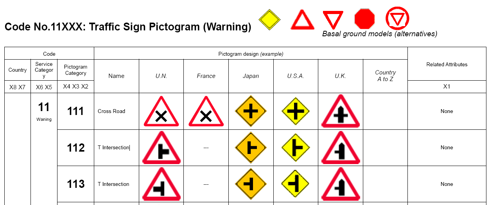
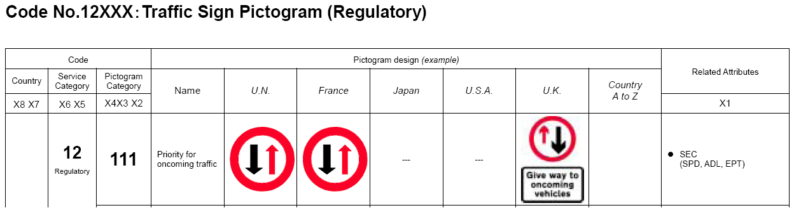
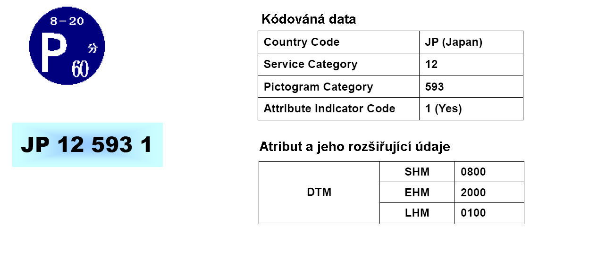
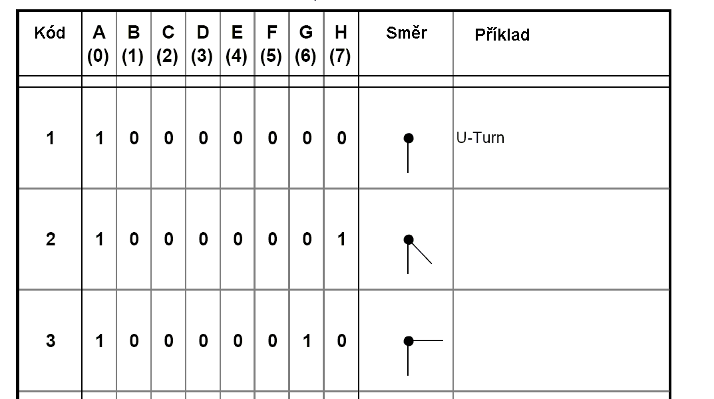

# EXTRAKT z české technické normy

**Extrakt nenahrazuje samotnou technickou normu, je pouze informativním materiálem o normě.**

**ICS 35.240.60**

**Dopravní a cestovní informace – Šíření zpráv prostřednictvím stacionárních systémů nezávislých na médiích – Slovník grafických dat pro šíření informací před jízdou a za jízdy**

ČSN CEN TS 14823 — třídicí znak 01 8255

184 stran

**Úvod**

Tato norma se pokouší sjednotit v celosvětovém měřítku označení svislého dopravního značení na pozemních komunikacích. Toto značení se v minulosti vyvíjelo ve větší či menší spolupráci zejména mezi sousedními zeměmi, ale nese v sobě i nezaměnitelný otisk osobitého vývoje národa a jeho kultury. Tato norma se snaží najít v každém piktogramu (grafickém návrhu značky) jeho podstatnou informaci a tu pasportizovat, tj. převést na celosvětový jednotný systém dopravního značení. Norma tedy bude důležitá v případech, kdy se bude jednat o projekty překračující rámec jedné země, konkrétně pro popis svislého dopravního značení na mezinárodních tazích nebo v rámci vypisování mezinárodních soutěží.

Snaha takto sjednotit popisy dopravního značení není nová. Všechny předchozí návrhy však byly před svým definitivním přijetím zamítnuty. Zřejmě z důvodu, že kódování dopravního značení zasahuje do řady zákonů, vyhlášek i norem, převážila obava z nákladů a zmatků, které by provázely tuto poměrně rozsáhlou změnu. Nynější podoba normy představuje technický návrh před závěrečným hlasováním.

Poměrně obsáhlý slovník grafických symbolů (piktogramů) vychází z velkého množství zdrojových pramenů – ponejvíce ze stávajícího svislého dopravního značení na pozemních komunikacích, zahrnující výstražné, zákazové, příkazové a informativní dopravní značky. V úvodu jsou uvedeny kategorie, které v této normě plně charakterizují každý piktogram: (plné jméno **piktogramu**, jeho **definice**, jeho **kódové vyjádření** a nakonec **jeho atributy**).

Poznámka: Extrakt uvádí vybrané kapitoly popisovaného dokumentu a přejímá původní číslování kapitol.

**Užití**

**3 Termíny, definice a zkratky**

Jak je z úvodu patrné, klíčové je v této normě vyjádření obsahu grafického symbolu konkrétním číselným kódem, který v množině značek musí být jedinečný. Pro základní kódování byla navržena následující struktura:

|                                      |                                                    |                                                  |                          |          |    |    |    |  |
| ------------------------------------ | -------------------------------------------------- | ------------------------------------------------ | ------------------------ | -------- | -- | -- | -- |  |
| Data DE1 – kód země (_Country Code)_ | DE2 – servisní kategorie (_Service Category Code)_ | DE3 – kód piktogramu (_Pictogram Category Code)_ | DE4 – indikátor atributu | Atributy |    |    |    |  |
| X8                                   | X7                                                 | X6                                               | X5                       | K4       | X3 | X2 | X1 |  |

**Kódovací pravidla:**

**X8 a X7**
Mohou nabývat hodnot od A do Z. Systém kódování konkrétních zemí používá normu ISO 3166 (která každou zemi vyjadřuje pomocí dvoupísmenového kódu).

**X6 a X5
**Tyto pozice mohou nabývat hodnot od 1 do 9 a jsou přiřazovány dle následující tabulky:

|                 |                                                     |                                   |
| --------------- | --------------------------------------------------- | --------------------------------- |
|                 | **X6**                                              | **X5**                            |
| Hodnota a popis | **Kód skupiny značek**                              | **Kód třídy značky**              |
|                 | 1: Piktogramy dopravních značek                     | 1: Výstražné značky               |
|                 |                                                     | 2: Zákazové a příkazové značky    |
|                 |                                                     | 3: Informativní značky            |
|                 |                                                     | 4:                                |
|                 | 2: Informační značky pro veřejnost                  | 1: Informační značky              |
|                 |                                                     | 2:                                |
|                 | 3: Piktogramy klimatických podmínek a stavu vozovky | 1: Vnější (atmosférické) podmínky |
|                 |                                                     | 2: Stav vozovky                   |
|                 |                                                     | 3:                                |

**X4, X3 a X2
**Tyto pozice mohou nabývat hodnot od 1 do 9. Pro X4 platí složitější pravidla, závislá na tom, ve které skupině a třídě se daná značka nachází a v rámci tohoto článku je není třeba rozvádět. X3 a X4 jsou už jen jednotlivé indexy v dané skupině.

**X1
**Tato pozice může nabývat pouze dvou hodnot, a to 1 v případě, že kódování značky vyžaduje použití dalších doplňujících atributů. Jinak je na hodnotě 0.

Další termíny a zkratky z oboru ITS jsou obsaženy ve slovníku ITS terminology (www.ITSterminology.org).

## Příloha A (informativní)

Příloha A se zabývá možnými atributy výstražných značek (servisní kategorie 11), zákazových a příkazových značek (kategorie 12) a informačních značek (kategorie 13). Společné atributy pro všechny tři kategorie jsou popsány v následující tabulce. V té je uvedeno ve sloupci Kód originální návěští, po kterém zpravidla následuje ještě doplňující údaj (kvantifikátor).

|                                                              |                                                                                                                                                                                                                                                                                                                                                                                                                                  |
| ------------------------------------------------------------ | -------------------------------------------------------------------------------------------------------------------------------------------------------------------------------------------------------------------------------------------------------------------------------------------------------------------------------------------------------------------------------------------------------------------------------- |
| **Kód**                                                      | **Význam**                                                                                                                                                                                                                                                                                                                                                                                                                       |
| **DTM** (**D**ate/**T**i**m**e/Period)                       | Indikuje datum /čas /periodu kdy je značka platná. Za tímto návěštím se dle okolností uvádějí další doplňující údaje (SYR – _Year (Start)_, EYR – _Year (End),_ SMD - _Month & Day (Start),_ EMD - _Month & Day (End),_ PMD – _Special Month & Day,_ SHM – _Hours & Minute (Start),_ EHM – _Hours & Minute (End)_, SDY – _Day of the week (Start)_, EDY – _Day of the week (End)_ a nakonec LHM – _Time limit (Hours & Minute)._ |
| **EDT** (**E**xception Status of **D**ate /**T**ime /Period) | Indikuje datum /čas /periodu kdy není značka platná. Doplňující údaje jsou shodné s předešlým řádkem.                                                                                                                                                                                                                                                                                                                            |
| **SEC** (**Sec**tion)                                        | Indikuje úsek cesty na kterém je značka platná. Z tohoto důvodu obsahuje tři doplňující údaje: Začátek platnosti spolu s údajem o délce – SPD – _Starting point_ _& Length,_ vzdálenost k začátku platnosti a délka úseku _– ADL – Applicable distance & Length a_ konec platnosti _- EPT – End point._                                                                                                                          |
| **NOL** (**N**umber **o**f **L**anes)                        | Zobrazuje počet jízdních pruhů a čísla jízdních pruhů. Číslování je vzestupné zleva doprava ve směru jízdy. Počet jízdních pruhů je vyjádřen doplňujícím údajem LMX – _Lane maximum._                                                                                                                                                                                                                                            |
| **DFL** (**D**irectional **F**low of **L**ane)               | Pomocí osmi údajů označuje směr dopravního proudu, a to od výlučně přímého - SDL – _Straight direction only_ přes SLT – _Straight and Left Turn Only_, SRT – _Straight and Right turn Only_, LTO – _Left Turn Only_, RTO – _Right Turn Only_, CLL – _Convergence from the Left Lane_, CRI – _Convergence from the Right Lane_ až po protijedoucí vozidla – OVL – _Oncoming Vehicles Lane_                                        |
| **VED** (**Ve**hicle **D**imension)                          | Tento atribut má též řadu doplňujících údajů: třída vozidla - VCL – _Vehicle class,_ výjimka z třídy vozidel - EXC – _Vehicle class exeption_, váha vozidla - HEI – _Vehicle Height_, šířka vozidla - WID – _Vehicle widht_, délka vozidla - WEI – _Vehicle weight_ a nakonec délka vozidla - VLN – _Vehicle lenght_.                                                                                                            |
| **SPM** (**Sp**eed)                                          | Udává rychlostní limit a následují dva číselné údaje: MXS – Maximum speed o maximální a MNS – Minimum speed - minimální rychlosti. Údaj o maximální povolené rychlosti musí být za tímto indikátorem uveden vždy, údaj o minimální povolené rychlosti může chybět (záleží na významu značky).                                                                                                                                    |
| **ROI** (**R**ate **o**f **I**ncline)                        | Udává v procentech sklon vozovky, která může stoupat – UHL – Uphill nebo klesat - DHL – Downhill.                                                                                                                                                                                                                                                                                                                                |
| **DVB** (**D**istance **B**etween **V**ehicles               | Udává vzdálenost mezi vozidly, následuje číselný údaj o této vzdálenosti - GAP – _Vehicular gap._                                                                                                                                                                                                                                                                                                                                |

## Příloha B (informativní)

Příloha B (pouze informativní) je slovník grafických piktogramů. Jako nejnázornější příklad poslouží dva následující obrazové příklady (značka 11 111 má v české legislativě označení A3, značka 12 111 je B26):

## Příloha C (informativní)

Příloha C (opět pouze informativní) obsahuje příklady použití, je uveden jeden z mnoha. Tato značka používaná v Japonsku znamená, že v úseku platnosti této značky je povoleno v době od 08.00 do 20.00 parkovat po dobu 60 minut. Použité zkratky jsou uvedeny v tabulce přílohy B.

## Příloha D (informativní)

Příloha D se zabývá kódováním směru. Následující tabulka názorně ukazuje použití tohoto systému. Maximální hodnota ve sloupci **Kód** může dosáhnout hodnoty 128, což znamená znázornění všech směrů po 45 stupních.

