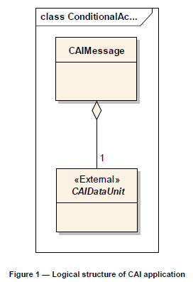
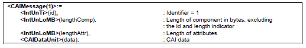

# EXTRAKT z technické specifikace ISO

**Extrakt nenahrazuje samotnou technickou normu, je pouze informativním materiálem o normě.**

ICS 35.240.60; 03.220.01

**Dopravní a cestovní informace (TTI) – Zprávy TTI předávané označovacím jazykem s možností rozšíření Expertní skupiny protokolů pro dopravu (TPEG) Část 10: Podmíněný přístup k informacím (TPEG-CAI)**

ISO/TS 18234-10

48 stran

**Úvod**

Desátá část technické specifikace je součástí technických specifikací zaměřených na inteligentní dopravní systémy a poskytování dopravních informací. ISO/TS 18234 se skládá z následujících dílčích částí, pod obecným názvem Inteligentní Dopravní Systémy - Dopravní a cestovní informace (TTI) – Zprávy TTI předávané označovacím jazykem s možností rozšíření Expertní skupiny protokolů pro dopravu (TPEG)

  - Část 1: Úvod, číslování a verze (TPEG-INV)

  - Část 2: Syntax, sémantika a rámování struktur (TPEG-SSF)

  - Část 3: Aplikace služeb a informační sítě (TPEG-SNI)

  - Část 4: Použití zpráv silniční dopravy (TPEG-RTM)

  - Část 5: Informace o veřejné dopravě (TPEG-PTI)

  - Část 6: Odkazování na polohu, používané v souvislosti s ostatními způsoby využití (TPEG‑LOC)

  - Část 7: Informace o parkování (TPEG-PKI)

  - Část 9: Aplikace pokrývající dopravní události (TPEG-TEC)

  - **Část 10: Podmíněný přístup k informacím (TPEG-CAI)**

  - Část 11: Zásobník odkazování na polohu (TPEG-LRC)

**Důvod standardizace**

Hlavními důvody pro vývoj norem v této oblasti je zvýšení interoperability koncových zařízení uživatelů, jimiž jsou účastníci silničního provozu. Protokolová standardizace, kterou je popisovaný dokument, je základem pro samotnou technologickou standardizaci vybavení pro příjem a poskytování informací.

**Užití**

Soubor technických specifikací 18234 slouží ke standardizaci komunikačního protokolu, který je prioritně určen pro příjem dopravních zpráv vozidlovými jednotkami. Soubor technických specifikací 18234 definuje komunikační protokol TPEG a část 10 popisuje podmíněný přístup k informacím, který je řešen pomocí šifrovacích klíčů.

**Pro výrobce vozidlových systémů a palubních jednotek** je norma nepostradatelná, protože definuje strukturu zasílaných zpráv do vozidlových jednotek a definuje podmíněný přístup ke zprávám.

Aplikace podmíněného přístupu je uplatňována na úrovni služby komponent. Je otevřena pro integraci různých systémů podmíněného přístupu.

Používané protokoly přenosu dat jsou definovány, tak aby byly vhodné pro širokou veřejnost, stejně jako pay-per-user použití nebo na základě předplatného služby. Jsou vymezeny existující způsoby, jak chránit obsah objednaných služeb před neoprávněným použitím pomocí systému podmíněného přístupu.

Tato specifikace se týká podmíněného přístupu uplatňovaného na úrovni služby komponent pro zabezpečení přístupu k přenášeným informacím např. pro komerční využití.

V technické specifikaci TPEG-CAI se stanovují standardní prvky podoby finální zprávy.

V této technické specifikaci je stěžejní normativní příloha A. Tato příloha vymezuje binární syntaktické, sémantické a rámcové struktury protokolu a datové typy.

Poznámka: Extrakt přejímá původní číslování kapitol.

**1 Předmět technické specifikace**

Tato technická specifikace definuje TPEG aplikaci: podmíněného přístupu k informacím (CAI). Tato aplikace vymezuje vyhrazené podmíněné přístupové údaje, jako je řízení zpráv (např. kontrola Slova a ECM) do klientských zařízení přijímající strany za účelem stanovení, například nastavení, prodloužení nebo zrušení služby na konkrétní klientské zařízení. CAI definuje:

  - logický kanál, pro přenos dodatečných informací CA (CAI);

  - jak je CAI propojena a synchronizována do šifrovaného obsahu.

Aplikace podmíněného přístupu je uplatňována na úrovni služby komponent. Je otevřena pro integraci různých systémů podmíněného přístupu.

Používané protokoly přenosu dat jsou definovány, tak aby byly vhodné pro širokou veřejnost, stejně jako pay-per-user použití nebo na základě předplatného služby. Jsou vymezeny existující způsoby, jak chránit obsah objednaných služeb před neoprávněným použitím pomocí systému podmíněného přístupu.

**2 Souvisící normy**

Následující dokumenty jsou nepostradatelné pro používání této technické specifikace:

  - ISO/TS 18234-1, Část 1: Úvod, číslování a verze (TPEG-INV)

  - ISO/TS 18234-2, Část 2: Syntax, sémantika a rámování struktura (TPEG-SSF)

  - ISO/TS 18234-3, Část 3: Aplikace služeb a informační sítě (TPEG-SNI)

**3 Termíny a definice**

Kapitola obsahuje 9 termínů a definic souvisejících s touto normou.

AID ApplicationIdentification Identifikace aplikace

CA Conditional Access Podmíněný přístup

CAI Conditional Access Information Podmíněný přístup k informacím

CRC Cyclicredundancycheck Cyklická redundantní kontrola

ECM EntitlementControlMessage Oprávnění dohledové zprávy

EMM Entitlement Management Message Oprávnění řídicí zprávy

TPEG Transport Protocol Expert Group Expertní skupiny protokolů pro dopravu

SSF Syntax, Semantics and FramingStructures Syntaktické, sémantické a rámcové struktury

TTI Traffic and TravellerInformation Dopravní a cestovní informace

**4 Identifikační číslo aplikace a číslování verzí**

Identifikační číslo aplikace se používá v rámci aplikace TPEG-SNI a určuje, jak zpracovat obsah zprávy TPEG a usnadňuje směrování informací do příslušné aplikace dekodéru.

Je popsáno samotné číslování verzí této aplikaci z důvodů neustálého vyvíjení specifikace. Číslování verzí zajistí korektní dekódování TPEG zpráv na klientských zařízení s různými verzemi specifikacemi TPEG.

**5 Servisní komponenta dat**

Kapitola se odkazuje na **Normativní přílohu A** na kapitolu A.3.2.6.2.1, kde je uveden princip určení platnosti zaslaných TPEG zpráv pomocí kontrolního součtu CRC uloženého na konci každé zprávy.

**6 Metodika podmíněného přístupu**

Kapitola popisuje metody podmíněného přístupu ke zprávě na úrovni komponenty služby na základě šifrovacího klíče. Šifrovací klíč může být sdílen mezi službami TPEG komponent. Pro použité šifrovací klíče musí být zpracována Tabulka referencí podmíněného přístupu, na základě níž dojde k dešifrování zprávy. Příklady užití jsou uvedeny v originálním znění technické specifikace ISO/TS 18234-10 a také v její **Normativní příloze A**.

**7 Komponenty zpráv**

TPEG aplikace CAI nepoužívá klasický management zpráv, a proto je v této kapitole uvedena logická struktura zasílaných zpráv.

**Obr. 1** Logická struktura CAI aplikace zobrazená pomocí UML

Je upřesněn formát zasílané zprávy i s hodnotami, které mohou jednotlivé proměnné nabývat. V technické specifikaci ISO/TS 18234-10 jsou uvedeny příklady skladby zpráv jako je na následujícím obrázku.

**Obr. 2** Příklad formátu zprávy TPEG

**Normativní příloha A**

Je zde popsána obecná struktura datové zprávy, která není v současné technické specifikaci přesně identifikována. Normativní příloha obsahuje ke každé komponentě datové zprávy i stručný příklad.

Definuje, jak mají vypadat zasílané zprávy v protokolu TPEG a  jsou detailně popsány jednotlivé položky obsahující informace o parkování včetně hexadecimálního kódování zprávy a  zpětné CRC kontroly.

Příloha A  dále nabízí použití šablon pro používání protokolu TPEG, která napomáhá k implementaci protokolu aplikace CAI.

Příloha obsahuje následující popis protokolu.

  - A.1 Konvence a symboly

> _Tato kapitola vymezuje bytové uspořádání, způsob popisu byte-orientovaného protokolu, implicitní a variabilní symboly použité v protokolu_

  - A.2 Reprezentace syntaxe

> _Toto ustanovení zavádí terminologii a syntaxi, které se používá k definování TPEG datové prvky a struktury, zejména pak základní notaci datových typů, závislé datové typy a sady externích definic a zásad pro design aplikace a její základních komponent. Vždy je uveden názorný příklad pro úplné pochopení problematiky_

  - A.3 TPEG popis datového toku

> _Zde jsou popsány dle hierarchie všechny komponenty datového proudu. Na příkladech jsou popsány základní struktury zpráv a komponenty zpráv._
>
> 
**Obr. 3** Obecné binární datové typy

  - A.4 Obecné binární datové typy

> _Tato kapitola popisuje primitivní prvky a složené prvky, které jsou používány TPEG aplikací CAI. Používané datové prvky jsou representovány a definovány pomocí stanoveného protokolu s hodnotami, které mohou nabývat._
