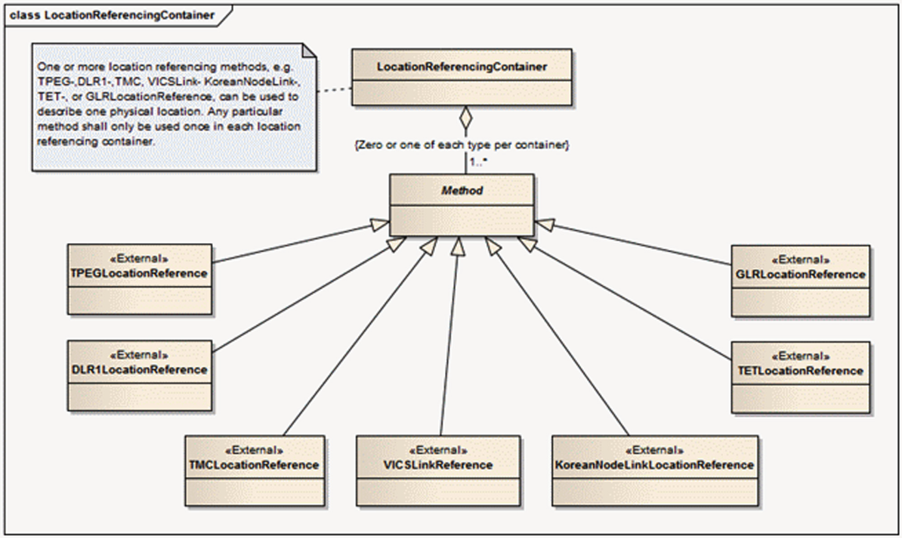
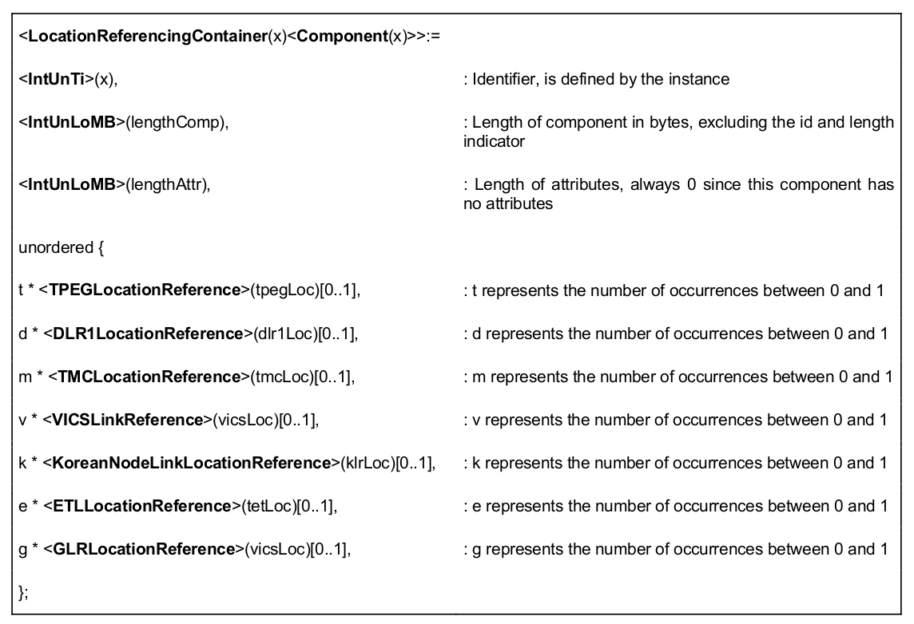
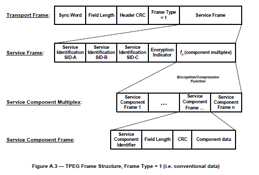

# EXTRAKT z technické specifikace ISO

**Extrakt nenahrazuje samotnou technickou normu, je pouze informativním materiálem o normě.**

**Dopravní a cestovní informace (TTI) – Zprávy TTI předávané označovacím jazykem s možností rozšíření Expertní skupiny protokolů pro dopravu (TPEG) – Část 11: Zásobník odkazování na polohu (TPEG-LRC)**

ISO/TS 18234-11

48 stran

**Úvod**

Jedenáctá a poslední část technické specifikace je součástí technických specifikací zaměřených na inteligentní dopravní systémy a poskytování dopravních informací. ISO/TS 18234 se skládá z následujících dílčích částí, pod obecným názvem Inteligentní Dopravní Systémy - Dopravní a cestovní informace (TTI) – Zprávy TTI předávané označovacím jazykem s možností rozšíření Expertní skupiny protokolů pro dopravu (TPEG)

  - Část 1: Úvod, číslování a verze (TPEG-INV)

  - Část 2: Syntax, sémantika a rámování struktura (TPEG-SSF)

  - Část 3: Aplikace služeb a informační sítě (TPEG-SNI)

  - Část 4: Použití zpráv silniční dopravy (TPEG-RTM)

  - Část 5: Informace o veřejné dopravě(TPEG-PTI)

  - Část 6: Odkazování na polohu, používané v souvislosti s ostatními způsoby využití (TPEG‑LOC)

  - Část 7: Informace o parkování (TPEG-PKI)

  - Část 9: Aplikace pokrývající dopravní události (TPEG-TEC)

  - Část 10: Podmíněný přístup k informacím(TPEG-CAI)

  - **Část 11: Zásobník odkazování na polohu (TPEG-LRC)**

**Důvod standardizace**

Hlavními důvody pro vývoj norem v této oblasti je zvýšení interoperability koncových zařízení uživatelů, jimiž jsou účastníci silničního provozu. Protokolová standardizace, kterou je popisovaný dokument, je základem pro samotnou technologickou standardizaci vybavení pro příjem a poskytování informací.

**Užití**

Technická specifikace předkládá možnost zasílání informací o dopravních událost na pozemních komunikacích a  je jednou z nejstěžejnějších aplikací TPEG. Jedná se o aplikaci, která snižuje riziko nehodovosti na pozemních komunikacích a  dokáže zároveň eliminovat vznik dopravních kongescí.

**Pro výrobce vozidlových systémů a palubních jednotek** je norma nepostradatelná, protože definuje strukturu zasílaných zpráv do vozidlových jednotek a definuje podmíněný přístup ke zprávám.

**Pro poskytovatele dopravních dat** je norma nepostradatelná, protože definuje strukturu zasílaných dat tak, aby byla data předávána ve standardizovaném formátu.

Technická specifikace je určena správcům **a  provozovatelům telematických systémů na pozemních komunikacích**. Tato aplikace je také prioritně určena pro dopravně informační centra a  pro správní orgány jako je PČR, kteří mohou při včasném zadání mimořádné události či dopravní nehody a  předání dalším účastníkům provozu snížit míru nebezpečí během nastalých událostí.

Hlavním předpokladem je nahrazení systémů na bázi RDS-TMC využívající ALERT-C kód. TPEG naproti RDS-TMC lépe popisuje vzniklé nebezpečné situace na pozemních komunikacích.

**1 Předmět technické specifikace**

Tato technická specifikace stanovuje metodu signalizace odkazování na konkrétní místo, které používají všechny TPEG1 aplikace vyžadující detailní informace o poloze, které mají být dodány do klientských zařízení, jako jsou TPEG1-RTM, TPEG1-PTI, TPEG1-TEC nebo TPEG1-PKI.

**2 Souvisící normy**

Následující dokumenty jsou nepostradatelné pro používání této technické specifikace:

  - ISO 639-1:2002, Part 1: Alpha-2 code

  - ISO 3166-1:2006, Part 1: Country codes

  - ISO 17572-2:2008, Part 2: Pre-codedlocationreferences (pre-coded profile)

  - ISO 17572-3:2008, Part 3: Dynamiclocationreferences (dynamic profile)

  - ISO/TS 18234-2:2006, Part 2: Syntax, Semantics and FramingStructure (SSF)

  - ISO/TS 18234-3:2006, Part 3: Service and Network Information (SNI) application

  - ISO/TS 18234-6:2006, Part 6: Locationreferencingapplications

  - IEC 60559:1989

  - ISO 4217:2008

**3 Termíny a definice**

Kapitola obsahuje 6 termínů a definic souvisejících s touto normou.

**3.1 dynamicky označená pozice** _(dynamic location reference) DLR_

označená pozice vygenerovaná „za pohybu“ v závislosti na geografických vlastnostech digitálních mapových databází, také známá jako DLR1, neboť se jedná o první LRM metodu s dynamickým profilem

**3.2 označení pozic** *(location referencing)
*metoda označování pozic za účelem snadné výměny informací o pozicích mezi různými systémy

**3.3 schránka označování pozic *(location referencing container)***

seskupení všech umístění odkazující na prvky TPEG zprávy v jednom místě

**3.4 zpráva** _(message)_
datový prvek, jehož formát je vhodný pro přenos a vysílání prostřednictvím šíření elektromagnetického pole

**3.5 předem kódovaná označená poloha** _(pre-coded location reference)_

označená poloha používající jednoznačný identifikátor, který je sjednocen jak na straně vysílacího, tak i přijímacího systému k výběru poloh z množiny předem kódovaných poloh

**4 Zkratky**

Kapitola obsahuje 12 zkratek. Následující jsou nad rámec základní terminologie TPEG.

EBU EuropeanBroadcasting Union Evropská vysílací unie

RTM RoadTrafficMessage Zpráva silniční dopravy

SSF Syntax, Semantics and FramingStructures Syntaktické, sémantické a rámcové struktury

VICS VehicleInformation and CommunicationSystem Vozidlový informační a komunikační systém

**
**

**5 Schránka označování pozic**

**5.1 Úvod**

Technická specifikace popisuje základní principy technologie TPEG vyžadující přenos dat, které umožní klientovi předložit takové podrobnosti, aby člověk, přímo z textu, řeči, grafiky nebo kombinací těchto, docílil srozumitelnosti reprezentovaného místa.

Jsou zavedeny tři různé typy odkazování na polohu:

  - pre-kódování, kde jsou místa, stanovené v seznamu a stejný seznam musí mít poskytovatel služeb, tak i dekodér klientského zařízení;

  - dynamický, kde jsou definována umístění v reálném čase a dekódují se pomocí klientského zařízení bez nutnosti dalších předchozích znalostí;

  - hybrid, kombinace předchozích typů.

Technická specifikace generuje 7 možných metod specifikace umístění, které jsou využívány po celém světě.

**Obrázek 2 – Location Referencing Container construct**

**5.2 TPEG-LRC metody**

Zde je popsáno všech sedm metod pro určování pozice (odkazování na polohu). Jsou popsány jak statické tak dynamické metody popisu místa události, které mohou být použity nad rámec specifikace TPEG a jsou využívány i např. ve specifikaci DATEX II. Doporučuje se použití kombinace statické a dynamické lokalizace pro různé typy událostí a zařízení

**5.2.1 DLR1 Location**

Jedná se o dynamickou metodu odkazování na polohu, která je dále popsána v ISO 17572-3

**5.2.2 Korean Node Link Location**

Referenční (statická) metoda odkazování na polohu, definována pro jihokorejskou silniční sítˇ.

**
**

**5.2.3 TMC Location**

Jedná se o zavedený protokol využívající ALERT-C tabulky, který je vyvinutý pro přenos pomocí radiového FM signálu v RDS sub-kanálu. Lokační tabulky TMC dostatečně pokrývají silniční síť v České republice. Tato metoda je popsána v normě ISO 17572-2.

**5.2.4 TPEG Location**

Nativní dynamický způsob odkazování na polohu TPEG-LOC je popsán v technické specifikaci ISO/TC18234-6. Metoda TPEC1-LOC poskytuje strojově čitelné údaje, které mohou být převedeny jednoduše do srozumitelného jazyka metodou text-to-speech.

**5.2.5 VICS Link Location**

Referenční (statická) metoda odkazování na polohu definována pro japonskou silniční sítˇ.

**5.2.6 ETL Location**

Jedná se o rozšířenou metodu TMC Location. Definuje narozdíl od TMC Location také začátek a konec silnice.

**5.2.7 GLR Location**

Jedná se o nejjednodušší dynamickou metodu odkazování na polohu pomocí geografických funkcí.

**6 Komponenty zpráv**

Zde jsou uvedeny základní komponenty zpráv pro všech sedm metod odkazování na polohu.

**Normativní příloha A**

Zde je popsána obecná struktura datové zprávy, která není v současné technické specifikaci přesně identifikována. Normativní příloha obsahuje ke každé komponentě datové zprávy i stručný příklad.

Definuje, jak mají vypadat zasílané zprávy v protokolu TPEG a  detailně popisuje jednotlivé položky, obsahující informace o parkování včetně hexadecimálního kódování zprávy a  zpětné CRC kontroly.

Příloha A  dále nabízí užití šablon pro používání protokolu TPEG, která napomáhá k implementaci protokolu aplikace CAI.

Příloha obsahuje následující popis protokolu.

  - Konvence a symboly

> _Tato kapitola vymezuje bytové uspořádání, způsob popisu byte-orientovaného protokolu, implicitní a variabilní symboly použité v protokolu_

  - Reprezentace syntaxe

> _Toto ustanovení zavádí terminologii a syntaxi, která se používá k definování TPEG datové prvky a struktury._

  - TPEG popis datového toku

> _Zde jsou popsány dle hierarchie všechny komponenty datového proudu dle následujícího obrázku._
>
> 

  - Obecné binární datové typy

> _Tato kapitola popisuje primitivní prvky a složené prvky, které jsou používány TPEG aplikací CAI. Používané datové prvky jsou representovány a definovány pomocí stanoveného protokolu s hodnotami, které mohou nabývat._
