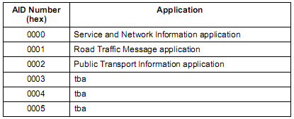
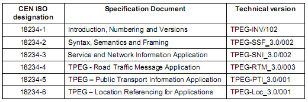

# EXTRAKT z české technické normy

**Extrakt nenahrazuje samotnou technickou normu, je pouze informativním materiálem o normě.**

**03.220.01, 35.240.60**

**Dopravní telematika – Zprávy TTI předávané označovacím jazykem s možností rozšíření Expertní skupiny protokolů pro dopravu (TPEG) – Část 1: Úvod, číslování a verze**

ČSN P CEN ISO/TS 18234-1 — třídicí znak 01 8256

Platí od 1.1.2007 10 stran

**Úvod**

V úvodu předběžné normy je popsána technologie TPEG a její vývoj. TPEG je formou strukturovaného zápisu informací o dopravě, která používá bajtově orientovaný formát toku dat, který lze použít pro přenos jakýmkoliv digitálním nosičem s příslušnou adaptační vrstvou. Zprávy TPEG jsou přenášeny od poskytovatelů služeb ke koncovým uživatelům a používají se k přenosu dat aplikace z databáze poskytovatele služeb do zařízení koncového uživatele.

TPEG byl vyvinut jako nový protokol pro přenos dopravních informací v prostředí širokopásmového multimediálního vysílání. Při jeho vývoji byly dodržovány tyto zásady:

- TPEG je jednosměrný;

- TPEG je bajtově-orientovaný, kde bajte představuje 8 bitů;

- TPEG obsahuje strukturu protokolu, která používá asynchronní seskupování bitů

- TPEG zahrnuje schopnost detekce chyby prostřednictvím CRC používané na různých úrovních;

- TPEG předpokládá použití transparentního datového kanálu;

- TPEG předpokládá, že nižší systémy budou mít příslušnou úroveň spolehlivosti;

- TPEG předpokládá, že nižší systémy mohou použít korekci chyb;

- TPEG má hierarchickou strukturu datového rámce;

- TPEG se používá pro dopravní informace z databáze do databáze;

- TPEG poskytuje název poskytovatele služby, název služby a síťové informace;

- TPEG umožňuje použití šifrovacích mechanismů, pokud jsou požadovány aplikací.

Protokol TPEG je strukturován do vrstev a používá obecný datový rámec, který je adaptabilní a rozšiřitelný a který může nést rámce různých délek.

**Užití**

Technologie TPEG je určena pro poskytovatele služeb, neboť byla navržena pro širokou škálu aplikací, které vyžadují efektivní přenos z jednoho bodu do více bodů přes veskrze nespolehlivé širokopásmové vysílání.

**Souvisící normy**

Kromě ostatních částí této specifikace (18234-2 až 6) souvisí také se všemi částmi ISO/IEC 7498, které definují OSI.

**1 Předmět normy**

Tato norma předkládá počáteční množinu případů použití TPEG. Umožňuje indexování nových i stávajících aplikací TPEG tím, že stanovuje pro každou aplikaci TPEG jednoznačný identifikátor AID. Dále je v příloze této normy stanoven postup sestavování zkrácených názvů norem (stávajících i budoucích), spolu v číslem redakční verze, sloužících pro rychlou orientaci v celé množině norem z této skupiny 18234.

**3 Termíny a definice**

Tato kapitola uvádí 1 termín a jeho definici.

uvést definici

**4 Zkratky**

Tato kapitola uvádí 22 zkratek, podstatné z nich jsou uvedeny níže:

**TPEG** Transport protocol experts group (Expertní skupina dopravních protokolů)

**4.1 AID** identifikátor aplikace TPEG

**4.2 ARIB** asociace rádiových společností _(Association of Radio Industries and Business)_

**4.3 ATSC** komise pro televizní normy v Americe _(American Television Standards Committee)_

**4.7 DAB** digitální audio vysílání

**4.8 DVB** digitální vysílání videosignálu

**4.15 RDS-TMC** rádiový datový systém – kanál dopravních zpráv _(Radio data system – Traffic message channel)_

**4.16 RTM** zpráva o stavu dopravy _(Road Traffic Message)_

**5 Identifikace aplikace**

Každá aplikace TPEG musí mít přidělen svůj identifikátor AID, ten je přidělen okamžitě po dokončení vývoje aplikace před započetím jejího užití v rámci struktury TPEG.. Přidělený identifikátor aplikace je nezbytně nutný (viz CEN ISO/TS 18234-3) pro určení způsobu zpracování strukturované informace a pro směrování (routování) těchto informací k dekodéru náležejícímu dané aplikaci.

**Tab. 1** Seznam přidělených identifikátorů aplikace TPEG

**6 Aplikace a přenosová prostředí**

Použití protokolu TPEG je podmiňováno vysokorychlostním přenosovým prostředím. Jako vysokorychlostní prostředí je míněno takové, které je „rychlejší“ než RDS (přenosová rychlost ~80 b/s). V rámci vývoje norem TPEG byly vyzkoušeny digitální pozemní audio vysílání DAB a Internet, pro obě tato prostředí jsou dobře popsány technické podmínky adaptace protokolu přenosovému médiu. Zároveň byla v rámci vývoje zkoumána přenosová prostředí ARIB, ATSC a DVB, která mají velmi vysokou přenosovou kapacitu, ovšem s tím závěrem, že díky přílišné složitosti jejich struktury jsou **nevhodná** pro přenos informací ve struktuře TPEG.

## Příloha A (informativní) Přehled jednotlivých částí, pojmenování a verzí

Tato příloha poskytuje přehled, o jakých norem je specifikace protokolu TPEG rozložena a jak jsou pojmenovány a jak mají být číslovány různé verze vznikajících norem. Zároveň pro nově přidané položky specifikuje, jak mají být pojmenovány. V případě, že se jedná o vysvětlivky k dané normě (guidelines), tak je za zkrácený název a verzi dodáno písmeno G.

**Příklad:** 2. redakční verze aplikace TPEG RTM byla publikována jako: **TPEG-RTM_1.0/002.**

**Tab. 2** Seznam norem a jejich vydaných verzí

